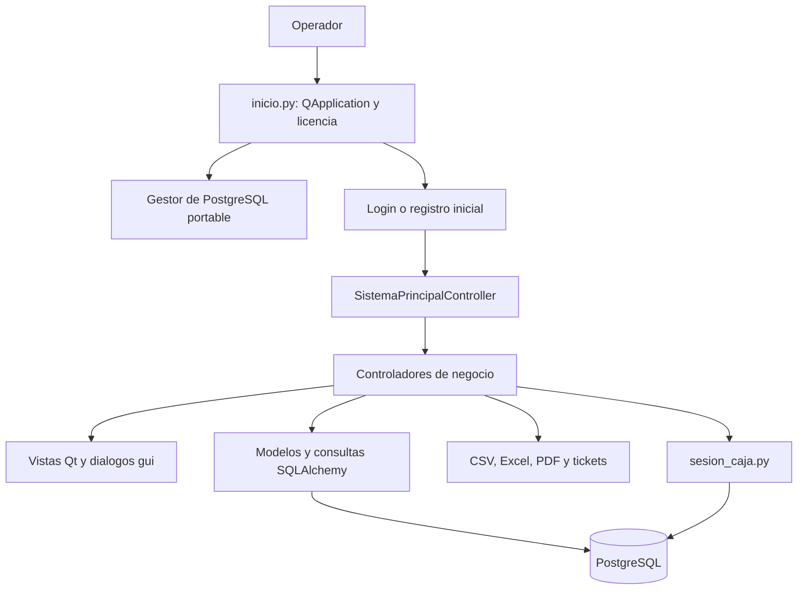

# TuleVenta: indice y contexto para IA

## 1. Estado y contrato documental

Fecha del levantamiento: 2026-11-10. Fases 1 a 4 documentales entregadas; ejecucion del plan: infraestructura REF-01 y cambios REF-05 a REF-16 aplicados. Cierre de implementacion de Fase 1 con37 pruebas unitarias y77 Qt aprobadas; gates PostgreSQL/Alembic no ejecutados. REF-17 y Fase 2 no iniciadas. El levantamiento original no modificaba codigo; los deltas posteriores estan registrados en cada ficha/spec. No se conecto a PostgreSQL ni se modificaron datos de una instalacion.

Actualizacion 2026-11-18: se aplicaron ajustes globales de estilos (texto negro, fondos blancos en campos numericos, popups de picklists, anchos estandarizados) y la funcionalidad de compra directa sin proveedor mediante un proveedor interno reservado. El detalle esta en la seccion7 de este indice, en la seccion8 de la guia UI/UX, en el delta de la spec01 y en la seccion14 de la spec03. No hubo cambios de esquema.

Actualizacion 2026-11-18 (arranque): se corrigio el bloqueo del primer arranque cuando PostgreSQL portable no estaba corriendo. `pg_ctl start` ya no captura `stdout`/`stderr` mediante pipes que `postgres.exe` heredaba, se agrego `-w -t 120`, una espera de socket posterior y un `QSplashScreen` visible durante la preparacion. El diagnostico y el delta estan en la seccion3 de [arquitectura](01-arquitectura-y-analisis-actual.md#3-arranque-y-operacion) y en la solucion de problemas del [README](../README.md#el-primer-arranque-se-queda-sin-ventana). No hubo cambios de esquema ni de datos.

El codigo es la evidencia primaria del comportamiento implementado. Estos documentos son su referencia tecnica trazable: una discrepancia debe resolverse contrastando la fuente, no suponiendo que la especificacion describe un comportamiento ya probado. Los cambios futuros deben actualizar codigo, especificacion y pruebas conjuntamente.

| Documento | Estado en esta fase | Contenido |
| --- | --- | --- |
| [01-arquitectura-y-analisis-actual.md](01-arquitectura-y-analisis-actual.md) | Entregado | Componentes, arranque, transacciones, riesgos y evidencia |
| [02-modelo-de-datos.md](02-modelo-de-datos.md) | Entregado | Diccionario de 37 tablas y 294 columnas, ER, relaciones ORM, indices y semillas |
| [03-especificaciones-funcionales-sdd.md](03-especificaciones-funcionales-sdd.md) | Completado | Convenciones, trazabilidad de 65 fuentes a 51 casos y catalogo de workers |
| [specs/spec-01-productos-e-importacion.md](specs/spec-01-productos-e-importacion.md) | Entregado + delta UI 2026-11-18 | Productos, catalogos, dos importadores, lector y ajuste de stock |
| [specs/spec-02-ventas-caja-y-promociones.md](specs/spec-02-ventas-caja-y-promociones.md) | Entregado | POS, promociones, credito, caja, historial e impresion |
| [specs/spec-03-compras-proveedores-e-inventario.md](specs/spec-03-compras-proveedores-e-inventario.md) | Completado + compra directa 2026-11-18 | 12 casos de compras, recepcion, proveedores, inventario y reportes |
| [specs/spec-04-clientes-personal-sucursales-y-seguridad.md](specs/spec-04-clientes-personal-sucursales-y-seguridad.md) | Completado | 17 casos de clientes, personal, organizacion, acceso, licencia y configuracion |
| [04-plan-de-refactorizacion.md](04-plan-de-refactorizacion.md) | Completado | 44 tareas REF, Fases de ejecucion 0 a 4, dependencias, gates y workflow Copilot |
| [05-guia-ui-ux-y-paleta.md](05-guia-ui-ux-y-paleta.md) | Incrementos1A/1B, correccion flotante e incremento de captura 2026-11-18 | Paleta/icono conservados; chrome, texto negro, fondos y picklists |

La estructura documental acordada esta entregada. Las capacidades ausentes se delimitan sin inventar implementaciones. Los parches locales de Fase 1 y pruebas de infraestructura estan aplicados con evidencia de unit/Qt; no equivale a certificar todos los escenarios SQL de los51 casos. REF-01 conserva gate DB pendiente, REF-02 no se da por completada globalmente y REF-03/REF-04 (Alembic) no ejecutadas. Las tareas siguientes requieren autorizacion por incremento.

## 2. Mapa del sistema

Aplicacion de escritorio Python/PySide6 orientada a Windows, con organizacion MVC nominal. Los controladores tambien contienen consultas, conversiones, validacion y coordinacion de transacciones. Los modelos combinan acceso a datos y reglas de negocio. Hay dialogos adicionales fuera de app/View y logica de caja en la raiz.



### Stack verificado

Fuente: [requirements.txt](../requirements.txt), imports y scripts de distribucion.

| Area | Tecnologia presente | Precaucion |
| --- | --- | --- |
| UI | PySide6, archivos .ui y Python generado | Convivencia de variantes de vistas; comprobar imports antes de editar |
| Datos | SQLAlchemy, PostgreSQL, psycopg2-binary, SQLAlchemy-Utils | Declaraciones ORM no garantizan igualdad con una BD desplegada |
| Migraciones | Alembic | Revisar historial disponible; create_all no migra columnas existentes |
| Importacion | csv estandar, openpyxl; Pandas declarado | No atribuir todo el lector a Pandas |
| Analitica e informes | Plotly, ReportLab | Comprobar salida y disponibilidad de dependencias en ejecutable |
| Seguridad | bcrypt, cryptography, licencia ligada a hardware | No incluir secretos ni datos reales en contexto IA |
| Distribucion | PyInstaller, instalador Inno Setup y PostgreSQL portable | Separar recursos empaquetados de rutas de datos escribibles |
| Otras dependencias declaradas | asyncpg, faker | Su presencia no demuestra uso en produccion |

No hay versiones fijadas en requirements.txt. La version efectiva de Python y de las bibliotecas requiere inventario del entorno de construccion, no se deduce de ese archivo.

## 3. Arbol y responsabilidades

Inventario del arbol propio, agrupado por responsabilidad; los binarios, recursos graficos y archivos generados no se interpretan como logica de negocio.

```text
TuleVenta/
  inicio.py                         Entrada, licencia, PostgreSQL y seleccion de acceso
  licencia.py, hardware.py           Activacion y huella de equipo
  sesion_caja.py                     Operaciones de apertura, acumulacion y cierre
  app/
    Controller/                     UI, consultas, coordinacion y reportes
    Model/                          ORM, acceso a datos, reglas y modelos de tabla Qt
    DataBase/                       Conexion, configuracion y gestion de PostgreSQL
    View/                           Formularios Qt y variantes Python
    Source/                         Recursos visuales de la aplicacion
    runtime_paths.py                 Resolucion de rutas de ejecucion
  gui/                              Activacion, apertura/corte de caja y herramientas
  datos/                            Configuracion local de BD y sistema
  alembic/                          Entorno y plantilla de migraciones
  installer/                        Instalador, scripts, output y third_party
  pyinstaller_runtime_hooks/        Ajuste de inspect para ejecucion empaquetada
  build/                            Artefactos de construccion
  .vscode/                          Tareas, ejecucion y configuracion del editor
  TuleVenta.spec, build_app.bat       Construccion del ejecutable
  configurar_conexion_postgresql.py Herramienta de configuracion de conexion
  fix_alembic_config.py              Herramienta auxiliar de Alembic
  *_rc.py                           Recursos Qt compilados
  docs/                             Base documental incremental
```

El README raiz presenta una estructura tipica con src/ y tools/ que no corresponde a la organizacion efectiva app/Controller, app/Model y app/View. Para navegar este snapshot debe prevalecer este mapa y los imports reales.

### Modulos detectados

| Dominio | Puntos de entrada y propietarios |
| --- | --- |
| Arranque, activacion y registro | inicio.py, licencia.py, hardware.py; InicioDeSesionController, VentanaInicialController, RegistroInicialController |
| Navegacion y configuracion | SistemaPrincipalController, UiTheme, ConfiguracionSistemaModel, herramientas_view |
| Productos e inventario | ProductosController, ProductosModel, ExistenciasClase, Productos_del_Proveedor |
| Catalogos de producto | CategoriasController/Model, PresentacionProductosController, UnidadMedidaProductosController |
| Importacion/exportacion | OperacionMasivaCsvController y flujos consumidores en controladores |
| Ventas y tickets | VentaController, VentasController, VentasModel, VentaTicketPrinter |
| Promociones | PromocionesController y PromocionesModel |
| Compras y proveedores | ComprasController, OrdenesDeCompraModel, ProveedoresController/Model, Proveedores_ProductosModel, RepresentanteProveedorModel, PurchaseOrderPDF |
| Clientes | ClientesController, ClientesFisicosAndMoralesModel, AreaNegocioClientesController/Model |
| Personal y organizacion | EmpleadosController, EmpleadoModel; Sucursales, Departamentos y Puestos con sus controladores/modelos |
| Identidad y permisos | UsuarioModel, GruposyPermisosModel, RolesPermisosController, RolesController, PerfilUsuarioController |
| Caja y pagos | sesion_caja.py, apertura_caja_dialog, corte_caja_dialog, MetodosPagoController/MetodoPagoModel |
| Analitica | DashboardController y DashboardModel |
| Infraestructura compartida | Hilo_consultas, Ventana_espera, AbstractTableModel, Convertir_a_diccionariosModel, Validaciones, MensajesAlertasController |

Un nombre de modulo detectado no implica que todos sus caminos esten expuestos por permisos ni que hayan sido ejecutados en esta revision.

## 4. Inventario de tablas declaradas

Fuente unica de este inventario: [BaseDatosModel.py](../app/Model/BaseDatosModel.py). Hay 32 clases con __tablename__ y 5 Table de asociacion: 37 tablas declaradas. No incluye alembic_version ni tablas externas que pudieran existir en una instalacion.

| Grupo documental | Nombres SQL exactos |
| --- | --- |
| Identidad | Permisos, Roles, Usuarios, rol_permisos, usuario_rol |
| Organizacion | Puestos, Empleados, Sucursales, Departamentos, departamento_sucursal |
| Catalogo e inventario | Presentacion_productos, Unidad_medida_productos, Productos, Categorias_productos, Movimientos_inventario, sucursal_producto |
| Promociones | Promociones, Promocion_productos |
| Proveedores | Proveedores, producto_proveedor, Representantes_proveedores, Categorias_proveedores, proveedor_categoria |
| Clientes | Clientes, Categorias_de_clientes, Areas_negocios, Clientes_fisicos, Clientes_morales, Representantes_clientes_morales |
| Operaciones | Compras, Detalles_compras, Turnos, Transacciones, Metodos_pagos, Detalles_ventas, Ventas, SesionCaja |

No inferir relaciones solo por agrupacion o nombre: usuario_rol existe, pero Usuarios.rol_id es el enlace usado por la relacion ORM con Roles. Tampoco sucursal_producto representa cantidades por sucursal: Productos.existencia es un atributo del producto.

## 5. Guia de lectura para IA y desarrolladores

1. Leer este indice y el diagnostico; identificar si la tarea es As-Is, correccion o cambio funcional deliberado.
2. Seguir desde la pantalla y su import hasta el metodo que decide la regla. No editar una variante de formulario solo por similitud de nombre.
3. Contrastar controlador, modelo, declaracion ORM y llamador de la transaccion. Conservar retornos heterogeneos hasta tener pruebas de caracterizacion.
4. Registrar entradas, limites UI/BD, valores por defecto, conversiones, FK, permisos, efecto en existencias y caja, commit y errores observables.
5. Escribir casos de caracterizacion antes de separar servicios; una propuesta To-Be no debe describirse como comportamiento existente.
6. Evitar importar modelos/controladores para una inspeccion documental si ello puede iniciar Qt, conectar a BD o crear tablas. Preferir AST y lectura estatica.
7. Actualizar referencias y marcar lo pendiente de verificacion. No generalizar un hallazgo de Productos a todos los CRUD.

### Convenciones SDD para las siguientes fases

- Hecho: comportamiento localizado en un archivo/metodo citado.
- Riesgo: consecuencia posible del hecho; no equivale a incidente reproducido.
- Pendiente: requiere revisar un flujo, datos o ejecucion no cubiertos.
- Propuesta: cambio futuro, no funcionalidad implementada.
- Los contratos funcionales posteriores deben incluir precondiciones, entradas UI/BD, flujo, excepciones, persistencia, casos borde y criterios de aceptacion observables.
- Las pruebas deben distinguir conservacion del As-Is y correccion autorizada de defectos. No convertir errores silenciosos en un contrato deseable por accidente.

## 6. Limites y mantenimiento

La Fase 1 inventaria el arbol y profundiza en arquitectura; la Fase 2 documenta diccionario, relaciones, indices y semillas. La Fase 3 completa cuatro specs con mapa funcional por archivo y casos borde; la Fase 4 entrega el plan incremental de44 tareas. Ninguna fase documental certifica por AST el funcionamiento de cada evento de todos los formularios ni sustituye pruebas de caracterizacion; el cierre automatico comprueba trazabilidad estructural y referencias reales, no ejecucion del To-Be.

No se ejecutaron GUI, licencia, instalador, migraciones, impresora ni operaciones reales de caja. La validacion documental debe comprobar tablas mediante AST, enlaces locales, bloques Mermaid y ausencia de cambios funcionales. El render visual de Mermaid requiere un visor compatible.

Al actualizar: indicar fecha y alcance, contrastar las fuentes cambiadas, corregir diagramas y trasladar decisiones aprobadas a las especificaciones. No incluir contrasenas, claves privadas, URLs con credenciales, licencias reales ni datos personales de clientes o empleados.

## 7. Registro de ajustes de implementacion (2026-11-18)

Esta seccion resume los cambios aplicados despues del levantamiento documental original. El codigo y las pruebas son la evidencia primaria; las fichas conservan el As-Is historico y los deltas se agregan sin reescribir los contratos previos.

### 7.1 Estilos globales de captura

- `UiTheme._aplicar_texto_negro_campos` se ejecuta en `apply_module_theme`, `apply_shell_theme` y `apply_access_theme`; `QLineEdit`, `QPlainTextEdit`, `QComboBox`, `QDateEdit`, `QTimeEdit`, `QDateTimeEdit`, `QSpinBox` y `QDoubleSpinBox` usan texto `#000000`.
- Los estados `read-only` y `disabled` de los campos tambien fuerzan texto negro.
- Los spinboxes conservan editor interno visible; no se aplican `border`, `padding` ni `border-radius` al widget externo porque Qt reduce el `QLineEdit` interno a 1 px.
- Los campos numericos usan fondo `surface.panel` (`#FFFFFF`) y `QTimeEdit`/`QDateTimeEdit` se incorporaron a la misma regla segura.
- `QComboBox QAbstractItemView` tiene fondo, borde, radio, padding y colores de seleccion; el popup no usa filas alternas y su ancho minimo se sincroniza con el control.
- `ANCHO_PICKLIST_ESTANDAR = 220` y `configurar_picklist_estandar` fijan el ancho de los picklists principales de compras y alta de producto.
- `AjustarCajaOpcionesGlobal` dejo de fijar un fondo `#F5F5F5` y un ancho fijo; ahora usa ancho minimo y `configure_combo_popup`.
- El modal de alta de producto reorganiza Categoria en una fila y Presentacion/Unidad de Medida en otra para permitir picklists de 220 px sin scroll horizontal.

### 7.2 Compra directa sin proveedor

- `BaseDatosModel.NOMBRE_PROVEEDOR_COMPRA_DIRECTA = "COMPRA DIRECTA (SIN PROVEEDOR)"`.
- `ProveedoresModel.obtener_o_crear_proveedor_compra_directa` crea el proveedor reservado de forma idempotente y sin migracion de esquema.
- El proveedor interno se excluye de `listar_dto`, `obtener_proveedores` y `obtener_nombre_proveedor`; se bloquea su alta manual, edicion y borrado en modelo y controlador.
- `Orden_compra` incorpora el checkbox "Compra directa sin proveedor"; al activarlo asigna el proveedor interno, bloquea el campo de proveedor y busca productos del catalogo por UPC.
- El precio unitario de una compra directa se toma de `Productos.costo_final` y se arma una `AsociacionProveedorDTO` en memoria para reutilizar tabla, subtotales y total.
- La orden directa se crea en estado `PENDIENTE`; el ingreso a inventario usa el flujo existente de recepcion. No se agrega recepcion automatica ni cambio de esquema.
- `WindowEditarOrdenCompra` reconoce el modo directo y `update_purchase_order` valida productos nuevos contra catalogo/costo actual cuando el proveedor es el interno.
- El PDF muestra el nombre reservado como proveedor y omite direccion/telefono/correo vacios.

### 7.3 Pruebas de referencia

- `tests/test_purchase_direct_supplier.py`: proveedor reservado, busqueda por catalogo, costo final y estado PENDIENTE.
- `tests/test_theme_fields_and_popups.py`: texto negro, fondo blanco de numericos, popup de combos, ancho del control, picklist de metodos de pago y reorganizacion del alta de producto.
- Pruebas Qt/unitarias relacionadas de productos, compras, proveedores y estabilizacion ejecutadas con `-p pytestqt.plugin`.