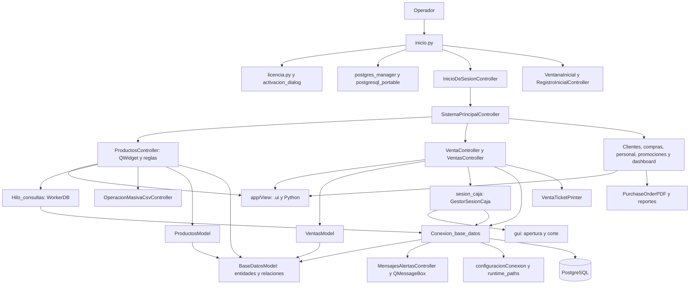
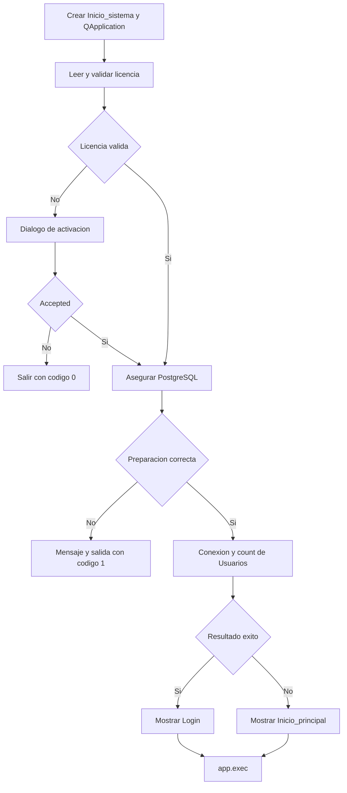
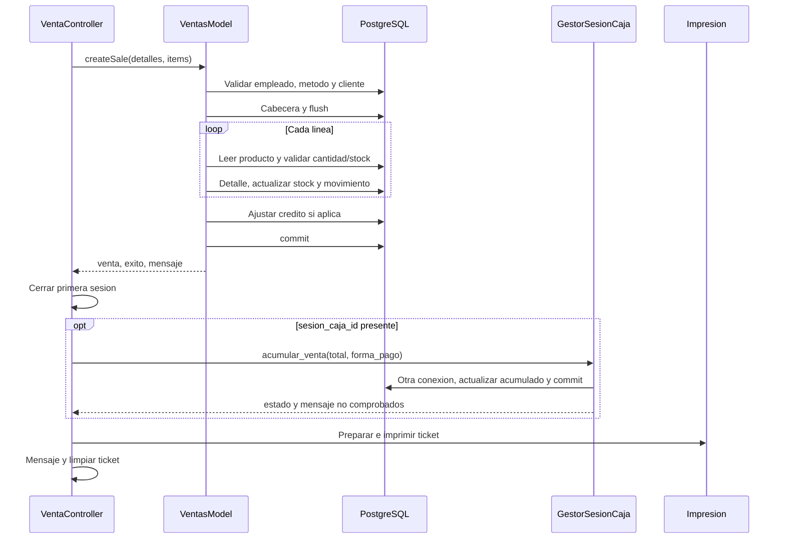
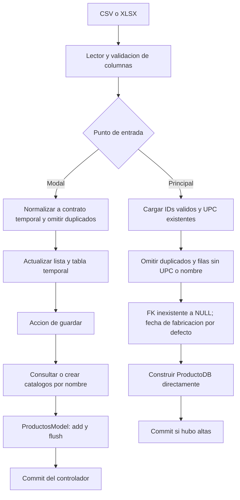
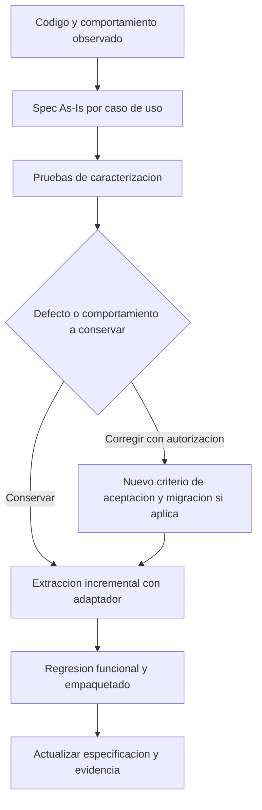

# Arquitectura y analisis actual de TuleVenta

## 1. Alcance y metodo

Levantamiento As-Is del 2026-11-10, mediante inventario del arbol y lectura estatica. Complementa el [indice y contexto IA](00-indice-y-contexto-ia.md). No se ejecutaron operaciones contra PostgreSQL, GUI, instalador ni impresora. Las consecuencias descritas como riesgos requieren pruebas; no se presentan como incidentes reproducidos.

Se revisaron en profundidad arranque, conexion, esquema, modelo de productos, lector masivo, rutas principal/modal de productos, registro de ventas, coordinacion con caja y worker de BD. El resto de modulos se inventario por archivos y responsabilidades, sin certificar todos sus eventos. El diccionario completo y las especificaciones por modulo se desarrollaran en fases posteriores.

### Resumen del diagnostico

Monolito de escritorio con organizacion MVC, pero sin separacion estricta de capas. Hay reglas y consultas en controladores QWidget, reglas y commits en modelos, infraestructura de BD que depende de mensajes Qt y servicios de caja en la raiz. El mayor riesgo de refactorizacion no es la carpeta elegida, sino alterar contratos implicitos de transaccion, conversion, errores y senales.

Fortalezas existentes: modelos por dominio, ORM centralizado, lector comun CSV/XLSX, conexiones con pool_pre_ping, workers administrados, carga anticipada en varias consultas de productos y rollback explicito en ventas. Conviene conservar estas piezas mientras se caracterizan sus limites.

## 2. Componentes y dependencias

Diagrama de componentes, equivalente a una vista C4 de componentes simplificada; no representa servicios de red independientes.

Las flechas expresan uso, no una arquitectura deseada. La pantalla coordina modelos y SQL directamente. La infraestructura importa un controlador de mensajes, por lo que acceder a datos no es una operacion independiente de Qt. La caja se invoca desde VentaController; los dialogos residen en gui y no son una capa de dominio.

### Responsabilidades reales

| Pieza | Responsabilidad observada | Limite relevante |
| --- | --- | --- |
| Vistas .ui/Python | Construccion y disposicion de widgets | Hay variantes con sufijos _ui y sin ellos; el import decide la usada |
| Controladores | Eventos, estado visual, validaciones, consultas, mapeos y commits | No son solo coordinadores MVC |
| Modelos de dominio | Consultas y mutaciones ORM, reglas y algunos commits | No hay un contrato uniforme de repositorio |
| BaseDatosModel | Metadata, entidades, relaciones y restricciones SQL | No debe confundirse con la BD fisica de una instalacion |
| AbstractTableModel | Adaptacion de datos para tablas Qt | La carpeta Model no contiene exclusivamente dominio persistente |
| Conexion_base_datos | Engine, sessionmaker, create_all y mensajes de error | Instanciacion con efectos de conexion/DDL |
| WorkerDB | Sesion en hilo secundario, llamada y emision de resultado | No hace commit automatico ni decide exito funcional de un diccionario |
| GestorSesionCaja | Acumulados y estado de caja | Hace commit incluso con sesion recibida del llamador |
| runtime_paths | Recursos y configuracion mutable | Distingue ejecucion normal/congelada y rutas de configuracion |

## 3. Arranque y operacion

Fuentes: [inicio.py](../inicio.py), [conexionBD.py](../app/DataBase/conexionBD.py), [runtime_paths.py](../app/runtime_paths.py), [postgres_manager.py](../app/DataBase/postgres_manager.py).

Detalles significativos:

- La instancia Inicio_sistema configura QApplication y paleta antes de comprobar la licencia.
- comprobar_usuarios usa una conexion sincrona; los nombres de callbacks con sufijo hilo no demuestran ejecucion asincrona en este camino.
- comprobar_existencia_usuarios_query convierte tanto cero usuarios como una excepcion interna en exito=False, resultado=0. mostrar_resultado_hilo abre el flujo inicial en ambos casos. Riesgo: un error de consulta puede presentarse como sistema sin inicializar.
- Si una excepcion alcanza mostrar_error_hilo, se muestra alerta y se abre Login. Es un camino distinto del error absorbido por la consulta.
- Conexion_base_datos.conectar llama create_engine, sessionmaker y Base.metadata.create_all. create_all crea tablas faltantes; no transforma columnas/restricciones ya existentes.
- La conexion ante SQLAlchemyError muestra QMessageBox y contempla Abort/Retry; Retry vuelve a llamar conectar recursivamente. No hay un contrato de excepcion independiente de la UI para el llamador.
- runtime_paths usa PROGRAMDATA cuando esta disponible para configuracion mutable y contempla recursos en ejecucion congelada. No debe suponerse que datos/ del repositorio sea siempre el destino efectivo.

## 4. Persistencia y transacciones

### 4.1 Ciclo de vida de conexion

[Conexion_base_datos](../app/DataBase/conexionBD.py) crea un engine por instancia, no un engine global compartido. abrir_sesion reutiliza la sesion de esa instancia. __enter__ abre la sesion y retorna la conexion; __exit__ cierra la sesion, sin commit ni rollback explicitos. Session.close libera recursos y termina la transaccion pendiente conforme a SQLAlchemy; no debe interpretarse como guardado automatico. Tampoco se llama engine.dispose en este wrapper.

Consecuencias posibles: multiples pools y create_all repetido al crear conexiones por operacion; falta medir el costo antes de cambiarlo. Cerrar una sesion no hace seguros todos los objetos enviados a Qt: un atributo diferido o relacion no cargada puede necesitar una sesion posterior. Varias consultas de ProductosModel ya usan joinedload; no se afirma que todas produzcan DetachedInstanceError.

### 4.2 Propietario del commit no uniforme

| Camino | Efecto actual | Riesgo al componer |
| --- | --- | --- |
| ProductosModel.agregar_producto | add y flush; retorna objeto/estado; captura Exception | El llamador necesita decidir commit y distinguir error de duplicado |
| ProductosModel.actualizar_producto | Modifica entidad, sin commit propio | Depende de la transaccion exterior |
| ProductosModel.eliminar_producto | delete y commit internos | Una operacion mayor no puede deshacer ese commit |
| eliminar_presentacion_producto / eliminar_unidad_medida | commit interno; en excepcion retorna False | No hace rollback explicito en esos except |
| Admin_productosController.agregar_productos_query | Resuelve catalogos, llama al modelo y hace commit | Mezcla lectura de widgets con trabajo de persistencia |
| Productos.importar_productos_query | Construye entidades directamente y hace commit si hay altas | No pasa por agregar_producto ni por sus mismas reglas |
| VentasModel.createSale | Cabecera, detalles, stock, movimientos y credito; commit final y rollback en error | Unidad util existente, pero caja queda fuera |
| GestorSesionCaja | Operaciones con commit interno, incluso si se inyecta session | Inyectar sesion no garantiza participar sin cerrar la transaccion del llamador |

### 4.3 Registro de venta y caja

Fuentes: [VentasModel.createSale](../app/Model/VentasModel.py#L235), [VentaController._registrar_venta](../app/Controller/VentaController.py#L740), [sesion_caja.py](../sesion_caja.py).

Hechos relevantes:

- Se rechazan ticket vacio y empleado, metodo o cliente inexistentes; credito requiere habilitacion y saldo disponible.
- Las cantidades se redondean a dos decimales, deben ser positivas y no superar la existencia leida. Se registran movimientos de salida y se distribuyen descuento e IVA por linea, ajustando la ultima con el remanente.
- Subtotal, descuento, IVA y total de cabecera provienen de sale_details; este metodo no constituye una recalculadora independiente de todos los totales enviados por el controlador.
- La lectura usa session.get sin bloqueo explicito with_for_update ni control optimista visible en ese metodo. Dos ventas concurrentes requieren una prueba de stock y credito; no se afirma una sobreventa reproducida.
- Tras el primer commit, una falla en caja no revierte venta/stock. _registrar_venta ignora el retorno de acumular_venta. Es una brecha concreta de atomicidad y observabilidad, aunque no se haya provocado en ejecucion.
- Un error de impresion posterior no debe confundirse con venta no registrada. Reintentar toda la venta por fallo de impresion puede duplicar la operacion si no se controla el reintento.

## 5. Productos: validacion y rutas divergentes

### 5.1 Limites UI frente a SQL

Fuentes: [limites del modal](../app/Controller/ProductosController.py#L222), [columnas Productos](../app/Model/BaseDatosModel.py#L263). Se trata de ese formulario, no de todos los importadores o vistas.

| Campo | setMaxLength en modal | Declaracion ORM | Diagnostico |
| --- | --- | --- | --- |
| codigo_upc | 255 | String(20), NOT NULL, unique | UI admite hasta 235 caracteres de mas |
| nombre_producto | 255 | String(60) | UI admite hasta 195 caracteres de mas |
| marca | 100 | String(100) | Limite alineado en esta UI |
| modelo | 50 | String(100) | UI mas restrictiva que BD |
| color | 20 | String(255) | UI mas restrictiva que BD |
| material | 255 | String(255) | Limite alineado en esta UI |

PostgreSQL normalmente rechaza un varchar demasiado largo; no hay evidencia aqui de truncado automatico en la BD. Los riesgos son rechazo tardio, error reducido a un estado generico y diferencias entre canales de alta. Cambiar String en ORM no altera por si mismo una columna ya instalada.

Los validadores de widgets no cubren la importacion directa. La unicidad por consulta previa tampoco elimina una carrera: la restriccion unique sigue siendo la ultima defensa y su error debe tratarse dentro de la transaccion.

### 5.2 Dos contratos de importacion

Fuentes: [ProductosController](../app/Controller/ProductosController.py), [lector comun](../app/Controller/OperacionMasivaCsvController.py), [ProductosModel](../app/Model/ProductosModel.py).

| Aspecto | Modal Admin_productosController | Vista principal Productos |
| --- | --- | --- |
| Destino inicial | Lista temporal self.lista_productos | Entidades en la sesion de BD |
| Claves del objeto preparado | codigo_barras, nombre, precio_venta, existencia_min/max | codigo_upc, nombre_producto, precio, existencia_minima/maxima |
| Catalogos | Nombres; agregar_presentacion, agregar_unidad_medida y CategoriasModel.agregar | IDs contrastados con conjuntos de IDs existentes |
| Catalogo inexistente | Puede crearse al guardar si hay nombre | FK se sustituye por None |
| Proveedor | Se consulta por nombre y se pasa al modelo | No se construye vinculo de proveedor en este importador |
| Duplicados | Se detectan en preparacion; modelo vuelve a buscar UPC | Conjunto de UPC en BD y del mismo lote; se omiten |
| Persistencia | Accion de guardado posterior con commit del controlador | commit al final si hubo productos nuevos |
| Margen | Objeto temporal usa parse_int; guardado lo pasa como cadena al modelo | parse_float directo |
| Filas sin UPC/nombre | Verificar mensajes y descarte del modal en su spec | Se omiten sin detalle individual en el retorno |

En la ruta principal se permiten solo columnas enumeradas, exige encabezados codigo_upc y nombre_producto, usa fecha actual si fabricacion no es interpretable y agrega el UPC al conjunto tras cada alta para detectar duplicados del lote. La columna id se acepta en la lista de columnas validas pero no se asigna al objeto creado. El retorno informa agregados y codigos duplicados; no enumera cada descarte por campo vacio.

En el modal, agregar_productos_query cuenta el mensaje con len(self.lista_productos), no con productos_agregados. Recoge productos_no_agregados pero no lo devuelve. Si agregar_producto retorna False por un duplicado sin invalidar la sesion, el mensaje puede sobreestimar altas. Si un flush falla y es absorbido por el modelo, un commit posterior puede fallar hasta hacer rollback; la captura exterior no convierte ese lote en exito parcial seguro.

### 5.3 Comportamiento del lector compartido

- CSV usa csv.DictReader y prueba utf-8-sig, utf-8 y latin-1; no hay deteccion explicita de separador en ese metodo.
- Excel usa hoja activa con openpyxl, read_only=True y data_only=True. No evalua formulas; lee valores almacenados por Excel.
- La extension .xls entra al despachador pero _leer_excel la rechaza con ValueError. El mensaje generico de formatos menciona .xls: discrepancia de mensaje frente a capacidad efectiva.
- Se eliminan espacios de encabezados; no hay normalizacion general de mayusculas/minusculas de columnas. Faltantes y extras se validan cuando el consumidor proporciona la lista correspondiente.
- Vacios, nan, none y nat se normalizan a cadena vacia. parse_float y parse_int retornan default ante muchos errores; parse_int convierte primero a float y puede perder fraccion. Esto es tolerancia con posible perdida silenciosa de significado, no validacion estricta.
- parse_float no exige finitud: valores como inf pueden atravesar float. Su aceptacion de negocio debe especificarse y probarse antes de cambiarse.
- parse_date admite ISO, formatos explicitos y serial numerico; formatos ambiguos priorizan dia/mes sobre mes/dia. Valores invalidos devuelven default.

El lector comun ya es una reutilizacion valiosa. No conviene reemplazarlo por otro parser sin conservar estos contratos o aprobar sus cambios.

## 6. Modelo de datos: implicaciones arquitectonicas

Fuente: [BaseDatosModel](../app/Model/BaseDatosModel.py). Inventario completo de nombres en el indice; el ER exhaustivo corresponde a Fase 2.

| Hecho | Implicacion |
| --- | --- |
| 37 tablas, PK mayormente BigInteger y varias asociaciones | Refactorizar por agregado/caso de uso, no renombrar tablas por estetica |
| Importes y existencias usan Float en productos, ventas y caja | El redondeo en Python no equivale a decimal exacto; migrar exige reconciliacion y pruebas |
| Productos.existencia vive en producto; sucursal_producto solo contiene IDs | No se observa saldo de stock por sucursal en esa asociacion |
| Usuarios.rol_id y tabla usuario_rol coexisten | La relacion Usuarios.rol usa la FK directa; no asumir multirol operativo por existir una tabla puente |
| Productos.proveedores es secondary con viewonly=True | Asignarla en agregar_producto/actualizar_producto no es un mecanismo persistente de escritura de la asociacion |
| ProductoProveedor existe como objeto de asociacion | Evaluar sus escritores antes de concluir que ningun flujo vincula proveedores |
| As-Is original: Puestos repetia hora_salida, empleados, departamento_id y departamento | REF-13 retira primeras declaraciones con snapshot unitario efectivo equivalente, sin DDL; no eran columnas SQL separadas |
| Movimientos_Inventario usa Integer para FK producto/usuario frente a PK BigInteger | Revisar compatibilidad de tipos y capacidad a largo plazo; no afirmar fallo inmediato sin probar PostgreSQL |
| Relaciones combinan SET NULL, CASCADE, RESTRICT y cascadas ORM | El borrado no puede homologarse con una regla generica sin casos por relacion |

Los catalogos se precargan desde metodos de modelos y flujos de inicializacion, no solo desde un script SQL. En ProductosModel, unidades, categorias y presentaciones se insertan si no hay ni una fila. No se repone un catalogo parcialmente poblado. La lista original repetia Cilindro-(cil); REF-14 retira una repeticion solo para semillas futuras, no sanea instalaciones. Nombre sigue sin unique. Literales y delta historico estan en el documento de datos.

## 7. Hilos, estado y UI

Fuentes: [Hilo_consultas](../app/Controller/Hilo_consultas.py), [ProductosController](../app/Controller/ProductosController.py).

WorkerDB._run abre una conexion en el hilo secundario e inyecta session a una funcion. Para un tuple de dos elementos emite data/estado; para cualquier otro resultado emite resultado/True. Por tanto, un diccionario con exito=False puede viajar con el segundo argumento True. Los consumidores deben comprobar el contrato concreto, no usar indistintamente ambos indicadores.

El administrador global gestiona workers por owner_id y limpia anteriores del mismo propietario. _CallbackRelay usa conexiones encoladas y adapta argumentos con inspect.signature; es infraestructura existente que no debe descartarse sin pruebas de callbacks y cierre de ventanas.

Riesgos localizados:

- agregar_productos_query consulta opcion_TieneCaducidad.isChecked dentro del trabajo llamado desde WorkerDB. Esto cruza el limite entre persistencia en hilo secundario y widget de UI; tomar una instantanea de entradas en el hilo principal es una futura correccion, no comportamiento actual.
- Se retornan entidades ORM en varios caminos. Tras cerrar la sesion, solo es seguro lo ya cargado; caracterizar relaciones requeridas por tablas y tickets antes de sustituir entidades por DTO.
- ejecutar puede hacer quit y wait si el hilo esta corriendo. No es una cancelacion de una consulta SQL en curso y puede esperar su finalizacion.
- Variables de paginacion, listas temporales, modales y estado de seleccion residen en controladores grandes. La limpieza al ocultar/cerrar existe en Productos, pero no se extrapola a todas las pantallas.
- Conexion_base_datos puede mostrar mensajes Qt desde un camino iniciado por WorkerDB si falla la conexion. Debe caracterizarse ese escenario y separar notificacion del error tecnico.

## 8. Registro de deuda tecnica

Prioridad diagnostica: P0 = integridad financiera/stock a caracterizar antes de refactorizar; P1 = correccion y estabilidad; P2 = mantenibilidad/reproducibilidad. No es todavia la matriz Impacto/Esfuerzo del plan To-Be.

| ID | Prioridad | Evidencia y code smell | Riesgo y comprobacion recomendada |
| --- | --- | --- | --- |
| DT-01 | P0 | VentaController confirma venta y despues acumula caja sin comprobar resultado | Inyectar fallo de caja y verificar venta persistida, aviso y recuperacion |
| DT-02 | P0 | createSale lee/modifica stock y credito sin bloqueo explicito en ese metodo | Dos sesiones con ultima existencia o credito limite; comprobar saldo y movimientos |
| DT-03 | P1 | UPC/nombre 255 en UI frente a 20/60 en ORM | Pruebas limites 20/21 y 60/61 por alta, edicion e importacion |
| DT-04 | P1 | ProductosModel.agregar_producto captura Exception y retorna None/False | Diferenciar duplicado, violacion de longitud y error de conexion; comprobar rollback |
| DT-05 | P1 | Commits en modelos, controladores y caja | Una unidad compuesta debe poder revertirse; inventariar commits antes de moverlos |
| DT-06 | P1 | Dos contratos de importacion y mensajes basados en lista temporal | Mismo archivo adaptado por canal, comparar catalogos, omisiones y altas reales |
| DT-07 | P1 | Asignacion a Productos.proveedores viewonly | Reabrir otra sesion y verificar filas reales de producto_proveedor |
| DT-08 | P1 | Error de count de usuarios convertido a exito=False | Simular error y distinguirlo de instalacion sin usuarios |
| DT-09 | P1 | parse_float/int/date con defaults y sin errores por fila | Archivo con numericos invalidos, infinitos y fechas ambiguas; contrastar importado |
| DT-10 | P1 | Funcion de persistencia consulta widgets y retorna ORM al worker | Cerrar modal durante trabajo, fallar conexion y acceder relacion no cargada |
| DT-11 | P1 | Float para valores financieros | Caracterizar sumas, IVA, descuentos, devolucion por cancelacion y diferencia de caja |
| DT-12 | P2 | Engine y create_all por instancia; infraestructura depende de QMessageBox | Medir conexiones/latencia y probar fallo sin QApplication |
| DT-13 | P2 | Puestos con declaraciones repetidas y controladores extensos | Eliminar duplicacion solo con equivalencia comprobada de metadata y contratos |
| DT-14 | P2 | Sin versiones fijadas ni historial de revisiones Alembic en arbol observado | Instalacion limpia reproducible y comparacion de esquema contra BD existente |
| DT-15 | P2 | README con arbol tipico distinto y smoke test de importacion con ruta absoluta | Onboarding reproducible, pruebas aisladas y documentacion basada en imports reales |

Dimension del codigo propio inspeccionado: ProductosController tiene 2161 lineas, ClientesController 2234, ComprasController 1665 y RegistroInicialController 1357 en este snapshot. La longitud es una senal de concentracion de responsabilidades, no prueba suficiente de defecto por si sola.

## 9. Seguridad, despliegue y observabilidad

- Hay activacion de licencia antes de preparar BD y CodificarPasswordController usa bcrypt.hashpw con gensalt. Esto no sustituye una auditoria de autorizacion de cada accion, almacenamiento de credenciales, recuperacion de cuenta y verificaciones de licencia.
- Roles/permisos tienen entidades y controladores propios. No se asume que ocultar un boton garantice autorizacion en todos los caminos de persistencia; comprobarlo por caso de uso en las specs.
- ConfiguracionConexionBD centraliza la URL usada por conexion y Alembic. No se reproducen valores de credenciales ni contenido de configuracion local en esta documentacion.
- PyInstaller, hooks e instalador son parte del sistema operativo real: cambios en imports, recursos o bibliotecas necesitan un smoke test del ejecutable, no solo ejecucion desde fuentes.
- El README menciona actualizaciones desde GitHub, pero este levantamiento no establece un flujo de actualizacion verificado. No se declara esa capacidad implementada basandose solo en el README.
- WorkerDB registra excepciones con traceback; varios modelos capturan excepciones y retornan estados genericos sin conservar causa. No hay un contrato uniforme de error tecnico frente a mensaje de negocio en los flujos revisados.
- No se encontro una suite configurada en el arbol propio inspeccionado. El archivo raiz de nombre literal %TEST_SCRIPT% agrega una ruta local absoluta e importa SistemaPrincipalController; no prueba ventas, stock ni transacciones y no se ejecuto.
- alembic/env.py usa Base.metadata y la configuracion compartida. En el arbol observado hay entorno y plantilla, pero no archivos de revisiones: no afirmar que existe una cadena versionada que pueda reconstruir el esquema.

## 10. Criterios para una refactorizacion segura

Estos son requisitos derivados del diagnostico, no una implementacion ni el plan completo de Fase 4:

1. Caracterizar primero ventas, stock, credito y caja con datos de prueba aislados. Distinguir cambios correctivos autorizados de conservacion del comportamiento.
2. Formalizar entradas y errores por canal; homologar longitudes sin ampliar/reducir capacidades silenciosamente. Mantener la restriccion de BD como ultima defensa.
3. Decidir una frontera transaccional por caso de uso. No mover commits a una capa nueva sin incluir sus efectos actuales ni su comportamiento de rollback.
4. Separar lectura de archivos, normalizacion, reglas y persistencia de importacion, reutilizando el lector existente y conservando diferencias aprobadas de catalogos.
5. Capturar entradas Qt antes de lanzar workers. Retornar resultados serializables/DTO solo despues de identificar los atributos que cada vista necesita.
6. Extraer servicios/repositorios gradualmente desde los metodos decisores, con adaptadores para las firmas actuales. Evitar reescritura simultanea de todas las pantallas.
7. Introducir migraciones verificables para todo cambio de esquema; create_all no es una estrategia de evolucion de BD instalada.
8. Probar fuente y distribucion Windows, rutas mutables, licencia, impresion y cierre de hilos con escenarios definidos, sin usar datos de produccion.

## 11. Evidencia y pendientes de verificacion

| Tema | Fuente principal |
| --- | --- |
| Esquema y relaciones | [BaseDatosModel.py](../app/Model/BaseDatosModel.py) |
| Sesion y creacion de tablas | [conexionBD.py](../app/DataBase/conexionBD.py) |
| Configuracion y rutas | [configuracionConexion.py](../app/DataBase/configuracionConexion.py), [runtime_paths.py](../app/runtime_paths.py) |
| Arranque | [inicio.py](../inicio.py) |
| Consultas y mutaciones de productos | [ProductosModel.py](../app/Model/ProductosModel.py) |
| UI, listas temporales e importacion directa | [ProductosController.py](../app/Controller/ProductosController.py) |
| Conversion de archivos | [OperacionMasivaCsvController.py](../app/Controller/OperacionMasivaCsvController.py) |
| Transaccion de venta | [VentasModel.py](../app/Model/VentasModel.py) |
| Coordinacion de caja e impresion | [VentaController.py](../app/Controller/VentaController.py), [sesion_caja.py](../sesion_caja.py) |
| Hilos y callbacks | [Hilo_consultas.py](../app/Controller/Hilo_consultas.py) |
| Migraciones | [env.py](../alembic/env.py) |
| Dependencias y distribucion | [requirements.txt](../requirements.txt), [TuleVenta.spec](../TuleVenta.spec), [TuleVentaSetup.iss](../installer/TuleVentaSetup.iss) |

Pendientes: comparar metadata con una BD autorizada; renderizar Mermaid en visor; ejecutar pruebas de concurrencia y fallos; revisar todos los permisos por operacion; diccionario completo y catalogos; contratos de compras, clientes, promociones, cancelaciones y cortes; pruebas de impresion/instalacion. Ninguno de estos pendientes se presenta como validado en esta fase.