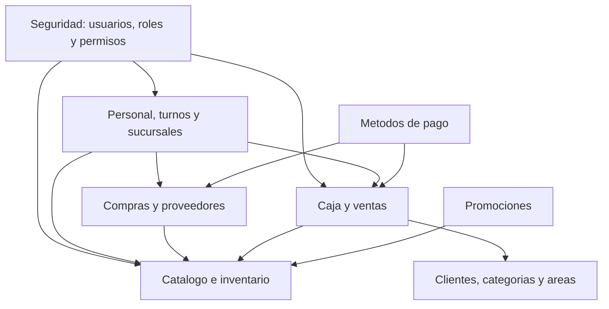
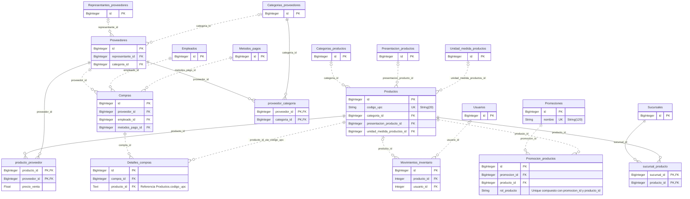
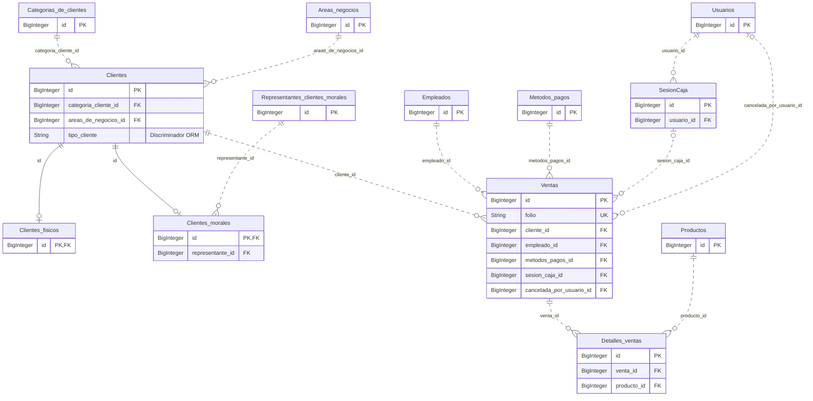
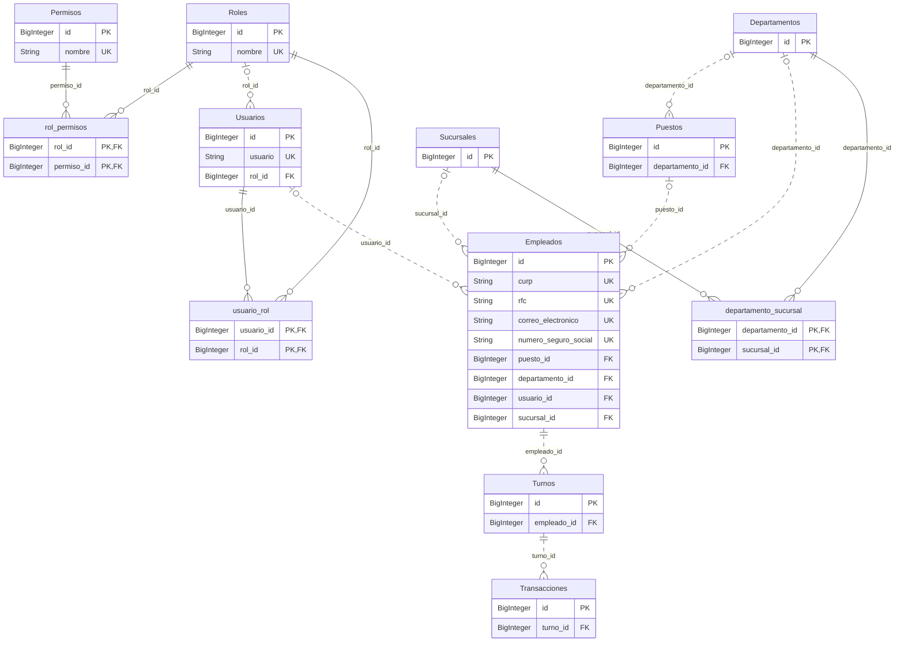
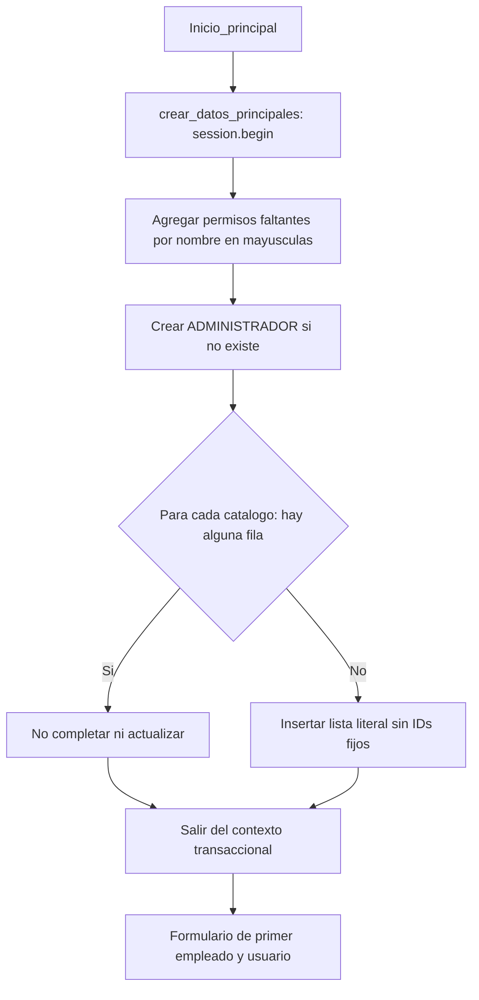

# Modelo de datos As-Is de TuleVenta

## 1. Alcance y convenciones

Fecha: 2026-11-10. Fuente: [BaseDatosModel.py](../app/Model/BaseDatosModel.py). Inventario estatico: 32 entidades mapeadas y 5 tablas Table, 37 tablas en total. No se conecto a una BD ni se aplico DDL. Este documento describe las declaraciones actuales, no certifica que una instalacion tenga el mismo esquema. Contexto: [indice](00-indice-y-contexto-ia.md) y [arquitectura](01-arquitectura-y-analisis-actual.md).

El diccionario enumera columnas fisicas declaradas, no atributos heredados repetidos. En el As-Is original Puestos conservaba las ultimas asignaciones de hora_salida/departamento_id; REF-13 retira las declaraciones previas sin cambiar metadata efectiva. Las columnas siguen enumeradas una sola vez. Clientes_fisicos y Clientes_morales usan herencia joined-table: sus campos comunes viven en Clientes.

### Lectura de las tablas

- `NI`: nullable omitido, NOT NULL inferido por SQLAlchemy a partir de Mapped[T] no Optional. No equivale a nullable=True.
- `NF`: nullable=False explicito. `NT`: nullable=True explicito. `PK`: nullable omitido y NOT NULL por clave primaria (tambien anotada no Optional en mapped_column).
- `PK=True`: primary_key=True. `U=True`: unique=True. Una PK de varias columnas es compuesta, no unicidad individual por columna.
- `FK Tabla.columna`: ForeignKey literal; `delete=...` reproduce ondelete. Si no se indica delete, no hay ondelete explicito (la accion efectiva depende del motor; PostgreSQL usa NO ACTION por defecto).
- `D=...`: default de SQLAlchemy del lado cliente. `UP=...`: onupdate del lado cliente. No son server_default ni triggers de PostgreSQL.
- `-` en restricciones significa: sin PK, FK, unique, default u onupdate declarados en esa columna. Su nulabilidad sigue siendo la de la columna anterior.
- Ausencia de `U=True` no elimina una unicidad de PK o la restriccion compuesta descrita aparte. No hay server_default, CheckConstraint, Enum ni Numeric declarados en este archivo.
- Los tipos conservan su nombre SQLAlchemy; Float no es Decimal y Date no almacena hora. DateTime no lleva timezone=True en estas declaraciones.
- No se declara Identity, Sequence ni autoincrement por columna. Las PK BigInteger simples pueden recibir generacion implicita del dialecto PostgreSQL; no se promete una secuencia concreta sin inspeccionar el DDL instalado.

## 2. Diccionario exhaustivo

Los nombres de seccion son nombres SQL exactos. La columna Restricciones usa la notacion de la seccion 1; los valores de texto entre comillas son literales. Todos los campos no listados como default carecen de default declarado, incluso cuando un controlador les asigna valores.

### 2.1 `rol_permisos`

Tabla Table, variable Python rol_permiso. PK compuesta (rol_id, permiso_id).

| Columna | Tipo SQLAlchemy | NULL | Restricciones |
| --- | --- | --- | --- |
| rol_id | BigInteger | PK | PK=True; FK Roles.id; delete=CASCADE |
| permiso_id | BigInteger | PK | PK=True; FK Permisos.id |

### 2.2 `usuario_rol`

Tabla Table. PK compuesta (usuario_id, rol_id); no esta configurada como secondary de Usuarios.rol.

| Columna | Tipo SQLAlchemy | NULL | Restricciones |
| --- | --- | --- | --- |
| usuario_id | BigInteger | PK | PK=True; FK Usuarios.id |
| rol_id | BigInteger | PK | PK=True; FK Roles.id |

### 2.3 `sucursal_producto`

Tabla Table. PK compuesta (sucursal_id, producto_id). No contiene cantidades de stock.

| Columna | Tipo SQLAlchemy | NULL | Restricciones |
| --- | --- | --- | --- |
| sucursal_id | BigInteger | PK | PK=True; FK Sucursales.id |
| producto_id | BigInteger | PK | PK=True; FK Productos.id |

### 2.4 `proveedor_categoria`

Tabla Table. PK compuesta (proveedor_id, categoria_id). No es el enlace usado por Proveedores.categoria.

| Columna | Tipo SQLAlchemy | NULL | Restricciones |
| --- | --- | --- | --- |
| proveedor_id | BigInteger | PK | PK=True; FK Proveedores.id |
| categoria_id | BigInteger | PK | PK=True; FK Categorias_proveedores.id |

### 2.5 `departamento_sucursal`

Tabla Table. PK compuesta (departamento_id, sucursal_id).

| Columna | Tipo SQLAlchemy | NULL | Restricciones |
| --- | --- | --- | --- |
| departamento_id | BigInteger | PK | PK=True; FK Departamentos.id |
| sucursal_id | BigInteger | PK | PK=True; FK Sucursales.id |

### 2.6 `Permisos`

| Columna | Tipo SQLAlchemy | NULL | Restricciones |
| --- | --- | --- | --- |
| id | BigInteger | PK | PK=True |
| nombre | String(50) | NI | U=True |

### 2.7 `Roles`

| Columna | Tipo SQLAlchemy | NULL | Restricciones |
| --- | --- | --- | --- |
| id | BigInteger | PK | PK=True |
| nombre | String(100) | NI | U=True |
| descripcion | Text | NI | - |

### 2.8 `Usuarios`

| Columna | Tipo SQLAlchemy | NULL | Restricciones |
| --- | --- | --- | --- |
| id | BigInteger | PK | PK=True |
| usuario | String(60) | NT | U=True |
| contraseña | LargeBinary | NT | - |
| fecha_creacion | Date | NF | - |
| fecha_actualizacion | Date | NT | - |
| rol_id | BigInteger | NT | FK Roles.id; delete=SET NULL |

El nombre exacto de la columna de credencial es `contraseña`, no password ni contrasena. Un usuario nulo esta permitido y su unique no implica que solo pueda existir un NULL en PostgreSQL.

### 2.9 `Puestos`

| Columna | Tipo SQLAlchemy | NULL | Restricciones |
| --- | --- | --- | --- |
| id | BigInteger | PK | PK=True |
| nombre | String(100) | NI | - |
| salario | Float | NI | - |
| horas_laborales | Float | NI | - |
| dias_laborales | Text | NI | - |
| descripcion_puesto | Text | NI | - |
| hora_entrada | Time | NI | - |
| hora_salida | Time | NI | - |
| departamento_id | BigInteger | NT | FK Departamentos.id; delete=SET NULL |

### 2.10 `Empleados`

| Columna | Tipo SQLAlchemy | NULL | Restricciones |
| --- | --- | --- | --- |
| id | BigInteger | PK | PK=True |
| nombre | String(100) | NI | - |
| apellido_paterno | String(100) | NI | - |
| apellido_materno | String(100) | NI | - |
| genero | String(20) | NI | - |
| fecha_nacimiento | Date | NI | - |
| estado_civil | String(20) | NI | - |
| curp | String(18) | NI | U=True |
| rfc | String(13) | NI | U=True |
| nivel_academico | String(100) | NI | - |
| carrera | String(150) | NI | - |
| correo_electronico | String(100) | NT | U=True |
| numero_seguro_social | String(13) | NI | U=True |
| fecha_contratacion | Date | NI | - |
| fecha_despido | Date | NT | - |
| ciudad | String(100) | NT | - |
| codigo_postal | String(5) | NT | - |
| estado | String(100) | NT | - |
| pais | String(100) | NT | - |
| numero_telefonico | String(10) | NT | - |
| nombre_contacto | String(100) | NT | - |
| contacto_emergencia | String(10) | NI | - |
| parentesco_contacto | String(20) | NI | - |
| calles | String(100) | NT | - |
| avenidas | String(100) | NT | - |
| colonia | String(100) | NI | - |
| num_interior | String(10) | NT | - |
| num_exterior | String(10) | NT | - |
| direccion_adicional | Text | NT | - |
| puesto_id | BigInteger | NT | FK Puestos.id; delete=SET NULL |
| departamento_id | BigInteger | NT | FK Departamentos.id; delete=SET NULL |
| activo | Boolean | NF | D=True |
| foto_empleado | Text | NT | - |
| usuario_id | BigInteger | NT | FK Usuarios.id; delete=SET NULL |
| sucursal_id | BigInteger | NT | FK Sucursales.id; delete=RESTRICT |

### 2.11 `Sucursales`

| Columna | Tipo SQLAlchemy | NULL | Restricciones |
| --- | --- | --- | --- |
| id | BigInteger | PK | PK=True |
| nombre_sucursal | String(50) | NI | - |
| codigo_postal | String(5) | NI | - |
| ciudad | String(50) | NI | - |
| estado | String(50) | NI | - |
| pais | String(50) | NI | - |
| num_telefono | String(10) | NI | - |
| razon_social | String(300) | NI | - |
| rfc | String(13) | NI | - |
| direccion | Text | NI | - |

### 2.12 `Departamentos`

| Columna | Tipo SQLAlchemy | NULL | Restricciones |
| --- | --- | --- | --- |
| id | BigInteger | PK | PK=True |
| nombre | String(70) | NI | - |
| descripcion | Text | NI | - |

### 2.13 `Presentacion_productos`

| Columna | Tipo SQLAlchemy | NULL | Restricciones |
| --- | --- | --- | --- |
| id | BigInteger | PK | PK=True |
| nombre | String(100) | NF | - |

### 2.14 `Unidad_medida_productos`

| Columna | Tipo SQLAlchemy | NULL | Restricciones |
| --- | --- | --- | --- |
| id | BigInteger | PK | PK=True |
| nombre | String(100) | NI | - |

### 2.15 `Productos`

| Columna | Tipo SQLAlchemy | NULL | Restricciones |
| --- | --- | --- | --- |
| id | BigInteger | PK | PK=True |
| codigo_upc | String(20) | NF | U=True |
| nombre_producto | String(60) | NI | - |
| descripcion_producto | Text | NI | - |
| costo_inicial | Float | NI | - |
| costo_final | Float | NI | - |
| margen_porcentaje | Float | NI | - |
| precio | Float | NI | - |
| existencia | Float | NI | - |
| existencia_minima | Float | NI | - |
| existencia_maxima | Float | NI | - |
| marca | String(100) | NI | - |
| modelo | String(100) | NI | - |
| peso | Float | NI | - |
| alto_cm | Float | NI | - |
| largo_cm | Float | NI | - |
| ancho_cm | Float | NI | - |
| color | String(255) | NI | - |
| material | String(255) | NI | - |
| fecha_fabricacion | Date | NI | - |
| fecha_vencimiento | Date | NT | - |
| imagen | Text | NI | - |
| notas | Text | NI | - |
| presentacion_producto_id | BigInteger | NT | FK Presentacion_productos.id; delete=SET NULL |
| unidad_medida_productos_id | BigInteger | NT | FK Unidad_medida_productos.id; delete=SET NULL |
| categoria_id | BigInteger | NT | FK Categorias_productos.id; delete=SET NULL |

### 2.16 `Promociones`

| Columna | Tipo SQLAlchemy | NULL | Restricciones |
| --- | --- | --- | --- |
| id | BigInteger | PK | PK=True |
| nombre | String(120) | NF | U=True |
| descripcion | Text | NT | - |
| tipo_promocion | String(40) | NF | - |
| porcentaje_descuento | Float | NF | D=0.0 |
| cantidad_compra_requerida | Integer | NF | D=1 |
| cantidad_beneficio | Integer | NF | D=1 |
| aplica_mismo_producto | Boolean | NF | D=False |
| activa | Boolean | NF | D=True |
| fecha_inicio | Date | NT | - |
| fecha_fin | Date | NT | - |
| fecha_creacion | DateTime | NF | D=datetime.now |
| fecha_actualizacion | DateTime | NF | D=datetime.now; UP=datetime.now |

### 2.17 `Promocion_productos`

Clase Python PromocionProducto. Restriccion adicional: UniqueConstraint(promocion_id, producto_id, rol_producto), nombre exacto `uq_promocion_producto_rol`.

| Columna | Tipo SQLAlchemy | NULL | Restricciones |
| --- | --- | --- | --- |
| id | BigInteger | PK | PK=True |
| promocion_id | BigInteger | NF | FK Promociones.id; delete=CASCADE |
| producto_id | BigInteger | NF | FK Productos.id; delete=CASCADE |
| rol_producto | String(20) | NF | - |
| fecha_creacion | DateTime | NF | D=datetime.now |

### 2.18 `Movimientos_inventario`

Clase Python Movimientos_Inventario; el nombre SQL tiene inventario con inicial minuscula.

| Columna | Tipo SQLAlchemy | NULL | Restricciones |
| --- | --- | --- | --- |
| id | BigInteger | PK | PK=True |
| producto_id | Integer | NT | FK Productos.id; delete=CASCADE |
| cantidad_cambio | Float | NI | - |
| tipo_movimiento | String(20) | NI | - |
| fecha_movimiento | Date | NI | - |
| notas | Text | NI | - |
| usuario_id | Integer | NT | FK Usuarios.id; delete=SET NULL |

### 2.19 `Categorias_productos`

| Columna | Tipo SQLAlchemy | NULL | Restricciones |
| --- | --- | --- | --- |
| id | BigInteger | PK | PK=True |
| nombre | String(100) | NI | - |
| descripcion | Text | NI | - |

### 2.20 `Proveedores`

| Columna | Tipo SQLAlchemy | NULL | Restricciones |
| --- | --- | --- | --- |
| id | BigInteger | PK | PK=True |
| nombre | String(150) | NI | - |
| pais | String(30) | NI | - |
| estado | String(30) | NI | - |
| ciudad | String(30) | NI | - |
| codigo_postal | String(5) | NI | - |
| calles | String(60) | NI | - |
| avenidas | String(60) | NI | - |
| colonia | String(50) | NI | - |
| direccion_adicional | Text | NI | - |
| rfc | String(13) | NI | - |
| pagina_web | Text | NI | - |
| correo | String(100) | NI | - |
| telefono | String(10) | NI | - |
| clave_moneda | String(5) | NI | - |
| tipo_moneda | String(50) | NI | - |
| representante_id | BigInteger | NT | FK Representantes_proveedores.id |
| categoria_id | BigInteger | NT | FK Categorias_proveedores.id |

### 2.21 `producto_proveedor`

Clase Python ProductoProveedor (entidad mapeada, no una de las cinco Table). PK compuesta (producto_id, proveedor_id).

| Columna | Tipo SQLAlchemy | NULL | Restricciones |
| --- | --- | --- | --- |
| producto_id | BigInteger | PK | PK=True; FK Productos.id; delete=SET NULL |
| proveedor_id | BigInteger | PK | PK=True; FK Proveedores.id; delete=SET NULL |
| precio_venta | Float | NI | - |

### 2.22 `Representantes_proveedores`

| Columna | Tipo SQLAlchemy | NULL | Restricciones |
| --- | --- | --- | --- |
| id | BigInteger | PK | PK=True |
| nombre | String(100) | NI | - |
| apellido_paterno | String(60) | NI | - |
| apellido_materno | String(60) | NI | - |
| telefono | String(10) | NI | - |
| correo | String(100) | NI | - |
| puesto | String(100) | NI | - |

### 2.23 `Categorias_proveedores`

| Columna | Tipo SQLAlchemy | NULL | Restricciones |
| --- | --- | --- | --- |
| id | BigInteger | PK | PK=True |
| nombre | String(150) | NI | - |
| descripcion | Text | NI | - |

### 2.24 `Clientes`

Discriminador ORM: tipo_cliente; identidad de clase base `clientes` (minusculas).

| Columna | Tipo SQLAlchemy | NULL | Restricciones |
| --- | --- | --- | --- |
| id | BigInteger | PK | PK=True |
| nombre | String(255) | NI | - |
| correo | String(255) | NI | - |
| rfc | String(20) | NI | - |
| telefono | String(15) | NI | - |
| pais | String(100) | NI | - |
| estado | String(100) | NI | - |
| ciudad | String(255) | NI | - |
| avenidas | String(255) | NI | - |
| calles | String(255) | NI | - |
| codigo_postal | String(20) | NI | - |
| direccion_adicional | Text | NI | - |
| entidad_legalizada | Boolean | NI | - |
| categoria_cliente_id | BigInteger | NI | FK Categorias_de_clientes.id |
| credito | Boolean | NI | - |
| estado_credito | String(25) | NI | - |
| limite_credito | Float | NI | - |
| porcentaje_interes | Float | NI | - |
| fecha_ultimo_reporte | DateTime | NI | - |
| credito_disponible | Float | NI | - |
| credito_utilizado | Float | NI | - |
| tipo_cliente | String(50) | NI | - |
| aplica_descuento | Boolean | NI | - |
| porcentaje_descuento | Float | NI | - |
| comentarios | Text | NI | - |
| areas_de_negocios_id | BigInteger | NF | FK Areas_negocios.id |

### 2.25 `Categorias_de_clientes`

| Columna | Tipo SQLAlchemy | NULL | Restricciones |
| --- | --- | --- | --- |
| id | BigInteger | PK | PK=True |
| nombre | String(100) | NI | - |
| descripcion | String(255) | NI | - |

### 2.26 `Compras`

| Columna | Tipo SQLAlchemy | NULL | Restricciones |
| --- | --- | --- | --- |
| id | BigInteger | PK | PK=True |
| proveedor_id | BigInteger | NF | FK Proveedores.id |
| empleado_id | BigInteger | NF | FK Empleados.id |
| fecha_compra | DateTime | NT | - |
| fecha_creacion | DateTime | NI | D=datetime.now() |
| total_compra | Float | NI | - |
| estado | String(20) | NI | D="PENDIENTE" |
| metodos_pago_id | BigInteger | NF | FK Metodos_pagos.id |
| plazo_pago | Integer | NT | D=0 |
| fecha_vencimiento | DateTime | NT | - |

### 2.27 `Detalles_compras`

producto_id apunta al UPC, no a Productos.id.

| Columna | Tipo SQLAlchemy | NULL | Restricciones |
| --- | --- | --- | --- |
| id | BigInteger | PK | PK=True |
| compra_id | BigInteger | NF | FK Compras.id; delete=CASCADE |
| producto_id | Text | NF | FK Productos.codigo_upc |
| cantidad | Float | NI | - |
| precio_unitario | Float | NI | - |
| subtotal | Float | NI | - |

### 2.28 `Turnos`

| Columna | Tipo SQLAlchemy | NULL | Restricciones |
| --- | --- | --- | --- |
| id | BigInteger | PK | PK=True |
| empleado_id | BigInteger | NF | FK Empleados.id |
| fecha_turno | DateTime | NI | - |
| hora_inicio | DateTime | NI | - |
| hora_fin | DateTime | NI | - |

### 2.29 `Transacciones`

| Columna | Tipo SQLAlchemy | NULL | Restricciones |
| --- | --- | --- | --- |
| id | BigInteger | PK | PK=True |
| tipo | String(100) | NI | - |
| monto | Float | NI | - |
| fecha | DateTime | NI | - |
| turno_id | BigInteger | NF | FK Turnos.id |

### 2.30 `Areas_negocios`

| Columna | Tipo SQLAlchemy | NULL | Restricciones |
| --- | --- | --- | --- |
| id | BigInteger | PK | PK=True |
| nombre | String(100) | NI | - |
| descripcion | Text | NI | - |

### 2.31 `Clientes_fisicos`

Hereda Clientes; identidad polimorfica `FISICO`.

| Columna | Tipo SQLAlchemy | NULL | Restricciones |
| --- | --- | --- | --- |
| id | BigInteger | PK | PK=True; FK Clientes.id; delete=CASCADE |
| apellido_paterno | String(255) | NI | - |
| apellido_materno | String(255) | NI | - |
| curp | String(18) | NI | - |
| fecha_nacimiento | Date | NI | - |
| num_identificacion | String(20) | NI | - |
| ocupacion | String(150) | NI | - |
| ingresos | Float | NI | - |
| estado_civil | String(15) | NI | - |
| foto | Text | NI | - |

### 2.32 `Clientes_morales`

Hereda Clientes; identidad polimorfica `MORAL`. `NIF` conserva mayusculas.

| Columna | Tipo SQLAlchemy | NULL | Restricciones |
| --- | --- | --- | --- |
| id | BigInteger | PK | PK=True; FK Clientes.id; delete=CASCADE |
| razon_social | String(255) | NI | - |
| fecha_constitucion | Date | NI | - |
| web | String(255) | NI | - |
| sector | String(255) | NI | - |
| NIF | String(20) | NI | - |
| representante_id | BigInteger | NI | FK Representantes_clientes_morales.id |

### 2.33 `Metodos_pagos`

| Columna | Tipo SQLAlchemy | NULL | Restricciones |
| --- | --- | --- | --- |
| id | BigInteger | PK | PK=True |
| nombre | String(100) | NI | - |

### 2.34 `Representantes_clientes_morales`

| Columna | Tipo SQLAlchemy | NULL | Restricciones |
| --- | --- | --- | --- |
| id | BigInteger | PK | PK=True |
| nombre | String(100) | NI | - |
| telefono | String(20) | NI | - |
| correo | String(100) | NI | - |
| puesto | String(100) | NI | - |

### 2.35 `Detalles_ventas`

| Columna | Tipo SQLAlchemy | NULL | Restricciones |
| --- | --- | --- | --- |
| id | BigInteger | PK | PK=True |
| venta_id | BigInteger | NF | FK Ventas.id; delete=RESTRICT |
| producto_id | BigInteger | NF | FK Productos.id; delete=RESTRICT |
| cantidad | Float | NF | - |
| precio_unitario | Float | NF | - |
| subtotal | Float | NF | - |
| descuento | Float | NI | D=0.0 |
| iva | Float | NF | - |
| total_con_iva | Float | NF | - |
| nombre_producto | String(200) | NF | - |
| clave_producto | String(200) | NF | - |
| activo | Boolean | NF | D=True |

### 2.36 `Ventas`

| Columna | Tipo SQLAlchemy | NULL | Restricciones |
| --- | --- | --- | --- |
| id | BigInteger | PK | PK=True |
| folio | String(100) | NF | U=True |
| fecha | DateTime | NI | - |
| fecha_creacion | DateTime | NI | D=datetime.now() |
| fecha_actualizacion | DateTime | NI | D=datetime.now(); UP=datetime.now() |
| subtotal | Float | NF | - |
| iva | Float | NF | D=0.0 |
| total | Float | NI | - |
| estado | String(100) | NF | D='PENDIENTE' |
| comentarios | Text | NI | - |
| activo | Boolean | NF | D=True |
| motivo_cancelacion | String(200) | NT | - |
| cancelada_por_usuario_id | BigInteger | NT | FK Usuarios.id |
| fecha_cancelacion | DateTime | NT | - |
| forma_pago | String(50) | NT | - |
| sesion_caja_id | BigInteger | NT | FK SesionCaja.id |
| cliente_id | BigInteger | NF | FK Clientes.id; delete=RESTRICT |
| empleado_id | BigInteger | NF | FK Empleados.id; delete=RESTRICT |
| metodos_pagos_id | BigInteger | NF | FK Metodos_pagos.id; delete=RESTRICT |

### 2.37 `SesionCaja`

| Columna | Tipo SQLAlchemy | NULL | Restricciones |
| --- | --- | --- | --- |
| id | BigInteger | PK | PK=True |
| usuario_id | BigInteger | NF | FK Usuarios.id; delete=RESTRICT |
| fecha_apertura | DateTime | NI | D=datetime.now |
| monto_inicial | Float | NI | D=0.0 |
| ventas_efectivo | Float | NI | D=0.0 |
| ventas_tarjeta | Float | NI | D=0.0 |
| ventas_transferencia | Float | NI | D=0.0 |
| entradas_efectivo | Float | NI | D=0.0 |
| retiros_efectivo | Float | NI | D=0.0 |
| conteo_usuario | Float | NT | - |
| efectivo_esperado | Float | NI | D=0.0 |
| diferencia | Float | NI | D=0.0 |
| fecha_cierre | DateTime | NT | - |
| estado | String(50) | NI | D="ABIERTA" |

## 3. Mapa general y diagramas ER

El mapa agrupa dominios; las flechas indican referencias entre ellos, no procesos. Los tres ER siguientes cubren las 37 tablas y todas sus FK. Repiten entidades frontera para hacer legibles las referencias; esas repeticiones no son tablas adicionales. Los bloques de atributos ER muestran PK, FK y claves unicas relevantes, no sustituyen las 294 columnas del diccionario.

En ER, `||` significa referencia obligatoria, `o|` opcional y `o{` cero o muchos hijos. Las relaciones de herencia usan `o|` del lado subtipo porque una fila base puede no pertenecer a ese subtipo. Lineas solidas para FK integrantes de PK y discontinuas para las demas. La nulabilidad procede de las declaraciones, no de valores observados. Una relacion visual no implica cascade ni back_populates: consultar las secciones 2 y 4.

### 3.1 Catalogo, inventario, promociones y compras

Empleados, Usuarios, Metodos_pagos y Sucursales son fronteras compartidas con los otros ER.

### 3.2 Ventas, clientes, caja y pagos

Productos, Empleados y Usuarios son fronteras compartidas. El vinculo de cancelacion es independiente del usuario de caja y del empleado de venta.

### 3.3 Seguridad, personal, sucursales y turnos

Usuarios.empleado es escalar en ORM, pero Empleados.usuario_id no es unique: el ER representa la cardinalidad permitida por las restricciones SQL, no la expectativa escalar del ORM.

## 4. Propiedades relationship y herencia

Se enumeran las propiedades declaradas efectivas por clase. Notacion `atributo -> Clase / inversa` significa back_populates="inversa". Si no se indican opciones especiales, la declaracion no establece secondary, cascade, passive_deletes, lazy, foreign_keys, uselist o viewonly: rigen los defaults de SQLAlchemy (habitualmente lazy select, cascade save-update/merge, passive_deletes=False y viewonly=False). No es una afirmacion de que la consulta no pueda usar joinedload u otras opciones.

| Clase Python | Propiedades declaradas y opciones explicitas |
| --- | --- |
| Permisos | roles -> Roles / permisos; secondary=rol_permiso (tabla rol_permisos) |
| Roles | permisos -> Permisos / roles, secondary=rol_permiso; usuarios -> Usuarios / rol |
| Usuarios | rol -> Roles / usuarios; empleado -> Empleados / usuario, uselist=False; movimientos_inventario -> Movimientos_Inventario / usuario |
| Puestos | empleados -> Empleados / puesto; departamento -> Departamentos / puestos, lazy="joined". Repeticiones de fuente retiradas por REF-13; configuracion efectiva conservada |
| Empleados | puesto -> Puestos / empleados; departamento -> Departamentos / empleados, lazy="joined"; usuario -> Usuarios / empleado; ventas -> Ventas / empleado; turnos -> Turnos / empleado; sucursal -> Sucursales / empleados, lazy="joined"; compras -> Compras / empleado |
| Sucursales | productos -> Productos / sucursales, secondary=sucursal_producto; departamentos -> Departamentos / sucursales, secondary=departamento_sucursal; empleados -> Empleados / sucursal |
| Departamentos | empleados -> Empleados / departamento; puestos -> Puestos / departamento; sucursales -> Sucursales / departamentos, secondary=departamento_sucursal, lazy="select", cascade="save-update, merge", passive_deletes=True |
| Presentacion_productos | productos -> Productos / presentacion_productos |
| Unidad_medida_productos | productos -> Productos / unidad_medida_productos |
| Productos | presentacion_productos -> Presentacion_productos / productos; unidad_medida_productos -> Unidad_medida_productos / productos; categoria -> Categorias_productos / productos; sucursales -> Sucursales / productos, secondary=sucursal_producto; producto_proveedor_asociaciones -> ProductoProveedor / producto, cascade="all, delete-orphan", collection_class=set; proveedores -> Proveedores, secondary="producto_proveedor", viewonly=True, sin back_populates; detalles_compras -> Detalles_compras / producto; detalles_ventas -> Detalles_ventas / producto; movimientos_inventario -> Movimientos_Inventario / producto, cascade="all, delete-orphan"; promociones_asociadas -> PromocionProducto / producto, cascade="all, delete-orphan" |
| Promociones | productos_promocion -> PromocionProducto / promocion, cascade="all, delete-orphan" |
| PromocionProducto | promocion -> Promociones / productos_promocion; producto -> Productos / promociones_asociadas |
| Movimientos_Inventario | producto -> Productos / movimientos_inventario; usuario -> Usuarios / movimientos_inventario |
| Categorias_productos | productos -> Productos / categoria |
| Proveedores | categoria -> Categorias_proveedores / proveedores; representante -> Representantes_proveedores / proveedores; producto_proveedor_asociaciones -> ProductoProveedor / proveedor, cascade="all, delete-orphan", collection_class=set; productos -> Productos, secondary="producto_proveedor", viewonly=True, sin back_populates; compras -> Compras / proveedor |
| ProductoProveedor | producto -> Productos / producto_proveedor_asociaciones; proveedor -> Proveedores / producto_proveedor_asociaciones |
| Representantes_proveedores | proveedores -> Proveedores / representante |
| Categorias_proveedores | proveedores -> Proveedores / categoria |
| Clientes | ventas -> Ventas / cliente; areas_de_negocios -> Areas_negocios / clientes; categoria -> Categorias_de_clientes / clientes |
| Categorias_de_clientes | clientes -> Clientes / categoria |
| Compras | detalles -> Detalles_compras / compra, cascade="all, delete-orphan", passive_deletes=True; proveedor -> Proveedores / compras; metodos_de_pago -> Metodos_pagos / compras; empleado -> Empleados / compras |
| Detalles_compras | compra -> Compras / detalles; producto -> Productos / detalles_compras |
| Turnos | empleado -> Empleados / turnos; transacciones -> Transacciones / turno |
| Transacciones | turno -> Turnos / transacciones |
| Areas_negocios | clientes -> Clientes / areas_de_negocios |
| Clientes_fisicos | No declara relationship propio; hereda las relaciones de Clientes |
| Clientes_morales | representante -> Representantes_clientes_morales / clientes_morales; hereda las relaciones de Clientes |
| Metodos_pagos | compras -> Compras / metodos_de_pago; ventas -> Ventas / metodos_de_pago |
| Representantes_clientes_morales | clientes_morales -> Clientes_morales / representante |
| Detalles_ventas | venta -> Ventas / detalles_ventas; producto -> Productos / detalles_ventas |
| Ventas | cliente -> Clientes / ventas; empleado -> Empleados / ventas; metodos_de_pago -> Metodos_pagos / ventas; sesion_caja -> SesionCaja / ventas; detalles_ventas -> Detalles_ventas / venta, cascade="save-update, merge", passive_deletes=False; cancelada_por_usuario -> Usuarios, foreign_keys=[cancelada_por_usuario_id], sin back_populates |
| SesionCaja | usuario -> Usuarios, sin back_populates; ventas -> Ventas / sesion_caja |

Las cinco Table no tienen metodos relationship propios. usuario_rol y proveedor_categoria no se usan como secondary en ninguna relacion de este archivo. La existencia de esas tablas no demuestra multirol efectivo ni multicategoria efectiva de proveedor.

### 4.1 Persistencia y borrados

- viewonly=True en Productos.proveedores y Proveedores.productos permite leer la asociacion pero no persistirla por asignacion a esas colecciones. El objeto de asociacion ProductoProveedor es distinto e incluye precio_venta obligatorio sin default. Una futura escritura debe decidir ese valor; no basta con copiar IDs.
- cascade ORM y ondelete SQL no son equivalentes. ProductoProveedor pide SET NULL en columnas PK no nulas: un borrado SQL directo del padre puede fallar. El borrado ORM por las colecciones con delete-orphan puede eliminar asociaciones antes y mostrar otro resultado.
- Productos.movimientos_inventario lleva delete-orphan, y su FK tambien CASCADE. Esto permite perder historico al borrar un producto por esos caminos; Detalles_ventas, en cambio, referencia Productos con RESTRICT.
- Compras.detalles combina delete-orphan con passive_deletes=True y FK CASCADE. Ventas.detalles_ventas no declara delete/delete-orphan, tiene passive_deletes=False y FK RESTRICT. No homologar ambos borrados sin pruebas.
- Departamentos.sucursales tiene passive_deletes=True, pero departamento_sucursal no declara ondelete CASCADE. Borrar un departamento con enlaces no cargados exige caracterizacion, no se puede asumir limpieza automatica por BD.
- Usuarios.empleado uselist=False no agrega unique a Empleados.usuario_id. La expectativa uno-a-uno no esta garantizada por el esquema.
- Clientes usa polymorphic_on=tipo_cliente, polymorphic_identity="clientes". Sus subtipos usan FISICO y MORAL. No hay CHECK que restrinja esos textos ni impida dos filas subtipo con el mismo id base mediante SQL directo.

## 5. Indices y restricciones de tabla

Estos son los 12 Index explicitos del archivo; se conservan mayusculas de los nombres:

| Nombre | Tabla.columna |
| --- | --- |
| idx_usuario | Usuarios.usuario |
| idx_curp | Empleados.curp |
| idx_rfc | Empleados.rfc |
| idx_idProducto | Productos.id |
| idx_nombreProducto | Productos.nombre_producto |
| idx_CODIGOupcpRODUCTO | Productos.codigo_upc |
| idx_categoriaProducto | Categorias_productos.id |
| idx_unidadMedidaProducto | Unidad_medida_productos.id |
| idx_presentacionProducto | Presentacion_productos.id |
| idx_proveedorId | Proveedores.id |
| idx_promocion_nombre | Promociones.nombre |
| idx_promocion_tipo | Promociones.tipo_promocion |

PK y unique generan sus propias estructuras de unicidad en PostgreSQL. Varios Index explicitos sobre PK/unique pueden ser redundantes; no eliminarlos sin inspeccionar el catalogo real y planes de consulta. No hay indices explicitos sobre Ventas.fecha/estado, las FK de detalles o Productos.categoria_id en este archivo. Una FK no crea automaticamente un indice en la columna hija en PostgreSQL. El indice ordinario de nombre_producto tampoco garantiza acelerar un ILIKE con comodin inicial.

Ademas de todas las PK y los U=True del diccionario, solo se declara un UniqueConstraint de tabla: uq_promocion_producto_rol. No hay restricciones CHECK, exclusion, indices parciales, expresiones lower(...) ni onupdate SQL para FK. Las reglas de cantidad positiva, saldo no negativo, rango de descuento, fechas ordenadas, tipo/estado valido y una sola caja abierta por usuario no estan expresadas como restricciones de BD aqui.

## 6. Datos semilla y puntos de carga

### 6.1 Orquestacion y garantias reales

Fuentes: [VentanaInicialController.py](../app/Controller/VentanaInicialController.py), [GruposyPermisosModel.py](../app/Model/GruposyPermisosModel.py), [RegistroInicialController.py](../app/Controller/RegistroInicialController.py), [RolesPermisosController.py](../app/Controller/RolesPermisosController.py).

Inicio_principal.__init__ llama crear_datos_principales. Es la bienvenida seleccionada por el arranque cuando el resultado de comprobacion de usuarios no es exitoso; no se ejecuta necesariamente en cada login. crear_datos_principales abre Conexion_base_datos y with session.begin(), e invoca en orden:

1. PermisosModel.crear_permisos_principal (property, sin parentesis).
2. RolesModel.crear_grupo_principal (property, sin parentesis).
3. ProductosModel.insertar_unida_de_medida_basicas.
4. ProductosModel.insertar_categorias_basicas.
5. ProductosModel.insertar_presentaciones_basicas.
6. ProveedoresModel.insertar_categoria_proveedor_basicas.
7. ClientesFisicosAndMorales.insertar_areas_negocio_basicas.
8. ClientesFisicosAndMorales.insertar_categorias_negocio_basicas.
9. MetodoPagoModel.crear_metodos_pagos_compras_inicial.

Los catalogos de los puntos 3 a 9 consultan limit(1) y solo insertan si la tabla esta vacia. No completan catalogos parciales, no actualizan descripciones y no fijan IDs. El orden de la lista no debe convertirse en una FK numerica hardcodeada. Los metodos no hacen commit individual en este camino; la transaccion exterior es la responsable. Se captura Exception dentro del bloque y se imprime; algunos metodos tambien absorben errores. No es un contrato de inicializacion con rollback/resultado uniforme: un error SQL puede dejar la transaccion fallida, y una excepcion no SQL absorbida podria permitir confirmar trabajo previo al salir normalmente del contexto.

### 6.2 Proveedor reservado de compras directas (2026-11-18)

`BaseDatosModel` expone `NOMBRE_PROVEEDOR_COMPRA_DIRECTA = "COMPRA DIRECTA (SIN PROVEEDOR)"`; no es una tabla ni una columna nueva. `ProveedoresModel.obtener_o_crear_proveedor_compra_directa` crea una fila de `Proveedores` con nombre exacto y cadenas vacias en los campos obligatorios cuando el flujo de nueva orden lo requiere. La busqueda previa por nombre la hace idempotente. No forma parte de `crear_datos_principales` y no se ejecuta en el arranque general: se invoca al cargar proveedores para la orden de compra y la sesion del worker confirma el alta.

La fila queda oculta de busquedas administrativas (`listar_dto`, `obtener_proveedores`, `obtener_nombre_proveedor`) y protegida contra alta manual, actualizacion y borrado. No modifica la declaracion ORM de `Proveedores` ni `Compras.proveedor_id`; este ultimo sigue siendo NOT NULL y la compra directa guarda el id del proveedor reservado. Para el flujo funcional ver [spec03 seccion14](specs/spec-03-compras-proveedores-e-inventario.md#14-compra-directa-sin-proveedor-2026-11-18).

RegistroInicialController importa RolesModel/PermisosModel, obtiene roles y maneja variable_primer_registro, pero no contiene las listas semilla de permisos/roles ni las llamadas generales anteriores. abrir_registro en la bienvenida construye Registro_personal_inicial y luego activa variable_primer_registro=True. No confundir primer usuario capturado con un usuario/password precargado: no hay credencial fija semilla en este flujo.

RolesPermisosController._asegurar_catalogo_roles tambien invoca permisos y rol principal dentro de session.begin. RolesModel.crear_Rol y actualizar_rol aseguran permisos antes de resolver los solicitados. Esto no implica que todos los catalogos se reparen al entrar a roles.

El diagrama es el camino nominal. Si hay errores absorbidos o una transaccion fallida, no garantiza llegar al registro con todos los catalogos correctos.

### 6.2 Unidades de medida: 19 filas, 19 nombres distintos (REF-14)

Fuente: [ProductosModel.insertar_unida_de_medida_basicas](../app/Model/ProductosModel.py#L10). Tabla Unidad_medida_productos. El As-Is original tenia20 filas y Cilindro-(cil) repetido. REF-14 (2026-11-10) retira solo una repeticion de la semilla futura; no sanea instalaciones ni modifica IDs/referencias. Se conservan las demas erratas del literal. Regresiones de ambas ramas en [test_phase1_stabilization.py](../tests/test_phase1_stabilization.py), sin PostgreSQL.

| nombre |
| --- |
| Sin unidad |
| Kilogramo-(Kg) |
| Gramo-(g) |
| Litro-(L) |
| Mililitro-(ml) |
| Unidad-(u) |
| Caja-(caj) |
| Paquete-(paq) |
| Docena-(dz) |
| Pieza-(pza) |
| Tetra pack-(Tetra) |
| Sobre-(sob) |
| Metro-(m) |
| Centrimetro-(cm) |
| Set-(set) |
| Rol-(rol) |
| Tarro-(tarro) |
| Cilindro-(cil) |
| Saco-(sac) |

Sigue sin unique(nombre): instalaciones existentes pueden conservar dos filas Cilindro-(cil); el inicializador no las modifica si hay alguna fila.

### 6.3 Presentaciones: 26 filas

Fuente: [ProductosModel.insertar_presentaciones_basicas](../app/Model/ProductosModel.py#L66). Tabla Presentacion_productos.

| nombre |
| --- |
| Sin presentación |
| Unidad |
| Pieza |
| Paquete |
| Caja |
| Bolsa |
| Saco |
| Docena |
| Litro |
| Mililitro |
| Kilogramo |
| Gramo |
| Tarro |
| Tetra pack |
| Sobre |
| Frasco |
| Set |
| Rollo |
| Cilindro |
| Balde |
| Metro |
| Centímetro |
| Galón |
| Bidón |
| Blíster |
| Estuche |

### 6.4 Categorias de productos: 16 filas

Fuente: [ProductosModel.insertar_categorias_basicas](../app/Model/ProductosModel.py#L40). Tabla Categorias_productos. Descripciones literales, incluida la de Lacteos que corresponde a botanas en el codigo.

| nombre | descripcion |
| --- | --- |
| Sin categoria | Sin descripción |
| Alimentos Perecederos | Productos que requieren refrigeración, como carnes, pescados, lácteos, frutas y verduras frescas |
| Alimentos No Perecederos | Comestibles que no requieren refrigeración, tales como arroz, pasta, galletas, sopas enlatadas, cereales, y otros productos empaquetados |
| Bebidas | Refrescos, jugos, agua embotellada, bebidas energéticas, y también bebidas alcohólicas como cervezas, vinos, y licores |
| Productos de Panadería | Pan, bollería, pasteles, galletas, y otros productos de panadería que se venden en tiendas de abarrotes |
| Congelados | Alimentos congelados como pizzas, vegetales, carnes y postres helados |
| Comidas Preparadas | Comidas listas para consumir como platos precocinados, ensaladas envasadas, y snacks de comida rápida |
| Herramientas Manuales | Martillos, destornilladores, llaves inglesas, sierras, y otros instrumentos de mano |
| Herramientas Eléctricas | Taladros, sierras eléctricas, lijadoras, y otros equipos que requieren energía para su funcionamiento |
| Materiales de Construcción | Cemento, pintura, clavos, tornillos, maderas, y otros productos para la construcción y remodelación |
| Plomería | Tuberías, grifos, llaves, selladores, y otros accesorios para trabajos de plomería |
| Iluminación | Bombillos, lámparas, focos, linternas y otros productos relacionados con la iluminación |
| Accesorios de Jardinería | Regaderas, fertilizantes, macetas, semillas y otros elementos para el cuidado de jardines |
| Snacks y Botanas | Papas fritas, galletas, nueces, palomitas, y otros aperitivos envasados |
| Lácteos y Derivados | Papas fritas, galletas, nueces, palomitas, y otros |
| Productos de Higiene Personal | Jabón, shampoo, pasta dental, desodorante, toallas sanitarias y otros productos de cuidado personal |

### 6.5 Categorias de proveedores: 15 filas

Fuente: [ProveedoresModel.insertar_categoria_proveedor_basicas](../app/Model/ProveedoresModel.py#L11). Tabla Categorias_proveedores.

| nombre | descripcion |
| --- | --- |
| Bebidas Alcohólicas | Proveedores que distribuyen cervezas, vinos, tequilas y mezcales, tanto nacionales como internacionales, en diferentes presentaciones. Sus productos son clave en la industria de bebidas para restaurantes, tiendas y supermercados, ofreciendo opciones variadas en calidad y presentación |
| Bebidas No Alcohólicas | Proveedores que comercializan refrescos, jugos, agua embotellada y bebidas energéticas. Estas marcas están presentes en el mercado ofreciendo productos refrescantes y saludables, con opciones en diferentes sabores y fórmulas, disponibles en varios tamaños y presentaciones |
| Productos Lácteos | Proveedores que ofrecen leche, yogurt, queso, crema y mantequilla. Estos productos son esenciales en la canasta básica mexicana, garantizando calidad en la producción y distribución en tiendas, supermercados y puntos de venta |
| Alimentos Empacados | Proveedores que distribuyen productos alimenticios como pan, galletas, cereales, alimentos congelados, sopas, entre otros. Estos productos están disponibles en tiendas de abarrotes, supermercados y puntos de venta especializados, ofreciendo conveniencia y variedad al consumidor |
| Snacks y Botanas | Proveedores de botanas saladas y dulces, como papas fritas, galletas, nachos y otros aperitivos. Este sector es popular en tiendas de abarrotes, gasolineras y supermercados, proporcionando opciones de snack para diferentes gustos |
| Productos de Higiene y Cuidado Personal | Proveedores de artículos para la higiene personal, como jabones, champús, cremas, desodorantes y toallas sanitarias. Estos productos son esenciales para el bienestar y cuidado diario, y están disponibles en tiendas y grandes cadenas de distribución |
| Productos de Limpieza | Proveedores de productos para limpieza del hogar y oficina, como detergentes, desinfectantes, limpiadores multiusos, blanqueadores, entre otros. Estos productos cubren todas las necesidades de limpieza, desde productos para pisos hasta limpieza de superficies |
| Tecnología y Electrónica | Proveedores de dispositivos electrónicos como computadoras, smartphones, televisores, cámaras y accesorios tecnológicos. Estas empresas ofrecen productos innovadores, siendo esenciales tanto para el hogar como para el ámbito profesional |
| Ferretería y Herramientas | Proveedores que ofrecen herramientas manuales y eléctricas, materiales de construcción, pinturas, tornillos y otros suministros para proyectos domésticos o industriales. Están presentes en tiendas especializadas y cadenas de ferreterías, ofreciendo productos de alta calidad |
| Automotriz y Repuestos | Proveedores de autopartes y accesorios para vehículos, como frenos, aceites, filtros, llantas y herramientas automotrices. Estos proveedores garantizan la disponibilidad de repuestos y accesorios necesarios para mantener y reparar vehículos en talleres, distribuidores y tiendas especializadas |
| Ropa y Calzado | Proveedores que ofrecen ropa y calzado para hombres, mujeres y niños, incluyendo desde ropa casual hasta deportiva, formal y accesorios de moda. Estos productos están disponibles en tiendas de moda, grandes almacenes y comercios en línea |
| Muebles y Decoración | Proveedores que ofrecen muebles para el hogar, oficina y jardín, como sofás, mesas, camas, sillas y artículos decorativos. Estos productos buscan combinar estética y funcionalidad, y son distribuidos en grandes almacenes y tiendas de decoración |
| Herramientas y Material de Construcción | Proveedores de materiales para la construcción, como cemento, bloques, varilla, y herramientas como martillos, sierras y taladros. Estos productos son fundamentales para proyectos de obra, desde pequeños proyectos en el hogar hasta grandes desarrollos inmobiliarios |
| Productos para Mascotas | Proveedores de alimentos, juguetes, accesorios, camas, y artículos de cuidado para mascotas como perros, gatos, aves, entre otros. Estos productos están disponibles en tiendas especializadas y grandes cadenas, atendiendo las necesidades de los dueños de mascotas |
| Artículos de Oficina | Proveedores que distribuyen productos para oficina como papelería, mobiliario, equipos de computo y accesorios. Estos artículos son necesarios tanto para oficinas corporativas como para el hogar, ayudando a optimizar el trabajo diario con calidad y funcionalidad |

### 6.6 Areas de negocio: 15 filas

Fuente: [ClientesFisicosAndMorales.insertar_areas_negocio_basicas](../app/Model/ClientesFisicosAndMoralesModel.py#L12). Tabla Areas_negocios.

| nombre | descripcion |
| --- | --- |
| Retail y Comercio al por Menor | Empresas que venden productos directamente a los consumidores, tanto en tiendas físicas como en línea. Ofrecen una amplia gama de productos, desde ropa hasta alimentos y tecnología |
| Tecnología y Software | Empresas que desarrollan, venden o distribuyen software, hardware y servicios tecnológicos. Su enfoque está en la innovación digital y la mejora de procesos mediante soluciones tecnológicas avanzadas |
| Servicios Financieros | Instituciones que ofrecen productos financieros como cuentas bancarias, créditos, seguros, inversiones y asesoría financiera. Ayudan a gestionar los ahorros, inversiones y seguros de individuos y empresas |
| Salud y Bienestar | Negocios dedicados a servicios médicos, hospitales, clínicas, farmacias y bienestar personal. Ofrecen atención en salud física, mental y nutricional para clientes individuales y corporativos |
| Educación y Capacitación | Instituciones que proveen servicios educativos, desde educación básica hasta programas de capacitación profesional y universidades. Enfocadas en el desarrollo de habilidades y formación académica de estudiantes. |
| Alimentos y Bebidas | Proveedores de productos alimenticios y bebidas, incluyendo distribución a supermercados, restaurantes, bares y tiendas. Su objetivo es satisfacer las necesidades del mercado de consumo masivo y especializado |
| Turismo y Ocio | Empresas dedicadas a ofrecer servicios turísticos como agencias de viajes, hoteles, transportes, actividades recreativas y entretenimiento. Ayudan a planificar viajes tanto nacionales como internacionales |
| Construcción e Inmobiliaria | Empresas que se dedican a la construcción, venta, alquiler o gestión de propiedades residenciales, comerciales e industriales. También abarcan servicios de remodelación y urbanización en distintas localidades |
| Industria Automotriz | Empresas que fabrican, distribuyen o venden vehículos y repuestos automotrices. Además de proveer servicios de mantenimiento, reparación y accesorios para vehículos particulares y comerciales |
| Entretenimiento y Medios | Negocios dedicados a la producción de contenido digital, cine, música, deportes, y medios de comunicación. Ofrecen una variedad de servicios, desde distribución hasta creación de contenido en diferentes plataformas |
| Energía y Recursos Naturales | Empresas dedicadas a la generación, distribución y comercialización de energía, como electricidad, gas y energías renovables. También manejan recursos naturales para industrias como la minería y petróleo |
| Moda y Textiles | Proveedores y fabricantes de ropa, calzado y accesorios. Ofrecen productos para clientes individuales o para la venta al por mayor en tiendas y boutiques, con un enfoque en tendencias de moda |
| Logística y Transporte | Empresas que se encargan del transporte de mercancías y distribución a nivel local e internacional. Ofrecen soluciones para la gestión de cadenas de suministro, incluyendo almacenamiento y distribución |
| Servicios de Consultoría | Firmas que ofrecen asesoramiento en áreas como finanzas, recursos humanos, tecnología, estrategia empresarial, y más. Ayudan a empresas a mejorar sus procesos y tomar decisiones informadas |
| Seguros y Protección | Compañías que ofrecen productos de seguros para la protección de bienes, salud, vida y otros riesgos. Ayudan a individuos y empresas a mitigar riesgos financieros y pérdidas inesperadas |

### 6.7 Categorias de clientes: 53 filas

Fuente: [ClientesFisicosAndMorales.insertar_categorias_negocio_basicas](../app/Model/ClientesFisicosAndMoralesModel.py#L37). Tabla Categorias_de_clientes. No hay FK entre categoria de cliente y area de negocio: son dos referencias independientes en Clientes.

| nombre | descripcion |
| --- | --- |
| Supermercados | Venta de alimentos, productos de uso doméstico y productos de consumo diario. |
| Ropa y Accesorios | Venta de ropa, calzado y accesorios de moda para hombres, mujeres y niños. |
| Electrónica y Tecnología | Venta de dispositivos electrónicos, computadoras, teléfonos móviles y accesorios tecnológicos. |
| Jugueterías | Venta de juguetes y productos recreativos para niños y adolescentes. |
| Muebles y Decoración | Venta de muebles para el hogar, decoración y artículos para mejorar el ambiente doméstico. |
| Software Empresarial | Soluciones informáticas para la gestión de empresas, como ERP y CRM. |
| Hardware | Venta de componentes electrónicos, computadoras y dispositivos tecnológicos. |
| Desarrollo de Aplicaciones | Servicios de creación y personalización de aplicaciones móviles y de escritorio. |
| Servicios de Cloud Computing | Soluciones basadas en la nube para almacenamiento, computación y respaldo de datos. |
| Ciberseguridad | Servicios enfocados en proteger sistemas informáticos y redes contra amenazas y ataques digitales. |
| Banca y Créditos | Servicios bancarios como cuentas, préstamos, tarjetas de crédito y débito. |
| Seguros | Productos de seguros para vida, salud, auto, hogar y empresas. |
| Inversiones | Servicios de asesoría y productos de inversión para maximizar los rendimientos financieros. |
| Consultoría Financiera | Servicios especializados en la gestión de finanzas personales y corporativas. |
| Tecnología Financiera | Soluciones tecnológicas para la industria financiera, como pagos digitales y fintech. |
| Servicios Médicos | Consultas médicas, diagnósticos y tratamientos médicos en diversas especialidades. |
| Farmacias y Medicamentos | Venta de medicamentos recetados y de venta libre, productos de cuidado personal. |
| Nutrición y Suplementos | Productos para mejorar la salud física, como suplementos alimenticios y dietas. |
| Bienestar Mental | Servicios de terapia psicológica, psicoterapia y bienestar emocional. |
| Cuidado de la Salud Preventiva | Programas y productos enfocados en la prevención de enfermedades y promoción de la salud. |
| Escuelas y Universidades | Instituciones educativas de nivel básico, medio superior y superior. |
| Capacitación Profesional | Cursos y talleres especializados para mejorar las habilidades y competencias laborales. |
| Educación en Línea | Plataformas y programas educativos disponibles en línea para aprendizaje a distancia. |
| Consultoría Educativa | Servicios que ayudan a instituciones educativas y estudiantes a tomar decisiones informadas. |
| Material Educativo | Libros, herramientas, recursos digitales y materiales de apoyo para estudiantes y docentes. |
| Distribuidores de Alimentos | Proveedores mayoristas de alimentos frescos, congelados y procesados. |
| Bebidas y Licores | Distribuidores de bebidas alcohólicas y no alcohólicas para consumo masivo. |
| Productos Gourmet | Venta de alimentos premium, especializados y de alta calidad para consumidores exigentes. |
| Comida Rápida y Restaurantes | Proveedores de productos para restaurantes, food trucks y servicios de comida rápida. |
| Catering y Banquetes | Servicios de catering para eventos, ofreciendo comida y bebida a gran escala. |
| Agencias de Viajes | Agencias que venden paquetes turísticos, boletos de avión y servicios de planificación de viajes. |
| Hoteles y Alojamiento | Servicios de hospedaje, tanto en cadenas hoteleras como en hospedajes independientes. |
| Transportes y Renta de Vehículos | Servicios de transporte turístico y renta de vehículos para turistas. |
| Actividades Recreativas | Empresas que organizan tours, excursiones y actividades recreativas para grupos o individuos. |
| Contratistas y Obras | Empresas que realizan obras de construcción civil, desde edificios hasta infraestructuras públicas. |
| Bienes Raíces | Servicios de compra, venta y alquiler de propiedades residenciales, comerciales e industriales. |
| Materiales de Construcción | Distribuidores de materiales como cemento, acero, madera y otros insumos para construcción. |
| Remodelación y Diseño | Empresas que ofrecen servicios de remodelación, decoración y diseño de interiores. |
| Fabricación de Vehículos | Empresas que fabrican vehículos, tanto para uso personal como comercial. |
| Repuestos y Accesorios | Proveedores de partes y piezas de repuesto para mantenimiento y reparación de vehículos. |
| Mantenimiento y Reparación | Servicios especializados en la reparación, mantenimiento y mejora de vehículos. |
| Venta de Automóviles | Concesionarios y distribuidores de vehículos nuevos y usados. |
| Servicios de Flotas | Gestión y mantenimiento de flotas de vehículos para empresas y particulares. |
| Cine y Producción Audiovisual | Empresas dedicadas a la producción y distribución de películas, series y contenido audiovisual. |
| Medios de Comunicación | Televisión, radio, periódicos y plataformas digitales de noticias y entretenimiento. |
| Música y Eventos | Promotoras de conciertos, festivales y eventos musicales. |
| Plataformas de Streaming | Empresas que ofrecen servicios de transmisión de contenido audiovisual en línea. |
| Publicidad y Marketing | Agencias y consultoras que crean campañas publicitarias para diversos sectores. |
| Energía Eléctrica | Proveedores de servicios de electricidad tanto para usuarios domésticos como comerciales. |
| Gas y Petróleo | Distribuidores de gas natural, petróleo y derivados para consumo industrial y doméstico. |
| Energías Renovables | Proyectos y soluciones basadas en energías limpias como solar, eólica y geotérmica. |
| Minería y Extracción | Empresas dedicadas a la extracción de recursos minerales y naturales para su procesamiento y comercialización. |
| Reciclaje y Gestión de Residuos | Servicios dedicados al reciclaje y gestión adecuada de residuos industriales y urbanos. |

### 6.8 Metodos de pago: 6 filas

Fuente inicial: [MetodoPagoModel.crear_metodos_pagos_compras_inicial](../app/Model/MetodoPagoModel.py#L8). Tabla Metodos_pagos. [VentasModel.obtener_metodos_pago_venta](../app/Model/VentasModel.py#L126) tiene la misma lista y la inserta con commit propio si la consulta no devuelve metodos. Es una segunda ruta de poblado, no una reparacion de catalogo parcial.

| nombre |
| --- |
| Contado |
| Crédito |
| Transferencia |
| Cheque |
| Tarjeta de crédito |
| Tarjeta de débito |

incluir_credito=False en la consulta de ventas filtra nombres que contienen crédito/credito; por ese criterio tambien excluye Tarjeta de crédito. No existe una columna tipo que distinga credito al cliente de tarjeta bancaria en este catalogo.

### 6.9 Permisos y rol principal

Fuente: [GruposyPermisosModel.py](../app/Model/GruposyPermisosModel.py). PermisosModel.lista_permisos contiene 40 literales en minusculas, insertados mediante upper(). Se reproducen aqui los nombres persistidos, incluidas las asimetrias de singular/plural y la errata CREARTRASACCIONES.

| nombre persistido |
| --- |
| ADMINISTRADOR |
| CREARVENTA |
| ELIMINARVENTA |
| MODIFICARVENTA |
| CREARCOMPRA |
| ELIMINARCOMPRA |
| MODIFICARCOMPRA |
| CREARPRODUCTO |
| ELIMINARPRODUCTO |
| MODIFICARPRODUCTO |
| CREAREMPLEADO |
| ELIMINAREMPLEADO |
| MODIFICAREMPLEADO |
| CREARPROVEEDOR |
| ELIMINARPROVEEDOR |
| MODIFICARPROVEEDOR |
| CREARCLIENTE |
| ELIMINARCLIENTE |
| MODIFICARCLIENTE |
| CREARSUCURSAL |
| ELIMINARSUCURSAL |
| MODIFICARSUCURSAL |
| CREARDEPARTAMENTO |
| ELIMINARDEPARTAMENTO |
| MODIFICARDEPARTAMENTO |
| CREARPUESTOS |
| ELIMINARPUESTO |
| MODIFICARPUESTO |
| CREARGRUPOPERMISOS |
| ELIMINARGRUPOPERMISOS |
| MODIFICARGRUPOPERMISOS |
| CREARTRASACCIONES |
| ELIMINARTRANSACCIONES |
| MODIFICARTRANSACCIONES |
| CREARTURNOS |
| ELIMINARTURNOS |
| MODIFICARTURNOS |
| CREARUSUARIOS |
| ELIMINARUSUARIOS |
| MODIFICARUSUARIOS |

crear_permisos_principal consulta los nombres esperados ya presentes y agrega los faltantes; no borra permisos externos ni corrige variantes ortograficas. unique(nombre) aporta defensa ante duplicados, pero la comprobacion previa no elimina carreras concurrentes.

| Campo del rol principal | Valor persistido |
| --- | --- |
| Roles.nombre | ADMINISTRADOR |
| Roles.descripcion | ADMINISTRADOR DEL SISTEMA |
| Permiso enlazado por rol_permisos | ADMINISTRADOR |

crear_grupo_principal busca ADMINISTRADOR, crea el rol solo si no existe y agrega el permiso ADMINISTRADOR si buscar_por_nombre lo encuentra. No adjunta automaticamente los otros 39 permisos ni repara la coleccion de un rol existente. Hace flush, captura Exception y retorna False si falla; el llamador debe interpretar ese estado (la bienvenida no lo comprueba).

### 6.10 Cliente PUBLICO GENERAL: creacion diferida

Fuente: [VentasModel.obtener_o_crear_cliente_publico_general](../app/Model/VentasModel.py#L165). No es una fila insertada por crear_datos_principales: se obtiene/crea al invocar este metodo. Busca Clientes.nombre con ilike("PUBLICO GENERAL"), elige el menor id si hay varios; nombre no es unique en el esquema. Si no existe, requiere al menos una categoria de clientes y un area de negocio; usa la primera de cada una ordenada por id.

| Campo | Valor usado al crear |
| --- | --- |
| nombre | PUBLICO GENERAL |
| correo | publico.general@tuleventa.local |
| rfc | XAXX010101000 |
| telefono | 0000000000 |
| pais | MEXICO |
| estado | N/D |
| ciudad | N/D |
| avenidas | N/D |
| calles | N/D |
| codigo_postal | 00000 |
| direccion_adicional | Cliente genérico para ventas de mostrador. |
| entidad_legalizada | False |
| categoria_cliente_id | categoria.id seleccionada |
| credito | False |
| estado_credito | INACTIVO |
| limite_credito | 0.0 |
| porcentaje_interes | 0.0 |
| fecha_ultimo_reporte | datetime.now() en la llamada |
| credito_disponible | 0.0 |
| credito_utilizado | 0.0 |
| tipo_cliente | clientes |
| aplica_descuento | False |
| porcentaje_descuento | 0.0 |
| comentarios | Cliente automático para ventas sin cliente identificado. |
| areas_de_negocios_id | area.id seleccionada |

Hace add y commit propio; en error, rollback y retorno de fallo. Si faltan categoria o area, retorna fallo sin crear el cliente. No crea fila Clientes_fisicos ni Clientes_morales, porque su identidad es la de la clase base.

### 6.11 Listas de UI que no son tablas semilla

RegistroInicialController define listas de estados civiles, niveles academicos, parentescos y generos para combos. No son filas de un catalogo relacional; se guardan como texto en columnas de Empleados. Una concatenacion de literales sin coma produce CUÑADO/ASUEGRO/A en parentesco_contacto, no dos opciones separadas. No se convierte esa errata en una nueva tabla ni se corrige en esta fase documental. ConfiguracionSistemaModel usa configuracion fuera de este esquema; no debe contarse como tabla 38.

## 7. Anomalias y riesgos del esquema para SDD

### 7.1 Precision numerica, tiempos y defaults

| ID | Hecho As-Is | Impacto y criterio para una futura spec |
| --- | --- | --- |
| DAT-01 | Float en costo_inicial/final, margen, precio, existencias y dimensiones de Productos; salario/horas de Puestos; precio_venta de producto_proveedor; credito, intereses y descuentos de Clientes; ingresos de Clientes_fisicos; compras, detalles, ventas, movimientos, transacciones y caja | La lista exacta de columnas Float esta en el diccionario. Distinguir dinero, tasas y cantidades; definir escala, redondeo y reconciliacion antes de migrar a Numeric/Decimal. No usar la misma escala para todas por defecto |
| DAT-02 | Compras.fecha_creacion y Ventas.fecha_creacion usan default=datetime.now(); Ventas.fecha_actualizacion usa default y onupdate=datetime.now() | Se evalua al importar el modulo, no en cada fila. Es un riesgo de marcas temporales repetidas/obsoletas; caracterizar filas sin valor explicito y migrar solo con criterio aprobado |
| DAT-03 | Promociones, Promocion_productos y SesionCaja usan datetime.now callable | Se calcula cuando SQLAlchemy aplica el default. No homologarlo con now() como si ya fueran equivalentes |
| DAT-04 | No hay server_default ni timezone=True; movimientos_inventario.fecha_movimiento es Date | SQL directo debe proporcionar valores obligatorios; el ORM no impone defaults a clientes SQL externos. Definir zona horaria y granularidad requerida del historico |

### 7.2 Longitudes UI/BD

Fuente: [ProductosController.py](../app/Controller/ProductosController.py#L222). Limites verificados de Admin_productosController; no generalizan a todas las pantallas.

| Campo | UI setMaxLength | BD | Riesgo |
| --- | --- | --- | --- |
| codigo_upc | 255 | String(20), unique, NOT NULL | Rechazo tardio a partir de 21 caracteres |
| nombre_producto | 255 | String(60), NOT NULL inferido | Rechazo tardio a partir de 61 |
| marca | 100 | String(100) | Alineado en este canal |
| modelo | 50 | String(100) | Captura mas restrictiva que BD |
| color | 20 | String(255) | Captura mas restrictiva que BD |
| material | 255 | String(255) | Alineado en este canal |

PostgreSQL no trunca automaticamente un varchar largo en la insercion ordinaria: normalmente produce error. La importacion puede evadir estos limites de widgets. La spec debe decidir rechazo, advertencia o ampliacion con migracion; no documentar truncado como solucion implementada. Detalles_ventas.clave_producto/nombre_producto conservan snapshots de hasta 200 caracteres; no son los mismos limites del catalogo.

### 7.3 Nulabilidad e integridad

| ID | Hecho As-Is | Riesgo / caracterizacion requerida |
| --- | --- | --- |
| DAT-05 | Muchas columnas no escriben nullable=False, pero Mapped[T] no Optional infiere NOT NULL | No clasificarlas como permisivas por omision. Revisar diferencia entre metadata y BD instalada; probar INSERT sin campo, NULL y cadena vacia por separado |
| DAT-06 | Productos.imagen es Text con NOT NULL inferido; el modal puede pasar None si no hay imagen | En un esquema fiel a metadata el flush puede fallar. No se ejecutaron altas para reproducirlo; contrastar BD instalada, error absorbido y retorno del modelo |
| DAT-07 | Usuarios.usuario/contraseña/rol_id pueden ser NULL; FK de producto a catalogos tambien; movimientos permite producto/usuario NULL | No asumir credencial o referencia siempre disponible. Definir invariantes por caso de uso y preservar SET NULL en historicos donde corresponda |
| DAT-08 | No hay CheckConstraint ni Enum | No hay defensa SQL de stock/credito no negativo, cantidad positiva, porcentaje en rango, tipo_movimiento, rol_producto, estados de venta/compra/caja, orden de fechas o existencia_minima <= maxima. Las validaciones en Python no protegen escrituras externas |
| DAT-09 | producto_proveedor declara ON DELETE SET NULL en las dos columnas de su PK | Accion incompatible con PK NOT NULL si llega a ejecutarse sobre filas dependientes. Comparar borrado ORM y SQL directo; definir CASCADE/RESTRICT u otro contrato antes de migrar |
| DAT-10 | Movimientos_inventario.producto_id/usuario_id son Integer, padres BigInteger; Detalles_compras.producto_id es Text a Productos.codigo_upc String(20) | Diferencias reales de tipo y clave de identidad. Integer limita rango respecto a BigInteger; la FK por UPC acopla compras al codigo comercial. No afirmar incompatibilidad inmediata de PostgreSQL sin inspeccion |
| DAT-11 | No hay unique(Empleados.usuario_id), aunque Usuarios.empleado usa uselist=False | Multiples empleados pueden referir al mismo usuario segun SQL. Probar datos existentes antes de crear unique |
| DAT-12 | usuario_rol y proveedor_categoria coexisten con FK directas; estas Table no tienen secondary ORM configurado | Posibles modelos alternativos/residuos, no multirol/multicategoria confirmado. Inventariar lectores/escritores antes de retirar tablas |
| DAT-13 | sucursal_producto carece de saldo; existencia se guarda en Productos | El esquema no representa inventario por sucursal en esa asociacion. Una separacion futura requiere datos y reglas nuevas, no solo extraer servicios |
| DAT-14 | Sin unicidad de nombre en catalogos, PUBLICO GENERAL ni caja ABIERTA por usuario; sin restriccion de rango/solapamiento en promociones | Consultar antes de insertar no elimina carreras. Definir claves de negocio y tratamiento de duplicados antes de introducir constraints |
| DAT-15 | Clientes.tipo_cliente es discriminador libre; subtipos tienen FK/PK independientes | SQL directo puede introducir discriminadores desconocidos o combinaciones no esperadas. Probar carga polimorfica y migraciones de subtipo |
| DAT-16 | As-Is original: Puestos repetia dos columnas y dos relaciones; REF-13 retira las primeras declaraciones | Snapshot unitario de columnas/FK/relaciones efectivo identico antes/despues, sin DDL. No se ejecuto autogenerate contra PostgreSQL |

La columna NT solo permite NULL; no garantiza que el programa lo maneje. La columna NI/NF tampoco rechaza cadena vacia ni impone validacion de formato, salvo la longitud del tipo y otras restricciones expresas.

### 7.4 Indices, historico y concurrencia

- Los 12 indices explicitos estan inventariados en la seccion 5. No afirmar ausencia total de indices: PK y unique tambien los aportan. Las ausencias de indices hijos/fechas/estados son candidatos a medir con EXPLAIN, no una orden de indexar todas las columnas.
- Las PK compuestas indexan su orden declarado; un acceso solo por la segunda columna puede no beneficiarse igual. Revisar proveedor_id en producto_proveedor y producto_id en sucursal_producto con consultas reales.
- Ventas.folio es unique, Productos.codigo_upc es unique y uq_promocion_producto_rol evita duplicar una combinacion de rol/producto/promocion; no evitan por si mismos perdida de actualizacion en stock/credito/caja.
- El esquema no declara version_id_col ni control optimista. La transaccion de venta revisada no usa bloqueo explicito; las pruebas concurrentes deben formar parte de las specs, sin presentar una carrera como incidente ya reproducido.
- Borrar producto puede borrar movimientos por cascade y, a la vez, ser rechazado si hay detalles de venta. Definir retencion de historico y baja logica; no reemplazar todas las eliminaciones por un CRUD generico.
- No hay FK desde Transacciones a SesionCaja: turno/transacciones y caja/ventas son estructuras diferentes. No documentarlas como un libro contable unico ya integrado.

### 7.5 Alembic frente a create_all

Fuentes: [conexionBD.py](../app/DataBase/conexionBD.py), [alembic/env.py](../alembic/env.py), [alembic.ini](../alembic.ini).

Conexion_base_datos.conectar llama Base.metadata.create_all(self.engine) al crear cada instancia de conexion. Esto crea tablas faltantes, no modifica longitudes, nulabilidad, indices o constraints de tablas existentes para reconciliarlas con el modelo.

alembic/env.py apunta target_metadata a Base.metadata y toma la URL de ConfiguracionConexionBD. El arbol inspeccionado contiene env.py, README y script.py.mako; no contiene revisiones de migracion en alembic/versions. No se verifico alembic_version ni historial de una BD desplegada. La presencia de Alembic instalado/configurado no demuestra una cadena reproducible de evolucion.

Para SDD, todo cambio de esquema requiere: comparar BD autorizada con metadata, definir estado inicial, crear migracion revisable, ensayar con respaldo/restauracion y verificar datos/constraints despues. Cambiar String(20) en el archivo Python o extraer un repositorio no migra una instalacion existente.

## 8. Verificacion y limites

La validacion de esta fase se realiza con Python estandar y ast.parse, sin importar la aplicacion ni crear conexiones. El AST es un control de declaraciones de fuente; no es introspeccion de PostgreSQL ni prueba de reglas de negocio.

| Control | Alcance |
| --- | --- |
| Diccionario | Igualdad de 37 secciones de tabla y 294 columnas efectivas; nombres, tipos, nulabilidad explicita/inferida, PK, FK/ondelete, unique, default y onupdate |
| ER | Union de entidades de los tres erDiagram igual al inventario; 47 FK representadas con su columna de enlace |
| ORM | 76 relationship efectivos, objetivos y opciones explicitas documentados |
| Indices | Los 12 Index y la UniqueConstraint compuesta contrastados con fuente |
| Semillas | Listas literales, orden y duplicados contrastados por AST; roles/permisos normalizados segun su codigo |
| Markdown | Bloques Mermaid cerrados; enlaces locales y anclas de linea existentes; enlace desde el indice a este documento |

No se garantiza el render visual de Mermaid sin un visor compatible. Tampoco se verificaron datos reales, DDL del dialecto instalado, rendimiento de indices, concurrencia, integridad de una BD existente, migraciones o cobertura completa de validaciones UI ajenas a Productos. Los ejemplos de riesgo son entradas para las futuras especificaciones, no funcionalidades corregidas por esta documentacion.

La siguiente fase, aun no iniciada, es la especificacion funcional SDD por modulo. Este documento no crea nuevas tablas, migra valores ni altera catalogos.