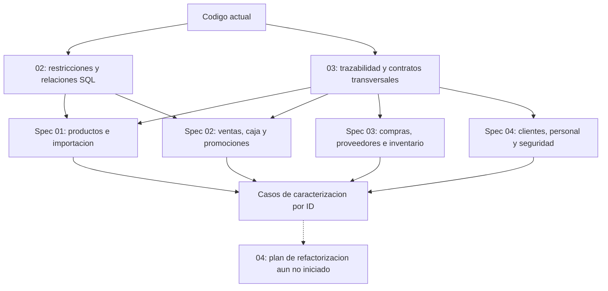
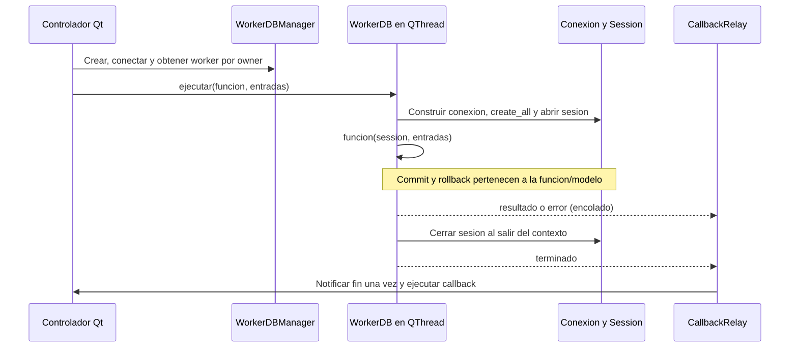

# Especificaciones funcionales SDD: maestro

## 1. Estado, alcance y convenciones

Fecha: 2026-11-10. Fase 3 completada documentalmente en entregas A y B: cuatro specs modulares y 51 casos/contratos. No se inicia Fase 4. Referencias: [contexto](00-indice-y-contexto-ia.md), [arquitectura](01-arquitectura-y-analisis-actual.md) y [diccionario exhaustivo](02-modelo-de-datos.md).

Estas specs describen codigo As-Is mediante lectura estatica, no comportamiento certificado en ejecucion. Cada caso usa identificador estable, actor/permisos, entrada UI/BD, secuencia, transaccion/hilos, excepciones y criterios de caracterizacion. Un criterio de caracterizacion describe lo que comprobar antes de refactorizar; no afirma que exista una prueba automatizada ni convierte un defecto en comportamiento deseado.

- `P-*`: producto/catalogos/importacion (10 casos); `V-*`: venta, caja y promociones (12); `C-*`: compras/proveedores/inventario/reportes (12); `S-*`: clientes/personal/organizacion/seguridad/infraestructura (17). Un caso de ausencia o auxiliar no implica un CRUD implementado.
- Hecho: deriva de un metodo citado. Riesgo: consecuencia posible, no incidente reproducido. Defecto estatico: incompatibilidad localizada entre contratos; sigue pendiente su reproduccion con datos/entorno autorizados.
- UI y BD son contratos diferentes. La nulabilidad inferida de Mapped[T], tipos, FK y defaults exactos se encuentran en el documento 02. Un default de importacion no es un server_default SQL.
- Permisos de menu, restricciones de botones y autorizacion en modelo no son equivalentes. No atribuir un permiso a un metodo solo porque el nombre de la accion se parece al permiso.
- Las anclas de linea de fuentes son orientativas del snapshot. Los identificadores de casos son los destinos estables para nuevas pruebas.
- No se ejecutan Qt, licencia, impresora, instalaciones, migraciones ni escrituras reales para esta revision. Todo el trabajo generado es Markdown en docs/.

## 2. Especificaciones modulares

| Documento | Estado |
| --- | --- |
| [specs/spec-01-productos-e-importacion.md](specs/spec-01-productos-e-importacion.md) | Completado: P-01 a P-10 |
| [specs/spec-02-ventas-caja-y-promociones.md](specs/spec-02-ventas-caja-y-promociones.md) | Completado: V-01 a V-12 |
| [specs/spec-03-compras-proveedores-e-inventario.md](specs/spec-03-compras-proveedores-e-inventario.md) | Completado: C-01 a C-12 |
| [specs/spec-04-clientes-personal-sucursales-y-seguridad.md](specs/spec-04-clientes-personal-sucursales-y-seguridad.md) | Completado: S-01 a S-17 |

La matriz de seccion 5 asigna cada archivo real a casos de las specs existentes. La validacion automatizada comprueba referencias, existencia de casos y simbolos; no interpreta semanticamente todas las ramas ni demuestra pruebas funcionales ejecutadas. Las capacidades solicitadas que no existen se documentan como tales, no se inventan interfaces.

## 3. Trazabilidad por dominio y permisos

Fuente de acceso general: [SistemaPrincipalController.py](../app/Controller/SistemaPrincipalController.py). SistemaPrincipal._cargar_contexto_autorizacion obtiene rol y permisos por usuario; ADMINISTRADOR habilita el acceso global. _tiene_algun_permiso acepta interseccion, no exige todos los permisos del modulo. Si falla la carga, deja conjunto vacio. La navegacion/restriccion UI no protege por si misma un acceso directo a modelos.

| Dominio | Controlador -> modelo | Tablas principales | Permisos de acceso al modulo / observacion |
| --- | --- | --- | --- |
| Productos | ProductosController -> ProductosModel, CategoriasModel, ProveedoresModel | Productos, catalogos, producto_proveedor, Movimientos_inventario | CREARPRODUCTO, MODIFICARPRODUCTO o ELIMINARPRODUCTO; restricciones por accion en el principal; detalle en spec 01 |
| Importacion | ProductosController -> OperacionMasivaCsvController; modelo o ProductoDB directo segun canal | Productos; catalogos por nombre en modal | No hay un permiso semilla exclusivo de importacion; comprobar puerta UI concreta, no asumir autorizacion de modelo |
| Punto de venta | VentaController -> VentasModel, PromocionesModel, ConfiguracionSistemaModel | Ventas, Detalles_ventas, Productos, Movimientos_inventario, Clientes, Metodos_pagos | CREARVENTA para modulo venta |
| Historial de ventas | VentasController -> VentasModel | Ventas, Detalles_ventas, Productos, Clientes, Movimientos_inventario | CREARVENTA, MODIFICARVENTA o ELIMINARVENTA para modulo ventas; revisar botones y metodos en spec 02 |
| Caja | VentaController y dialogos gui -> GestorSesionCaja | SesionCaja, Ventas | No hay permiso semilla APERTURACAJA/CORTECAJA; no inventarlo |
| Promociones | PromocionesController -> PromocionesModel | Promociones, Promocion_productos, Productos | No existe permiso semilla CREARPROMOCION; verificar puerta desde opciones del principal |
| Compras y proveedores | ComprasController, ProveedoresController, Productos_del_Proveedor -> OrdenesDeCompraModel, ProveedoresModel, Proveedores_ProductosModel | Compras, Detalles_compras, Productos, Proveedores, producto_proveedor | Familias COMPRA/PROVEEDOR; C-01 a C-12, recepcion por MODIFICARCOMPRA |
| Clientes | ClientesController -> ClientesFisicosAndMoralesModel, AreaNegocioClientesModel, CategoriasModel | Clientes y subtipos, representantes, categorias y areas | CREARCLIENTE, MODIFICARCLIENTE o ELIMINARCLIENTE; S-03 a S-06 |
| Personal | EmpleadosController, RegistroInicialController -> EmpleadoModel, UsuarioModel, PuestoModel | Empleados, Usuarios, Puestos | CREAREMPLEADO, MODIFICAREMPLEADO o ELIMINAREMPLEADO; S-07/S-08 |
| Organizacion y roles | ControlSucursalesController y editores -> SucursalesModel, DepartamentosModel, PuestoModel, GruposyPermisosModel | Sucursales, Departamentos, Puestos, Roles, Permisos y puentes | Modulo sucursales admite permisos de sucursal/departamento/puesto/grupopermisos; CREARPUESTOS conserva plural |
| Acceso e inicializacion | InicioDeSesionController, VentanaInicialController, RegistroInicialController -> UsuarioModel, GruposyPermisosModel y modelos semilla | Usuarios, Empleados, Roles, Permisos y catalogos | Login no presupone autenticacion previa; S-01/S-02/S-07/S-13 |
| Dashboard | DashboardController -> DashboardModel | Consultas de productos, compras, ventas e inventario | Acceso por cualquiera de los permisos producto/venta/compra configurados en principal; no hay permiso DASHBOARD dedicado |
| Configuracion y pagos | SistemaPrincipalController, MetodosPagoController -> ConfiguracionSistemaModel, MetodoPagoModel | Metodos_pagos; configuracion fiscal fuera de tablas ORM | Opciones usa CREARTRASACCIONES, MODIFICARTRANSACCIONES o ELIMINARTRANSACCIONES (errata real del primero) |

## 4. Catalogo de hilos y contratos transversales

Fuente: [Hilo_consultas.py](../app/Controller/Hilo_consultas.py). Hay dos familias, no un unico lector masivo universal.

| Componente | Entrada, resultado y vida util | Efectos y riesgos |
| --- | --- | --- |
| WorkerDB | ejecutar(funcion, *args, **kwargs), funcion recibe session como primer argumento. QObject movido a QThread; _run se ejecuta al arrancar | Crea Conexion_base_datos dentro del hilo; el constructor ejecuta create_all. No mueve la UI automaticamente al hilo correcto |
| WorkerDB._run | Si el retorno es tuple de longitud 2, emite resultado(data, estado); en otro caso resultado(result, True). Al terminar emite terminado y pide quit | No hace commit automatico. Captura Exception, registra traceback y emite error(str). El cierre de sesion se realiza por el contexto, incluso ante error |
| _CallbackRelay | Slots on_resultado/on_error/on_terminado conectados con QueuedConnection; adapta numero de argumentos con inspect.signature | Notifica terminado_callback una sola vez, antes del callback de resultado/error cuando corresponda. No interpreta payload.exito |
| WorkerDBManager | Singleton/registro por worker_id; create_worker limpia el anterior del mismo owner_id; get/connect/cleanup por owner o global | Owner IDs compartidos entre instancias de ventana pueden interferir. Quit/wait no son cancelacion de una consulta SQL |
| ProcesadorArchivoWorker | ejecutar(documento, productos_existentes), pandas.read_excel(na_filter=False), columnas minimas codigo_upc/nombre_producto | Lee Excel, no BD. Usa lista existente de codigo_barras; convierte invalidos a 0 y prepara diccionarios; emite resultado_productos_masivos_excel(nuevos, duplicados) |
| ProcesadorArchivoWorker._procesar | Omite codigo vacio/nan/none, detecta duplicados contra lista y lote, admite cancelacion por _activo en el bucle | No es el camino activo de los dos metodos de importacion documentados en spec 01, que usan WorkerDB y lector comun. No atribuirle sus mismas validaciones de extras/FK |
| ProcesadorArchivoWorker.detener | _activo=False; quit; wait(1000), terminate si no termina; wait(500); limpia referencias | Terminate forzoso existe; no es una cancelacion cooperativa garantizada de pandas |
| ProcesadorArchivoManager | Registro y wrappers managed para procesador de archivos | Mantiene su propio ciclo de vida; no inicia una transaccion SQL |
| ModalManager / Modal_de_espera | UI de espera coordinada con callbacks | [Ventana_espera.py](../app/Controller/Ventana_espera.py). Cerrar modal no equivale a abortar transaccion |

Un dict con exito=False puede viajar como segundo argumento True. El consumidor debe inspeccionar el contrato particular. Tambien hay retornos de tres elementos de modelos (objeto, exito, mensaje); no se desempaquetan como el tuple de dos del worker si se retornan directamente. Los controladores suelen envolverlos en dict.

## 5. Inventario de cobertura por archivo

Todas las entradas siguientes son referencias reales a los 42 app/Controller/*.py y 23 app/Model/*.py, incluidos inicializadores y auxiliares. Cada fila tiene destino funcional o contrato transversal por ID; los cuatro documentos tambien referencian las fuentes directamente. No se equipara cobertura documental por archivo a cobertura de tests de cada metodo. Los casos con capacidades ausentes y archivos comentados explican expresamente esa condicion.

### 5.1 Controladores

| Archivo | Responsabilidad documentada | Casos |
| --- | --- | --- |
| [__init__.py](../app/Controller/__init__.py) | Inicializador sin logica de negocio | S-17 |
| [AjustarCajaOpcionesGlobal.py](../app/Controller/AjustarCajaOpcionesGlobal.py) | Combo y borrado contextual delegado, no solo estilo | S-17 |
| [AreaNegocioClientesController.py](../app/Controller/AreaNegocioClientesController.py) | Alta interactiva de area | S-06 |
| [CantidadProductosComprasController.py](../app/Controller/CantidadProductosComprasController.py) | Cantidad temporal y Signal(int) | C-01 |
| [CategoriasController.py](../app/Controller/CategoriasController.py) | Categorias de producto, proveedor y cliente | P-06, C-06, S-03 |
| [ClientesController.py](../app/Controller/ClientesController.py) | CRUD, credito e importaciones por subtipo | S-03, S-04, S-05, S-06 |
| [CodificarPasswordController.py](../app/Controller/CodificarPasswordController.py) | Hash bcrypt | S-02, S-07 |
| [ComprasController.py](../app/Controller/ComprasController.py) | Orden, consulta, baja y recepcion | C-01, C-02, C-03, C-04, C-05 |
| [ComprobarValoresTablasController.py](../app/Controller/ComprobarValoresTablasController.py) | None a vacio, sin persistencia | S-17 |
| [ControlSucursalesController.py](../app/Controller/ControlSucursalesController.py) | Contenedor de organizacion/roles | S-09, S-13 |
| [CreadencialesUsuarioController.py](../app/Controller/CreadencialesUsuarioController.py) | Verificacion de credenciales | S-02 |
| [DashboardController.py](../app/Controller/DashboardController.py) | Tabs, filtros, Plotly y CSV | C-11 |
| [DepartamentosController.py](../app/Controller/DepartamentosController.py) | CRUD y sucursales M:M | S-10 |
| [EmpleadosController.py](../app/Controller/EmpleadosController.py) | Consulta, editor y baja fisica | S-08 |
| [favicon.py](../app/Controller/favicon.py) | Icono/recurso sin caso de negocio | S-17 |
| [FuncionesAuxiliares.py](../app/Controller/FuncionesAuxiliares.py) | Imagen, texto, combos y geometria | P-04, S-17 |
| [Hilo_consultas.py](../app/Controller/Hilo_consultas.py) | Catalogo de seccion 4 y contrato transversal | S-17 |
| [InicioDeSesionController.py](../app/Controller/InicioDeSesionController.py) | Login y saludo | S-02 |
| [MensajesAlertasController.py](../app/Controller/MensajesAlertasController.py) | Mensajes Qt y APIs ausentes | S-17 |
| [MetodosPagoController.py](../app/Controller/MetodosPagoController.py) | Alta y operaciones pass | V-12, C-12 |
| [OperacionMasivaCsvController.py](../app/Controller/OperacionMasivaCsvController.py) | Lector/normalizacion compartidos | P-07, P-08, P-09, C-08, S-05, S-06 |
| [PerfilUsuarioController.py](../app/Controller/PerfilUsuarioController.py) | Consulta protegida por password, no cambio de clave | S-14 |
| [PresentacionProductosController.py](../app/Controller/PresentacionProductosController.py) | Alta/baja de presentacion | P-06 |
| [Productos_del_Proveedor.py](../app/Controller/Productos_del_Proveedor.py) | Asociaciones, filtros, precio y desvinculacion | C-09 |
| [ProductosController.py](../app/Controller/ProductosController.py) | CRUD, importacion y stock manual | P-01, P-02, P-03, P-04, P-05, P-08, P-09, P-10 |
| [PromocionesController.py](../app/Controller/PromocionesController.py) | Editor y selector de productos | V-04 |
| [ProveedoresController.py](../app/Controller/ProveedoresController.py) | CRUD e importacion | C-06, C-07, C-08 |
| [PuestosController.py](../app/Controller/PuestosController.py) | Jornada/horarios, no asistencia | S-11 |
| [PurchaseOrderPDF.py](../app/Controller/PurchaseOrderPDF.py) | PDF y paginas de orden | C-02 |
| [RegistroInicialController.py](../app/Controller/RegistroInicialController.py) | Primer registro y mantenimiento de personal | S-07, S-08 |
| [RolesController.py](../app/Controller/RolesController.py) | Solo codigo comentado, sin clase activa | S-13 |
| [RolesPermisosController.py](../app/Controller/RolesPermisosController.py) | ControlRolesController | S-13 |
| [SistemaPrincipalController.py](../app/Controller/SistemaPrincipalController.py) | Navegacion, permisos, fiscal e impresora | S-13, S-16, V-12 |
| [SucursalesController.py](../app/Controller/SucursalesController.py) | CRUD de sucursales | S-09 |
| [UiTheme.py](../app/Controller/UiTheme.py) | Estilo, foco y ventanas, sin SQL | S-17 |
| [UnidadMedidaProductosController.py](../app/Controller/UnidadMedidaProductosController.py) | Alta de unidad y limites de mantenimiento | P-06 |
| [Validaciones.py](../app/Controller/Validaciones.py) | Validadores de captura, no reglas de BD | S-17, P-02, S-07 |
| [VentaController.py](../app/Controller/VentaController.py) | POS y caja | V-01, V-02, V-03, V-05, V-06, V-07, V-08, V-09 |
| [Ventana_espera.py](../app/Controller/Ventana_espera.py) | Espera no implica cancelacion | S-17 |
| [VentanaInicialController.py](../app/Controller/VentanaInicialController.py) | Bienvenida/semillas sin credenciales fijas | S-01, S-07 |
| [VentasController.py](../app/Controller/VentasController.py) | Historial, edicion y cancelacion | V-10 |
| [VentaTicketPrinter.py](../app/Controller/VentaTicketPrinter.py) | PDF y despacho de ticket | V-11 |

### 5.2 Modelos

| Archivo | Responsabilidad documentada | Casos |
| --- | --- | --- |
| [__init__.py](../app/Model/__init__.py) | Inicializador sin logica de negocio | S-17 |
| [AbstractTableModel.py](../app/Model/AbstractTableModel.py) | Adaptacion de tablas y edicion en memoria | S-17 |
| [AreaNegocioClientesModel.py](../app/Model/AreaNegocioClientesModel.py) | Alta/consulta, retornos y errores | S-06 |
| [BaseDatosModel.py](../app/Model/BaseDatosModel.py) | Restricciones, herencia e identidades; diccionario 02 | C-05, S-03, S-11, S-12 |
| [CategoriasModel.py](../app/Model/CategoriasModel.py) | Catalogos por tipo y acceso defectuoso por ID | P-06, C-06, S-03 |
| [ClientesFisicosAndMoralesModel.py](../app/Model/ClientesFisicosAndMoralesModel.py) | CRUD por subtipo, representantes y credito | S-03, S-04, S-05, S-06 |
| [ConfiguracionSistemaModel.py](../app/Model/ConfiguracionSistemaModel.py) | JSON fiscal/impresora, no tabla | V-12, S-16 |
| [Convertir_a_diccionariosModel.py](../app/Model/Convertir_a_diccionariosModel.py) | Serializacion de columnas/relaciones | S-17 |
| [DashboardModel.py](../app/Model/DashboardModel.py) | Saldos actuales, movimientos y montos estimados | C-11 |
| [DepartamentosModel.py](../app/Model/DepartamentosModel.py) | CRUD y relaciones M:M | S-10 |
| [EmpleadoModel.py](../app/Model/EmpleadoModel.py) | Personal, baja/alta y credenciales | S-07, S-08 |
| [GruposyPermisosModel.py](../app/Model/GruposyPermisosModel.py) | Semillas, rol de usuario y mantenimiento | S-01, S-13 |
| [MetodoPagoModel.py](../app/Model/MetodoPagoModel.py) | Catalogo compartido de pagos | V-12, C-12 |
| [OrdenesDeCompraModel.py](../app/Model/OrdenesDeCompraModel.py) | Cabecera/detalles por UPC, recepcion y baja | C-01, C-02, C-03, C-04, C-05 |
| [ProductosModel.py](../app/Model/ProductosModel.py) | Catalogo, CRUD y movimientos | P-01, P-02, P-03, P-05, P-06, P-10, C-10 |
| [PromocionesModel.py](../app/Model/PromocionesModel.py) | Persistencia y calculadora de beneficios | V-04, V-05 |
| [Proveedores_ProductosModel.py](../app/Model/Proveedores_ProductosModel.py) | Asociacion/precio y consultas del comprador | C-01, C-09 |
| [ProveedoresModel.py](../app/Model/ProveedoresModel.py) | CRUD, filtros y vinculo persistente | C-06, C-07, C-09 |
| [PuestoModel.py](../app/Model/PuestoModel.py) | Jornada/horarios y desvincular empleados al borrar | S-11 |
| [RepresentanteProveedorModel.py](../app/Model/RepresentanteProveedorModel.py) | Alta y retorno ID en edicion | C-06, C-07 |
| [SucursalesModel.py](../app/Model/SucursalesModel.py) | CRUD y defectos de tuplas | S-09 |
| [UsuarioModel.py](../app/Model/UsuarioModel.py) | Hash/credenciales, asignacion y lectura de perfil | S-02, S-07, S-08, S-14 |
| [VentasModel.py](../app/Model/VentasModel.py) | Venta, credito, stock y cancelacion | V-01, V-06, V-07, V-10 |

## 6. Puertas de verificacion

Antes de cerrar cada entrega: comparar por AST el inventario glob de controladores/modelos contra referencias reales del maestro y specs; validar simbolos de los casos nuevos, columnas de importacion y listas de permisos contra fuente; revisar enlaces/anclas y cierre de Mermaid. El control de referencias debe incluir inicializadores, archivos sin clase y auxiliares, sin confundirlos con casos de negocio.

Las cuatro specs estan enlazadas. El cierre B valida la matriz por archivo y exige que cada ID asignado exista en el documento modular correspondiente; tambien que todas las fuentes del inventario esten referenciadas directamente por las specs. Es un control estructural de cobertura documental, no una prueba semantica de completitud de cada rama.

Los escenarios de regresion propuestos en las specs requieren pruebas aisladas y datos de prueba. Esta entrega no agrega tests ejecutables ni modifica funcionalidad o esquema.

Resultado del inventario de cierre: 42 controladores y 23 modelos (65 total), asignados a 51 casos/contratos en las cuatro specs. Se cotejan por AST las columnas validas/requeridas de productos principal/modal, proveedores y clientes fisicos/morales; los simbolos de los nuevos casos, ausencia de capacidades solicitadas, enlaces/anclas y bloques Mermaid. El render visual y las pruebas de caracterizacion quedan pendientes; Fase 4 requiere autorizacion posterior.

## 7. Deltas de implementacion posteriores (2026-11-18)

Los siguientes cambios estan implementados y probados; actualizan el contrato descrito en las specs sin reescribir su evidencia historica:

- **Tema global:** `UiTheme` fuerza texto negro en campos editables, da fondo blanco a spinboxes/tiempos/fechas y estiliza los popups de picklists. Ver [guia UI/UX seccion16](05-guia-ui-ux-y-paleta.md#16-incremento-de-estilos-de-captura-y-picklists-2026-11-18).
- **Alta de producto:** picklists de Categoria/Presentacion/Unidad con ancho estandar220 y fila reorganizada. Ver [delta spec01](specs/spec-01-productos-e-importacion.md#delta-de-interfaz-del-alta-de-producto-2026-11-18).
- **Compras:** compra directa sin proveedor mediante proveedor interno reservado, busqueda por catalogo y costo final; orden PENDIENTE y recepcion existente. Ver [delta spec03](specs/spec-03-compras-proveedores-e-inventario.md#14-compra-directa-sin-proveedor-2026-11-18).
- **Datos:** proveedor reservado creado bajo demanda, oculto y protegido; sin migracion ni cambio de nulabilidad. Ver [modelo de datos 6.2](02-modelo-de-datos.md#62-proveedor-reservado-de-compras-directas-2026-11-18).

Pruebas de referencia: `tests/test_theme_fields_and_popups.py`, `tests/test_purchase_direct_supplier.py`, mas regresion Qt/unit de productos, compras, proveedores y estabilizacion ejecutada con `-p pytestqt.plugin`. No se reejecutaron gates PostgreSQL ni build instalable.