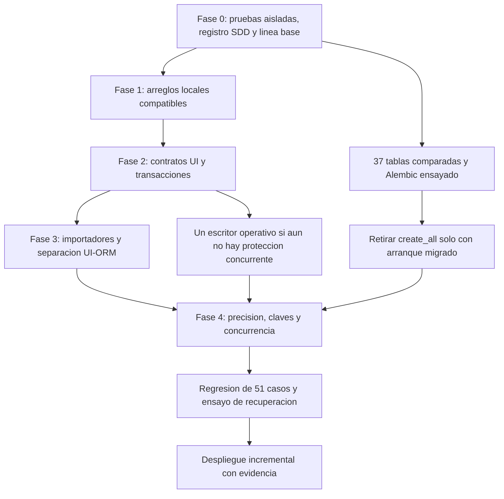
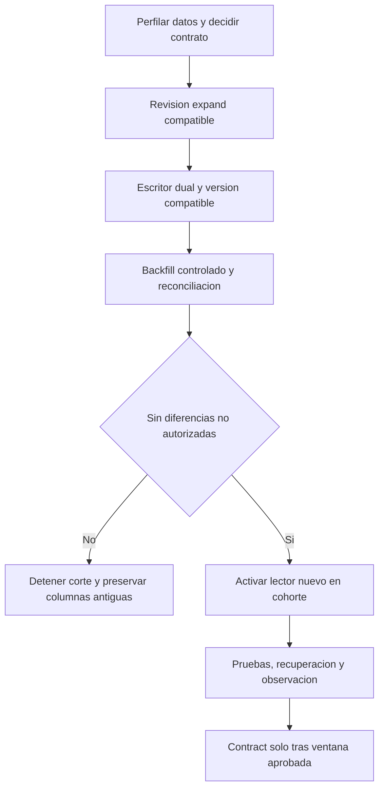

# Plan de refactorizacion incremental SDD

## Cierre de cinco incidencias autorizadas

Incremento acotado: imagenes P-02/P-03/P-04 (REF-10), captura Clientes S-03/S-04 (REF-22), arranque S-01 (REF-15), geometria del modal de precio y comprobacion de actualizaciones. No implementa otros REFs, migraciones ni nuevas reglas financieras. Contratos y limites quedan en [spec productos](specs/spec-01-productos-e-importacion.md), [spec proveedores](specs/spec-03-compras-proveedores-e-inventario.md) y [spec clientes/acceso](specs/spec-04-clientes-personal-sucursales-y-seguridad.md).

[ActualizadorRemotoModel.py](../app/Model/ActualizadorRemotoModel.py) acepta tags estables vX.Y.Z y X.Y.Z y normaliza a vX.Y.Z. Conserva instalador canonico TuleVenta-Update-vX.Y.Z-windows-x64.exe, SHA256, unicidad, tamano y validacion de URLs/redirects. [tests/test_auto_updater.py](../tests/test_auto_updater.py) caracteriza el rechazo del tag sin prefijo y valida ambos sin relajar las pruebas de seguridad.

Validacion ejecutada con PYTHONDONTWRITEBYTECODE=1 y .venv/Scripts/python.exe: `-m pytest -q -m unit`: 480 passed; `-m pytest -q -m qt -p pytestqt.plugin`: 463 passed y dos errores de setup por falta de destino SQL (no conecto). El mismo gate Qt mediante `tests/run_postgres_ephemeral.py -q -m qt -p pytestqt.plugin`: 465 passed con PostgreSQL temporal explicito, detenido y eliminado. Aviso existente de SQLAlchemy declarative_base; no es fallo de las correcciones.

Rollback: revertir exclusivamente este incremento de fuente, pruebas y documentacion; no requiere revertir datos ni DDL. Pendiente: comprobacion manual de instalacion Windows, DPI y paquete frozen real. Qt simulado no demuestra esa distribucion; la suite SQL aqui no certifica todos los escritores ni concurrencia global.

## Evidencia SQL real de cuatro modulos (2026-11-12)

### Auditoria de consumidores DTO 2026-11-12

Dictamen Proveedores/Productos del Proveedor/Compras: NO100% global. El AttributeError manual de Manejar Precio demuestra un hueco de cobertura seleccion->boton->modal; no invalida escenarios SQL focalizados aprobados.

Incremento C-09/REF-32/34/36: seleccion vacia controlada, proveedor del editor sin ORM en AsociacionProveedorDTO, precio actual del par, modal reemplazado al cambiar producto, consulta exacta unica y refresco/cierre solo tras precio confirmado con fallo seguro. [Pruebas](../tests/test_suppliers_vertical.py):8 regresiones Qt nuevas y1 integracion escaneo Compras->DTO->tabla real, con UPC/dedupe intactos. [Matriz auditada](specs/spec-03-compras-proveedores-e-inventario.md#auditoria-dto-y-manejar-precio-2026-11-12) e [integracion Productos](specs/spec-01-productos-e-importacion.md#auditoria-de-integracion-proveedor-y-compras-2026-11-12).

Pendiente: receive_purchase_order lee PENDIENTE/stock sin locks ni actualizacion condicional (REF-40); serial SQL no certifica dos recepciones concurrentes. WindowEditarOrdenCompra sigue pass; delete_purchase_order borra sin reverso y update_purchase_order conserva commit interno legacy. REF-37/provisionamiento/migraciones, autorizacion integral, PDF/empaquetado no concluidos. No se cambia politica de anulacion, stock/costos, esquema ni datos para simular cierre.

Evidencia final con PYTHONDONTWRITEBYTECODE=1: unit424 y Qt338 aprobadas,521 enlaces/anclas sin errores. Diagnosticos y diff --check focalizado sin errores. Comandos en la spec de auditoria; warning legacy declarative_base conservado. Sin nueva ejecucion PostgreSQL/DDL ni commits. Recuperacion por hunks propios y9 tests, preservando lotes/worktree ajeno. Resultados posteriores conservan fechas y alcance historicos, no certifican todas las superficies actuales.

Este incremento posterior sustituye los gates SQL pendientes **solo para los escenarios ensayados**; las notas de lotes anteriores conservan su estado historico. Sin cambios de codigo productivo, reglas, configuracion habitual ni migraciones.

Comando: `PYTHONDONTWRITEBYTECODE=1 .venv/Scripts/python.exe tests/run_postgres_ephemeral.py`. El [ejecutor](../tests/run_postgres_ephemeral.py) provisiona PostgreSQL **18.4** portable con initdb/pg_ctl, directorio temporal, puerto libre en 127.0.0.1, BD dedicada y rol sin SUPERUSER/CREATEDB/CREATEROLE; ejecuta `.venv/Scripts/python.exe -m pytest -q -m db --tb=short` con autorizacion explicita del destino. Firewall, JSON y esquemas UUID del fixture se mantienen. Resultado final: **36 passed, 712 deselected, 1 warning**, 26.60 s; warning legacy de declarative_base. Detencion fast y eliminacion del directorio confirmadas tras exito y tambien tras el ensayo inicialmente fallido por fixture moral incompleto.

| Modulo / REF / casos | Evidencia PostgreSQL real |
| --- | --- |
| 1 / REF-21/24/25 / P-02/P-03/P-08/P-09 | 18 variantes de alta/edicion n-1/n/n+1 en seis campos, rechazo sin truncar, UPC de edicion inmutable; pares producto_proveedor insertados/eliminados, precio existente conservado y rollback; lote modal exitoso y FK invalida en segunda fila revierte productos/catalogos |
| 2 / REF-17..20 / V-07/V-09/V-10 | Contado/credito con una Session y un commit, cabecera/detalles/stock/movimientos/credito/caja relectos desde otra Session; CHECK de test provoca fallo despues de mutar y deja cero efectos; cancelacion repone saldos/stock y segundo intento serial no duplica stock |
| 3 / REF-25/29 / C-01/C-04/C-07 | Alta de compra con detalle por UPC, recepcion fraccionaria 0.125, estado/stock/movimiento durables; FK de usuario invalido revierte recepcion; segunda recepcion rechazada; lote de proveedores con duplicado/entrada invalida y CHECK tardio revierte lote |
| 4 / REF-25/30/31 / S-03/S-05/S-06/S-07/S-08/S-10 | Fisico/moral: segunda conexion inserta duplicado tras snapshot inicial; savepoint elimina catalogos/representante de fila descartada sin perder filas vecinas; fallo CHECK tecnico revierte lote completo; alta/edicion de personal y sincronizacion departamento-sucursales con relectura y rollback FK |

Pruebas: [test_modules_postgres.py](../tests/test_modules_postgres.py), 34 escenarios nuevos, mas dos de infraestructura existentes. Reproduccion y aislamiento en [tests/README.md](../tests/README.md). Se crea metadata ORM unicamente en esquemas desechables; esto no prueba equivalencia con instalaciones ni linea base/upgrade/downgrade Alembic (REF-03/04). REF-39/40, locks, carreras generales de stock/credito/caja, edicion de ventas, commit de resultado incierto, permisos de dominio, SQL en workers/cierre, impresion, render y empaquetado siguen no verificados. El duplicado tardio reproducible no demuestra unicidad SQL de clientes ni seguridad multiusuario. Los 712 unit/Qt previos no se reejecutaron en este incremento.

Rollback: retirar solo estos tests/ejecutor y evidencia si se revierte el incremento; no hay datos habituales ni migracion que deshacer. Una terminacion forzosa puede impedir finally: revisar exclusivamente el directorio temporal anunciado y detener ese cluster por su `-D`, nunca por nombre de proceso ni sobre la instalacion habitual. Validacion documental mediante `PYTHONDONTWRITEBYTECODE=1 .venv/Scripts/python.exe tests/check_docs_links.py`: **502 enlaces locales, 0 errores**; enlaces/AST no certifican comportamiento adicional ni render.

## 1. Estado, evidencia y regla de seguridad

Fecha: 2026-11-10. Estado: plan tecnico entregado; ninguna tarea REF esta implementada por este documento. La Fase 4 documental no es la Fase 4 de ejecucion interna descrita mas abajo. No se modifican Python, configuracion, dependencias, esquema ni datos en esta entrega. No se garantiza continuidad por declaracion: la evidencia para cada despliegue sera su puerta de pruebas, ensayo y recuperacion.

Fuentes exclusivas de diagnostico: [arquitectura As-Is](01-arquitectura-y-analisis-actual.md), [datos](02-modelo-de-datos.md), [spec de productos](specs/spec-01-productos-e-importacion.md), [ventas/caja/promociones](specs/spec-02-ventas-caja-y-promociones.md), [compras/proveedores/inventario](specs/spec-03-compras-proveedores-e-inventario.md) y [clientes/personal/seguridad](specs/spec-04-clientes-personal-sucursales-y-seguridad.md). Los enlaces a fuentes Python son anclas de esos hallazgos, no una nueva auditoria ni prueba de reproduccion.

### Lote 2: cierre local de Modulo 4 (2026-11-12)

Remate autorizado completado en codigo y regresiones locales. [Tabla de cierre, deltas y gates en Spec 04](specs/spec-04-clientes-personal-sucursales-y-seguridad.md#lote-2-cierre-local-del-modulo-4-2026-11-12). No equivale a cierre global de REFs compartidos ni a certificar persistencia/concurrencia PostgreSQL o los 17 casos completos.

| REF | Cierre del incremento local |
| --- | --- |
| REF-22/23 | Contratos de entradas/catalogos, FK/placeholder y numeros; cambio Qt validado; regresion bcrypt legacy compatible sin relajar altas/cambios |
| REF-25 | Errores tecnicos propagados en los seis modelos; asociaciones por IDs en sesion propia, coordinador con commit/rollback; ausencias y callbacks sin falso exito |
| REF-30/31 sobre REF-27 | Savepoint por fila y cache condicionada al exito; duplicado tardio/error de entrada aislado, fallo tecnico revierte lote |
| REF-35/36 | DTO administrativos/perfil/login y payloads de altas; capturas previas al worker, owners/limpieza por instancia conservados |

Gates con `PYTHONDONTWRITEBYTECODE=1`: `.venv/Scripts/python.exe -m pytest -q -m unit` **392 passed**; `.venv/Scripts/python.exe -m pytest -q -m qt -p pytestqt.plugin` **320 passed**. Evidencia en [test_module4_clients.py](../tests/test_module4_clients.py) y [test_phase1_access.py](../tests/test_phase1_access.py). SQL real, Session.new/dirty efectiva, carreras, constraints, relectura tras rollback, migraciones y smoke siguen bloqueados/no verificados. Ningun PostgreSQL/DDL ni commit. Recuperacion: artefacto de codigo previo, preservar trabajo ajeno; sin migracion de datos/esquema.

Gate documental del Lote 2: `PYTHONDONTWRITEBYTECODE=1 .venv/Scripts/python.exe tests/check_docs_links.py`: **491 enlaces, 0 errores**. Esta comprobacion estructural no certifica SQL ni renderizado.

### Incremento vertical de Modulo 4

Esta seccion conserva el **estado historico del Lote 1**, que no cerraba Modulo 4 ni los REFs globales. Su tabla de pendientes previa al remate se mantiene en [Spec 04](specs/spec-04-clientes-personal-sucursales-y-seguridad.md#incremento-vertical-de-modulo-4-evidencia-y-pendientes); el cierre local posterior se registra arriba.

- REF-22/23: limites/validacion de longitudes y politica aprobada de nuevas claves (12 caracteres, 72 bytes UTF-8, sin espacios exteriores); quedan validadores/canales de cambio y regresion explicita de login legacy.
- REF-25: coordinadores y modelos migrados de clientes y parte de organizacion; quedan retornos absorbidos y alta/asociaciones de departamento/usuario/empleado por revisar.
- REF-30/31 sobre REF-27: lector comun, reporte por fila y commit unico en ambas importaciones; quedan efectos de duplicado tardio, presentacion detallada y ensayo atomico PostgreSQL.
- REF-35/36: DTO de clientes/personal, pagina capturada y siete controladores con owners por instancia/cierre al ocultar; adaptadores administrativos disponibles, otros consumidores/perfil pendientes.

Evidencia: [137 pruebas focalizadas](../tests/test_module4_clients.py); `PYTHONDONTWRITEBYTECODE=1 .venv/Scripts/python.exe -m pytest -q -m unit`: **339 passed**; `PYTHONDONTWRITEBYTECODE=1 .venv/Scripts/python.exe -m pytest -q -m qt -p pytestqt.plugin`: **297 passed**. Sin SQL real/DDL, Alembic, despliegue ni commit. Los tests simulados no autorizan afirmar persistencia, concurrencia, recuperacion de datos ni cobertura total S-01 a S-17. Recuperacion de codigo: artefacto previo, sin revertir trabajo ajeno; no hay migracion que revertir. S-12/S-16 siguen siendo ausencia caracterizada, no nuevas capacidades.

### Principios

1. Antes de cambiar un camino productivo, ejecutar su caracterizacion As-Is en entorno aislado. Para defectos conocidos, conservar fixture y prueba de regresion del resultado correcto; no convertir False silencioso o dato corrupto en el comportamiento deseado. Registrar cambio correctivo autorizado y delta respecto de la spec.
2. Cada REF es un resultado acotado y revisable. Si exige varias pantallas/columnas, repetir la tarea por consumidor o cohorte explicitamente elegida, con verificacion entre iteraciones; no hacer una reescritura masiva bajo un solo ID. Un PR no mezcla cambio de parser, algoritmo fiscal y esquema.
3. Mantener el sistema ejecutable al terminar cada iteracion: imports, firma publica compatible o adaptador, prueba del caso, fallo recuperable y smoke de UI afectada. No cambiar SQL instalado hasta tener linea base Alembic y migracion ensayada. No retirar DDL automatico antes de tener sustituto operativo.
4. Cualquier cambio de reglas observables (rechazar negativos, saldo/caja, longitud permitida, atomicidad del importador o autenticacion de inactivo) requiere criterio To-Be aprobado y prueba. Se conserva el resto del caso As-Is y se actualiza la spec sin borrar la evidencia historica del defecto.
5. Una sesion por unidad de trabajo y por hilo; un propietario de commit/rollback. El wrapper legacy puede seguir confirmando hasta que sus consumidores migren. No introducir una transaccion exterior mientras un metodo interior aun confirma inesperadamente.
6. Usar lo existente: lector comun, modelos por dominio, metadata y WorkerDB. No introducir microservicios, CQRS, bus de eventos ni repositorios genericos para todos los CRUD. Extraer una funcion/servicio concreto solo cuando tiene una responsabilidad verificable.
7. Datos financieros e inventario requieren PostgreSQL real de prueba, pruebas de fallos y dos conexiones para carreras. AST verifica estructura, nombres y columnas; no prueba un commit, la API Qt, FK efectiva, bloqueo ni exactitud financiera.
8. Recuperacion primero: para codigo compatible, volver al artefacto anterior sin perder datos nuevos. Para cambios irreversibles o cuantizados, no prometer downgrade sin perdida; mantener columnas antiguas durante expand/contract o restaurar respaldo ensayado en ventana sin escrituras. La aplicacion hoy no trae un mecanismo de respaldo verificado (S-16).

### Red de seguridad de 51 casos

El registro de caracterizacion debe tener una entrada por ID con fixture, tipo de prueba, comando, resultado esperado As-Is, delta autorizado, responsable y ultima evidencia. No basta con que el nombre del archivo contenga el ID ni con declarar 51 tests vacios. Un caso amplio tiene variantes positivas/negativas/concurrencia segun su spec; el numero de casos no es un objetivo de numero de tests.

| Familia | IDs del registro obligatorio | Prueba principal |
| --- | --- | --- |
| Productos | P-01, P-02, P-03, P-04, P-05, P-06, P-07, P-08, P-09, P-10 | Consultas y CRUD en PostgreSQL, fixtures CSV/XLSX, Qt para captura y senales |
| Venta/caja/promociones | V-01, V-02, V-03, V-04, V-05, V-06, V-07, V-08, V-09, V-10, V-11, V-12 | Calculos deterministas, rollback, saldo, impresion simulada y carreras |
| Compras/proveedores | C-01, C-02, C-03, C-04, C-05, C-06, C-07, C-08, C-09, C-10, C-11, C-12 | Detalles por UPC, recepcion, vinculacion, informes y fallos de lote |
| Clientes/seguridad | S-01, S-02, S-03, S-04, S-05, S-06, S-07, S-08, S-09, S-10, S-11, S-12, S-13, S-14, S-15, S-16, S-17 | Herencia, credito, permisos, archivos/entorno aislados y auxiliares |

S-12 caracteriza la ausencia de Asistencias y la diferencia Turnos/caja, no un CRUD ficticio. S-16 documenta que respaldo y restauracion no estan implementados como modulo de la aplicacion. S-17 incluye archivos sin reglas de negocio propias. Mantener esos contratos no obliga a crear esas funcionalidades durante el refactor.

### Hoja de ruta y dependencias



No se espera a la ultima fase para reconocer una carrera P1: hasta REF-40, evitar escritores simultaneos mediante restriccion operativa comprobable o adelantar esa tarea. Un mutex de proceso no protege varias instancias. Una tarea posterior puede adelantarse si sus dependencias y pruebas estan satisfechas; fase y prioridad son dimensiones distintas.

## 2. Matriz de priorizacion

Prioridad solicitada: P0 = ruptura en ejecucion/tipo corrupto; P1 = integridad/transaccion; P2 = desacoplamiento/duplicacion; P3 = evolucion de esquema/arquitectura. P3 no significa que una carrera de stock sea leve: REF-40 es P1 aun estando en la fase de concurrencia. Impacto A/M/B = alto/medio/bajo; esfuerzo S/M/L = estimacion relativa (hasta1, 2-3 o 4-6 jornadas de trabajo y pruebas por iteracion), no compromiso sin entorno ni datos. En fase0 se hacen habilitadores necesarios aunque tengan etiqueta P3.

Todas las tareas empiezan pendientes. La columna fuente contiene archivos actuales; destinos nuevos de servicios/pruebas se elegiran al ejecutar y no se presentan como ya existentes.

| ID | Fase | Prioridad y severidad | Impacto | Esfuerzo | Fuente principal | Casos SDD |
| --- | --- | --- | --- | --- | --- | --- |
| REF-01 | 0 | P1: pruebas sin tocar datos reales | A | M | [conexionBD.py](../app/DataBase/conexionBD.py) | S-16, S-17 |
| REF-02 | 0 | P1: regresion no caracterizada | A | L | [maestro SDD](03-especificaciones-funcionales-sdd.md) | P-01, V-07, C-04, S-07 |
| REF-03 | 0 | P3: sin linea base migrable | A | L | [env.py](../alembic/env.py), [BaseDatosModel.py](../app/Model/BaseDatosModel.py) | S-01, S-16 |
| REF-04 | 0 | P3: DDL por conexion | A | M | [conexionBD.py](../app/DataBase/conexionBD.py), [PromocionesModel.py](../app/Model/PromocionesModel.py) | S-01, S-16, V-04 |
| REF-05 | 1 | P0: str recibe tupla | A | S | [SucursalesModel.py](../app/Model/SucursalesModel.py) | S-09 |
| REF-06 | 1 | P0: API de mensaje ausente | M | S | [MetodosPagoController.py](../app/Controller/MetodosPagoController.py) | V-12, C-12, C-01 |
| REF-07 | 1 | P0: conexion a atributo ausente | M | S | [ComprasController.py](../app/Controller/ComprasController.py) | C-03 |
| REF-08 | 1 | P0: retorno escalar desempaquetado | A | S | [RepresentanteProveedorModel.py](../app/Model/RepresentanteProveedorModel.py), [ProveedoresController.py](../app/Controller/ProveedoresController.py) | C-07 |
| REF-09 | 1 | P0: tupla falsa interpretada como exito | A | M | [ProveedoresController.py](../app/Controller/ProveedoresController.py), [SucursalesController.py](../app/Controller/SucursalesController.py), [Productos_del_Proveedor.py](../app/Controller/Productos_del_Proveedor.py) | C-07, C-09, S-09 |
| REF-10 | 1 | P0: None frente a NOT NULL de imagen | A | S | [ProductosController.py](../app/Controller/ProductosController.py), [ProductosModel.py](../app/Model/ProductosModel.py) | P-02, P-03, P-04, P-09 |
| REF-11 | 1 | P0: .id sobre catalogo ausente | A | S | [ProductosController.py](../app/Controller/ProductosController.py) | P-02, P-03, P-06, P-09 |
| REF-12 | 1 | P1: atribucion de inventario incorrecta | A | S | [ProductosController.py](../app/Controller/ProductosController.py) | P-10, C-10 |
| REF-13 | 1 | P2: declaraciones repetidas | M | S | [BaseDatosModel.py](../app/Model/BaseDatosModel.py) | S-11 |
| REF-14 | 1 | P2: semilla duplicada | B | S | [ProductosModel.py](../app/Model/ProductosModel.py) | P-06, S-01 |
| REF-15 | 1 | P0: error de BD parece primer uso | A | S | [inicio.py](../inicio.py) | S-01 |
| REF-16 | 1 | P1: contexto de login incompleto/inactivo | A | M | [CreadencialesUsuarioController.py](../app/Controller/CreadencialesUsuarioController.py), [InicioDeSesionController.py](../app/Controller/InicioDeSesionController.py) | S-02, S-08 |
| REF-17 | 2 | P1: commit de quien recibe sesion | A | M | [VentasModel.py](../app/Model/VentasModel.py), [sesion_caja.py](../sesion_caja.py) | V-07, V-08, V-09, V-10 |
| REF-18 | 2 | P1: credito contado como efectivo | A | M | [sesion_caja.py](../sesion_caja.py), [VentaController.py](../app/Controller/VentaController.py) | V-06, V-09, V-12 |
| REF-19 | 2 | P1: venta y caja en commits separados | A | L | [VentaController.py](../app/Controller/VentaController.py), [VentasModel.py](../app/Model/VentasModel.py), [sesion_caja.py](../sesion_caja.py) | V-06, V-07, V-09, V-11 |
| REF-20 | 2 | P1: cancelacion/edicion desajusta caja | A | L | [VentasModel.py](../app/Model/VentasModel.py), [VentasController.py](../app/Controller/VentasController.py) | V-09, V-10 |
| REF-21 | 2 | P1: longitudes de producto divergentes | A | M | [ProductosController.py](../app/Controller/ProductosController.py), [UI_AGREGARPRODUCTO.py](../app/View/UserInterfacePy/UI_AGREGARPRODUCTO.py) | P-01, P-02, P-03, P-08, P-09 |
| REF-22 | 2 | P1: captura administrativa incompatible | A | M | [UI_CONTROL_CLIENTES.py](../app/View/UserInterfacePy/UI_CONTROL_CLIENTES.py), [ProveedoresController.py](../app/Controller/ProveedoresController.py), [CategoriasController.py](../app/Controller/CategoriasController.py) | C-06, C-08, S-03, S-05, S-06, P-06 |
| REF-23 | 2 | P1: password truncable y contrato desigual | A | M | [RegistroInicialController.py](../app/Controller/RegistroInicialController.py), [UsuarioModel.py](../app/Model/UsuarioModel.py) | S-02, S-07, S-08, S-14 |
| REF-24 | 2 | P1: asociaciones viewonly no persisten | A | M | [ProductosModel.py](../app/Model/ProductosModel.py), [Proveedores_ProductosModel.py](../app/Model/Proveedores_ProductosModel.py) | P-02, P-03, C-09 |
| REF-25 | 2 | P1: fallos pierden causa y estado | A | M | [ProductosModel.py](../app/Model/ProductosModel.py), [CategoriasController.py](../app/Controller/CategoriasController.py) | P-01, P-02, P-06, S-03 |
| REF-26 | 2 | P1: totales/valores sin contrato comun | A | M | [VentaController.py](../app/Controller/VentaController.py), [VentasModel.py](../app/Model/VentasModel.py) | V-02, V-03, V-05, V-06, V-07 |
| REF-27 | 3 | P2: parser y decisiones de negocio mezclados | M | M | [OperacionMasivaCsvController.py](../app/Controller/OperacionMasivaCsvController.py) | P-07, C-08, S-05, S-06 |
| REF-28 | 3 | P2: dos contratos de producto | A | M | [ProductosController.py](../app/Controller/ProductosController.py) | P-02, P-08, P-09 |
| REF-29 | 3 | P2: importacion proveedor sin informe uniforme | M | M | [ProveedoresController.py](../app/Controller/ProveedoresController.py) | C-06, C-07, C-08 |
| REF-30 | 3 | P2: lote fisico y catalogos laterales | A | M | [ClientesController.py](../app/Controller/ClientesController.py) | S-03, S-05 |
| REF-31 | 3 | P2: commit por fila moral | A | M | [ClientesController.py](../app/Controller/ClientesController.py) | S-03, S-06 |
| REF-32 | 3 | P2: consulta UI de productos | M | M | [ProductosController.py](../app/Controller/ProductosController.py), [ProductosModel.py](../app/Model/ProductosModel.py) | P-01, P-03, P-06 |
| REF-33 | 3 | P2: POS coordina SQL, calculo y salida | A | M | [VentaController.py](../app/Controller/VentaController.py) | V-01, V-02, V-03, V-04, V-05, V-07, V-11 |
| REF-34 | 3 | P2: compra combina UI y persistencia | A | M | [ComprasController.py](../app/Controller/ComprasController.py) | C-01, C-02, C-04, C-05 |
| REF-35 | 3 | P2: cliente mezcla captura y ORM | M | M | [ClientesController.py](../app/Controller/ClientesController.py), [ClientesFisicosAndMoralesModel.py](../app/Model/ClientesFisicosAndMoralesModel.py) | S-03, S-04, S-05, S-06 |
| REF-36 | 3 | P2: objetos ORM y widgets entre hilos | A | L | [Hilo_consultas.py](../app/Controller/Hilo_consultas.py), [AbstractTableModel.py](../app/Model/AbstractTableModel.py) | P-02, C-01, S-07, S-14, S-17 |
| REF-37 | 3 | P2: conexion depende de Qt y engine repetido | A | M | [conexionBD.py](../app/DataBase/conexionBD.py) | S-01, S-16, S-17 |
| REF-38 | 4 | P3: precision Float y limites de escala | A | L | [BaseDatosModel.py](../app/Model/BaseDatosModel.py), [DashboardModel.py](../app/Model/DashboardModel.py) | P-10, V-03, V-07, V-09, C-01, C-04, C-11, S-04 |
| REF-39 | 4 | P3: FK comercial en detalles | A | L | [BaseDatosModel.py](../app/Model/BaseDatosModel.py), [OrdenesDeCompraModel.py](../app/Model/OrdenesDeCompraModel.py) | P-03, C-01, C-04, C-05, C-11 |
| REF-40 | 4 | P1: stock/credito/recepcion concurrentes | A | L | [VentasModel.py](../app/Model/VentasModel.py), [OrdenesDeCompraModel.py](../app/Model/OrdenesDeCompraModel.py), [sesion_caja.py](../sesion_caja.py) | V-07, V-08, V-09, V-10, C-04, P-10 |
| REF-41 | 4 | P3: saldo global vs sucursales | A | M | [BaseDatosModel.py](../app/Model/BaseDatosModel.py) | P-10, C-04, C-10, C-11, S-09 |
| REF-42 | 4 | P3: restricciones/indices a decidir | A | L | [BaseDatosModel.py](../app/Model/BaseDatosModel.py) | P-05, P-06, C-07, C-09, S-08, S-10, S-13 |
| REF-43 | 4 | P3: defaults de fecha evaluados al importar | M | S | [BaseDatosModel.py](../app/Model/BaseDatosModel.py) | V-07, V-10, C-01, C-04, C-11 |
| REF-44 | 3 | P1: destino de arranque/configuracion desigual | A | M | [configuracionConexion.py](../app/DataBase/configuracionConexion.py), [postgres_manager.py](../app/DataBase/postgres_manager.py) | S-01, S-16, V-12 |

## 3. Fase 0: red de seguridad y migraciones

### REF-01: habilitar pytest con aislamiento verificable

- **Estado de ejecucion (2026-11-10):** infraestructura implementada en [tests/README.md](../tests/README.md), sin cambios productivos. Unit y sandbox Qt verificados; provisionamiento/limpieza y dos sesiones PostgreSQL aun no verificados por falta de URL de test autorizada. Gate DB bloqueado, tarea no cerrada completamente; REF-02 no iniciada.
- **Problema/evidencia:** arquitectura DT-14/DT-15 y S-16/S-17: no hay suite configurada; Conexion_base_datos.conectar puede crear tablas al construir, y configuracion/licencia/Qt tienen efectos fuera de BD.
- **Cambio:** incorporar pytest y, solo para pruebas Qt necesarias, pytest-qt como dependencias de desarrollo, no del ejecutable. Declarar marcas unit, db, qt y concurrency; crear fixture que exige URL explicita de PostgreSQL de test, compara destino resuelto, rechaza destino de produccion y crea BD/usuario/schema desechables autorizados. No reutilizar datos/ local ni URL por defecto. Aislar rutas temporales de JSON, QSettings, salidas PDF y hardware/impresora simulados antes de construir controladores.
- **Dependencias/casos:** ninguna; S-16, S-17. PostgreSQL de test con misma version mayor de objetivo. SQLite solo para funciones puras/adaptadores sin dialecto; no validar las 37 tablas, BigInteger autoincrement, herencia, FK, locks o Numeric con SQLite como sustituto.
- **Aceptacion/verificacion:** `python -m pytest -q -m unit` ejecuta un test real sin Qt/BD; marca db crea y descarta datos solo en destino autorizado. Sin URL o con destino no permitido, falla antes de conectar/DDL. Conectar dos sesiones para futuras pruebas concurrentes. No confiar solo en rollback de fixture: legacy hace commits; usar BD desechable y limpieza explicita.
- **Entrega/reversion:** configuracion y fixtures minimos, inventario de versiones del entorno probado y comando reproducible; revertir dependencia/configuracion de test no altera ejecutable ni BD instalada. No instalar paquetes durante esta fase documental.

### REF-02: establecer registro de caracterizacion por caso

- **Problema/evidencia:** los 51 contratos de specs tienen escenarios propuestos, no tests ejecutados. Validar AST no protege total fiscal, cantidad de compra, rollback ni senales; ejemplos decisores: VentasModel.createSale en [VentasModel.py](../app/Model/VentasModel.py) y OrdenesDeCompraModel.receive_purchase_order en [OrdenesDeCompraModel.py](../app/Model/OrdenesDeCompraModel.py).
- **Cambio:** crear un registro de esos 51 IDs y asociarlo a pruebas existentes/nuevas, sin crear un archivo por cada caso. Primer incremento ejecuta fixtures representativos de P-08, V-07, C-04 y S-07; antes de cada REF agregar las variantes de sus IDs. El registro distingue no implementado, caracterizado, corregido con delta y verificado; no marcar verde por una prueba vacia o xfail sin seguimiento.
- **Dependencias/casos:** REF-01; todos los IDs de la tabla de seccion1. Pruebas unitarias de conversion/promociones; db para SQL; Qt para captura; mocks para licencia/impresion. S-12 y ausencias de S-16 se comprueban por AST y ausencia de efectos, no por pantallas ficticias.
- **Aceptacion/verificacion:** cada tarea posterior incluye resultado As-Is reproducible y esperado To-Be. Primer incremento demuestra que una mutacion intencional de codigo o dato de fixture hace fallar su check. Antes del cierre de ejecucion, los 51 IDs tienen evidencia vigente, incluyendo fallos, permisos y variantes concurrentes cuando apliquen.
- **Entrega/reversion:** registro versionado con comandos y fixtures anonimos; tarea continua por iteraciones acotadas, no condiciona arreglar un crash a implementar toda la suite. No se trata un As-Is defectuoso como aceptacion permanente.

### REF-03: activar Alembic con linea base de las 37 tablas

- **Problema/evidencia:** datos7.5: [alembic.ini](../alembic.ini) y [env.py](../alembic/env.py) existen, no hay revisiones observadas. BaseDatosModel declara 37 tablas/294 columnas, 47 FK, 12 indices explicitos y unicidad compuesta; BD instalada no fue inspeccionada. El DDL hoy lo dispara Conexion_base_datos.conectar, no una revision versionada.
- **Cambio:** generar y revisar revision inicial en entorno de test vacio desde metadata actual, reproduciendo nombres con mayusculas, FK por UPC, nulabilidad inferida, indices y anomalias existentes, sin arreglarlos en el mismo cambio. Comparar por inspector con copia autorizada del esquema instalado (tipos, longitudes, NULL, PK/FK/unique, defaults/indices); registrar diferencias antes de decidir reconciliacion. alembic_version es tabla de infraestructura adicional, no tabla de negocio 38 inventada.
- **Dependencias/casos:** REF-01/REF-02; S-01, S-16. Respaldo/restauracion verificados por operador y ventana acordada antes de actuar sobre instalacion existente; sin esas condiciones solo test. No correr `stamp` sobre una BD divergente ni `drop_all` sobre una instalacion.
- **Aceptacion/verificacion:** sobre BD vacia aislada, `alembic upgrade head` produce las 37 tablas esperadas mas versionado; revision repetida no cambia esquema. Sobre copia compatible, adopcion por stamp solo tras comparacion sin diferencias no aprobadas. Sobre copia divergente, detener y emitir informe, no marcar como migrada por fuerza. Ensayar downgrade de linea base solo en BD desechable; revisar secuencias/constraints, no solo nombres AST.
- **Entrega/reversion:** revision inicial revisada y procedimiento para vacia/existente/divergente; el codigo legacy sigue arrancando. No aplicar downgrade destructivo como rollback de instalacion con ventas.

### REF-04: mover evolucion del esquema fuera del constructor

- **Problema/evidencia:** Conexion_base_datos.conectar llama create_all en cada instancia; PromocionesModel.ensure_schema crea sus tablas al consultar/editor. Datos7.5 y V-04 documentan que no migran columnas existentes.
- **Cambio:** preparar comprobacion explicita de version compatible en arranque y comando/etapa de instalacion para upgrade, con backup y permiso administrativo fuera del constructor. Primer cambio conserva mecanismo legacy hasta probar instalaciones nuevas/existentes. Segundo incremento retira create_all del constructor; tercero retira creacion automatica de promociones. Cada retiro es una iteracion distinta con smoke propio, no hacer DDL silencioso durante consulta.
- **Dependencias/casos:** REF-03 en verde, revision de artefacto/instalador; S-01, S-16, V-04. No cambiar FK, tipos o nombres por esta tarea.
- **Aceptacion/verificacion:** tras upgrade de test, construir varias conexiones y consultar promociones no emite CREATE/ALTER; abrir esquema viejo produce mensaje de incompatibilidad y procedimiento, no excepcion opaca ni migracion desde worker. Abrir instalacion vacia mediante ruta de instalacion provisiona/migra antes de login. Smoke de ejecutable PyInstaller con recursos y rutas aisladas.
- **Entrega/reversion:** despliegue compatible y mecanismo de diagnostico; mantener revision/version de artefacto. Si el arranque nuevo falla, volver al binario compatible con el esquema sin deshacer datos; no reactivar DDL oculto como parche permanente.

## 4. Fase 1: defectos locales y saneamiento temprano

Entrada: REF-01 y la caracterizacion focalizada de REF-02. Estas correcciones no requieren alterar esquema; pueden adelantarse al retiro de create_all siempre que no dependan de su comportamiento. P0 expresa riesgo por evidencia estatica, no que todos los usuarios hayan reproducido el incidente. REF-12/REF-13/REF-14/REF-16 no se reclasifican artificialmente como P0 por ejecutarse temprano.

### REF-05: eliminar tuplas accidentales en sucursal

- **Estado de ejecucion (2026-11-10):** parche minimo aplicado: solo se retiran las dos comas finales de asignacion. Regresion en [tests/test_sucursales_model.py](../tests/test_sucursales_model.py), con entidad ORM transitoria y sesion simulada: antes 2 fallos/22 aprobadas; despues `.venv/Scripts/python.exe -m pytest -q -m unit` da 24 aprobadas/3 excluidas. Firma, otros campos y ausencia de commit/rollback/flush internos comprobados. Por decision del usuario no se inicia PostgreSQL; persistencia real y smoke Qt pendientes. No se ejecuta REF-06 ni se da por completada REF-02.
- **Problema/evidencia:** S-09, [SucursalesModel.py](../app/Model/SucursalesModel.py), SucursalesModel.actualizar asigna razon_social y rfc con coma final; llegan tuplas al commit del controlador, no strings.
- **Cambio:** quitar solo esas comas; conservar normalizacion, firma y propietario actual del commit. No ampliar validadores o cambiar nombres de columnas en el mismo parche.
- **Dependencias/casos:** REF-01/REF-02; S-09.
- **Aceptacion/verificacion:** test unitario comprueba atributos str exactos; test db actualiza, confirma y relee en otra sesion, incluidos textos acentuados permitidos por SQL. Fallo de integridad no produce mensaje de exito. Smoke de editar sucursal y consulta posterior.
- **Entrega/reversion:** parche de asignacion y regresion; revertir codigo no requiere migracion ni convertir datos validos nuevos.

### REF-06: usar APIs reales de notificacion

- **Estado de ejecucion (2026-11-10):** ambos incrementos locales aplicados, sin cambios SQL ni de transacciones. [Regresiones Qt](../tests/test_ref06_notifications.py): pagos reproduce 4 fallos por API ausente antes del primer parche; despues, compra reproduce 1 fallo por mensaje_exito. Resultado final: 7 pruebas Qt aprobadas (6 nuevas y sandbox previo), 24 unitarias aprobadas; solo advertencia legacy de declarative_base. Smoke de construccion de ventanas/tabla y callbacks reales con mensajes/sesion simulados: alta se agrega/confirma una vez en el doble antes de informar, fallo solo alerta, compra agrega una linea y rechaza duplicado. Sin PostgreSQL; persistencia real y visualizacion manual de QMessageBox no verificadas. Bytecode deshabilitado durante pruebas y diff de .pyc revisado. REF-07 no iniciada.
- **Problema/evidencia:** V-12/C-12, [MetodosPagoController.py](../app/Controller/MetodosPagoController.py), MetodosPagoController.resultado_del_hilo y mostrar_error_hilo llaman al atributo mensaje que no existe en Mensaje. C-01 documenta el atributo mensaje_exito inexistente en Orden_compra.agregarProductoALConjuntoTabla.
- **Cambio:** primer incremento sustituye notificacion de exito por Mensaje.mensaje_informativo y error por Mensaje.mensaje_alerta en pagos; segundo hace equivalente local en agregar linea de compra. Ambos metodos reales estan en [MensajesAlertasController.py](../app/Controller/MensajesAlertasController.py). No agregar aliases vacios que oculten usos erroneos ni reejecutar alta cuando falla un dialogo.
- **Dependencias/casos:** REF-01/REF-02; V-12, C-12 y C-01 en segundo incremento.
- **Aceptacion/verificacion:** con mensajes simulados se llama una vez al metodo correcto con texto; camino exitoso confirma una sola fila y luego notifica, fallo no anuncia exito. Seleccionar producto de compra agrega una sola linea sin AttributeError. AST confirma que no quedan accesos a esas APIs ausentes en los llamadores migrados.
- **Entrega/reversion:** una pantalla por iteracion, sin cambio SQL. No confundir prueba AST con entrega real del dialogo: smoke Qt obligatorio.

### REF-07: cortar conexion a editor de compra inexistente

- **Estado de ejecucion (2026-11-10):** guardia y retirada de conexion muerta aplicadas. [Regresiones Qt](../tests/test_phase1_quick_wins.py): primero 1 fallo/2 aprobadas, despues 3 aprobadas; orden seleccionada avisa sin construir editor, nueva orden/reutilizacion preservadas con doble de dialogo. Sin SQL ni editor nuevo. REF-12 no iniciada.
- **Problema/evidencia:** C-03, [ComprasController.py](../app/Controller/ComprasController.py), Compras.orden_compra_window intenta conectar un atributo recibirOrdenCompra de Orden_compra no declarado. WindowEditarOrdenCompra solo contiene pass.
- **Cambio:** tratar orderSelected no nulo como edicion no disponible, informar y salir antes de crear/conectar modal; conservar nueva orden sin seleccion. Retirar conexion muerta, sin implementar CRUD de lineas, sin llamar a receive_purchase_order para simular una edicion. La implementacion de un editor completo seria cambio funcional separado, fuera de este Quick Win.
- **Dependencias/casos:** REF-01/REF-02; C-03, regresion C-01.
- **Aceptacion/verificacion:** abrir nueva orden mantiene captura; invocar camino con orden seleccionada informa indisponibilidad sin AttributeError, sin alta, UPDATE, recepcion ni dialogo vacio. AST demuestra que no queda acceso al atributo ausente; Qt prueba ambas ramas.
- **Entrega/reversion:** guardia y prueba, no migracion. Mantener el modelo auxiliar de edicion existente hasta evaluar consumidores; no borrarlo solo por el editor incompleto.

### REF-08: consumir el retorno real de representante

- **Estado de ejecucion (2026-11-10):** solo consumidor adaptado a id/None; modelo y firma escalar conservados. [Pruebas](../tests/test_phase1_quick_wins.py): 2 fallos antes/2 aprobadas despues; modelo real con sesion simulada prueba actualizacion del representante compartido sin creacion duplicada y rollback si falta. Commit/lectura entre sesiones PostgreSQL no ejecutados.
- **Problema/evidencia:** C-07, [RepresentanteProveedorModel.py](../app/Model/RepresentanteProveedorModel.py), RepresentanteProveedorModel.actualizar_representante devuelve id o None; Control_proveedores.actualizar_proveedor_query en [ProveedoresController.py](../app/Controller/ProveedoresController.py) lo desempaqueta como par. El propietario del retorno escalar no es ProveedoresModel.
- **Cambio:** adaptar ese consumidor para recibir id, comprobar None y seguir con id valido; conservar firma escalar para otros llamadores. Si se desea tipar mas tarde, hacerlo con adaptador en REF-25, no cambiar todos los contratos aqui.
- **Dependencias/casos:** REF-01/REF-02; C-07, regresion C-06.
- **Aceptacion/verificacion:** proveedor con representante existente actualiza campos y confirma; representante ausente/fallo revierte toda la edicion. Probar representante compartido: el parche no debe duplicarlo silenciosamente ni cambiar esa regla. Mock y db verifican que nunca se desempaqueta un entero.
- **Entrega/reversion:** correccion del consumidor con tests; sin nueva tabla ni commit en el modelo.

### REF-09: desempaquetar estado, no usar bool de tupla

- **Estado de ejecucion (2026-11-10):** migrados en secuencia baja de proveedor, vinculo proveedor/producto y baja de sucursal con callback. [Regresiones](../tests/test_phase1_quick_wins.py): 16 variantes aprobadas, incluidos no encontrado, False, excepcion, commit fallido y payload de callback. Cada consumidor se valido antes del siguiente. El modelo de vinculos mantiene commit interno legacy; rollback exterior no lo revierte, deuda de REF-24. Restricciones FK reales no verificadas sin PostgreSQL.
- **Problema/evidencia:** C-07/C-09/S-09: Control_proveedores.eliminar_proveedor_query, Productos_de_proveedorController.vincular_productos_al_proveedor_query y SucursalesController.eliminar_sucursal_query evalúan retornos de dos elementos como booleano. Una tupla (False, error) o ([], False) sigue siendo verdadera. Fuentes: [proveedores](../app/Controller/ProveedoresController.py), [asociaciones](../app/Controller/Productos_del_Proveedor.py), [sucursales](../app/Controller/SucursalesController.py).
- **Cambio:** por consumidor, leer explicitamente el contrato de su modelo y desempaquetar en el orden real; no asumir que todos usan (objeto, estado). Envolver respuesta de sucursal como dict exito/mensaje para WorkerDB, no como tuple interpretado data/estado. Incluir commit en el try y rollback ante falso/error. Mantener los modelos actuales mientras se migra el consumidor.
- **Dependencias/casos:** REF-01/REF-02; C-07, C-09, S-09.
- **Nota de coordinacion:** el commit interno de vinculos sigue siendo deuda a resolver en REF-24; no prometer rollback exterior de algo ya confirmado. Esa tarea posterior no bloquea corregir el bool de tupla aqui.
- **Aceptacion/verificacion:** tabla parametrizada de retornos de cada modelo (exito, no encontrado, fallo y excepcion), espias de commit/rollback y respuesta UI. No anunciado exito en ningun retorno falso; db con proveedor referenciado por compra impide borrado sin perder asociaciones. Migrar un consumidor, validar y solo luego el siguiente.
- **Entrega/reversion:** parche acotado por pantalla, firmas de modelo conservadas. No aprovechar para generalizar todos los workers.

### REF-10: contrato de imagen sin NULL accidental

- **Estado de ejecucion (2026-11-10):** altas sin imagen normalizan None a "" en modal/modelo; edicion con None conserva ruta anterior y "" explicito representa ausencia. Selector mantiene ruta previa al cancelar/rechazar tamano o fallar lectura. [Modelo](../tests/test_product_inputs.py): 6 pruebas aprobadas; [modal](../tests/test_phase1_quick_wins.py): 6 aprobadas, con fallos reproducidos primero. Sin DDL, copia de imagen ni saneamiento historico. Persistencia real pendiente de test PostgreSQL.
- **Problema/evidencia:** P-02/P-03/P-04/P-09 y datos DAT-06: [ProductosController.py](../app/Controller/ProductosController.py), Admin_productosController.agregar_productos_query y __actualizar_producto_query envian None a Productos.imagen, Text NOT NULL inferido; cargar_imagen conserva una ruta rechazada por tamano.
- **Cambio:** definir representacion compatible actual: sin imagen = cadena vacia en nuevas escrituras, no alterar nullable SQL. En edicion distinguir no seleccionar reemplazo (preservar ruta anterior) de borrar imagen explicitamente si la UI lo permite; no agregar boton ficticio como parte del fix. Normalizar al construir entrada del modelo y validar en ProductosModel.agregar_producto/actualizar_producto para llamadas directas. Separar luego el pequeno arreglo de ruta rechazada para no retenerla al fallar tamano.
- **Dependencias/casos:** REF-01/REF-02; P-02, P-03, P-04, P-09. Comparar metadata con BD real antes de cualquier saneamiento de NULL antiguos; no reescribir filas existentes por esta tarea.
- **Aceptacion/verificacion:** alta/importacion modal sin imagen confirma con ""; editar solo nombre conserva imagen existente; entrada directa None se normaliza al contrato elegido; archivo >5MiB no queda seleccionado; error de archivo muestra alerta y no borra ruta anterior. Otra sesion verifica la fila; sin DDL.
- **Entrega/reversion:** adaptacion de entradas y tests; documentar semantica de ausencia sin modificar rutas fisicas ni copiar imagenes a otro almacen.

### REF-11: FK opcionales de producto y catalogo valido

- **Estado de ejecucion (2026-11-10):** tipos/IDs de los tres catalogos validados antes del worker, snapshot de int/None y query sin desreferenciar .id. Guardado modal crea categoria con descripcion automatica y reutiliza existente sin alterarla; alta manual no modificada. [Regresiones Qt](../tests/test_phase1_quick_wins.py): 11 aprobadas tras reproducir 9 fallos de edicion y 1 de categoria nueva. Error de FK simulado revierte la coordinacion, no prueba integridad SQL real. Lote completo: 30 unitarias y 45 Qt aprobadas; sin PostgreSQL ni cambios .pyc. REF-12 permanece pendiente.
- **Problema/evidencia:** P-03/P-06: Admin_productosController.__actualizar_producto_query en [ProductosController.py](../app/Controller/ProductosController.py) accede a .id de tres currentData sin guardia aunque FK es nullable; P-02/P-09 ademas autocrean categoria con descripcion=None incompatible con NOT NULL.
- **Cambio:** primer incremento valida forma de currentData, extrae id o None para FK opcionales y rechaza objetos inesperados antes de lanzar worker; enviar ese snapshot. Segundo incremento asigna descripcion automatica explicita no nula al crear categoria por nombre en el guardado modal (sin cambiar la alta explicita que exige descripcion). No usar categoria arbitraria por defecto ni aceptar nombre como si fuera id.
- **Dependencias/casos:** REF-01/REF-02; P-02, P-03, P-06, P-09.
- **Aceptacion/verificacion:** editar con cada combo vacio guarda NULL permitido sin AttributeError; con ID inexistente falla FK y conserva fila previa; categoria nueva del modal guarda nombre/descripcion definidos, duplicada reutiliza existente. UI manual de categoria sigue exigiendo descripcion; test de SQL NOT NULL y sin modificacion de esquema.
- **Entrega/reversion:** un limite de entrada por incremento; no homologar todavia politicas distintas de los dos importadores.

### REF-12: atribuir ajuste de stock al usuario correcto

- **Estado de ejecucion (2026-11-10):** aplicado con TDD: 3 regresiones unitarias y 6 Qt, todas reproducen el fallo previo y pasan despues. GUI exige id_usuario entero positivo, no bool; modelo comprueba Usuarios antes de mutar y query revierte al False. [Modelo](../tests/test_phase1_stabilization.py) prueba IDs empleado7/usuario19, otro usuario7 y entrada/salida fraccionaria; [Qt](../tests/test_phase1_access.py) prueba contexto invalido y usuario ausente. Parametro legacy de query conserva nombre/firma, pero transporta ID de usuario. Sin saneamiento historico ni SQL real.
- **Problema/evidencia:** P-10/C-10, ExistenciasClase.ejecutar_existencias en [ProductosController.py](../app/Controller/ProductosController.py) toma id_empleado para usuarioid de ProductosModel.ejecutar_movimiento, cuya FK apunta a Usuarios.id.
- **Cambio:** exigir id_usuario valido en contexto, capturarlo en hilo UI y pasarlo a query/modelo; no sustituir por id1 ni inferir usuario por coincidencia con empleado. Si no existe usuario, error sin movimiento ni stock actualizado.
- **Dependencias/casos:** REF-01/REF-02; P-10, C-10.
- **Aceptacion/verificacion:** fixture con empleado y usuario de IDs distintos, incluido otro usuario cuyo ID coincide con empleado. Solo usuario real figura en movimiento; contexto incompleto/inexistente revierte stock y movimiento. Entrada/salida y cantidad fraccionaria siguen el contrato As-Is restante.
- **Entrega/reversion:** correccion de contexto sin migracion; no reasignar historico dudoso automaticamente, emitir lista para revision autorizada si se audita despues.

### REF-13: limpiar declaraciones duplicadas de Puestos

- **Estado de ejecucion (2026-11-10):** retiradas solo las primeras declaraciones repetidas. [Tests unitarios](../tests/test_phase1_stabilization.py): AST paso de rojo a verde, snapshot efectivo de9 columnas, FK SET NULL y ambas relaciones identico antes/despues; 37 tablas conservadas. Sin DDL. Autogenerate y CRUD PostgreSQL pendientes; no se afirma comparacion con instalacion real.
- **Problema/evidencia:** S-11 y datos DAT-16, clase Puestos en [BaseDatosModel.py](../app/Model/BaseDatosModel.py) repite hora_salida, departamento_id y relaciones empleados/departamento. Es una clase de metadata sin metodos propios; consumidor representativo PuestoModel.crear_puesto en [PuestoModel.py](../app/Model/PuestoModel.py). Python usa las ultimas declaraciones; no hay dos columnas SQL por ese motivo.
- **Cambio:** conservar una sola declaracion efectiva de cada atributo, identica a la ultima actual. No renombrar relaciones, cambiar lazy/cascade ni borrar tabla/columna. Es P2 temprano, no incidente P0 demostrado.
- **Dependencias/casos:** REF-02 y snapshot AST/metadata; S-11. No requiere migracion si la comparacion es equivalente.
- **Aceptacion/verificacion:** AST sin asignaciones duplicadas en Puestos; snapshot de columnas, NULL, FK/ondelete y opciones relationship identico antes/despues. Alembic autogenerate en test no propone cambios por esta limpieza. CRUD y carga de puesto/departamento/empleados siguen funcionando.
- **Entrega/reversion:** fuente limpia y regresion, sin DDL ni cambio de datos.

### REF-14: deduplicar solo la semilla futura de unidades

- **Estado de ejecucion (2026-11-10):** eliminado un literal Cilindro-(cil). [Regresiones](../tests/test_phase1_stabilization.py): nueva carga prepara19 nombres unicos; tabla ya poblada no ejecuta INSERT/delete/commit ni altera IDs17/18 o referencia de producto, con sesion simulada. Solo fallaba la prueba de semilla nueva antes del parche. Diccionario/spec actualizados con delta y nota historica. No se ha deduplicado ninguna BD ni se inicia REF-42.
- **Problema/evidencia:** datos6.2 y P-06/S-01, ProductosModel.insertar_unida_de_medida_basicas en [ProductosModel.py](../app/Model/ProductosModel.py) contiene Cilindro-(cil) dos veces; no hay unique de nombre.
- **Cambio:** quitar una repeticion del literal para instalaciones nuevas. No borrar unidades existentes, fusionar IDs ni reenumerar catalogos: productos pueden referir a cualquiera. Preparar solo diagnostico de duplicados para una migracion posterior autorizada REF-42.
- **Dependencias/casos:** REF-01/REF-02; P-06, S-01.
- **Aceptacion/verificacion:** AST/lista literal tiene 19 nombres distintos; tabla vacia recibe una sola fila Cilindro-(cil); tabla ya poblada con ambos IDs permanece igual al ejecutar el inicializador, incluidos sus productos asociados. Actualizar dato semilla esperado en spec/diccionario como delta, conservar nota As-Is historica.
- **Entrega/reversion:** un literal y tests; no prometer que el sistema instalado queda deduplicado por actualizar Python.

### REF-15: distinguir error de consulta de cero usuarios

- **Estado de ejecucion (2026-11-10):** resultado agrega error_consulta; fallo devuelve resultado=None y no abre bienvenida/login. Mensaje critico ofrece Abort/Retry; solo Retry encola QTimer.singleShot y una nueva consulta. [Cinco regresiones Qt](../tests/test_phase1_access.py) verdes tras reproducir3 fallos; count0/count1 conservados, conexion fallida no abre ventanas y reintento exitoso abre login una vez. No se invoca preparacion de PostgreSQL en tests ni se cambia wrapper de conexion.
- **Problema/evidencia:** S-01, Inicio_sistema.comprobar_existencia_usuarios_query y mostrar_resultado_hilo en [inicio.py](../inicio.py) convergen error interno y count0 en bienvenida/semillas.
- **Cambio:** resultado explicito de consulta fallida distinto de instalacion vacia; mostrar alerta reintentable y no abrir registro ni poblar catalogos por error. Mantener acceso a registro cuando count0 se obtuvo realmente. No repetir constructor de conexion sin limite por esta correccion.
- **Dependencias/casos:** REF-01/REF-02; S-01, regresion S-07.
- **Aceptacion/verificacion:** count0 abre bienvenida, count>0 abre login, excepcion no abre ninguna ruta de inicializacion y no escribe semillas. Error reintentado exitoso toma ruta correcta una vez, sin ventanas duplicadas; mock mas smoke Qt aislado.
- **Entrega/reversion:** contrato de arranque y pruebas, sin nuevos permisos ni tablas.

### REF-16: login robusto sin empleado activo implicito

- **Estado de ejecucion (2026-11-10):** guardias de hash/contexto y login aplicadas; delta correctivo aprobado en este lote: empleado inactivo no autentica, recontratado si. [21 regresiones Qt](../tests/test_phase1_access.py) aprobadas tras reproducir8 fallos de verificacion y6 del callback: bcrypt sintetico valido/invalido, contexto ausente, error tecnico, recontratacion, strip/nombre exacto y perfil. Logs solo registran categoria/tipo de fallo, no secreto/hash ni texto de excepcion. No se recalculan hashes ni se cambia politica de creacion. Persistencia/carga fuera de sesion real siguen pendientes de PostgreSQL.
- **Problema/evidencia:** S-02/S-08, CredencialesModel.verificar_credenciales en [CreadencialesUsuarioController.py](../app/Controller/CreadencialesUsuarioController.py) no valida hash nulo/invalido ni estado de empleado; Login.ingresar en [InicioDeSesionController.py](../app/Controller/InicioDeSesionController.py) desreferencia empleado incondicionalmente.
- **Cambio:** primer incremento captura formato de hash/contexto incompleto como fallo de autenticacion sin exception ni filtracion de causa sensible; mensaje interno trazable. Segundo, con decision correctiva explicita, rechaza empleado inactivo y prueba recontratacion; no deshabilitar cuentas existentes por suposicion. No cambiar comparacion exacta de nombre o strip de password junto con este parche.
- **Dependencias/casos:** REF-01/REF-02; S-02, S-08, S-14.
- **Aceptacion/verificacion:** hash NULL/corrupto, usuario sin empleado, empleado inactivo/activo y password incorrecto no lanzan excepcion; la cuenta valida conserva acceso. Ningun log contiene password/hash/licencia. Perfil sigue reautenticando y un error de conexion no se traduce en alta de usuario.
- **Entrega/reversion:** cambio de seguridad registrado como delta aprobado; no cambiar esquema ni recalcular hashes existentes.

### Cierre de implementacion de Fase 1 (2026-11-10)

REF-05 a REF-16 aplicadas y verificadas a nivel unitario/Qt del alcance autorizado. Resultado conjunto: `.venv/Scripts/python.exe -m pytest -q -m unit` da37 aprobadas; `.venv/Scripts/python.exe -m pytest -q -m qt -p pytestqt.plugin` da77 aprobadas; ambas ejecuciones usan PYTHONDONTWRITEBYTECODE=1. Solo advertencia legacy de declarative_base. No se ejecutan PostgreSQL, migraciones, autogenerate ni pruebas concurrentes reales; sus gates no se dan por cumplidos. REF-01 mantiene gate DB pendiente y REF-02 no se declara globalmente completada por estas regresiones focalizadas. REF-17 y Fase 2 no iniciadas. Esto cierra cambios de Fase 1, no certifica despliegue productivo ni todos los escenarios SQL de sus criterios.

## 5. Fase 2: transacciones y contratos UI/BD

Entrada: defectos locales de los caminos afectados corregidos y tests focalizados. La opcion preferida para venta/caja es transaccion unica, no compensacion distribuida: comparten PostgreSQL. Si un despliegue no puede compartir sesion, no liberar con dos commits ignorados; conservar version anterior y decidir una compensacion persistente con migracion e idempotencia como proyecto aprobado, no un except que reste dinero de memoria.

### REF-17: permitir composicion sin commits interiores

- **Estado local (2026-11-10, lote Ventas/Caja):** createSale/updateSale/cancelSale y las cuatro mutaciones de GestorSesionCaja admiten confirmar=False explicito; True conserva propietario legacy. En variante compuesta no se confirma/revierte la sesion del coordinador y las excepciones tecnicas se propagan. Caja exige session inyectada para False; apertura usa flush para obtener ID. Migrados POS y cambios de historial a coordinadores con un commit exterior. Espias verifican propietarios y fallos; rollback efectivo/relectura entre conexiones PostgreSQL pendientes. REF-01/02 parciales: no cierre global.
- **Problema/evidencia:** V-07/V-08/V-09/V-10, VentasModel.createSale y GestorSesionCaja.acumular_venta/abrir_sesion_caja/cerrar_sesion_caja en [VentasModel.py](../app/Model/VentasModel.py) y [sesion_caja.py](../sesion_caja.py) confirman dentro, aun si el gestor recibe session. Un session.begin exterior no garantiza atomicidad.
- **Cambio:** extraer primero una mutacion sin commit para cada operacion necesaria, o agregar opcion explicita confirmar=False conservando confirmar=True legacy. El llamador compuesto asume commit/rollback; wrappers antiguos conservan su firma/resultado mediante adaptador. No deducir no-commit de que session no sea None: ya hay consumidores que pueden depender del comportamiento anterior. Capturas internas no deben absorber una transaccion fallida como exito.
- **Dependencias/casos:** REF-01/REF-02, inventario de llamadores; V-07, V-08, V-09, V-10. Migrar un metodo y un consumidor por incremento; las firmas nuevas son propuesta, no API existente.
- **Aceptacion/verificacion:** wrapper legacy sigue confirmando como antes; variante compuesta no invoca commit ni rollback del propietario externo. Inyectar error despues de mutar y rollback externo deja ambas entidades intactas; sesion sigue controlada por la unidad de trabajo. Contar commits con espias y confirmar estado con otra conexion, no solo mock.
- **Entrega/reversion:** adaptadores compatibles; rollback de codigo permitido mientras los consumidores viejos conserven sus rutas. No retirar wrapper antes de migrar sus referencias.

### REF-18: clasificar pago por contrato, no substring ambiguo

- **Estado local (2026-11-10):** clasificar_forma_pago en [sesion_caja.py](../sesion_caja.py) normaliza espacios/caso/acentos y resuelve etiquetas explicitas: Contado/Efectivo, Tarjeta de credito/debito, Transferencia/Cheque, Credito/Credito al cliente. Desconocido/ambiguo falla visible, nunca efectivo por defecto. Menu contado conserva tarjetas; selector de credito elige solo credito al cliente. createSale resuelve por metodo del catalogo y exige coherencia con es_credito, guardando su etiqueta como snapshot. Credito no aumenta ningun bucket monetario de caja. Sin cambios de semillas, IDs hardcodeados ni Enum SQL. Compras C-12 no migrada por restriccion de archivos; gate pendiente. Politica solo para operaciones futuras, sin recomputar acumulados existentes; liberacion requiere conciliacion y nueva sesion operativa antes del corte de version, no impuesta automaticamente por fecha en codigo.
- **Problema/evidencia:** V-06/V-09/V-12 y C-12, [sesion_caja.py](../sesion_caja.py) GestorSesionCaja.acumular_venta manda Credito a efectivo por fallback; VentasModel.obtener_metodos_pago_venta excluye Tarjeta de credito por contener la palabra credito; Venta._obtener_metodo_credito toma la primera coincidencia.
- **Cambio:** resolver categorias explicitas a partir del catalogo real por ID y etiqueta canonica normalizada, sin IDs numericos hardcodeados ni nuevo Enum SQL obligatorio. Tabla de decision en codigo/configuracion validada: Contado/Efectivo -> efectivo; Tarjeta de credito/debito -> tarjeta; Transferencia/Cheque -> transferencia; Credito al cliente -> sin entrada de efectivo al originar venta. Metodo desconocido exige mapeo o error visible, nunca efectivo por defecto. Menu contado excluye solo credito al cliente. Modificar un resolver y migrar un consumidor por iteracion.
- **Dependencias/casos:** REF-17 para integracion posterior, no para unit de clasificacion; V-06, V-09, V-12, C-12. Definir desde que nueva sesion/caja rige la politica; los nombres historicos renombrados se revisan, no se reinterpretan en bloque.
- **Aceptacion/verificacion:** tabla parametrizada de 6 semillas, mayusculas/acentos, etiquetas nuevas, credito y tarjeta. Compra sigue reconociendo credito mediante el resolver compartido, no igualdad fragil. Venta a credito reduce disponible sin aumentar efectivo; Tarjeta de credito vuelve al menu bancario. Rechazo de desconocido sucede antes de confirmar venta.
- **Entrega/reversion:** resolucion explicita sin alterar catalogo ni cajas cerradas; registrar decision sobre pago desconocido como delta aprobado.

### REF-19: venta y caja en una unidad de trabajo

- **Estado local (2026-11-10):** registrar_venta_con_caja en VentasModel coordina createSale(False), acumular_venta(False), flush y commit en una misma Session; valida caja origen ABIERTA antes de mutar y al acumular. POS ya no acumula despues en otra conexion. Captura ID/folio antes del commit y devuelve datos simples; imprime/limpia solo tras exito. Folio incluye UUID y marca reservada -TV2- seguida de32 hex, compatible con String(100); UNIQUE real sigue siendo el gate de colision. Fallos antes del commit llaman rollback; excepcion durante commit devuelve referencia y confirmacion_incierta aun si rollback falla. POS bloquea reenvio en esa instancia hasta conciliacion; no es idempotencia persistente entre reinicios/ventanas. Pruebas simulan errores de cabecera/detalle/stock/credito/caja/flush/commit, no prueban atomicidad SQL. Dependencia REF-26 no implementada ni absorbida: sin liberacion financiera global; REF-40/PostgreSQL pendientes.
- **Problema/evidencia:** V-07/V-09, Venta._registrar_venta en [VentaController.py](../app/Controller/VentaController.py) confirma venta con VentasModel.createSale, luego llama gestor en otra conexion e ignora resultado. Fallo de caja deja stock/credito confirmados sin acumulado.
- **Cambio:** una coordinacion de venta con la misma session para cabecera, detalles, stock, movimientos, credito y caja, usando mutaciones sin commit de REF-17 y clasificacion de REF-18. Verificar sesion de caja ABIERTA dentro de la transaccion. Un solo commit exterior; convertir resultado para UI despues de obtener IDs/datos necesarios. Impresion sigue fuera y no vuelve a ejecutar venta al fallar. Folio unico deja de depender solo del segundo: generar identificador con entropia suficiente compatible con String(100), verificar unicidad y mantener folios antiguos.
- **Dependencias/casos:** REF-17, REF-18, REF-26; V-06, V-07, V-09, V-11.
- **Nota de coordinacion:** mantener contencion de escritores hasta REF-40; atomicidad de commit no elimina carreras. La proteccion concurrente posterior bloquea multiusuario, no la prueba aislada de esta unidad transaccional.
- **Aceptacion/verificacion:** fallo inyectado tras cabecera/detalle/stock/credito/caja y antes de commit deja cero efectos parciales; exito da una venta y un acumulado. Cierre concurrente no permite confirmar a caja no ABIERTA al aplicar proteccion posterior. Fallo de impresora conserva la venta y el mensaje no invita a recobrar. Pruebas de folios generados en mismo segundo y confirmacion desde otra sesion.
- **Entrega/reversion:** nuevo camino activado para un consumidor y probado antes de quitar llamada legacy. No implementar reintentos ciegos: ante resultado de commit incierto, consultar por referencia unica y mostrar estado antes de permitir reenvio. Idempotencia robusta entre reinicios requiere decision de referencia persistente, no cache en memoria.

### REF-20: cancelacion y edicion con saldo de caja coherente

- **Estado local (2026-11-10):** cohorte nueva identificada por sufijo de folio -TV2-32hex del coordinador; edicion preserva ese sufijo y rechaza introducirlo en historicos por el editor. Cambios monetarios requieren esa evidencia y caja origen ABIERTA: reverso del bucket segun forma_pago guardada, nunca nombre actual del catalogo; stock, detalles, movimientos, credito y caja comparten Session/commit. Cancelacion serial repetida rechaza. Edicion de metodo aplica reverso/origen y destino; contado->credito exige habilitacion/saldo; credito->contado/tarjeta libera credito sin alterar stock. Metadatos de historicos/caja cerrada pueden editarse sin reescribir forma_pago; cambio monetario/cancelacion no soportados requieren conciliacion. Historial usa coordinar_cambio_venta y payload simple; bloquea acciones en esa instancia tras commit incierto. Tests locales verdes; evidencia de corte de version, ausencia previa de marca reservada, persistencia/rollback y concurrencia PostgreSQL pendientes. No se reconstruyen ni ajustan cajas cerradas o ventas ya canceladas.
- **Problema/evidencia:** V-10, VentasModel.cancelSale repone inventario/credito sin reversar SesionCaja; updateSale cambia metodo sin corregir acumulados/credito. La restitucion de credito usa nombre del metodo actual, no evidencia inmutable del pago original.
- **Cambio:** mover cancelacion/edicion al mismo propietario transaccional de REF-19. Para operaciones nuevas con caja origen ABIERTA, calcular delta segun forma_pago guardada y mapeo aprobado, aplicarlo una sola vez con estado de venta y revertir stock/credito en la misma session. Al editar, solo permitir metadatos/folio o cambios de metodo con delta monetario completo validado; no convertir contado a credito por simple cambio de combo sin comprobar saldo/habilitacion.
- **Decision de negocio previa:** no modificar caja CERRADA ni inferir pagos antiguos de comentarios. Para historico ambiguo o sesion cerrada, detener el ajuste monetario automatico y exigir procedimiento de devolucion/conciliacion aprobado antes de habilitar ese camino; no inventar un modulo de reembolsos actual. Puede mantenerse consulta de historico y rechazo controlado de cambio no soportado. Registrar esa restriccion correctiva autorizada, no introducirla silenciosamente.
- **Dependencias/casos:** REF-17/REF-18/REF-19; V-09, V-10; pruebas C-10 de movimientos. Conservar evidencia de ventas ya canceladas antes del corte de version, no restar otra vez sus saldos.
- **Aceptacion/verificacion:** cancelar contado/tarjeta/transferencia/credito revierte solo bucket correspondiente y stock/credito una vez; segundo intento serial rechaza sin efecto. Error intermedio rollback integral. Edicion que no altera pago no altera caja; contado->credito exige reglas y sin saldo no confirma nada. Caja cerrada/historico ambiguo no se reescribe automaticamente. Pruebas concurrentes completas en REF-40.
- **Entrega/reversion:** cohortes y politica de corte claras; ensayo sobre copia. No recomputar todos los cierres desde SUM(Ventas) ni usar un downgrade de codigo para deshacer devoluciones ya efectivas.

#### Evidencia Del Lote Ventas Caja REF-17 A REF-20 (2026-11-10)

Leidas completas las cuatro fichas y V-01..V-12. Numeracion del plan preservada: REF-19 es cobro atomico y REF-20 cancelacion/edicion; promociones se caracterizan adicionalmente por V-03/V-05, no se renombra REF-20. Implementacion limitada a VentaController, VentasController, VentasModel, sesion_caja y PromocionesModel. No se modifico ProductosController ni cambios previos del usuario.

TDD en [test_sales_cash.py](../tests/test_sales_cash.py):82 casos nuevos,74 unit/8 Qt. Se reprodujeron falta de confirmar=False, fallback de credito/desconocido a efectivo, tarjeta excluida del menu/elegida como credito al cliente, cobro sin coordinacion, caja sin reverso, credito no reconciliado, historicos modificados automaticamente, empate promocional dependiente de entrada y perdida de referencia ante commit+rollback fallidos. Check focalizado tras cada parche antes de ampliar diff.

| REF / casos | Resultado local | Pendiente / gate |
| --- | --- | --- |
| REF-17 / V-07..V-10 | Mutaciones componibles y wrappers legacy; propietario unico en consumidores migrados | REF-01/02 y rollback/relectura SQL real |
| REF-18 / V-06/V-09/V-12 | Resolver explicito; tarjeta en menu; credito sin efectivo; desconocido rechazado | C-12 fuera del alcance; conciliacion y nueva caja de corte |
| REF-19 / V-06/V-07/V-09/V-11 | Una Session/commit, folio con UUID, caja validada, impresion posterior, resultado incierto sin recobro en pantalla | REF-26; PostgreSQL; idempotencia persistente y REF-40 |
| REF-20 / V-09/V-10 | Reversos por snapshot, credito validado, marca conservada, rechazo historico/caja cerrada | Ensayo de cohorte/corte, rollback SQL y concurrencia |
| V-03/V-05 promociones | Cuatro tipos, unidades enteras, vigencia inclusiva, beneficio mas barato y descuento cliente/IVA caracterizados; desempate por ID | No cambia prioridad ni optimiza combinaciones; no prueba mantenimiento/DDL V-04 |

Comandos ejecutados con `PYTHONDONTWRITEBYTECODE=1`: `.venv/Scripts/python.exe -m pytest -q -m unit` ->176 aprobadas/162 excluidas; `.venv/Scripts/python.exe -m pytest -q -m qt -p pytestqt.plugin` ->160 aprobadas/178 excluidas. Total336 (base254 +82 nuevas); una advertencia legacy declarative_base. Conexion/hardware/impresion simulados mediante sandbox existente. Las pruebas verifican coordinacion, conteos de commit/rollback y efectos preparados en objetos, NO recuperacion efectiva de datos mediante rollback PostgreSQL ni estados observados por otra conexion.

Restricciones correctivas deliberadas: desconocido ya no es efectivo; tarjeta de credito no es deuda de cliente; origen ambiguo o cerrado no se ajusta automaticamente; folio nuevo reserva37 caracteres para marca/UUID y se valida longitud total100; edicion del mismo metodo preserva snapshot aunque el catalogo cambie. Calculos Float, reparto/precision y seeds previas al cobro se conservan; guardias basicas de finitud/no negatividad no completan REF-26. Promociones conservan orden tipo/nombre y anaden ID como desempate para promociones persistidas; sin ID unico no se promete orden total.

Gates bloqueados: no PostgreSQL por instruccion, ni DDL/migraciones/cobros reales. No se certifican locks, aperturas/cortes/cancelaciones concurrentes, idempotencia entre reinicios, empaquetado, impresion fisica ni integridad financiera productiva. Antes de liberar: comprobar que la marca reservada no exista en historicos, conciliar/cerrar cajas previas y ensayar la cohorte nueva en copia autorizada. El codigo no identifica automaticamente instalaciones sin ese corte ni implementa un modulo de reembolsos; no inferir pagos de comentarios. REF-03/04/26/40 y C-12 no se implementan lateralmente. El lote es avance local, no cierre global de Modulo 2.

Rollback: volver solo a artefacto anterior del lote, sin migracion ni saneamiento y conservando cambios de Productos. No revierte ventas, creditos ni devoluciones ya confirmadas. La vuelta reintroduce dos commits, clasificacion ambigua y ausencia de reversos de caja: requiere detener escritores/conciliar antes de operar, no usar downgrade como compensacion de dinero.

### REF-21: limites y formatos de producto coherentes

- **Estado de ejecucion, Lote 1 (2026-11-10):** implementado el contrato compartido [ProductoEntrada.py](../app/Model/ProductoEntrada.py), aplicado a alta/edicion del modelo, captura modal e importadores principal/preview. Modal efectivo20/60/100/100/255/255; delta autorizado modelo50->100 y color20->255. Busqueda admite acentos/numeros/UPC alfanumerico sin cambiar igualdad/ILIKE. Pruebas n-1/n/n+1 en modelo e importadores y widgets reales; fallos reproducidos antes del parche. REF-10/11 disponibles con evidencia unit/Qt; REF-02 solo focalizada, no globalmente cerrada. Implementacion local verificada; persistencia PostgreSQL sigue pendiente, no cierre SQL ni despliegue certificado.
- **Problema/evidencia:** P-02/P-03/P-08/P-09 y datos7.2, [ProductosController.py](../app/Controller/ProductosController.py): UPC/nombre max255 frente a String(20)/String(60), modelo50 frente a100, color20 frente a255.
- **Cambio:** definir un contrato de entrada de producto consultable por UI y servicio: UPC20, nombre60, marca100, modelo100, color255, material255. Ajustar captura y validacion previa de todos los canales, no truncar con slicing. Ampliar modelo/color solo en UI compatible con BD, con autorizacion del delta de captura; permitir textos que BD acepta donde regex de busqueda impide localizarlos, sin cambiar busqueda exacta/ILIKE por accidente. Rechazar vacios obligatorios y longitudes antes de persistir, indicando campo/fila.
- **Dependencias/casos:** REF-10/REF-11, REF-02; P-02, P-03, P-08, P-09; P-01 en cambios de busqueda.
- **Nota de coordinacion:** los importadores mantendran adaptadores hasta REF-28; el mismo validador se aplica tras normalizar cada canal. Unificar despues no bloquea corregir limites ahora.
- **Aceptacion/verificacion:** pruebas limite n-1/n/n+1 para cada campo por UI y servicio, UPC con ceros/alfanumerico y nombre con numeros/acentos; ninguna cadena larga se guarda truncada ni se convierte en otro UPC. Producto ya almacenado se consulta y edita sin perder sufijos. Ningun ALTER SQL por esta tarea.
- **Entrega/reversion:** contrato de producto y un canal por incremento. AST puede cotejar setMaxLength con regla, pero Qt/db prueban comportamiento real. Datos existentes mas largos de una BD divergente se diagnostican antes, no se recortan para que pase el formulario.

### REF-22: limites administrativos, clientes y catalogos

- **Proveedores (2026-11-11):** ubicacion UI30/BD30; contrato String de proveedor/representante contrastado con esquema, categoria proveedor1..150/descripcion obligatoria. Alta/edicion estrictas e importacion validan longitudes antes de mutar. [Evidencia de cohorte](#cohorte-vertical-proveedores-2026-11-11); resto del REF pendiente.
- **Actualizacion Ventas Lote 2 (2026-11-10):** pagos nombre1..100 (UI local30->100), promociones nombre1..120 y porcentaje finito0..100, editor folio100. Limites y n-1/n/n+1 probados sin truncado de servicio. No completa clientes/proveedores ni todos los campos promocionales.
- **Estado de ejecucion, Lote 1 (2026-11-10):** solo cohorte P-06: categoria de producto limita captura a100 y valida nombre1..100/descripcion obligatoria antes de escribir en CategoriasModel. Tests99/100/101 y Qt del limite efectivo. REF-25 parcialmente migrada; resto de categorias, clientes y proveedores pendiente. REF-22 global no completada.
- **Problema/evidencia:** C-06/C-08, S-03/S-05/S-06 y P-06: proveedor ubicacion UI50/BD30; clientes con QLineEdit default32767 frente a String finitos, tasas hasta99999999.99; categorias UI150 frente a100 para producto/cliente. Fuentes: [ProveedoresController.py](../app/Controller/ProveedoresController.py), [UI_CONTROL_CLIENTES.py](../app/View/UserInterfacePy/UI_CONTROL_CLIENTES.py), [CategoriasController.py](../app/Controller/CategoriasController.py).
- **Cambio:** repetir por formulario: limites de proveedor30 en pais/estado/ciudad; categoria segun tipo real100/150 y descripcion cliente255; contrato de cliente/subtipo/representante con longitudes del diccionario, porcentaje permitido0..100 y validacion finita. No copiar limites de empleados a clientes ni asumir campos SQL opcionales obligatorios por widget. Aplicar despues del parseo en importaciones y antes de worker en UI. Mantener estados/defaults existentes salvo delta aprobado.
- **Dependencias/casos:** REF-02/REF-25; C-06, C-08, S-03, S-05, S-06, P-06. Inconsistencias de credito se tratan como regla explicitamente aprobada: no recalcular saldos historicos ni borrar credito usado por un clamp.
- **Aceptacion/verificacion:** parametrizar cada String segun tipo/subtipo; nombres con acentos, RFC/CURP y formatos no se validan solo por longitud. Tasas negativas/>100/NaN/inf rechazadas con contexto, sin 0 silencioso como correccion automatica. Los combos y FK siguen validandose en BD. Fixture con ingreso0 fisico exige decision si sigue bloqueado o se corrige truthiness; no cambiarlo sin registrarlo.
- **Entrega/reversion:** un formulario y adaptador import por incremento; cambios de vista generada acompanan su fuente .ui correspondiente solo al ejecutar y comprobar import usado, no regenerar todas las vistas.

### REF-23: politica de password sin truncado ni cambio de hashes legacy

- **Aclaracion Proveedores (2026-11-11):** los validadores solicitados de proveedores/representantes pertenecen a REF-22. REF-23 conserva su politica de passwords pendiente; no hay passwords de representantes ni cambios de hashes/login en esta cohorte.
- **Problema/evidencia:** S-02/S-07/S-08: [RegistroInicialController.py](../app/Controller/RegistroInicialController.py) limita password10; [UsuarioModel.py](../app/Model/UsuarioModel.py) no tiene esa regla y bcrypt recibe bytes. Login strip y comparacion exacta forman parte del contrato actual.
- **Cambio:** acordar y documentar politica separada para creacion/cambio, no para verificar claves antiguas: propuesta minimo12 caracteres y maximo72 bytes UTF-8 mientras se conserve bcrypt. Validar bytes antes de hashear, no truncar a72 ni solo maxLength de caracteres; input puede admitir hasta72 caracteres pero valida longitud en bytes y no debe cortar silenciosamente entrada pegada. Contratar uso de espacios de forma consistente en nueva creacion y login; no activar un strip distinto para cuentas existentes sin transicion.
- **Dependencias/casos:** REF-16 y aprobacion de seguridad/negocio; S-02, S-07, S-08, S-14. No elevar minimo en login ni forzar cambio masivo de hashes por esta tarea. Si se elige otro algoritmo, especificarlo y versionar hashes en cambio independiente.
- **Aceptacion/verificacion:** password legacy <=10 sigue verificando, nuevas claves cumplen politica, 72 bytes validos y73 se rechaza antes de bcrypt; multibyte y espacios prueban diferencia entre caracteres/bytes. Crear con usuario o password vacio falla ambos casos, corrigiendo guardia and segun contrato aprobado. No guardar plaintext ni registrar secretos.
- **Entrega/reversion:** politica y adaptadores compatibles, smoke Qt de entrada pegada. No debe existir truncado silencioso que haga que dos claves distintas compartan prefijo efectivo.

### REF-24: escribir asociaciones persistentes y respetar sus precios

- **Proveedores (2026-11-11):** escritor compartido existente conservado y confirmar=False en editor; lecturas DTO, precio finito positivo y desvinculacion con errores propagados opt-in. [Evidencia de cohorte](#cohorte-vertical-proveedores-2026-11-11); persistencia/relectura PostgreSQL pendiente, sin DDL ni cambios de precio/stock del producto.
- **Actualizacion Lote 3 (2026-11-10):** escritor compartido sincronizar_proveedores_producto utilizado por ProductosModel y ProveedoresModel. Producto reemplaza por diferencias; editor proveedor agrega pares sin quitar otros, deduplica IDs y conserva precio de pares existentes/nuevos0.0, stock y precio de producto. actualizar_productos_al_proveedor conserva wrapper legacy con confirmar=True; el unico llamador real del editor pasa confirmar=False y su coordinador posee commit/rollback. Producto faltante invalida la vinculacion completa antes de mutar; callback fallido no emite exito ni limpia seleccion. Pruebas con entidades transitorias/sesion simulada; REF-17/25 y relectura/rollback SQL reales siguen pendientes. El estado Lote 1 siguiente es historico.
- **Estado de ejecucion, Lote 1 (2026-11-10):** incremento local de alta/edicion desde producto escribe ProductoProveedor por diferencias en la coleccion persistente; deduplica IDs, retiene precio existente, nuevos0.0 (politica actual), elimina solo pares ausentes. No merge de proveedores ni cambios a viewonly/PK/DDL. Sesion simulada y entidades ORM transitorias prueban objetos preparados, no persistencia efectiva. Dependencias: REF-09 disponible a nivel unit/Qt; REF-17 no iniciada y REF-25 parcial. NO completada: editor de proveedor/escritor compartido con sus adaptadores, relectura entre sesiones y rollback SQL pendientes. No se adelanta venta/caja para resolver esa dependencia.
- **Problema/evidencia:** P-02/P-03/C-09, [ProductosModel.py](../app/Model/ProductosModel.py) asigna Productos.proveedores viewonly; [Proveedores_ProductosModel.py](../app/Model/Proveedores_ProductosModel.py) y ProveedoresModel.actualizar_productos_al_proveedor si escriben ProductoProveedor, con commits dispares.
- **Cambio:** conservar viewonly para lectura; no quitarlo para tener dos escritores competidores. Definir escritor de objetos ProductoProveedor que calcula diferencias de pares por ID, conserva precio_venta en pares existentes, asigna precio explicito (0.00 solo con politica actual aceptada) a nuevos y elimina solo pares pedidos. Reutilizar la funcion de precio existente y migrar primero modal de producto, luego editor de proveedor. Separar commit del escritor con wrapper legacy hasta migrar sus consumidores.
- **Dependencias/casos:** REF-09/REF-17/REF-25; P-02, P-03, C-09.
- **Nota de coordinacion:** no cambiar SET NULL de las PK en esta tarea; corresponde a REF-42 posterior, que no bloquea escribir correctamente las asociaciones con esquema actual.
- **Aceptacion/verificacion:** guardar desde producto y releer otra sesion muestra pares reales; actualizar nombre no borra precios ni duplica asociaciones; desvincular no borra Producto ni detalles de compra. Error al escribir un par revierte solo unidad de trabajo definida; no puede anunciar todos vinculados tras fallo. Mantener PK compuesta y ausencia de nuevos commits ocultos.
- **Entrega/reversion:** un escritor efectivo con adaptadores, no dos relaciones SQLAlchemy de escritura sobre misma tabla. Tests de stock/precio de venta prueban que no cambian al tocar precio del proveedor.

### REF-25: errores tipados y propietario explicito por operacion

- **Proveedores (2026-11-11):** modo estricto opt-in conserva firmas/retornos legacy, propaga errores de proveedor/representante/precio/desvinculacion y deja commit/rollback en coordinadores migrados. Alta con representante comprueba ambos estados; commit de alta, baja de categoria y desvinculacion dentro de try. Importador estricto tiene un propietario de lote. [Evidencia de cohorte](#cohorte-vertical-proveedores-2026-11-11); taxonomia global y rollback SQL real pendientes.
- **Actualizacion Ventas Lote 2 (2026-11-10):** alta de pago propaga errores al coordinador opt-in, que cubre commit/rollback y devuelve codigo estable; wrapper legacy conservado. Promocion valida antes de ensure_schema y prepara respuesta tras flush antes de commit, sin reconsulta posterior; IntegrityError no presupone nombre duplicado. No completa taxonomia global ni prueba rollback SQL real.
- **Estado de ejecucion, Lote 1 (2026-11-10):** incremento parcial P-02/P-03/P-06/P-08: alta del modelo propaga error de flush; coordinadores de alta modal/edicion/categoria cubren mutacion y commit con rollback; importacion principal revierte y propaga error al worker. Callbacks de categoria aceptan error str/dict incompleto sin anunciar exito. Se mantienen firmas/tuplas legacy; algunos dict agregan codigo, pero NO existe aun resultado tipado integral ni DTO de salida para todos los consumidores. REF-02 caracterizada solo en caminos tocados; integracion REF-17 pendiente. Consultas P-01, bajas y otros catalogos/modelos conservan deuda legacy. NO completada.
- **Problema/evidencia:** P-01/P-02/P-06/S-03, ProductosModel.agregar_producto captura Exception y retorna None,False, CategoriasController.resultado_del_hilo supone mensaje incluso cuando falta y varios modelos confirman sin que el llamador lo sepa. Fuentes: [ProductosModel.py](../app/Model/ProductosModel.py), [CategoriasController.py](../app/Controller/CategoriasController.py), [ClientesFisicosAndMoralesModel.py](../app/Model/ClientesFisicosAndMoralesModel.py).
- **Cambio:** introducir resultado pequeno con exito, codigo estable, mensaje, datos serializables y errores de campo; separar duplicado, no encontrado, validacion, integridad y fallo tecnico. Excepciones tecnicas se propagan a frontera de transaccion, que hace rollback y registra causa sin secretos. Adaptar al dict/tuple actual durante migracion, un metodo por incremento. Estandarizar que solo coordinacion confirme; modelo muta/flush y no muestra QMessageBox. Registrar propietario antiguo/nuevo de cada consumidor antes de retirar commits.
- **Dependencias/casos:** REF-02, integrar con REF-17; P-01, P-02, P-06, S-03; extender por tarea derivada solo al dominio que se migra. No eliminar todos los except Exception del repo en un solo parche: el borde UI puede seguir capturando fallo inesperado con log y resultado seguro.
- **Aceptacion/verificacion:** duplicado/no encontrado/error SQL son distinguibles; error de flush no se convierte en exito y no se reutiliza sesion fallida sin rollback. Callback acepta forma documentada, incluyendo error(str) del worker legacy, sin KeyError. Test de que commit solo ocurre en propietario y ninguna entidad lazy requerida escapa de sesion sin convertirla.
- **Entrega/reversion:** adaptador y tests por caso, no reemplazo global de APIs. Conservar causa interna y mensaje seguro para usuario; no devolver stack o credenciales a widgets.

### REF-26: validar y reconciliar matematica de venta

- **Actualizacion Ventas Lote 2 (2026-11-10):** calculadora pura compartida y validacion antes de agregar cabecera; rechazo de cantidades/precios/no finitos, cabecera y detalles incoherentes. Reparto proporcional con residuo solo en bases positivas, Float/round2 conservados; delta deliberado de centavos por linea, sin recalculo historico. Matriz determinista de fracciones/descuentos/IVA y ultima base0, no prueba universal ni migracion Decimal. POS rechaza stock<1 para insercion implicita de1. Integridad/concurrencia PostgreSQL pendientes.
- **Problema/evidencia:** V-02/V-03/V-05/V-06/V-07: Venta._calcular_totales y _construir_items_venta en [VentaController.py](../app/Controller/VentaController.py) distribuyen descuentos, mientras VentasModel.createSale en [VentasModel.py](../app/Model/VentasModel.py) confia en cabecera recibida y ajusta remanentes. No valida toda incoherencia/negativo/finitud de entrada directa.
- **Cambio:** extraer una calculadora pura compartida con politica de redondeo explicita y validar en frontera de venta: cantidades positivas y precio/totales finitos no negativos, descuento no mayor que base, suma de detalles igual a cabecera segun escala. Conservar orden de promociones y precio unitario capturado por el cajero, no sustituir por precio actual de catalogo. Rechazar payload incoherente antes de mutar BD, no reajustarlo silenciosamente para que sume. Precision Decimal definitiva y revision de escala en REF-38.
- **Dependencias/casos:** REF-02, REF-25; V-02, V-03, V-05, V-06, V-07. Fixture del algoritmo actual antes de extraer; cambios de redondeo se documentan aparte y requieren comparacion de diferencias.
- **Aceptacion/verificacion:** ejemplos con ultima linea sin base, descuentos combinados, cantidades fraccionarias, 2x1, total0, tasa IVA0/16, limites y NaN/inf. Tests basados en propiedades: sumas de IVA/descuento/total cuadran, no descuento por encima de subtotal; ante error no hay cabecera/stock/caja parcial. Caracterizar stock0.5 y linea inicial1 de UI para corregir su guardia sin cambiar unidad de medida de todos los productos.
- **Entrega/reversion:** una calculadora sin Qt/SQL mas adaptadores y golden tests; no recalcular ni actualizar ventas historicas por cambiar algoritmo.

### Puerta de salida de Fase 2

#### Evidencia Del Lote 1 De Productos (2026-11-10)

| REF / cohorte | Resultado local | Dependencias y gate restante |
| --- | --- | --- |
| REF-21 / P-01, P-02, P-03, P-08, P-09 | Contrato y captura implementados, unit/Qt verdes | REF-10/11 disponibles; REF-02 focalizada; relectura PostgreSQL pendiente |
| REF-22 / P-06 productos | Limite y validacion de categoria implementados | REF-25 parcial; otros dominios no migrados |
| REF-24 / modal de producto | Asociaciones preparadas por diferencias, precios conservados | REF-17 pendiente; REF-25 parcial; editor proveedor y SQL pendientes |
| REF-25 / coordinadores tocados | Rollback y respuestas seguras de los caminos probados | Resultado tipado, DTO, consultas/bajas y restantes consumidores pendientes |

Pruebas primero en [test_product_inputs.py](../tests/test_product_inputs.py) y [test_phase2_products_qt.py](../tests/test_phase2_products_qt.py): limites de modelo/canales, campos obligatorios, pares/precios, fallo de flush, fallo de mutacion/commit y callbacks. Se reprodujeron fallos antes de cada parche. No se caracterizan por ello todos los escenarios P-01..P-10 ni se cierra REF-02 globalmente.

Comandos finales, ambos con `PYTHONDONTWRITEBYTECODE=1`: `.venv/Scripts/python.exe -m pytest -q -m unit` ->78 aprobadas/134 excluidas; `.venv/Scripts/python.exe -m pytest -q -m qt -p pytestqt.plugin` ->132 aprobadas/80 excluidas. Una advertencia legacy declarative_base. Sin PostgreSQL, migraciones, DDL, hardware ni impresoras; sandbox/firewall existentes activos. No se modifico BaseDatosModel porque sus longitudes ya son el contrato elegido.

Propietarios: alta/edicion de producto mantiene commit en coordinador de ProductosController; modelo muta y alta hace flush; categoria confirma en CategoriasController; importador principal confirma su lote en ProductosController. Nuevos pares pertenecen a la misma Session/unidad de trabajo del producto. No se retiro ningun commit legacy de otros consumidores. Bajas y editor proveedor conservan sus propietarios previos. Los retornos ORM y capturas legacy restantes se migran en REF-25/36, no se afirma desacoplamiento completado.

Rollback de codigo: volver al artefacto anterior sin migracion ni saneamiento, conservando datos/asociaciones ya escritos. Esa vuelta reintroduce los defectos; codigo antiguo puede limitar la edicion de modelo/color largos. No elimina asociaciones ni revierte operaciones ya confirmadas. Riesgos no verificados: FK/unique/rollback real, concurrencia, renderizado manual y empaquetado. Las filas invalidas de importacion ahora se rechazan con ordinal de registro y campo antes de las escrituras; no se truncan, no hay modo parcial nuevo. El ordinal no es linea fisica cuando el lector omite filas vacias o hay CSV multilinea.

Lote 2 del modulo: REF-27 (lector/reporte), REF-28 (adaptadores principal/modal), REF-32 (consultas fuera de QWidget) y cohorte Productos de REF-36 (snapshots/DTO). REF-37 es habilitador de infraestructura de REF-36; REF-17/25 y remanentes REF-22/24 siguen siendo prerrequisitos, no tareas implicitamente completadas ni trasladadas de fase. Completar estos incrementos y gates antes de declarar cerrado el modulo; P-10/concurrencia de REF-40 no queda resuelto por este lote.

Crear/editar/consultar producto/proveedor/cliente sigue disponible con validacion previa; venta/caja/cancelacion del alcance aprobado confirman una sola unidad o no confirman nada. En caja historica ambigua hay procedimiento explicito, no parche silencioso. No declarar listo para multiusuario hasta pruebas concurrentes de REF-40 o contencion operativa real. Efectos historicos y decisiones de negocio pendientes bloquean su liberacion, no la redaccion de tests.

## 6. Fase 3: importadores y separacion UI-ORM

La unidad compartida es lectura, normalizacion, validacion, resolucion explicita y reporte; no un importador ORM generico que acepte cualquier tabla/columna. Decidir transaccion por caso: propuesta por defecto, confirmar en un lote todas las filas aceptadas y sus auxiliares; duplicados/vacios rechazados por regla producen informe, errores tecnicos revierten el lote. Modo parcial por fila solo si esta aprobado y visible, con SAVEPOINT que incluya sus catalogos/representante y contadores de confirmado reales. No usar catch/continue sobre una sesion fallida.

### REF-27: aislar lector y reporte de importacion

- **Actualizacion Lote 3 (2026-11-10):** ambos importadores de Productos consumen leer_con_reporte y presentan diagnosticos con fila/campo mediante callbacks compatibles. Errores estructurales bloquean sin consultas/escrituras. Originales permiten rechazar no finitos; conversion numerica invalida conserva default legacy con advertencia. API legacy de Clientes/Proveedores intacta. REF-22/25 y cobertura completa del lector siguen parciales; no cierre global.
- **Estado, Lote 2 parcial autorizado (2026-11-10):** API opt-in leer_con_reporte devuelve columnas, filas de origen, valores limpios/originales, errores y advertencias; numero_con_reporte distingue vacio/invalido/no_finito/valido. Valida encabezados duplicados/vacios/desconocidos/faltantes y devuelve error seguro ante .xls o libro corrupto. CSV conserva encodings/BOM; XLSX hoja activa/data_only y cierre del libro. API legacy y parsers tolerantes conservados; Clientes/Proveedores no migrados. Pruebas reales de archivo en [test_products_phase3.py](../tests/test_products_phase3.py). Pendiente: integrar reporte en importadores/callbacks, advertencias de dominio, casos adicionales y dependencias REF-22/25; NO cierre global. CSV indica linea final del registro si contiene saltos internos; XLSX usa numero de fila real.
- **Problema/evidencia:** P-07, C-08, S-05/S-06: OperacionMasivaCsvController.leer_y_validar_archivo y parse_float/parse_int/parse_date en [OperacionMasivaCsvController.py](../app/Controller/OperacionMasivaCsvController.py) ya son reutilizables, pero defaults esconden invalidez y consumidores reportan formas distintas.
- **Cambio:** conservar lector csv/openpyxl sin dependencia de Qt ni BD; envolverlo en servicio de archivo con fila origen, columnas, valores y advertencias/errores tipados. Preservar BOM/encodings, hoja activa, data_only, rechazo real .xls y preferencia de fechas que especifica P-07. Informar extension compatible en selector/mensaje; no agregar .xls por instalar motor distinto sin necesidad aprobada. Separar parser tolerante legacy del validador de dominio: vacio, invalido, NaN e infinito no deben ser indistinguibles aunque el adaptador antiguo aun use default.
- **Dependencias/casos:** REF-21/REF-22/REF-25; P-07, C-08, S-05, S-06. Nuevas clases/funciones se nombran durante implementacion, no existen aun por este plan.
- **Aceptacion/verificacion:** fixtures CSV UTF-8/BOM/latin-1, separador no soportado, Excel con hoja activa/formula sin cache, encabezado duplicado/extra/vacio, fecha ambigua y serial convertido a texto. Comparar salida legacy antes/despues; modo nuevo reporta fila/columna y no sustituye invalido por cero sin advertencia. Tests sin QApplication ni create_engine.
- **Entrega/reversion:** adaptador lector preservado; no reemplazar por pandas o framework de validacion solo por uniformidad de nombres.

### REF-28: compartir preparacion de producto con politicas de canal

- **Actualizacion Lote 3 (2026-11-10):** coordinar_importacion_productos comparte validacion, dedupe y reporte de total/validas/omitidas/duplicados/errores/advertencias. Delta deliberado frente al rechazo integral de Lote 1: filas con textos invalidos o numericos no finitos se omiten con origen; las aceptadas se confirman juntas solo en principal, con rollback del lote ante fallo tecnico. Duplicado con nombre vacio se clasifica como invalido antes de dedupe en ambos canales. Preview sigue sin escrituras. FK principal desconocida -> None con advertencia; IDs modales se conservan para validacion FK al guardar. Aliases presentes/vacios, margen float/int y fechas/defaults legacy no cambian. Guardado modal y gates REF-17/24/25/SQL no se declaran completados por compartir preview.
- **Estado, Lote 2 parcial autorizado (2026-11-10):** [ProductosImportacion.py](../app/Model/ProductosImportacion.py) prepara entrada canonica usada por ambos canales y adaptador a lista modal. Contrato comun de25 columnas (26 con id ignorado) probado con XLSX real y con valores de precio/min/max/IDs. Conserva aliases presentes vacios, margen principal float/modal int y defaults; IDs del modal ahora sobreviven preview y guardado, con prioridad sobre nombres. Nombre sin ID conserva autocreacion aprobada. ID modal inexistente queda sujeto a FK al guardar (no se inventa catalogo ni se ignora silenciosamente); gate SQL pendiente. Preview sigue sin add/commit, no crea proveedor. Dependencias REF-24/25 parciales. Pendientes: reporte por fila integrado, advertencias FK, dedupe/coordinacion compartidos y migracion completa del guardado; NO cierre global.
- **Problema/evidencia:** P-08/P-09: Productos.importar_productos_query y Admin_productosController.importar_productos_modal_query en [ProductosController.py](../app/Controller/ProductosController.py) admiten26/33 columnas, aliases/defaults/dedupe/FK distintos; una escribe, otra solo prepara lista. No son implementaciones intercambiables hoy.
- **Cambio:** extraer una entrada canonica de producto con adaptadores de ambos contratos. Preservar inicialmente requeridas UPC/nombre, id ignorado, preferencia de aliases presentes/vacios y diferencia margen float/int como fixtures; luego aprobar contrato comun de margen sin perdida de fraccion. Politica principal: IDs conocidos o None con advertencia; modal: nombres con autocreacion aprobada al guardar y consulta de proveedor, no proveedor nuevo. Compartir validadores y dedupe dentro de lote; estado temporal del modal se pasa como lista de UPC, no self dentro del worker. Guardado y preview son operaciones separadas del mismo servicio.
- **Dependencias/casos:** REF-10/REF-11/REF-21/REF-24/REF-25/REF-27; P-02, P-08, P-09. El producto canonico es diseño propuesto, no objeto ORM enviado a Qt.
- **Aceptacion/verificacion:** contratos de26/33 columnas cotejados con fixture AST/documental; mismo input adaptado produce diferencias solo por politica declarada. Preview no hace INSERT ni commit; guardado usa propietario unico y devuelve agregados/duplicados/omitidos/errores por fila, conteo confirmado no longitud de lista. Imagen vacia, categoria nueva, UPC duplicado sin nombre, alias vacio y fallo tardio quedan probados.
- **Entrega/reversion:** migrar principal, verificar; migrar preview modal, verificar; migrar guardado, verificar. No borrar importador legacy antes de comparar salidas y cerrar diferencias autorizadas.

### REF-29: migrar importacion de proveedor al servicio comun

- **Proveedores (2026-11-11):** 18 columnas/1 requerida conectadas a leer_con_reporte; preparacion ORM en ProveedoresModel, longitudes, invalidos/duplicados por fila, id ignorado y FK desconocida advertida/None. CSV/XLSX mixtos y flush/commit fallidos probados con dobles; codigo sin_cambios con cero altas. [Evidencia de cohorte](#cohorte-vertical-proveedores-2026-11-11); SQL y unicidad concurrente pendientes.
- **Problema/evidencia:** C-08: Control_proveedores.importar_proveedores_query en [ProveedoresController.py](../app/Controller/ProveedoresController.py) normaliza/deduplica/construye ORM dentro del controlador y puede informar exito con cero altas, sin errores por fila.
- **Cambio:** adaptador de18 columnas validas/1 requerida con semantica de nombre lower para dedupe, RFC upper, FK desconocida a None y ausencia de representantes autocreados. Servicio aplica limites antes de SQL; id aceptado se informa ignorado. Mantener opcion de omitir duplicados, pero especificar que cero altas es resultado sin cambios, no alta realizada. Commit exterior una vez por lote aceptado segun politica aprobada.
- **Dependencias/casos:** REF-22/REF-25/REF-27; C-08, regresion C-06/C-07.
- **Aceptacion/verificacion:** mismo archivo que As-Is con variaciones de nombre/RFC/IDs, columnas extra y campo vacio produce reporte determinista. Fila invalida despues de valida no deja parcial en modo atomico; pruebas db verifican filas/auxiliares y contadores. Dos importaciones concurrentes siguen bloqueadas/serializadas hasta contrato de unicidad en REF-42.
- **Entrega/reversion:** conservar fachada del controlador y formatos de mensaje mediante adaptador; sin agregar unique a nombre/RFC en este paso.

### REF-30: cliente fisico sin catalogos laterales de filas descartadas

- **Problema/evidencia:** S-05: Clientes.importar_clientes_fisicos_query y _resolver_categoria_cliente_importacion/_resolver_area_negocio_importacion en [ClientesController.py](../app/Controller/ClientesController.py) pueden crear catalogos antes de validar/deduplicar cliente; se confirman si otra fila se agrega.
- **Cambio:** separar resolucion de lectura de materializacion; validar fila y detectar duplicado antes de crear categoria/area con descripcion explicita. Canonizar43 columnas validas/19 requeridas, CP, bool y fechas segun spec; preservar aliases admitidos por canal, no ampliar encabezados solo porque helper los entiende. Persistir cliente y auxiliares solo para fila aceptada; propietario unico del lote y errores tipados, sin reutilizar sesion tras flush fallido.
- **Dependencias/casos:** REF-22/REF-25/REF-27; S-03, S-05. Corregir creacion lateral es delta registrado; no borrar catalogos antiguos potencialmente usados.
- **Aceptacion/verificacion:** fila omitida/duplicada con categoria nueva no crea catalogo; fila valida crea y reutiliza una sola entidad por nombre normalizado en el lote. Probar CP123.0/00123, bool desconocido, ingreso0, nacimiento invalido, limite/disponible omitidos y fallo tecnico intermedio: modo lote revierte todo. Los contadores se reconcilian contra BD al confirmar.
- **Entrega/reversion:** migracion por entrada fisica sin cambiar el alta manual en el mismo parche; conservar diferencias deliberadas de obligatorios UI/importacion en fixtures hasta decision autorizada.

### REF-31: cliente moral con atomicidad explicita

- **Problema/evidencia:** S-06: Clientes.importar_clientes_morales_query llama Clientes.agregar_cliente_moral_query por fila y ese metodo hace commit/rollback; commit final no hace al lote atomico. Representantes/categorias pueden persistir por esas fronteras.
- **Cambio:** extraer mutacion moral sin commit reutilizable por alta manual wrapper y lote; adaptar45 columnas/20 requeridas, incluido nif requerido aunque exista alias NIF, y estado de resultado por codigo, no buscar 'ya existe' en mensaje. Elegir modo lote por defecto aprobado; si negocio exige legado parcial, exponerlo claramente y SAVEPOINT completo por fila, no commits ocultos. Dedupe antes de crear representante/categoria/area y definir rechazo de representante vacio para entrada nueva, sin modificar silenciosamente historico.
- **Dependencias/casos:** REF-25/REF-27/REF-30; S-03, S-06. Unificar mecanismo no obliga a convertir moral/fisico en una megaentidad ni a eliminar herencia ORM.
- **Aceptacion/verificacion:** rollback tecnico en filaN elimina las anteriores en modo atomico; en modo parcial solo filas confirmadas y auxiliares de ellas sobreviven, con conteos exactos. Probar representante compartido, nif/NIF, alias descuento, duplicado nombre/razon frente a RFC y mensaje localizado que ya no cambia clasificacion. Alta moral manual conserva un commit y su UI.
- **Entrega/reversion:** primero mutacion y wrapper con equivalencia; luego importador con cambio de politica autorizado. No ofrecer 'rollback del lote' a quien eligio confirmaciones parciales sin un procedimiento de compensacion.

### REF-32: consultas de productos fuera de QWidget

- **Actualizacion Lote 3 (2026-11-10):** las cinco consultas directas restantes del controlador (UPCs de dos importadores y tres conjuntos de IDs) pasan a codigos_upc_registrados e ids_catalogos_importacion de ProductosModel. AST verifica ausencia de session.query/get/execute/scalar en ese controlador y pruebas de conjuntos verifican resultado/sin commit. No equivale a migrar todos los listados a DTO ni a eliminar construccion ORM/coordinacion transaccional del controlador; SQL real pendiente.
- **Estado, Lote 2 parcial autorizado (2026-11-10):** solo primera consulta: buscar_productos_dto en ProductosModel calcula filtro ILIKE/UPC exacto, orden y offset/limit; DTO frozen ProductoListadoDTO/CategoriaListadoDTO/CatalogoListadoDTO contiene valores, no entidades ORM. Incluye escalares, fechas, catalogos y proveedores que el editor legacy consume directamente; regresion Qt carga ese snapshot en el modal real. Adaptador buscar_producto_query conserva firma con offset/limit opcionales; camino GUI captura ambos antes del worker y callback actualiza paginacion. Tests con sesion simulada verifican filtros/paginacion por valores y materializacion; Qt pinta/selecciona101 DTO sin sesion. No son pruebas de SQL ejecutado ni relectura PostgreSQL. Listado general, paginacion posterior, catalogos y otras consultas siguen legacy; REF-25/36 parciales. NO cierre global ni afirmacion de cero ORM directo en controlador.
- **Problema/evidencia:** P-01/P-03/P-06: Productos.buscar_producto_query y Admin_productosController.obtener_categorias_query en [ProductosController.py](../app/Controller/ProductosController.py) mezclan estado Qt, ORM, paginacion y resultados. ProductosModel ya ofrece consultas y carga de relaciones.
- **Cambio:** extraer primero una consulta con filtros/offset/limite por valores, reutilizando ProductosModel; devolver DTO/estructura concreta que la tabla requiera, no entidad lazy. Dejar captura y rendering en controlador y adaptador a GenericTableModel. Mover siguiente consulta solo despues del test de equivalencia de la primera; no crear repositorio generico que replique session.query.
- **Dependencias/casos:** REF-25/REF-36; P-01, P-03, P-06. REF-36 puede adelantarse al resto de extracciones una vez listo su contrato.
- **Aceptacion/verificacion:** orden/filtros/paginacion y texto de ausencia siguen sus specs; consulta ejecutable sin QWidget, tabla funciona despues de cerrar sesion y no dispara SQL al pintar/seleccionar. Fixture con relaciones nulas y100/101 registros; tests Qt comprueban seleccion tras paginar.
- **Entrega/reversion:** una funcion/caso de consulta por iteracion, adaptador mantiene firma de la query antigua hasta retirar consumidor.

### REF-33: separar POS de consultas y efectos externos

- **Actualizacion Ventas Lote 2 (2026-11-10):** calculo fuera de Qt y lecturas materializadas en modelo para POS/historial/ticket. Consultas ya residian mayormente en modelos: guardia AST no equivale a nueva extraccion ni prueba SQL. Sin cambio a busqueda asincrona ni impresion real.
- **Problema/evidencia:** V-01/V-03/V-05/V-07/V-11: Venta.buscar_y_agregar_producto, _recalcular_promociones_ticket y _registrar_venta en [VentaController.py](../app/Controller/VentaController.py) hacen SQL, calculo/coordinacion y salida; llamadas sincronas pueden bloquear UI.
- **Cambio:** repetir por caso: servicio de busqueda que conserva regla numerico/parcial vs nombre; consulta de promociones con DTO; coordinacion de cobro de REF-19; ticket como salida posterior que usa datos confirmados. UI captura comandos y renderiza, no mueve objetos Qt a servicio. Mantener algoritmo de prioridad/promociones existente salvo correccion aprobada; no introducir precio optimo global ni productos gratis agregados automaticamente.
- **Dependencias/casos:** REF-19/REF-20/REF-26/REF-36; V-01, V-02, V-03, V-04, V-05, V-07, V-11. No cambiar sincronismo a asincronismo a la vez que matematicas sin un incremento y pruebas propios.
- **Aceptacion/verificacion:** unit de servicio sin QApplication para busqueda/adaptadores/calculo; db para commit; Qt prueba doble clic/cobro pendiente/deshabilitacion y resultado una vez. Error de impresion no reejecuta venta; datos serializados permiten generar PDF con sesion cerrada. Escaneo parcial mantiene o cambia contrato solo con fixture de delta aprobado.
- **Entrega/reversion:** un flujo por iteracion; conservar interfaces de modelos mientras otros consumidores (historial) aun las usan.

### REF-34: coordinacion de compras fuera de dialogos

- **Extension autorizada Proveedores (2026-11-11):** SQL del importador extraido a ProveedoresModel; listados/filtros de proveedor/editor usan modelos con DTO. Consultas en workers reciben snapshot sin QWidget; paginacion se aplica en callback GUI. [Evidencia de cohorte](#cohorte-vertical-proveedores-2026-11-11). Compras C-01/C-02/C-04/C-05 NO implementadas por este lote; REF-34 global pendiente.
- **Problema/evidencia:** C-01/C-04: Orden_compra.__createOrder_query en [ComprasController.py](../app/Controller/ComprasController.py) limpia tabla desde worker antes del commit; Compras.recibir_orden_compra_query coordina persistencia sobre objetos del UI.
- **Cambio:** tomar snapshot de IDs/UPC/cantidades/precios/usuario/proveedor antes de lanzar worker; servicio resuelve referencias en su sesion y confirma orden o recepcion. Solo callback de exito confirmado limpia UI en hilo principal. Mantener FK por UPC y politica de costos sin actualizacion de C-04 hasta migracion/refuncionalizacion aprobada; no agregar recepcion parcial ni nuevo editor por extraer servicio.
- **Dependencias/casos:** REF-07/REF-25/REF-36; C-01, C-02, C-04, C-05. En otro incremento corregir Signal(int) de CantidadProductosComprasController.aceptar y contrato de cantidad fraccionaria si se aprueba conservar3/4 decimales; no perder fraccion al cruzar senal.
- **Aceptacion/verificacion:** fallo de commit conserva ticket y cantidades; servicio funciona sin QDialog; limpiar tabla solo sucede en callback UI; id/UPC con ceros y cantidad fraccionaria conservados. Recepcion mantiene costos, crea movimientos y revierte completo ante una linea invalida; concurrencia final en REF-40.
- **Entrega/reversion:** snapshot y callback por operacion; no alterar a la vez relaciones SQL ni presentacion del PDF de compra.

### REF-35: separar clientes y permisos de captura

- **Problema/evidencia:** S-03/S-04/S-05/S-06: Clientes.actualizar_clientes_query en [ClientesController.py](../app/Controller/ClientesController.py) mapea todos los widgets a ORM; ClientesFisicosAndMorales.actualizar_cliente_fisico confirma internamente, actualizar_cliente_moral no lo hace y sus joins/representantes tienen casos borde.
- **Cambio:** un caso por iteracion: comando por subtipo y mutacion en servicio/modelo sin Qt, propietario exterior unico y DTO de salida; corregir joins con pruebas de identidad antes de moverlos mecanicamente. Reutilizar mutacion moral/fisica de importacion sin confundir validadores manuales mas estrictos con politica de lote. Validar actor/permiso en coordinacion de escritura, manteniendo restricciones visuales, no autorizacion solo por boton.
- **Dependencias/casos:** REF-25/REF-30/REF-31/REF-36; S-03, S-04, S-05, S-06; S-13 en autorizacion. Saldos se validan, no se recalculan o perdonan deudas automaticamente.
- **Aceptacion/verificacion:** modificar clienteA con varios fisicos/morales solo cambia fila objetivo; representante compartido/no existente y categoria/area nulas controladas. Una transaccion por edicion, cero QMessageBox de modelo, API sin permiso rechazada aunque boton se invoque directamente. Regresion PUBLICO GENERAL y credito/cancelaciones V-06/V-10.
- **Entrega/reversion:** fachada compatible por subtipo y sin cambiar identidades polimorficas o borrados historicos en este paso.

### REF-36: frontera de hilos con snapshots y DTO

- **Proveedores (2026-11-11):** owners por instancia y cierre_seguro=True en proveedor/categorias/editor/precio. Hide/close/error de lanzamiento cierran modal; callbacks de importacion cierran antes de cleanup. Consultas sobre snapshot de valores/DTO sin QWidget, paginacion GUI y adaptador opt-in ResultadoProductos con estado real. Dos QThreads reales/conexiones simuladas verifican sesiones distintas, callback GUI y cierre aislado. [Evidencia de cohorte](#cohorte-vertical-proveedores-2026-11-11); SQL real y REF-37 pendientes. Cerrar no cancela ni revierte SQL.
- **Actualizacion Ventas Lote 2 (2026-11-10):** snapshots frozen de producto/cliente/pago/venta, detalles y sucursal fiscal; opt-in conserva salidas legacy. Historial y alta de pago capturan escalares/paginacion en GUI, usan funciones libres y owners por instancia con cierre seguro existente. Dos QThreads reales con conexiones simuladas prueban sesiones distintas, callback GUI y cierre aislado; cerrar suprime callback, no cancela ni revierte SQL. REF-37 y otros consumidores pendientes.
- **Actualizacion Lote 3 (2026-11-10):** los 14 owners de ProductosController distinguen instancia y operacion y optan por cierre_seguro. Limpieza de worker activo conserva referencias hasta thread.finished y suprime callbacks; no quit/wait/terminate de consulta en curso. Nuevo trabajo con el mismo owner se rechaza mientras termina el anterior; otra instancia queda intacta. Pruebas de aislamiento y QThread real con conexion simulada/consulta bloqueada verifican limpieza diferida y salida de contexto. Cerrar ventana NO cancela ni revierte SQL: operacion puede confirmar sin callback. Otros dominios mantienen limpieza legacy; snapshots/DTO de restantes flujos Productos y REF-17/25/37 siguen pendientes.
- **Estado, Lote 2 parcial autorizado (2026-11-10):** adaptador opt-in ResultadoProductos en [ProductoEntrada.py](../app/Model/ProductoEntrada.py); WorkerDB emite bool real solo para ese tipo, conservando dict/tuple legacy de otros modulos. Busqueda y preview se encolan sin metodo ligado a QWidget: filtros/offset/limite/UPCs temporales se capturan en GUI; busqueda devuelve DTO y preview estructuras simples. Firma directa legacy conserva fallback de self para consumidores no migrados. Worker real con conexion simulada verifica resultado True/False, callback GUI y fin unico; legacy dict exitoFalse sigue emitiendo True por compatibilidad. Pendientes: migrar resto de Productos, owner por instancia, cancelacion cooperativa/cierre seguro y sesiones/pool reales; REF-17/25/37 no satisfechas. NO cierre de cohorte ni cambio global del contrato de senales.
- **Problema/evidencia:** P-02/C-01/S-07/S-14/S-17, WorkerDB._run y _CallbackRelay.on_resultado en [Hilo_consultas.py](../app/Controller/Hilo_consultas.py) emiten objetos y bool que puede ser True con dict exitoFalse; queries leen widgets/mutan tablas en hilo secundario. [AbstractTableModel.py](../app/Model/AbstractTableModel.py) pinta entidades y guarda ediciones locales.
- **Cambio:** primer incremento define adaptador de resultados tipados a Signal(object,bool) existente, con estado real; mantener callbacks legacy por adaptador, no cambiar toda firma de senales. Segundo toma snapshot de entrada y transforma salida completa dentro de sesion a DTO simple; tercero migra una pantalla, luego las demas. Widget solo en hilo GUI, session solo en worker; no usar expunge como sustituto de cargar/serializar datos requeridos. Owner ID debe distinguir instancia de pantalla para no limpiar worker ajeno.
- **Dependencias/casos:** REF-17/REF-25/REF-37; P-02, C-01, S-07, S-14, S-17. Dependencia de REF-37 es infraestructura, puede ejecutarse antes de extracciones por dominio.
- **Aceptacion/verificacion:** exitoFalse emite segundo boolFalse en camino migrado; error y terminado notifican fin exactamente una vez, con callback en GUI. Tras cerrar sesion, pintar/seleccionar/crear ticket no hace lazy SQL ni DetachedInstanceError. Cerrar una ventana no mata otra con mismo tipo; cancelacion cooperativa no utiliza terminate para una transaccion en curso. Query fallida libera sesion/pool.
- **Entrega/reversion:** una pantalla por iteracion con test Qt de afinidad/cierre/paginacion. Retirar procesador Excel alternativo solo si busqueda de usos y caracterizacion prueban que no tiene consumidores; no borrarlo por parecer duplicado.

### REF-37: conexion sin UI ni engine por cada operacion

- **Estado, Lote 2 (2026-11-10):** BLOQUEADA, sin cambios de infraestructura. Se verifico create_all y engine por instancia en Conexion_base_datos; REF-03/04 no ejecutadas, REF-25 parcial. El usuario autorizo por pregunta explicita continuar solo incremento parcial sin retirar DDL ni cerrar modulo. No se crea fabrica compartida ni se afirma soporte headless/pool seguro. Resolver prerequisitos y entorno PostgreSQL autorizado antes de ejecutarla; el soporte opt-in de WorkerDB pertenece a REF-36, no completa REF-37.
- **Problema/evidencia:** S-01/S-16/S-17: Conexion_base_datos.conectar en [conexionBD.py](../app/DataBase/conexionBD.py) crea engine/pool por instancia y notifica mediante Mensaje/QMessageBox, incluso desde workers; cerrar sesion no hace dispose del engine.
- **Cambio:** despues de retirar DDL automatico, introducir fabrica de engine/sessionmaker por configuracion resuelta y ciclo de vida explicito; compartir engine, nunca Session entre hilos. Infraestructura lanza error tecnico con causa, UI decide reintento/salida con Mensaje en hilo principal. Recargar conexion descarta fabrica anterior solo cuando sus sesiones terminaron; no dispose mientras una venta este confirmando.
- **Dependencias/casos:** REF-04/REF-25; S-01, S-16, S-17. Preservar abrir_sesion/cerrar_sesion/context manager como fachada temporal, sin agregar commit automatico al salir.
- **Aceptacion/verificacion:** N operaciones con misma configuracion comparten engine, pero tienen sesiones independientes y cerradas; error de conexion se prueba sin QApplication ni dialogo. Dos workers concurrentes no comparten Session, reintento acotado y sin recursion infinita. Medir numero de pools/conexiones y arrancar ejecutable con configuracion normal/erronea.
- **Entrega/reversion:** infraestructura y adaptador antes de migrar widgets; no modificar algoritmo de licencia o rutas mutable/recurso en ese parche.

### REF-44: misma configuracion efectiva en gestor y SQLAlchemy

- **Problema/evidencia:** S-16, ConfiguracionConexionBD.obtener_url_conexion en [configuracionConexion.py](../app/DataBase/configuracionConexion.py) prioriza URL de entorno, pero PostgresServiceManager.cargar_configuracion en [postgres_manager.py](../app/DataBase/postgres_manager.py) lee JSON. La CLI [configurar_conexion_postgresql.py](../configurar_conexion_postgresql.py) guarda antes de probar, y cargar configuracion puede sobrescribir corrupta por defaults.
- **Cambio:** un resolvedor de destino validado que entregue mismos host/puerto/BD/credenciales a gestor/fabrica, conservando precedencia documentada; no publicar credenciales al mostrar resumen. En incremento aparte, la CLI prueba una configuracion candidata sin reemplazar archivo; escribe atomico solo al aprobarla. Archivo corrupto se conserva para diagnostico, no se sustituye sin consentimiento; configuracion fiscal/impresora mantiene su contrato independiente.
- **Dependencias/casos:** REF-02/REF-37; S-01, S-16, V-12. Escritura atomica de archivo no es transaccion entre JSON y BD, ni backup de negocio. No implementar un respaldo/restore productivo como efecto lateral de este ajuste.
- **Aceptacion/verificacion:** tabla entorno/URL JSON/campos produce mismo destino en ambos componentes; --test fallido deja archivo anterior byte a byte; archivo corrupto no pierde contenido; cambiar opciones/puerto se valida. Simular host remoto que no responde no intenta iniciar portable local; ningun log/exception publica password o URL sensible.
- **Entrega/reversion:** politica de configuracion y adaptadores; rutas/env se prueban en directorio temporal, no se ejecuta CLI con datos reales en test.

### Puerta de salida de Fase 3

#### Evidencia Del Lote 2 Parcial De Productos (2026-11-10)

Lectura de fichas/spec P-01..P-10 y comprobacion del constructor de conexion revelaron dependencias pendientes. El usuario aprobo incremento parcial sin retirar DDL ni declarar cerrado el modulo. Se conservan todos los cambios previos del Lote 1; sin PostgreSQL, migraciones, configuracion local ni cambios a importadores de Clientes/Proveedores.

TDD en [test_products_phase3.py](../tests/test_products_phase3.py):28 pruebas nuevas (19 unit,9 Qt). Antes de los parches se reprodujeron ausencia de reporte/preparacion/DTO/snapshot, perdida de IDs, libro corrupto, perdida del valor original nan y campos de edicion ausentes en DTO resumido. Seleccion Qt se prueba mediante la senal clicked que utiliza el consumidor legacy, no por setCurrentIndex. Worker real usa conexion simulada, no motor PostgreSQL.

| REF | Incremento verificado | Estado restante |
| --- | --- | --- |
| REF-27 | Reporte opt-in, origen y diagnostico separado, archivos reales | Parcial: integracion del reporte y consumidores pendientes |
| REF-28 | Preparacion por canal, plantilla25, IDs en modal y guardado | Parcial: informe/servicio completo y REF-24/25 pendientes |
| REF-32 | Busqueda DTO fuera del widget y consumidor Qt | Parcial: demas consultas/paginacion/categorias y gates SQL |
| REF-36 Productos | Snapshot busqueda/preview y adaptador de estado opt-in | Parcial: resto de flujos, aislamiento/cierre y REF-17/25/37 |
| REF-37 | Bloqueo confirmado por codigo y dependencias | No implementada: REF-03/04/25 pendientes |

Comandos con `PYTHONDONTWRITEBYTECODE=1`: `.venv/Scripts/python.exe -m pytest -q -m unit` ->97 aprobadas/143 excluidas; `.venv/Scripts/python.exe -m pytest -q -m qt -p pytestqt.plugin` ->141 aprobadas/99 excluidas. Una advertencia legacy declarative_base. Diagnosticos del editor sin errores en fuentes revisadas. Verificacion estatica documental:9 Markdown,448 enlaces locales y anclas existentes,32 bloques Mermaid cerrados y con directiva reconocida; no se ejecuta parser/renderizador Mermaid ni se verifica su sintaxis interna/disposicion visual.

Rollback: volver a codigo anterior a este incremento, sin migracion ni saneamiento; conserva escrituras confirmadas, pero vuelve a ignorar IDs en preview modal y a pasar entidades/estado legacy en busqueda. No deshacer datos historicos para revertir codigo. No se certifican FK/unique/transacciones/concurrencia, cierre de ventanas durante SQL ni ejecutable empaquetado. No hay cierre del Modulo de Productos: permanecen los remanentes de Lote 1, este lote y gates PostgreSQL/documentales visuales.

#### Evidencia Del Lote 3 De Productos (2026-11-10)

Incremento local autorizado, sin REF-03/04/Alembic ni conexion PostgreSQL. [Regresiones Lote 3](../tests/test_products_phase3.py):16 casos nuevos (5 unit/11 Qt); adaptadas las [fronteras de importacion](../tests/test_phase2_products_qt.py) al reporte sin debilitar n-1/n/n+1. TDD reprodujo limpieza prematura de worker, cinco consultas directas, commit no delegable del proveedor, callback falso positivo y reporte ausente en ambos importadores. Los checks focalizados se ejecutaron tras cada cambio antes de ampliar alcance.

| REF / casos | Incremento local verificado | Gate restante |
| --- | --- | --- |
| REF-27/28 / P-07..P-09 | Coordinacion compartida y reporte integrado; errores de encabezado sin acceso BD; filas omitidas/duplicadas/invalidas; callbacks compatibles | Politicas legacy declaradas; guardado modal integral y FK/unique/rollback PostgreSQL |
| REF-32 / P-01, P-08, P-09 | Sin consultas ORM directas en ProductosController; conjuntos consultados en ProductosModel | Todos los listados/combos DTO y equivalencia SQL real |
| REF-24/25 / P-02/P-03/C-09 | Escritor de pares reutilizado, precios conservados; editor proveedor confirma una vez; fallo conserva seleccion | REF-17/25 globales, persistencia entre sesiones y rollback real |
| REF-36 Productos | Owners por instancia; cierre diferido sin terminate; callback cancelado; hilo real con conexion simulada | Snapshot/DTO de flujos restantes, cierre durante SQL real, REF-17/25/37 |
| REF-37 | Sin cambios | Bloqueada por REF-03/04/25 y entorno autorizado |

Comandos finales con `PYTHONDONTWRITEBYTECODE=1`: `.venv/Scripts/python.exe -m pytest -q -m unit` ->102 aprobadas/154 excluidas; `.venv/Scripts/python.exe -m pytest -q -m qt -p pytestqt.plugin` ->152 aprobadas/104 excluidas. Una advertencia legacy declarative_base. Firewall/sandbox activos; sin hardware, impresoras, configuracion real, DDL ni migraciones.

Propietarios: importacion principal confirma todas las filas aceptadas en ProductosController y revierte ante fallo tecnico; preview modal no confirma; guardado modal conserva su coordinador. Editor proveedor confirma en Productos_del_Proveedor; wrapper publico del modelo mantiene commit legacy solo por defecto para consumidores externos. No hay commit en el escritor de pares ni en nuevas consultas del modelo.

Riesgos: chequeo UPC previo no garantiza concurrencia; errores reportados cuentan diagnosticos, omitidas cuenta filas. El resumen UI limita detalles a10, payload conserva reporte completo. Fechas invalidas y truncamiento de margen modal conservan politicas legacy explicitas. Cierre seguro desacopla callbacks pero no cancela transacciones ni garantiza salida del proceso con SQL bloqueado. No se verificaron integridad/concurrencia/locks PostgreSQL, empaquetado ni renderizado manual de diagramas. No se cierra el modulo ni las dependencias globales.

Rollback: volver solo al artefacto de codigo anterior al Lote 3, sin migracion ni saneamiento; conserva datos confirmados y cambios Lote 1/2. Reintroduce rechazo integral por validacion de fila, importadores sin reporte integrado, consultas directas y limpieza legacy de workers. Revertir codigo no revierte operaciones ya confirmadas ni elimina asociaciones.

La puerta de salida sigue siendo el contrato de politica/reporte y propietario transaccional por importador, mas extraccion funcional/afinidad por camino. Un chequeo AST ayuda a detectar regresiones, pero no sustituye pruebas de SQL, comportamiento ni concurrencia. No desviar trabajo a crear Asistencias, Historial_creditos o respaldo inexistentes.

#### Evidencia Del Lote 2 De Ventas (2026-11-10)

Cierre local de incrementos probados del modulo 2, no cierre global ni liberacion multiusuario. Filtro de fases2/3: REF-22/25/26/33 y cohorte Ventas REF-36; REF-37 bloqueada por REF-03/04/25. REF-17..20 y sus adaptadores se conservan; compras C-12 queda fuera. [Contrato y deltas](specs/spec-02-ventas-caja-y-promociones.md#lote-local-2-fases-2-y-3-2026-11-10).

| REF / casos | Evidencia local | Gate restante |
| --- | --- | --- |
| REF-22 / V-04, V-10, V-12 | Limites pago100/promocion120/folio100 y porcentaje finito | Otros dominios/campos y restricciones SQL |
| REF-25 / V-05, V-12 | Fallos de commit/propagacion y respuesta promocional precommit | Taxonomia integral, rollback/relectura SQL |
| REF-26 / V-02, V-03, V-05..V-07 | Calculadora, rechazo previo a mutacion y matriz de reconciliacion | Precision definitiva REF-38, concurrencia REF-40 |
| REF-33 / V-01, V-04, V-07, V-08, V-11 | Lecturas materializadas y calculo puro, tabla/editor reales | Ticket renderizado/impresion no ejecutados |
| REF-36 / historial y pagos | Snapshots, estado de exito real y dos hilos aislados | SQL real y REF-37 |
| REF-37 | Sin implementacion de infraestructura | REF-03/04/25; create_all/ensure_schema permanecen |

Pruebas primero reutilizadas en [test_sales_cash.py](../tests/test_sales_cash.py) y [test_ref06_notifications.py](../tests/test_ref06_notifications.py). Gates finales con PYTHONDONTWRITEBYTECODE=1: `.venv/Scripts/python.exe -m pytest -q -m unit` ->222 aprobadas/173 excluidas; `.venv/Scripts/python.exe -m pytest -q -m qt -p pytestqt.plugin` ->171 aprobadas/224 excluidas. Total393, incremento57 frente a336 del Lote1. Una advertencia legacy declarative_base por suite. Sandbox activo, sin PostgreSQL, DDL, hardware ni configuracion real. Matriz determinista no es demostracion exhaustiva.

Rollback: revertir solo el diff de este lote junto con sus adaptadores/pruebas; no revertir cambios previos del usuario. No hay migracion ni saneamiento. Revertir codigo no deshace ventas confirmadas ni dinero: conservar conciliacion y gate operativo de cohorte del Lote1. Pendientes idempotencia persistente, locks y pruebas con dos conexiones PostgreSQL autorizadas. Validar enlaces/AST solo acredita estructura, no comportamiento SQL ni renderizado de diagramas.

## 7. Fase 4: esquema, precision y concurrencia

Entrada: Alembic adoptado y retiro de DDL automatico verificado, propietarios transaccionales y DTO del camino afectado estables. Cada migracion agrega solo la cohorte elegida (por ejemplo, una columna de una tabla), se ensaya en copia autorizada y tiene informe de datos/rollback. No unir todos los cambios Float, FK, indices y stock por sucursal en una revision gigante.

### REF-38: Float a Numeric con contrato Decimal de extremo a extremo

- **Problema/evidencia:** datos DAT-01 y P/V/C/S: [BaseDatosModel.py](../app/Model/BaseDatosModel.py) usa Float para importes, existencias/tasas; consumidores VentasModel.createSale y DashboardModel.get_purchases_dashboard en [DashboardModel.py](../app/Model/DashboardModel.py) guardan/agregan importes y estiman con costos actuales. Redondear float en UI no garantiza decimal exacto ni identidad historica.
- **Cambio:** evaluar cada columna por semantica, no convertir todo Float: propuesta Numeric(12,2) para dinero (costos/precios/totales/credito/caja/salario/ingresos), Numeric(12,4) para cantidad/existencia/cantidad_cambio y tasas cuando su escala aprobada lo requiera. Peso/dimensiones/horas requieren decision propia; no adoptar dinero por coincidir el tipo. Calculo de dominio usa Decimal desde texto canonico o str de valor capturado, nunca Decimal(float) sin normalizar; quantize con politica explicita. DTO serializa decimal como texto/forma estable; Qt no calcula totales financieros en float.
- **Limite obligatorio:** Numeric(12,2) llega a 9,999,999,999.99; Numeric(12,4) a 99,999,999.9999. El maximum10000000000 de producto y1e45 del ajuste pueden excederlos. Perfilar min/max/NULL/NaN/inf y escala real en copia; si hay fuera de rango, bloquear migracion y decidir mayor precision o saneamiento manual autorizado. No clamp ni cast que desborde, no llenar NULL arbitrariamente ni prometer recuperar centavos ya perdidos por Float.
- **Dependencias/casos:** REF-03/REF-04/REF-21/REF-22/REF-26 y servicio del dominio; V-03, V-07, V-09, C-01, C-04, C-11, S-04; P-10 al migrar cantidades. Fijar primero politica de redondeo con ejemplos fiscales; mantener diferencias historicas auditables.
- **Secuencia atomica por cohorte:** (a) informe read-only y reglas de conversion; (b) revision expand agrega columna decimal paralela nullable con nombre propuesto documentado en esa revision; (c) nuevo escritor dual actualiza ambas en la misma transaccion, sin antiguos escritores activos durante backfill; (d) backfill por lotes bloqueados/condicionales, sin sobrescribir escrituras nuevas; (e) comparar montos/filas y activar lectura decimal en un consumidor; (f) imponer NOT NULL/constraints cuando todo esta completo; (g) contract elimina columna antigua solo tras ventana de compatibilidad y respaldo probado. Si no puede haber dual-write seguro, acordar ventana sin escrituras y migracion directa ensayada, no ejecutar ALTER prolongado en horario de venta.
- **Aceptacion/verificacion:** pruebas0.1+0.2, porcentajes/repartos con remanente, cantidades3/4 decimales, valores cercanos a maximo y tasas; sumas de cabecera/detalles/IVA/caja/credito iguales al criterio aprobado. Comparacion por fila y agregados antes/despues, diferencias de cuantizacion registradas, sin reescribir factualmente el precio historico con costo actual. Pruebas SQL en PostgreSQL, no solo Python/SQLite. AST puede contar tipos cambiados, no aceptar conversion por ese conteo.
- **Entrega/reversion:** nueva revision y codigo compatible por cohorte, informe y tiempos/bloqueos medidos. Volver a version dual-write compatible, no a binario legacy que redondea fracciones nuevas. Convertir decimal de vuelta a float no es downgrade sin perdida; si contract se ejecuto, recuperar por respaldo/plan de forward fix aprobado. No borrar columnas antiguas el mismo dia de activar lectores nuevos.

### REF-39: identidad estable en detalle de compra y UPC controlado

- **Problema/evidencia:** C-01/C-04/C-05/C-11, OrdenesDeCompraModel.create_purchase_order en [OrdenesDeCompraModel.py](../app/Model/OrdenesDeCompraModel.py) crea detalle por codigo_upc; [BaseDatosModel.py](../app/Model/BaseDatosModel.py) declara Detalles_compras.producto_id Text -> Productos.codigo_upc, sin onupdate CASCADE. P-03 recibe UPC pero no lo cambia en modelo.
- **Cambio:** decision registrada primero: si UPC es identidad comercial inmutable suficiente, mantener FK y hacer UI de edicion readonly/servicio rechazar cambio, mostrando regla en lugar de ignorar entrada. Si se requiere editar UPC o estabilizar relacion por PK, preferir expand/contract con nueva FK numerica separada (nombre nuevo, por ejemplo producto_pk_id, no existe hoy), conservar columna Text antigua y opcionalmente snapshot de UPC como dato comercial. No cambiar el tipo de la columna actual de Text a BigInteger por cast: el UPC no es un id numerico.
- **Dependencias/casos:** REF-03/REF-04/REF-32/REF-34; P-03, C-01, C-04, C-05, C-11. Mantener UPC estable mientras haya escritores legacy de detalle; no habilitar su edicion antes de retirar la dependencia vieja.
- **Secuencia por incremento:** crear nueva columna nullable/index/FK con Alembic; backfill por igualdad exacta de UPC conservando ceros/case, revisar faltantes/duplicados sin inferir por nombre; dual-write durante captura de compra; explicitar foreign_keys de las relaciones ORM para que dos FK hacia Productos no sean ambiguas; migrar recepcion/consultas/PDF/dashboard al ID nuevo y leer fallback solo durante transicion; verificar todas filas antes de NOT NULL; retirar FK vieja, conservar texto como snapshot si negocio lo aprueba. Una revision/consumidor por cambio revisable.
- **Aceptacion/verificacion:** detalle con UPC alfanumerico/ceros llega al mismo producto, conteo y SUM de cantidades/montos sin diferencias; datos huerfanos bloquean NOT NULL, no se borran. Cambiar UPC permitido solo tras corte conserva recepcion y reportes por id; snapshot historico no cambia sin regla. Tests de mapper prueban ausencia de AmbiguousForeignKeysError y equivalencia de dashboard/PDF.
- **Entrega/reversion:** evaluacion puede concluir no migrar, con evidencia y contrato de inmutabilidad. Si migra, conservar lectura/escritura legacy hasta corte y no eliminar Text mientras se necesite rollback. Restaurar FK por UPC tras permitir cambios comerciales no siempre es posible sin reconciliacion; definir limite de retorno.

### REF-40: transacciones concurrentes seguras de stock, credito y caja

- **Problema/evidencia:** V-07/V-08/V-09/V-10, C-04 y P-10: VentasModel.createSale/cancelSale en [VentasModel.py](../app/Model/VentasModel.py), OrdenesDeCompraModel.receive_purchase_order en [OrdenesDeCompraModel.py](../app/Model/OrdenesDeCompraModel.py), ProductosModel.ejecutar_movimiento en [ProductosModel.py](../app/Model/ProductosModel.py) y gestor en [sesion_caja.py](../sesion_caja.py) hacen lectura-modificacion sin bloqueo explicito. Serializar solo UI no protege otras instancias.
- **Cambio:** opcion preferida, dentro de la unidad de trabajo bloquear filas simples con SELECT FOR UPDATE, sin joinedload de outer joins que vuelva ambiguo el bloqueo. Orden global documentado para filas afectadas: caja, cabecera de venta/compra existente, cliente y productos por id ascendente; saltar tipos no usados pero conservar orden relativo en todos los mutadores. Releer estado/saldo despues del lock y antes de escribir. Agrupar cantidades por producto cuando entrada directa repite linea; bloquear venta antes de comprobar CANCELADA y compra antes de comprobar PENDIENTE.
- **Alternativa acotada:** UPDATE condicional de stock con existencia>=cantidad y RETURNING/rowcount puede reemplazar lock de producto para un flujo si se valida toda la unidad, pero credito, caja, cabecera y varios productos siguen necesitando contrato de orden/rollback. No mezclar algoritmos en varios consumidores sin prueba de carreras y deadlock. Las llamadas directas de ajuste, recepcion y cancelacion deben participar, no solo venta nueva.
- **Caja:** bloquear la fila de caja compartida para acumular/cerrar; apertura con cero filas no queda protegida por FOR UPDATE. Mantener politica actual de una ABIERTA global mediante mecanismo de exclusion entre todos los escritores y, tras diagnostico de duplicados, indice unico parcial PostgreSQL sobre constante para estado ABIERTA. No usar unique(usuario_id) ni crear una caja por usuario por accidente. Requerir Alembic para ese indice, o restriccion operativa temporal verificada hasta introducirlo.
- **Dependencias/casos:** REF-03/REF-17/REF-19/REF-20 y servicio del consumidor; V-07, V-08, V-09, V-10, C-04, P-10.
- **Nota de coordinacion:** no exige convertir primero todos los Float si esa espera deja un riesgo P1 abierto; se puede adelantar antes de REF-38 manteniendo pruebas de escala actual. La migracion Numeric no es dependencia de esta proteccion.
- **Aceptacion/verificacion:** PostgreSQL con dos conexiones y barreras deterministas (no tests basados en esperar segundos): dos ventas de ultima unidad -> solo una confirma; dos creditos sobre saldo limite -> sin sobreconsumo; doble recepcion -> un ingreso; doble cancelacion -> una reposicion; acumular mientras cierra -> o confirma antes del cierre o se rechaza, nunca modifica caja cerrada. Dos aperturas concurrentes -> una ABIERTA global. Caso de dos productos en orden opuesto no bloquea indefinidamente; verificar timeout y rollback. Sin cantidades/credito negativos ni movimientos duplicados por carreras.
- **Entrega/reversion:** un flujo con el mismo protocolo, ampliar cobertura a todos antes de habilitar multiusuario. Deadlock/serializacion puede tener reintento acotado solo si PostgreSQL confirmo aborto y no hubo efectos externos; commit incierto no se reintenta a ciegas. Registrar referencia unica y diagnostico. Volver a codigo sin locks obliga a contencion operativa; no presentarlo como rollback seguro para concurrencia activa.

### REF-41: evaluar, no inventar, inventario por sucursal

- **Problema/evidencia:** C-10/C-11/S-09 y datos DAT-13: [BaseDatosModel.py](../app/Model/BaseDatosModel.py) guarda saldo en Productos.existencia; sucursal_producto solo contiene pares de IDs. Consumidores actuales: ProductosModel.ejecutar_movimiento y DashboardModel.get_inventory_dashboard. No se puede distribuir saldo por sucursal a partir de esa asociacion.
- **Cambio:** decision de alcance con muestras de uso y requisitos: si negocio requiere saldo global, conservarlo y aclararlo en consultas, sin nueva arquitectura. Si requiere saldo local, abrir expansion aprobada con saldo por par y trazabilidad de sucursal/ubicacion en movimientos, ventas/compras y ajustes; no asignar todo a cada sucursal ni usar sucursal de empleado como verdad historica no registrada. Crear plan de carga inicial por conteo/conciliacion y transferencias, no inferir cantidades de asociaciones.
- **Dependencias/casos:** REF-03/REF-38/REF-39/REF-40, decision y datos autorizados; P-10, C-04, C-10, C-11, S-09. Es ampliacion funcional opcional, no requisito para terminar arreglos de integridad global.
- **Aceptacion/verificacion:** si se mantiene global, ningun reporte promete stock local. Si se amplia, piloto de una sucursal con saldo inicial firmado; suma local concilia total autorizado sin duplicar, movimientos de entrada/salida/transferencia no pierden atribucion, permisos de sucursal y carreras en el par probados. Ceros/ubicacion desconocida se gestionan como pendientes, no se reparten proporcionalmente sin evidencia.
- **Entrega/reversion:** primero decision escrita, despues tareas derivadas por piloto/migracion con gate propio. Este REF de evaluacion se cierra con decision; no declara implementadas las tareas derivadas. Mantener vista/global compatible en transicion; no retirar saldo global antes de reconciliar y probar retorno.

### REF-42: restricciones e indices despues de limpiar datos autorizados

- **Problema/evidencia:** datos DAT-09/DAT-11/DAT-12/DAT-14 y C-07/C-09/S-08/S-10/S-13: [BaseDatosModel.py](../app/Model/BaseDatosModel.py) combina SET NULL en PK de producto_proveedor, supuesto uno-a-uno sin unique, tablas puente paralelas, catalogos sin unique ni CHECK y12 indices que incluyen posibles redundancias. Consumidores de borrado a caracterizar: ProductosModel.eliminar_producto, ProveedoresModel.eliminar_proveedor y DepartamentosModel.eliminar_departamento.
- **Cambio:** por revision, no en bloque, diagnosticar datos y escritores; decidir RESTRICT o CASCADE de asociacion segun retencion aprobada, no SET NULL imposible; unique de Empleados.usuario_id solo tras resolver duplicados; CHECK de cantidad/tasas/saldos solo donde contrato define signos y ausencia; dedupe de unidad Cilindro-(cil) solo con tabla de remapeo de FK conservada y aprobacion. No borrar usuario_rol/proveedor_categoria por no tener secondary ORM sin buscar consumidores SQL/datos externos. Indices de filtros/FK se agregan por EXPLAIN medido, no uno por columna.
- **Dependencias/casos:** REF-03/REF-13/REF-14/REF-24/REF-38 y contrato de negocio; P-05, P-06, C-07, C-09, S-08, S-10, S-13.
- **Nota de coordinacion:** el indice de caja de REF-40 sigue su propia dependencia prioritaria y no espera esta revision general de restricciones.
- **Aceptacion/verificacion:** informe previo con filas que violan regla, saneamiento revisado sin perdida de referencias, migracion ensayada y consultas/borrados ORM y SQL directo equivalentes al contrato. Borrar producto/proveedor con historico no borra mas de lo autorizado. Comparar planes/tiempos y uso de indice sobre volumen representativo; constraint valida todas las filas antes de declararse cumplida. No normalizar NULL a cadena/cero para ocultar violaciones.
- **Entrega/reversion:** una restriccion o indice por incremento con SQL de verificacion, respaldo/restauracion y plan de forward fix. Borrar indice no restaura dato fusionado: conservar mapa de saneamiento e historico, no prometer downgrade automatico de deduplicacion.

### REF-43: fechas calculadas por fila, no por importacion de modulo

- **Problema/evidencia:** datos DAT-02/DAT-03: en [BaseDatosModel.py](../app/Model/BaseDatosModel.py), Compras.fecha_creacion y Ventas.fecha_creacion/fecha_actualizacion usan datetime.now() evaluado al importar; promociones/caja usan callable datetime.now. Son defaults cliente, no server_default. Contrastar inserciones explicitas y sin valor en los caminos de OrdenesDeCompraModel.create_purchase_order y VentasModel.createSale, no atribuir un default incorrecto a toda fila si el llamador proporciona fecha.
- **Cambio:** sustituir por callable donde hoy se desea fecha actual de insercion/actualizacion; conservar Date/DateTime y semantica sin timezone hasta decision aparte. No cambiar a la vez a hora UTC de servidor, ni reescribir fechas antiguas estimandolas desde id. Los caminos que mandan fecha explicita deben conservarla. Esta correccion puede adelantarse tras baseline sin esperar migraciones Numeric.
- **Dependencias/casos:** REF-02/REF-03; V-07, V-10, C-01, C-04, C-11.
- **Aceptacion/verificacion:** AST sin Call como valor de default/onupdate de esos campos; dos inserciones sin fecha en instantes simulados distintos guardan valores diferentes y actualizacion cambia solo campo esperado. Valores explicitos de fixture no se reemplazan. Inspector/autogenerate confirma si no hay cambio de default SQL (normalmente cliente); generar revision solo si DDL efectivo difiere, no por numero de tarea.
- **Entrega/reversion:** ajuste cliente y regresion, anotacion de calidad historica. No anunciar reparacion de registros antiguos ni informacion temporal que Date ya perdio.

### Puerta de salida de Fase 4 de ejecucion

Las cohortes autorizadas se migran sin datos fuera de rango ni referencias huerfanas; rollback/forward fix ensayado; regresion de los51 casos vigente. Precision e identidad nuevas estan en lectores/escritores del artefacto desplegado, sin version antigua escribiendo campos obsoletos. Concurrencia P1 debe aprobar sus escenarios antes de permitir varias instancias. Evaluaciones opcionales (sucursal y FK) tienen decision formal, no una implementacion ficticia marcada terminada.



## Auditoria integral de Compras 2026-11-12

Incremento C-01/C-02/C-03/C-04/C-05, REF-07/22/25/34/36 y locks focalizados REF-40 autorizado; [tabla completa de botones, modales, filtros, dependencias y transacciones](specs/spec-03-compras-proveedores-e-inventario.md#auditoria-integral-de-compras-2026-11-12). Editor explicitamente autorizado para pendientes con proveedor fijo, cantidades/lineas/pago editables y precios registrados conservados; permiso MODIFICARCOMPRA/ADMINISTRADOR en coordinacion. Baja solo pendiente confirmada; no CANCELADA/reverso contable nuevo. Guardias de doble clic, seleccion estable, carrito/subtotal, selector exacto/paginacion y visor DTO; mensajes tecnicos seguros.

Verificacion PYTHONDONTWRITEBYTECODE=1:433 unit y371 Qt aprobadas; checker documental529 enlaces/anclas,0 errores. SQL con ejecutor efimero existente autorizado:6 escenarios aprobados (recepcion/rollback FK, misma orden con dos backends y solapamiento forzado, dos ordenes del mismo producto sin perdida de stock, edicion con nueva linea/precio y rollback/conflicto); cluster PostgreSQL18.4 detenido y eliminado. Diagnosticos sin errores. No cambios de conexion local, DDL en app, commit ni migracion instalada.

No cerrar REF-40 global: los escritores legacy ProductosModel/ventas/ajustes no comparten todavia el contrato de locks; prueba compras-compras no los certifica. REF-37/Alembic/empaquetado y PDF/impresion visual reales permanecen abiertos. Rollback acotado: retirar solo hunks de esta auditoria; conservar cambios ajenos y secciones historicas. No hay datos productivos ni esquema que revertir. La tabla anterior de C-03 pass/commit interno queda como evidencia historica sustituida para este incremento, no se borra su trazabilidad.

## 8. Workflow SDD con Copilot

### Secuencia por tarea e iteracion

1. Seleccionar un REF y un solo incremento/cohorte de su ficha, con dependencias satisfechas. Abrir la spec y revisar codigo actual, estado git y evidencia de tests. Si codigo/doc difieren, aclarar antes de ejecutar la tarea como si la base no hubiera cambiado.
2. Autorizar el delta correctivo/funcional y el destino de test. Para Numeric, FK o politica de caja, aprobar decision de negocio y estrategia de recuperacion antes del primer cambio de SQL. Si falta PostgreSQL de prueba, hacer solo unit/AST y declarar gate bloqueado: no usar datos locales como alternativa.
3. Crear o reutilizar caracterizacion en el hogar de tests existente. Ejecutar el check focalizado antes del parche; demostrar el fallo especifico cuando sea reproducible. Una prueba de defecto puede quedar roja solo durante el incremento; el resultado final no se acepta con tests nuevos fallando.
4. Modificar el menor conjunto de fuentes y, si procede, una revision Alembic independiente. Preservar firmas con adaptadores, no tocar archivos generados/variantes que no se importan. No cambiar campos o comportamientos vecinos para aprovechar el viaje.
5. Ejecutar el check mas barato que falsifique la hipotesis, despues regresion de los IDs afectados y gates de db/Qt/packaging requeridos. Registrar comando, entorno aislado, resultado y limites; no presentar compilacion AST como test financiero o concurrente.
6. Actualizar spec del caso, mantener nota As-Is historica y registrar criterio nuevo, pruebas y evidencia de cierre del REF/iteracion. Cerrar solo el incremento verificado; otros consumidores/cohortes del mismo REF permanecen pendientes.
7. Entregar diff revisable, resultado y rollback/forward fix. No hacer commit, migracion real, backup con secretos ni cambio de instrucciones globales sin solicitud/permiso especifico. Continuar con otra tarea solo despues de su gate.

### Plantilla exacta de ejecucion

La referencia de spec de este ejemplo es un archivo existente. Para V, C o S sustituir esa linea por la correspondiente de la tabla siguiente; adjuntar dos specs si el REF cruza dominios. No usar #file con comodines o rutas inventadas. Sustituir REF-XX y los campos entre corchetes antes de enviarlo.

```text
#file:docs/00-indice-y-contexto-ia.md
#file:docs/04-plan-de-refactorizacion.md
#file:docs/specs/spec-01-productos-e-importacion.md

Implementa solamente REF-XX, incremento [consumidor/cohorte concreto].
Casos SDD afectados: [IDs exactos de la ficha].
Delta To-Be autorizado: [regla correctiva aprobada, sin ampliar alcance].
Dependencias verificadas: [REFs y evidencia].

Lee las fuentes decisoras citadas y el diff actual antes de editar.
Primero caracteriza el As-Is de esos casos; reutiliza tests/fixtures existentes.
Indica una hipotesis falsable y su check focalizado, ejecutalo y aplica el cambio minimo.
Mantén la aplicacion ejecutable y las firmas mediante adaptador si hacen falta.
No cambies esquema ni datos reales. Si esta tarea requiere migracion, preparala
y ensayala solo en PostgreSQL desechable autorizado; sin test DB, declara el gate bloqueado.
No implementes otros REFs ni funciones inexistentes como efecto lateral.
Tras el primer cambio ejecuta el check focalizado antes de ampliar el diff.
Actualiza la spec y registra comandos/resultados, riesgos y rollback del incremento.
No afirmes pruebas ejecutadas si solo validaste AST. No hagas commit ni despliegue.
Al terminar, detente y reporta que criterio se cumplio y cual sigue pendiente.
```

| Dominio | Linea literal para contexto |
| --- | --- |
| Productos | `#file:docs/specs/spec-01-productos-e-importacion.md` |
| Venta/caja/promociones | `#file:docs/specs/spec-02-ventas-caja-y-promociones.md` |
| Compras/proveedores/inventario/reportes | `#file:docs/specs/spec-03-compras-proveedores-e-inventario.md` |
| Clientes/personal/organizacion/seguridad | `#file:docs/specs/spec-04-clientes-personal-sucursales-y-seguridad.md` |

Ejemplo de seleccion acotada: REF-05 con S-09 para quitar las dos comas de sucursal; no incluir tambien limpieza de seeds o Numeric. Ejemplo de tarea transversal: REF-19 usa V-07/V-09 y S-16 para aislamiento, no requiere adjuntar todas las specs si no toca sus casos.

### Uso de instrucciones del repositorio

La ruta `.github/copilot-instructions.md` es un destino futuro de personalizacion solicitado para este workflow: se comprobo que no existe en el snapshot y no se crea en esta entrega, que solo escribe docs/. No es una referencia de evidencia a un archivo fuente actual ni un enlace local roto. Su creacion posterior requiere solicitud explicita y una operacion aparte; no copiar todo este plan a instrucciones siempre activas.

Para reglas comunes a casi todo trabajo del repo, usar ese archivo corto de instrucciones del repositorio; no requiere applyTo para el formato general. Para reglas solo de una zona, considerar instrucciones especificas con patrones, no llenar el contexto global con todas las specs. Verificar en VS Code que el archivo se adjunta/aplica, y que las restricciones del prompt de la tarea no contradicen las del repo. Las instrucciones orientan al agente; no sustituyen pruebas ni garantizan ejecucion determinista.

Contenido propuesto minimo (no instalado; revisar con el equipo antes de adoptarlo):

```markdown
# Trabajo SDD en TuleVenta

- Antes de editar identifica el REF y los casos P/V/C/S de la tarea autorizada.
- Lee el indice documental y las specs afectadas; no inventes capacidades ausentes.
- Caracteriza antes de corregir. Tras el primer cambio ejecuta el check focalizado.
- No uses datos, credenciales, QSettings o rutas de produccion en pruebas.
- PostgreSQL aislado es obligatorio para integridad SQL, migraciones y concurrencia.
- No hagas DDL desde consultas; Alembic y ensayo de recuperacion antes de cambiar esquema.
- Un propietario de transaccion; Session no cruza hilos, widgets solo en GUI.
- No trunques datos ni conviertas errores de negocio a cero/None sin contrato explicito.
- Actualiza specs y evidencia del incremento; declara lo que no se pudo verificar.
- No hagas commit, despliegue ni migracion real sin instruccion expresa.
```

## 9. Gates, recuperacion y cierre del plan

### Auditoria Transversal UI 2026-11-12

Alcance autorizado: nueve bloques UI y renderizado estatico; sin cambio SQL, Float, precios/costos, permisos, licencia o despliegue. Revision transversal de entradas, creacion de workers, seleccion, snapshots y pruebas existentes; **cierre parcial, no auditoria exhaustiva ni certificacion de extremo a extremo**. Los parches previos de Compras/Proveedores se conservaron y no se atribuyen a este incremento. Casos P-02/P-03/P-04/P-06, V-08/V-09 y S-03/S-07/S-08/S-14; incrementos REF-06/10/25/33/36, sin cerrar globalmente esas fichas.

| Bloque | Evidencia revisada / correccion nueva | Pendiente de cierre integral |
| --- | --- | --- |
| 1 Gestor de ventas | POS, selector, cantidades, promociones, credito y ticket cubiertos por regresion existente; sin cambio financiero nuevo | Escaneo/hardware, impresion, promociones SQL y concurrencia |
| 2 Control de ventas/caja/pagos | Seleccion residual corregida; consulta/presentacion segura; espera de pago cerrada en fallo/resultado/hide; 5 pruebas Qt nuevas | Respuestas tardias de historial, caja multiusuario y edicion SQL |
| 3 Compras | Se conservan correcciones previas de editor/DTO, seleccion, recepcion, PDF y filtros; regresion existente ejecutada | PDF/impresion real, workers SQL, carreras de recepcion |
| 4 Empleados | Foto de registro/edicion y perfil centralizada; pruebas previas de DTO/roles/permisos incluidas | Mensajes tecnicos legacy en EmpleadosController; callbacks tardios y usuarios SQL |
| 5 Proveedores | Regresion previa de importacion, asociaciones, Manejar Precio/seleccion y paginacion incluida; no carga dinamica de fotos localizada | Mensajes legacy y revision exhaustiva de consultas/modal; SQL/concurrencia |
| 6 Clientes | Foto centralizada, adjustSize retirado y limites contradictorios normalizados | Mensajes tecnicos legacy, todas las carreras de filtros y persistencia de credito |
| 7 Inventario | Foto alta/edicion centralizada; presentacion/unidad con workers por instancia seguros y callbacks sin falso exito; 4 pruebas Qt nuevas | DTO/transaccion de catalogos legacy y mensajes tecnicos en otros caminos |
| 8 Sucursal | DTO/CRUD/organizacion incluidos en regresion existente; no editor de logo localizado | No hay paginacion ni captura de logo; permisos de dominio y vinculacion SQL integral |
| 9 Herramientas | Entrada real gui/herramientas_view.py y configuracion de impresora en SistemaPrincipal; regresion AutoUpdater/licencia aislada | Respaldo/restauracion no implementados en esta superficie; instalacion/licencia/impresora reales |
| Imagenes estaticas | Helper QLabel/boton, entradas nulas, 2000x2000, cuatro vistas reales y UiTheme para recursos; 4 unit + 13 Qt nuevas | Smoke visual interactivo y ejecutable empaquetado; HTML de placeholders se conserva |

Verificacion automatica en sandbox: PYTHONDONTWRITEBYTECODE=1; sin destino PostgreSQL nuevo autorizado ni conexion/DDL local. La evidencia PostgreSQL historica posterior conserva su fecha/alcance, no se reejecuto ni amplia en esta auditoria. Pruebas nuevas: 26 (4 unit y22 Qt). Gates ejecutados: **437 unit passed, 433 deselected** (revalidacion final); **393 Qt passed, 477 deselected**. Un warning SQLAlchemy de declarative_base deprecado en cada suite; sin fallos. Documentacion: **539 enlaces locales, 0 errores**. git diff --check de los archivos del incremento sin errores. Comandos:

- `.venv/Scripts/python.exe -m pytest -q -m unit`
- `.venv/Scripts/python.exe -m pytest -q -m qt -p pytestqt.plugin`
- `.venv/Scripts/python.exe tests/check_docs_links.py`

Rollback: revertir solo los hunks de este incremento y las expectativas de mensajes nuevas; retirar helper/prueba de imagen si se retiran sus imports. No usar reset/checkout global en este arbol con cambios previos. No requiere migracion ni saneamiento de datos. Riesgos abiertos: no se eliminaron todos los errores tecnicos legacy ni se verificaron todos los modales/callbacks; los suites verdes no prueban todas las nueve superficies.

### Lote 2 Cierre Local Modulo 3 2026-11-12

Delta autorizado Compras/OrdenesDeCompra y Dashboard, REF-22/25/34/36; C-01/C-02/C-04/C-05/C-11 y clasificacion C-12 de REF-18 existente. [Contrato, deltas y evidencia](specs/spec-03-compras-proveedores-e-inventario.md#lote-2-cierre-local-modulo-3-2026-11-12). Cohorte local cerrada, no cierre global de los REFs ni certificacion SQL/multiusuario. Se conserva sin revertir el bloque vertical previo de Proveedores.

| Modulo 3 / cohorte | Estado local | Gate pendiente |
| --- | --- | --- |
| Proveedores y submodulos / Lote1 | CRUD, validadores, importacion y DTO previos conservados | FK/rollback/relectura/concurrencia PostgreSQL |
| Ordenes / REF-22, REF-25 | Limites de captura, validacion estricta antes de add, pago clasificado, Float/fraccion3; commit unico y ticket limpiado solo en GUI postcommit | Persistencia/FK/rollback en otra sesion, autorizacion integral de dominio |
| Recepcion / REF-25, REF-34 | Prevalidacion integral, stock global/movimientos por PK y estado; coordinador commit/rollback, ID materializado precommit | Locks/dos conexiones de REF-40; no recepcion parcial ni costo ponderado |
| Compras/tablas/selector / REF-34, REF-36 | Operaciones en modelo, snapshots/DTO para tabla/PDF, fecha por dia, paginacion GUI, owner por instancia y cierre seguro | SQL real, PDF/render, REF-17/37 y empaquetado |
| Dashboard / REF-34, REF-36 | Consultas libres con worker, filtros/generaciones y cierre; reportes sin filas obsoletas | Coherencia entre agregados en SQL real, volumen y render Plotly |
| Reportes C-11 | Registrado/estimado separados, mixtos advertidos, finitos y CSV estandar con BOM | Equivalencia de agregados SQL/Python en datos reales y calidad historica |
| Esquema y capacidades ausentes | REF-39/40 sin DDL ni conexiones; C-03 conserva baja legacy y editor ausente | Numeric/UPC/locks/Alembic y anulacion con reverso requieren otro incremento |

[test_purchases_dashboard.py](../tests/test_purchases_dashboard.py):58 pruebas nuevas (25 unit/33 Qt), escritas y ejecutadas antes del parche de cada comportamiento. Gates finales: `PYTHONDONTWRITEBYTECODE=1 .venv/Scripts/python.exe -m pytest -q -m unit`:264 aprobadas; `PYTHONDONTWRITEBYTECODE=1 .venv/Scripts/python.exe -m pytest -q -m qt -p pytestqt.plugin`:235 aprobadas. Total499, frente a441 del bloque anterior. Warning legacy SQLAlchemy declarative_base sin cambios. Editor sin errores en las cinco fuentes y pruebas del lote; git diff --check sin errores de whitespace (aviso CRLF en logfile preexistente ajeno, no modificado por el lote).

Comando documental ejecutado: `PYTHONDONTWRITEBYTECODE=1 .venv/Scripts/python.exe tests/check_docs_links.py`:477 enlaces comprobados,0 errores. Enlaces/AST no prueban comportamiento SQL ni render Mermaid.

Lector de escaneo estricto evita absorber/imprimir errores SQL. CSV tabular migra de pandas a csv.DictWriter por fallo de importacion pandas/six reproducido en sandbox; mantiene BOM/sin indice/orden de columnas y API legacy _importar_pandas, sin cambios de dependencias. No se reescriben cabeceras, costos ni datos historicos.

No se ejecutan PostgreSQL, DDL, Alembic, REF-39/40, hardware, impresora/PDF, render de graficas/diagramas ni empaquetado. Dobles y conexiones simuladas prueban coordinacion/callback/cierre, no durabilidad/FK/concurrencia. No habilitar multiusuario con esta evidencia. Wrappers legacy disponibles, no se afirma migracion global de todos los llamadores ni cumplimiento completo de REF-17/25/37.

Recuperacion: retirar solo los hunks autorizados de Compras/Dashboard/cantidad, pruebas y notas del Lote2, tras revisar cambios ajenos; nunca revertir archivos documentales completos que contienen Proveedores. Sin DDL ni saneamiento que deshacer. Cerrar ventana suprime callbacks, no cancela ni revierte SQL activo y no autoriza repetir escritura.

### Cohorte vertical Proveedores 2026-11-11

Incremento autorizado C-06/C-07/C-08/C-09 y categorias proveedor C-12. Solo Proveedores y submodulos; sin modificar Compras, Dashboard, esquema, configuracion local ni datos. REF-23 conserva politica de password, no se renumera como validacion administrativa.

| Cohorte | Estado local | Gate pendiente |
| --- | --- | --- |
| CRUD Proveedores / REF-22, REF-25 | Captura ubicacion30, contrato String, alta con representante y edicion/baja con rollback seguro | FK y rollback/relectura PostgreSQL |
| Representantes / REF-22, REF-25 | Limites100/60/60/10/100/100, alta/edicion estrictas; baja por ID | Integridad SQL; no se inventa pantalla CRUD independiente ni se borran al desmarcarlos |
| Categorias proveedor / REF-22, REF-25 | Nombre1..150, descripcion obligatoria, baja DTO resuelta por ID, commit protegido | Referencias desde proveedores en PostgreSQL |
| Productos proveedor / REF-24, REF-25 | Escritor existente conservado, DTO/precio finito positivo/desvinculacion sin commit oculto en modo estricto | Pares/precios releidos en otra sesion SQL |
| Importacion / REF-29, REF-27 | 18 columnas, reporte por fila, invalidos/duplicados omitidos, FK/id advertidos, un propietario de lote | Rollback integral y duplicados concurrentes SQL |
| Consultas/hilos / REF-34, REF-36 | Consultas en modelos, snapshots sin QWidget, paginacion GUI, owners aislados y cierre de modal | Cierre durante SQL real, pooling/REF-37 y empaquetado |
| REF-23 | Fuera de cohorte; validadores administrativos en REF-22 | Decision de politica de password original |

Pruebas primero: [test_suppliers_vertical.py](../tests/test_suppliers_vertical.py), defectos reproducidos antes de corregir. Escritor REF-24 ya cubierto en [test_products_phase3.py](../tests/test_products_phase3.py). Entidades transitorias/dobles no prueban persistencia SQL.

Comandos finales con PYTHONDONTWRITEBYTECODE=1: `.venv/Scripts/python.exe -m pytest -q -m unit`, `.venv/Scripts/python.exe -m pytest -q -m qt -p pytestqt.plugin` y `.venv/Scripts/python.exe tests/check_docs_links.py`. Resultados en la spec. [Comprobador de enlaces](../tests/check_docs_links.py): rutas/anclas Markdown, excluye codigo/enlaces externos; no prueba render Mermaid ni semantica.

Siguiente lote previsto al cierre de Proveedores: Compras C-01/C-02/C-04/C-05 y Dashboard C-11, ahora ejecutado localmente en Lote2 anterior. C-03 conserva edicion incompleta/baja sin reverso, sin autorizacion para inventar capacidades. REF-38/39 y REF-40/42 requieren decisiones/migracion/SQL aislado. REF-37 bloqueada por sus prerrequisitos; no se retira create_all.

Recuperacion: revertir solo el diff de cohorte tras revisar cambios ajenos; wrappers legacy permanecen, sin DDL ni saneamiento que deshacer. No se ejecuto PostgreSQL, Alembic, instalador, impresora ni datos de produccion. Cerrar suprime callbacks, no cancela una transaccion ni garantiza rollback.

| Momento | Evidencia minima para liberar |
| --- | --- |
| REF local de codigo | Prueba del defecto y resultado corregido, regresion de casos vecinos, imports y smoke Qt si toca eventos |
| Cambio de transaccion | Otra sesion verifica filas confirmadas; fallos por etapas prueban rollback integral y ausencia de side effects externos previos |
| Cambio de captura/importacion | Matriz UI/BD por limite y archivo fixture; reporte de filas reconciliado, no truncado ni defaults silenciosos nuevos |
| Cambio de hilo | Callbacks en GUI, Session solo en worker, DTO sin lazy load, cierre/cancelacion no mata otra ventana |
| Revision Alembic | Upgrade de vacia/copia, diferencias autorizadas y datos reconciliados, compatibilidad del artefacto y recuperacion ensayada |
| Habilitar multiusuario | REF-40 en PostgreSQL con dos conexiones y escenarios deterministas de stock/credito/recepcion/cancelacion/caja |
| Cierre de ejecucion del plan | Registro vigente de51 casos, decisiones opcionales explicitas, empaquetado Windows y ensayo de recuperacion aprobado |

Despues de REF-01, comandos previstos (no ejecutados al redactar este documento):

```text
python -m pytest --collect-only -q
python -m pytest -q -m unit
python -m pytest -q -m db
python -m pytest -q -m qt
python -m pytest -q -m concurrency
```

Los cuatro ultimos seleccionan marcas a registrar en REF-01; no garantizan cobertura de casos por llamarse asi. El test de la tarea se selecciona segun el registro real de REF-02 y se ejecuta primero. La ejecucion de db/concurrency exige destino y permisos de test comprobados antes de conectar, no solo el nombre de la marca.

### Comprobacion documental de esta entrega

Se verifica con Python/AST sin importar la aplicacion: 44 IDs REF unicos en matriz y fichas con evidencia/cambio/casos/aceptacion, existencia de simbolos actuales y fuentes citadas, referencias de los51 casos en las specs, rutas #file concretas existentes, cierre de bloques Mermaid y enlaces/anclas en toda docs/. Los nuevos servicios, columnas paralelas y archivo de instrucciones se describen como propuestas, nunca como implementacion actual. La unica ruta futura de personalizacion se distingue explicitamente de fuentes existentes.

El plan no aporta aun tests ejecutados, una migracion aplicada, esquema inspeccionado en produccion ni garantia de recuperacion real. El render visual de Mermaid requiere verificacion adicional. Cada gate bloquea su despliegue si falta evidencia; no se marca completado un REF por entregar este Markdown.

## 9. Actualizacion remota por GitHub Releases (2026-11-12)

Incremento autorizado en dos bloques, capacidad nueva independiente de los 44 REF: blindaje del instalador/build y servicio/UI de actualizacion. Casos UPD-01 version/configuracion, UPD-02 consulta, UPD-03 descarga, UPD-04 cierre/aplicacion, UPD-05 preservacion. No incorpora DDL, migraciones ni cambio de major PostgreSQL. El As-Is no tenia actualizador y el instalador borraba data durante ssPostInstall; ese borrado se retira completamente.

### Contrato implementado

- [app/version.py](../app/version.py) es la fuente unica: version inicial 1.0.0 y comparacion SemVer (precedencia de prerelease, identificadores numericos y build metadata). Tags de distribucion aceptados: vX.Y.Z estable, sin ceros iniciales.
- Repositorio publico mediante TULEVENTA_GITHUB_OWNER y TULEVENTA_GITHUB_REPO, o archivo actualizador.json con github_owner/github_repo. Sin overrides, valores de fabrica LAngelVp/TuleVentaInstaller en app/version.py, sobrescribibles en tests. Ruta resuelta con runtime_paths: en instalado PROGRAMDATA/TuleVenta, en desarrollo datos; TULEVENTA_UPDATER_CONFIG_PATH permite ruta explicita. Precedencia por campo: entorno, JSON, constantes de fabrica. No se modifica configuracion_bd.json para configurar GitHub; no se incluyen tokens privados.
- [ActualizadorRemotoModel.py](../app/Model/ActualizadorRemotoModel.py) consulta releases/latest con urllib, HTTPS y redirecciones solo a hosts GitHub/CDN permitidos. Timeout de socket 10 segundos para conexion/lecturas; descarga con plazo cooperativo de 600 segundos, limite 2 GiB, API limitada a 1 MiB y checksum a 4096 bytes. DNS/lecturas internas de urllib no ofrecen un deadline duro independiente; no se promete cancelacion instantanea.
- Ignora draft/prerelease; version igual/anterior no descarga. Falta o duplicacion de asset, tag invalido, tamano incorrecto, destino no HTTPS y checksum ausente/invalido son errores, nunca autorizacion para instalar.
- Streaming en TEMP/TuleVenta-update-*, fuera de la instalacion, .exe.part renombrado solo tras tamano y SHA-256 correctos. Fallo elimina parcial; instalador verificado y logs se conservan para diagnostico. Cancelacion cooperativa al siguiente bloque/timeout.
- [herramientas_view.py](../gui/herramientas_view.py) ofrece Buscar Actualizaciones, version, estado, descarga, progreso y confirmacion en Opciones. Worker QThread independiente de WorkerDB; no hay SQL ni acceso a widgets desde run. No hay comprobacion automatica al arrancar en este incremento.
- [SistemaPrincipalController.py](../app/Controller/SistemaPrincipalController.py) valida ADMINISTRADOR en coordinacion, ticket vacio y workers DB/importacion/actualizacion inactivos antes del cierre. Descargar/comprobar no instala. La confirmacion se rechaza en desarrollo; instalar requiere Windows congelado.
- [Puente PowerShell](../installer/scripts/aplicar_actualizacion.ps1) se copia al temporal, espera salida del PID hasta 120 segundos, rechaza otras instancias, vuelve a comprobar SHA-256 y ejecuta /VERYSILENT /SUPPRESSMSGBOXES /NORESTART /UPDATEONLY /DIR con destino instalado. Solo reinicia si Setup retorna cero; fallo deja log y no repite automaticamente la instalacion. Mutex Local/TuleVentaPOS coordina app empaquetada/Inno.
- [TuleVentaSetup.iss](../installer/TuleVentaSetup.iss) toma snapshot antes de copiar; exe/configuracion/PG_VERSION existentes implican actualizacion. En ese modo no copia PostgreSQL, no inicializa, no escribe configuracion ni variable de entorno y no instala VC++. /UPDATEONLY sin instalacion valida falla; instalacion limpia silenciosa falla. Una carpeta data preexistente sin PG_VERSION tampoco se borra ni reinicializa.
- Copia excluye data, PostgreSQL y JSON de datos; JSON legacy opcional usa onlyifdoesntexist. [TuleVenta.spec](../TuleVenta.spec) ya no incluye los JSON locales. Licencia QSettings conserva organizacion/aplicacion/clave; no hay escrituras al registro de licencia en el actualizador.
- [build_installer.bat](../installer/build_installer.bat) reconstruye siempre, obtiene version Python, lee major del pg_ctl portable y produce EXE/checksum. [postgres_manager.py](../app/DataBase/postgres_manager.py) localiza binarios por PG_VERSION y verifica major antes de iniciar; no migra clusters ni reemplaza motores existentes.

### Publicar un Release

1. Configurar el repositorio publico de distribucion en los clientes, manteniendo el mismo owner/repo entre versiones. Ejemplo de actualizador.json: {"github_owner":"OWNER","github_repo":"REPO"}; sustituir ambos valores por el repositorio real.
2. Cambiar solamente __version__ en app/version.py a la version estable nueva; ejecutar unit/Qt y ensayo Windows descrito abajo. No modificar datos/configuracion_bd.json ni incorporar datos reales al paquete.
3. En Windows con Inno Setup 6, Python del entorno y PostgreSQL portable completo, ejecutar installer/build_installer.bat desde la raiz. El script reconstruye PyInstaller y compila Inno; si falla no publicar un artefacto anterior.
4. Para version 1.1.0 adjuntar exactamente TuleVenta-Update-v1.1.0-windows-x64.exe y TuleVenta-Update-v1.1.0-windows-x64.exe.sha256 desde installer/output. El checksum es el SHA-256 del EXE final, 64 hexadecimales, opcionalmente seguido de dos espacios y nombre exacto. Si se firma el EXE, regenerar checksum despues de firmarlo.
5. Crear Release publicado, no draft ni prerelease, tag v1.1.0 apuntando al commit usado para construir; marcarlo como latest. No usar ZIP automatico de fuentes ni cambiar nombre/asset de una version ya publicada. releases/latest sigue la seleccion de GitHub, no busca el mayor SemVer entre todos los releases.
6. En cliente instalado abrir Opciones, Buscar Actualizaciones, Descargar; con administrador y sin ticket/workers pendientes confirmar Cerrar y actualizar. Confirmar version nueva y conexion/licencia conservadas despues del reinicio.

### Evidencia, limites y recuperacion

[test_auto_updater.py](../tests/test_auto_updater.py): pruebas unit/Qt escritas primero; ausencia de servicio y borrado destructivo caracterizados en rojo. Comparador, red simulada 404/403/500/timeout, contratos invalidos, streaming/hash, guards estaticos de Inno, major incompatible, worker responsivo y bloqueos de instalacion verificados con dobles. No se ejecutan instaladores, procesos externos ni red real en tests.

Comandos ejecutados: PYTHONDONTWRITEBYTECODE=1 .venv/Scripts/python.exe -m pytest -q -m unit: 419 aprobadas; PYTHONDONTWRITEBYTECODE=1 .venv/Scripts/python.exe -m pytest -q -m qt -p pytestqt.plugin: 327 aprobadas; PYTHONDONTWRITEBYTECODE=1 .venv/Scripts/python.exe tests/check_docs_links.py: 512 enlaces, 0 errores. Test focalizado del actualizador: 34 aprobadas (27 unit/7 Qt). git diff --check del alcance sin errores. Warning legacy declarative_base no corregido. No se reejecutaron las 36 pruebas db en este incremento.

Gates de produccion pendientes: compilacion/ejecucion Inno y PyInstaller, parser/ejecucion del puente (PowerShell denegado por el entorno de esta sesion), HTTP real del repositorio elegido y ensayo N a N+1 en VM Windows. Probar instalacion limpia, actualizacion abierta/cerrada, otra instancia, rutas con espacios, cliente sin privilegios, disco lleno, cancelacion/fallo del instalador y reinicio. Con PostgreSQL detenido comparar hashes/listado del cluster, JSON y export sintetico de QSettings antes/despues; luego arrancar mismo major y comprobar datos. No usar cluster/credenciales/licencia reales.

SHA-256 garantiza integridad contra el checksum publicado, no autenticidad ante compromiso de GitHub/publicador. No hay manifiesto firmado ni verificacion Authenticode implementados; esta limitacion requiere aceptacion operativa o un incremento de firma antes de exigir autenticidad criptografica. No se afirma atomicidad del reemplazo Inno ni rollback automatico: conservar paquete anterior y copia coherente offline del cluster/configuracion/licencia para recuperacion ensayada. Reinstalar manualmente programa anterior solo si esquema es compatible; nunca desinstalar/borrar data para actualizar. Fallo deja log en temporal y requiere revision antes de reintentar.

No se hacen commits, despliegues, migraciones ni cambios de configuracion del cliente en esta sesion. El codigo no certifica por si solo el gate de conservacion Windows; no liberar como 100% verificado hasta el ensayo.