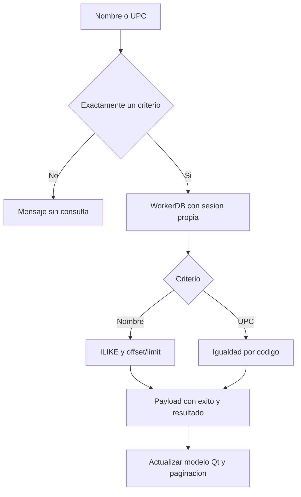
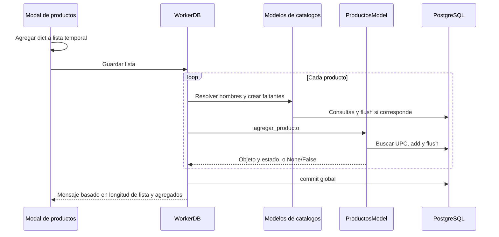
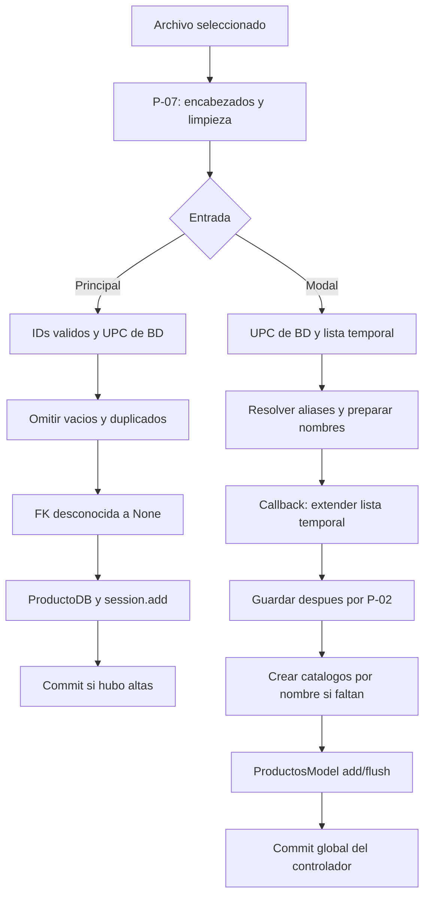

# Spec 01: productos, catalogos e importacion

## 1. Alcance y fuentes

Fecha: 2026-11-10. Estado: As-Is documentado por lectura estatica, no ejecutado. [Maestro SDD](../03-especificaciones-funcionales-sdd.md), [modelo de datos](../02-modelo-de-datos.md). No se refactoriza ni corrige codigo en esta entrega.

**Actualizacion de ejecucion, Lote 1 (2026-11-10):** la descripcion original As-Is se conserva como evidencia historica; los deltas de esta seccion prevalecen para los caminos modificados. REF-21 implementada localmente, REF-22 solo categoria de producto, REF-24/25 parciales. Evidencia:78 unitarias y132 Qt aprobadas con `PYTHONDONTWRITEBYTECODE=1`; sin PostgreSQL ni cambios de esquema. Detalle de dependencias, comandos, propietarios, riesgos y rollback en [plan, Lote 1](../04-plan-de-refactorizacion.md#evidencia-del-lote-1-de-productos-2026-11-10).

| Casos / REF | Delta implementado y caracterizado | Pendiente |
| --- | --- | --- |
| P-01 / REF-21 | Busqueda admite Unicode, numeros y UPC alfanumerico; igualdad UPC e ILIKE no cambian | Consulta/DTO y diferenciacion error SQL de ausencia REF-25/32/36 |
| P-02/P-03/P-08/P-09 / REF-21 | Contrato compartido20/60/100/100/255/255; valida antes de mutar; UPC/nombre obligatorios; captura modelo50->100/color20->255 | Relectura y restricciones PostgreSQL reales |
| P-02/P-03 / REF-24 | Alta/edicion escribe objetos ProductoProveedor, deduplica IDs y conserva precios existentes; nuevos0.0; desvincula solo pares ausentes | Migrar editor proveedor/reutilizar escritor, REF-17/25 y persistencia real |
| P-02/P-03/P-06/P-08 / REF-25 | Modelo propaga fallo tecnico; coordinacion revierte mutacion/commit fallidos; categoria no emite exito ante error str/dict incompleto | Resultado tipado/DTO integral, causa/diagnostico y restantes consultas/bajas |
| P-06 / REF-22 | Categoria de producto nombre1..100 y descripcion obligatoria antes de persistir; captura100 | Clientes/proveedores y gates SQL |

Regresiones en [modelo](../../tests/test_product_inputs.py) y [Qt/canales](../../tests/test_phase2_products_qt.py). Fronteras n-1/n/n+1 en seis campos de modelo e importadores; Qt comprueba maxLength y valores n-1/n. QLineEdit conserva su comportamiento nativo de limitar entrada; servicios/importaciones rechazan exceso sin recortar. Error de importacion incluye ordinal de registro (no necesariamente linea fisica) y campo, y rechaza el archivo antes de escribir. Esto reemplaza la omision silenciosa de UPC/nombre vacios en los importadores; aliases, defaults numericos y diferencias26/33 columnas no se unifican.

Alta modal ya no lee checkbox desde la query: usa fecha de vencimiento capturada en la lista. Su mensaje cuenta agregados reales, no longitud de self.lista_productos. El modelo ya no captura flush como None/False. Commit de edicion y alta de categoria quedan bajo try/rollback; importacion principal revierte antes de propagar el fallo al worker. Firma y tuplas legacy se conservan; UPC de edicion sigue sin reasignarse, stock/precio no se alteran por sincronizar proveedores. Los retornos ORM aun requieren REF-25/36. No se certifican P-04/P-05/P-07/P-10 completos por las pruebas de este lote.

| Fuente | Simbolos propietarios |
| --- | --- |
| [ProductosController.py](../../app/Controller/ProductosController.py) | Productos, Admin_productosController, ExistenciasClase |
| [ProductosModel.py](../../app/Model/ProductosModel.py) | ProductosModel |
| [CategoriasController.py](../../app/Controller/CategoriasController.py) | CategoriasController |
| [CategoriasModel.py](../../app/Model/CategoriasModel.py) | CategoriasModel |
| [PresentacionProductosController.py](../../app/Controller/PresentacionProductosController.py) | PresentacionProductos |
| [UnidadMedidaProductosController.py](../../app/Controller/UnidadMedidaProductosController.py) | UnidadMedidaProductos |
| [OperacionMasivaCsvController.py](../../app/Controller/OperacionMasivaCsvController.py) | Lector y conversiones comunes |
| [ProveedoresModel.py](../../app/Model/ProveedoresModel.py) | Consulta de proveedor por nombre en guardado modal |
| [SistemaPrincipalController.py](../../app/Controller/SistemaPrincipalController.py) | Restricciones de botones y acceso al modulo |
| [Hilo_consultas.py](../../app/Controller/Hilo_consultas.py) | WorkerDB y familia de procesador Excel alternativa |
| [Validaciones.py](../../app/Controller/Validaciones.py) | QRegularExpressionValidator |
| [FuncionesAuxiliares.py](../../app/Controller/FuncionesAuxiliares.py) | size_validator_image |
| [UI_AGREGARPRODUCTO.py](../../app/View/UserInterfacePy/UI_AGREGARPRODUCTO.py) | Vista importada para alta/edicion, no una variante _ui |
| [UI_EXISTENCIA_PRODUCTOS.py](../../app/View/UserInterfacePy/UI_EXISTENCIA_PRODUCTOS.py) | Cantidad con 3 decimales y combo Entrada/Salida |
| [UI_AGREGAR_UN_DATO.py](../../app/View/UserInterfacePy/UI_AGREGAR_UN_DATO.py) | Presentacion/unidad: txt_nombre de 30 caracteres |
| [BaseDatosModel.py](../../app/Model/BaseDatosModel.py) | Productos y sus FK; NOT NULL inferidos, unique y cascadas |

## 2. Actores, permisos y contratos compartidos

### Lote 2 Parcial Autorizado (2026-11-10)

No se declara cerrado el modulo: REF-37 depende de REF-04 (aun hay create_all), y REF-17/24/25 tienen remanentes. Tras verificarlo, el usuario autorizo continuar un incremento parcial sin retirar DDL. Resultados:97 unitarias y141 Qt aprobadas (28 nuevas), con bytecode deshabilitado, sandbox y sin PostgreSQL. Ver detalle, comandos, limites y rollback en [evidencia Lote 2](../04-plan-de-refactorizacion.md#evidencia-del-lote-2-parcial-de-productos-2026-11-10).

| Caso / REF | Delta implementado | Pendiente |
| --- | --- | --- |
| P-07 / REF-27 | leer_con_reporte opt-in con columnas, origen, valores limpios/originales y errores estructurados; numero_con_reporte distingue vacio/invalido/no_finito | Integracion en importadores/reportes UI; API legacy y Clientes/Proveedores intactos |
| P-08/P-09 / REF-28 | Preparacion comun en ProductosImportacion, contrato25 (26 con id ignorado), aliases/defaults por canal conservados | Unificar servicio de coordinacion/dedupe e informe por fila |
| P-02/P-09 / REF-28 | Preview conserva tres IDs y guardado los transmite con prioridad sobre nombres; nombre sin ID mantiene autocreacion actual | FK real de IDs inexistentes y REF-24/25; no se crean proveedores |
| P-01 / REF-32 | Buscar ILIKE/UPC exacto en modelo; salida DTO frozen de listado/categoria sin entidades lazy | Listado general/paginacion posterior, otras consultas y SQL real |
| P-01/P-09 / REF-36 | Captura offset/limite/filtros/UPCs en GUI; worker sin metodo ligado al widget en caminos migrados | Otros flujos, owner por instancia y cancelacion cooperativa |
| Infraestructura / REF-37 | Sin cambios: bloqueo comprobado | REF-03/04/25 y provisionamiento PostgreSQL |

ResultadoProductos es opt-in: WorkerDB traduce exito al bool real solo en busqueda/preview migrados. Los callbacks legacy mantienen su contrato, incluido dict exitoFalse emitido con boolTrue. Pruebas Qt con worker/hilo reales y conexion simulada verifican afinidad GUI, fin unico y compatibilidad; tabla pinta y selecciona101 DTO mediante clicked sin sesion. Esto no prueba persistencia, SQL de filtros ni cierre seguro de ventana durante una transaccion.

El editor consume directamente la seleccion: DTO de busqueda incluye todos los escalares, fechas y snapshots de catalogos/proveedores necesarios, no solo columnas visibles de tabla. Prueba Qt comprueba carga de marca/modelo/color en el modal real sin excepcion. La captura admite los catalogos DTO tipados del caso correcto y sigue extrayendo IDs antes del guardado; no se envian esas entidades ORM entre hilos desde la busqueda migrada.

El reporte conserva la fila real XLSX y linea final del registro CSV (puede ocupar varias lineas); celda/formula sin cache sigue vacia con data_only. Libro corrupto/.xls producen error seguro. Reporte de archivos no equivale aun a reporte integrado del importador. Originales permiten distinguir nan de vacio sin alterar limpiar_valor ni parse_float/parse_int legacy. Advertencias de dominio y filas mal formadas adicionales siguen pendientes.

Compatibilidad25 columnas verificada con un XLSX real: precio, existencia_minima/maxima y tres FK llegan a ambos adaptadores; id adicional se admite/ignora. Se conserva margen float principal/int modal y preferencia de alias presente aunque vacio; no se aprueba una nueva precision monetaria. IDs desconocidos principales conservan normalizacion a None; IDs explicitos modales se validaran por FK al guardar, con rollback ante fallo, sin inventar entidades ni reinterpretar el ID como nombre. Gate SQL no ejecutado.

Las secciones As-Is siguientes conservan evidencia historica; estos deltas y los de Lote 1 prevalecen para los caminos modificados. Ver [pruebas del incremento](../../tests/test_products_phase3.py).

### Lote 3 Local (2026-11-10)

Este delta prevalece sobre estados historicos de Lotes 1/2 y As-Is siguientes. Sin cierre de modulo ni REF-03/04/Alembic. Evidencia:102 unitarias/152 Qt, bytecode deshabilitado y sandbox, sin PostgreSQL. Ver [plan y gates Lote 3](../04-plan-de-refactorizacion.md#evidencia-del-lote-3-de-productos-2026-11-10).

| Caso / REF | Contrato implementado | Pendiente |
| --- | --- | --- |
| P-07/P-08/P-09 / REF-27/28 | Ambos canales usan reporte de archivo y coordinar_importacion_productos; claves legacy conservadas mas reporte; callbacks muestran counts y fila/campo | Guardado modal integral, mas casos de lector y gates SQL |
| P-08/P-09 / REF-32 | UPCs y conjuntos de IDs en ProductosModel; controlador sin consultas session.query/get/execute/scalar directas | Todos los flujos DTO, equivalencia PostgreSQL |
| P-02/P-03/C-09 / REF-24/25 | Escritor compartido: producto reemplaza por diferencias, proveedor agrega pares; conserva precios/stock; editor posee commit; fallo no limpia ni emite exito | REF-17/25 globales, persistencia/rollback entre sesiones |
| P-01..P-09 / REF-36 | Owners por instancia/operacion, limpieza diferida y supresion de callbacks; no terminate en workers opt-in activos | Snapshots/DTO restantes y REF-17/25/37; SQL real |

Politica deliberada de filas: encabezado invalido bloquea sin consultas/escrituras; textos fuera de contrato, obligatorios vacios y no finitos se reportan y omiten. Duplicados se omiten tras validacion, incluyendo UPCs de BD, temporales y aceptados del mismo lote. Principal confirma juntas las aceptadas; fallo tecnico revierte ese lote completo, sin catch/continue ni SAVEPOINT por fila. Preview no persiste y sus validas no significan productos confirmados. Esto sustituye el rechazo integral por validacion del Lote 1.

Reporte: total/validas/omitidas cuentan filas leidas no vacias; duplicados es lista de UPCs; errores/advertencias son diagnosticos con fila/campo/codigo/mensaje. Un error estructural puede tener fila de encabezado. Originales detectan NaN/inf aunque limpieza los convierta a vacio. Conversion numerica invalida retiene default legacy con advertencia; FK principal desconocida -> None con advertencia. Fechas/defaults, margen principal float/modal int y prioridad de alias presente/vacio se conservan. ID modal explicito se mantiene, sujeto a FK al guardar; no se crea proveedor. La UI presenta contadores y primeros10 diagnosticos; payload conserva el reporte completo.

Editor proveedor: confirmar=False propaga fallo tecnico al coordinador; confirmar=True mantiene wrapper legacy commit/rollback. Productos faltantes invalidan el vinculo completo antes de mutar. Un mismo par no se duplica, precios existentes no se reemplazan por0.0 y agregar desde proveedor no desvincula otros pares. Pruebas usan entidades ORM transitorias, no relectura SQL.

Cierre: cada uno de los14 owners de ProductosController incluye instancia y operacion. Worker activo queda registrado hasta finalizar, se rechaza reemplazo del mismo owner y callbacks cancelados no actualizan UI. Otra instancia no se limpia. Prueba de QThread real con conexion simulada y consulta bloqueada comprueba salida de contexto y limpieza; no demuestra cancelacion/rollback SQL. Una operacion puede confirmar tras cerrar ventana. Otros dominios conservan comportamiento legacy.

Actor: operador con acceso al modulo productos. SistemaPrincipal admite ADMINISTRADOR o cualquiera de CREARPRODUCTO/MODIFICARPRODUCTO/ELIMINARPRODUCTO para entrar. Sus reglas de botones asignan alta e importacion principal a CREARPRODUCTO, edicion y ajuste de stock a MODIFICARPRODUCTO y baja a ELIMINARPRODUCTO. Los metodos del modelo no validan esos permisos.

Las reglas de widgets internos del principal intentan resolver WindowsAddProduct_Dialog sobre self.productos, pero ese atributo reside en la instancia modal Admin_productosController. _resolver_widget_anidado devuelve None si no lo encuentra y _restringir_widget no actua sobre None. No afirmar que los botones del modal queden protegidos por esas reglas ni que exista autorizacion de dominio. Importadores/casos de catalogos no tienen permisos semilla dedicados.

### Entradas UI frente a BD

| Entrada | UI efectiva | BD / discrepancia |
| --- | --- | --- |
| UPC | txt_codBarras, strip, maxLength=20; obligatorio | codigo_upc String(20), unique, NOT NULL; contrato comun REF-21 |
| Nombre | strip, maxLength=60; obligatorio REF-21 | String(60), NOT NULL inferido |
| Marca / modelo | 100 / 100 caracteres tras REF-21 (modelo antes50) | String(100) / String(100) |
| Color / material | 255 / 255 caracteres tras REF-21 (color antes20) | String(255) / String(255) |
| Costos, precio, existencias min/max, peso, dimensiones | QDoubleSpinBox, maximum=10000000000.0 en vista; sin minimum/decimals propio, rigen defaults Qt (0 y 2 decimales) | Float sin CHECK de rango, positividad, finitud ni min <= max; importacion no usa el spinbox |
| Margen | QSpinBox maximum=100, minimo Qt 0; entero | Float; modal CSV usa parse_int; guardado lo pasa como cadena |
| Fabricacion / vencimiento | QDateEdit; caducidad condicionada por checkbox en alta/edicion | Fabricacion Date NOT NULL inferido; vencimiento nullable |
| Imagen | Ruta local seleccionada; filtro png/jpg/jpeg y todos; validacion de tamano | Text NOT NULL inferido; REF-10 normaliza altas sin imagen a "" y conserva ruta al editar sin reemplazo |
| Descripcion / notas | QPlainTextEdit, sin limite de caracteres adicional en controlador | Text NOT NULL inferido |
| Categoria/presentacion/unidad | Objetos en currentData | FK nullable con ON DELETE SET NULL; REF-11 valida tipo/ID en GUI y envia int/None al worker |
| Busqueda por nombre | Sin validator de formato tras REF-21 | Admite acentos, numeros y signos; conserva ILIKE |
| Busqueda UPC | Sin validator numerico tras REF-21 | Conserva igualdad exacta y ceros iniciales |

No se establece validator numerico sobre txt_codBarras en el constructor del modal; el de busqueda principal no define el contrato de alta. Los formatos de fecha y limites de Qt no son restricciones CHECK SQL.

## 3. P-01: consultar, buscar y paginar productos

**Actor/entrada:** operador con acceso al modulo; Productos.buscar_producto, consultar_productos_db y cargar_mas_productos. Usa nombre o UPC, no ambos. Si ambos vacios o ambos llenos muestra mensaje sin consulta. Estado inicial: offset 0, limite 100; una busqueda nueva limpia tabla y reinicia paginacion.

**Flujo:** buscar_producto_query llama ProductosModel.consultar_por_nombre (ILIKE con %termino%, nombre ascendente) o consultar_producto_por_codigoUPC (igualdad exacta y envoltura en lista). El listado usa obtener_productos con offset/limit. consultar_por_nombre_exacto existe en modelo y usa lower igual a lower; no reemplaza la busqueda parcial de la pantalla. Las consultas cargan relaciones con joinedload para proveedores, asociaciones y catalogos.

**Transaccion/hilos:** WorkerDB; lee Productos y relaciones, no commit funcional. El cierre de sesion es del wrapper. Las listas y offsets viven en QWidget; ocultar/cerrar limpia workers de esa pantalla, no cancela de forma transaccional una consulta ya en curso.

**Errores/bordes:** varios metodos de consulta de ProductosModel capturan Exception y devuelven [],False, indistinguibles de ausencia de filas para algunos llamadores. Cambios de stock por otra caja pueden invalidar la entidad mostrada. No asumir stock reservado por consultarlo.

**Caracterizacion:** nombre con coincidencias parciales y UPC con ceros iniciales; 0/100/101 registros; alternar filtros mientras hay consulta; relacion no precargada despues de cerrar sesion; error SQL frente a lista vacia.



## 4. P-02: preparar alta manual y guardar lote modal

**Actor/permiso:** operador de alta; CREARPRODUCTO en boton de entrada del principal, con la salvedad de autorizacion modal de seccion 2. Entradas: Admin_productosController.datos_campos y __agregar_producto; persistencia por __guardar_producto, agregar_productos_en_bd y agregar_productos_query -> ProductosModel.agregar_producto.

**Precondiciones/flujo:**

1. datos_campos toma strip en textos cortos, valores numericos y fechas; combos contienen objetos ORM.
2. __agregar_producto exige solo UPC no vacio y no duplicado en self.lista_productos. No comprueba BD ni exige nombre en este paso. Ante duplicado muestra alerta y limpia campos; no agrega fila.
3. Convierte catalogos a nombres, proveedor a nombre o None, fecha de vencimiento a None si checkbox desactivado e imagen a None si no hay ruta. Agrega dict a lista temporal y tabla Qt. El mensaje de agregado no significa INSERT confirmado.
4. __limpiar_campos limpia QLineEdit/QPlainTextEdit, pone QDoubleSpinBox a 0 y fechas al dia; no reinicia QSpinBox de margen ni combos en ese bucle. Restablece imagen.
5. Al guardar, agregar_productos_query itera la lista: busca proveedor por nombre; agregar_presentacion/agregar_unidad_medida y CategoriasModel.agregar pueden crear catalogos por nombre. REF-11 proporciona descripcion automatica al crear categoria y reutiliza existente sin cambiarla. Ausentes se envian como None. No se crea proveedor automaticamente.
6. Llama agregar_producto: consulta UPC existente, retorna (existente,False) si esta duplicado; en alta construye Productos, add/flush y retorna (objeto,True). Captura Exception y retorna (None,False), sin rollback interno.
7. El controlador hace un commit final; en excepcion de ese commit hace rollback y relanza. Guarda listas de agregados/no agregados, pero el retorno solo incluye agregados y el mensaje usa len(self.lista_productos), no el numero efectivamente insertado.

**BD/hilos:** WorkerDB; Productos y, si faltan, catalogos de producto. Tabla proveedor se consulta. La asignacion a proveedores es viewonly y no garantiza filas producto_proveedor. No se genera movimiento de inventario por existencia inicial en este metodo de alta.

**Bordes/defectos:**

- En el As-Is original la categoria autocreada recibia descripcion=None, incompatible con NOT NULL. REF-11 envia descripcion automatica explicita desde este llamador; el alta explicita de categoria sigue exigiendo captura de descripcion.
- En el As-Is original el modal enviaba imagen=None frente a Text NOT NULL. REF-10 normaliza altas a "" tanto en este llamador como en modelo; no cambia nullable ni sanea filas antiguas. Una ruta importada/manual no garantiza archivo disponible en otro equipo.
- Un error de flush absorbido deja potencialmente la sesion fallida y el commit global falla; no hay savepoint por fila ni contrato seguro de altas parciales.
- agregar_productos_query lee opcion_TieneCaducidad.isChecked desde el trabajo de BD; acceso a UI en hilo secundario. La expresion conserva una fecha importada no nula aunque el checkbox este apagado.
- Consulta previa de UPC no resuelve carreras; unique de BD sigue siendo ultima defensa.

**Caracterizacion:** lista de uno/varios productos; nombre vacio; UPC repetido en lista y BD; nuevo catalogo con/sin descripcion; sin imagen; fallo intermedio de flush; comparar conteo anunciado con filas confirmadas; stock inicial sin movimiento.



## 5. P-03: modificar producto, imagen y proveedores

**Actor/entrada:** operador de edicion; MODIFICARPRODUCTO en principal. Productos.modificar_producto exige seleccion y abre Admin_productosController; __actualizar_producto obtiene snapshot de datos, combina proveedores vinculados con nuevos sin repetir ID, decide caducidad y pide confirmacion. __actualizar_producto_query llama ProductosModel.actualizar_producto.

**Flujo/BD:** modelo hace session.get por id; si falta retorna None,False. Actualiza nombre, descripcion, costos, margen, precio, existencias/dimensiones, textos, fechas, imagen y tres FK. Recibe codigo_upc pero no lo asigna. Sucursales queda sin actualizar (asignacion comentada). Vacia/asigna proveedores mediante la relacion viewonly, fusionando objetos o dicts de proveedor con session.merge.

**Hilos/transaccion:** WorkerDB. Controlador hace rollback ante estado falso o excepcion dentro del try. session.commit queda despues de ese try; un fallo del commit llega al worker sin rollback explicito en ese metodo. No genera movimiento por cambio directo de existencia en esta edicion. La coleccion de asociaciones persistente es producto_proveedor_asociaciones, no proveedores.

**Errores/bordes y deltas:** en el As-Is original se accedia a .id sin guardia. REF-11 valida currentData de los tres tipos esperados y su id entero (no bool), acepta None, rechaza objeto/nombre inesperado antes del worker y envia snapshot de IDs. La query recibe int/None, no desreferencia entidades de catalogo. REF-10 conserva imagen previa si el argumento es None; "" explicito significa ausencia y se transmite sin reconvertir a None. No se agrega boton de borrado de imagen. Cambiar UPC en widget sigue sin cambiarlo en modelo; proveedores viewonly sigue sin garantizar escritura de asociaciones. Commit exterior sigue fuera del try, deuda no corregida por REF-11.

**Caracterizacion:** editar UPC y releer otra sesion; vaciar cada combo; cambiar existencia y contar movimientos; vincular/desvincular proveedor y consultar producto_proveedor desde otra sesion. El editor especifico Productos_del_Proveedor se documentara en spec 03, no se declara que ningun flujo del sistema persista asociaciones.

### P-04: seleccionar imagen y calcular precio

**Actor/entrada:** mismo modal, metodos cargar_imagen y calcular_precio_venta. La seleccion admite png/jpg/jpeg y todos; FuncionesAuxiliaresController.size_validator_image usa os.path.getsize y acepta hasta 5 * 1024 * 1024 bytes inclusive. No comprueba contenido/MIME. QPixmap se usa para la vista; no hay copia a un almacen de imagenes ni conversion binaria en este flujo.

**Regla de precio:** editingFinished de entero_margenProducto calcula costo_final + costo_final * (margen/100), fija decimal_precioVentaProducto y queda sujeto al redondeo/rango del widget. No calcula costo_final a partir de costo_inicial ni asegura que cambiar costo final dispare el mismo recalculo. El valor importado de precio no se recalcula por margen.

**Transaccion/hilos:** estas dos acciones son locales a Qt, sin BD/commit ni worker propio; la ruta/precio se persisten al guardar o editar. En el As-Is original la seleccion sobrescribia imagenProducto antes de validarla. REF-10 valida una ruta candidata antes de asignar: cancelar, exceder5MiB o fallar lectura conserva imagen previa; rechazo/error muestra alerta. El limite de5MiB inclusivo y el calculo de precio no cambian. No se agrega validacion de formato/MIME ni almacenamiento nuevo.

**Caracterizacion:** imagen de 5 MiB exactos y mayor, cancelar selector, archivo borrado antes de guardar; margen 0/100, costo grande, cambio solo de costo, precio manual distinto al calculado. El porcentaje de incremento sobre costo no equivale a margen sobre precio de venta.

## 6. P-05: eliminar producto

**Actor/entrada:** ELIMINARPRODUCTO en boton principal. Productos.eliminar_producto exige seleccion y confirmacion; WorkerDB llama eliminar_producto_query -> ProductosModel.eliminar_producto por UPC.

**Regla/transaccion:** modelo busca producto; si existe delete y commit internos, retorna (None,True); si falta retorna (None,False). Controlador no inicia otro commit ni tiene rollback propio aqui. El callback limpia seleccion al exito; no implica que toda la tabla se recargue automaticamente en ese metodo.

**BD/excepciones:** el borrado puede eliminar asociaciones/movimientos por cascadas ORM; Detalles_ventas.producto_id RESTRICT puede impedirlo. Detalles_compras apunta a UPC y puede impedir borrado si hay referencias. Error SQL no se absorbe en eliminar_producto del modelo y llega al worker. No hay baja logica en esta operacion.

**Caracterizacion:** sin seleccion; producto inexistente entre seleccion y confirmacion; con ventas/compras/movimientos/asociaciones; confirmar que historico conservado/eliminado corresponde a restricciones reales y no a una suposicion de CRUD generico.

## 7. P-06: catalogos de categorias, presentaciones y unidades

**Actor/puerta:** operadores que llegan desde modal/catalogos; no hay permisos especificos semilla. Ver salvedad de botones internos en seccion 2. Los datos semilla exactos y sus condiciones estan en [modelo de datos](../02-modelo-de-datos.md); estos casos son mantenimiento interactivo, no reposicion automatica de semillas.

| Caso | Entrada/validacion UI y BD | Flujo, hilos y transaccion | Bordes observables |
| --- | --- | --- | --- |
| Categoria alta | CategoriasController.guardar: nombre/descripcion upper y strip, ambos obligatorios, txt_nombre max=150. Categorias_productos.nombre String(100); proveedores String(150); clientes String(100), descripcion cliente String(255) | agregar_categoria_query -> CategoriasModel.agregar, selecciona modelo por tipo productos/clientes/proveedores; busca nombre exacto; add/flush si no existe; WorkerDB y commit del controlador; rollback en falso/error | Nombre 101-150 falla para producto/cliente. Tipo desconocido devuelve None como modelo. Except del arranque del worker contiene pass. Retorno por duplicado solo exito=False, sin mensaje, pero resultado_del_hilo accede a mensaje; mostrar_error_hilo espera dict aunque worker emite str |
| Categoria consulta/baja | Catalogos del modal se cargan por obtener_categorias_query; baja CategoriasController.eliminar con objeto | CategoriasModel.obtener_todo; eliminar hace delete sin commit y devuelve bool; eliminar_categoria_query confirma commit, rollback en error; WorkerDB | SQL puede fallar al flush/commit. obtener_categoria_por_id usa filter_by(id == id), no una comparacion id=valor correcta; no tratarlo como consulta fiable |
| Presentacion alta | PresentacionProductos.agregar: nombre upper/strip no vacio; vista UI_AGREGAR_UN_DATO maxLength=30, BD String(100) NOT NULL | agregar_presentacion_query -> ProductosModel.agregar_presentacion: consulta igualdad, add/flush si falta; WorkerDB; controlador commit y rollback en falso/error | Duplicado retorna existente,False, se informa fallo y se emite senal de recarga; no hay unique de BD ni normalizacion universal contra semillas con otra capitalizacion |
| Presentacion baja | PresentacionProductos.eliminar(objeto) | eliminar_presentacion_query -> eliminar_presentacion_producto: modelo delete/commit y captura Exception -> False; controlador puede hacer otro commit/rollback; WorkerDB | Commit duplicado entre capas; FK producto SET NULL, pero el estado cargado y ORM pueden influir en el borrado |
| Unidad alta | UnidadMedidaProductos.agregar: upper/strip no vacio; misma vista max=30, BD String(100) NOT NULL inferido | agregar_unidad_medida_query -> ProductosModel.agregar_unidad_medida: busca igualdad, add/flush; WorkerDB; controlador commit/rollback | Sin unique en BD; duplicados de concurrencia/capitalizacion posibles |
| Unidad baja | Existe ProductosModel.eliminar_unidad_medida con commit y Exception -> False | UnidadMedidaProductos no declara metodo eliminar; no inventar boton o flujo simetrico al de presentacion | Cualquier consumidor adicional debe trazarse; no basta con que el modelo tenga el metodo |

**Caracterizacion del conjunto:** duplicado exacto y distinto en mayusculas; nombres 30/31 por UI, 100/101 por importacion, 150 por categoria; descripcion vacia en alta manual frente a descripcion automatica de REF-11 en guardado modal; borrar categoria usada; error del worker como str; ausencia de catalogo al editar.

**Delta de semilla REF-14 (2026-11-10):** insertar_unida_de_medida_basicas prepara19 filas/nombres unicos en tabla vacia al retirar un Cilindro-(cil) duplicado. Tabla no vacia sigue sin reposicion/saneamiento; IDs y referencias existentes no se tocan. Dos [tests unitarios](../../tests/test_phase1_stabilization.py) verifican ambas ramas con sesion simulada, no carga real en PostgreSQL.

## 8. P-07: lector comun CSV/XLSX

**Entrada:** OperacionMasivaCsvController.leer_y_validar_archivo(documento, columnas_requeridas, columnas_validas=None). No tiene permiso, sesion, commit ni Qt; el consumidor decide ejecutarlo en worker. Retorna lista de dicts o lanza ValueError/otro error de lectura.

1. Despacha por extension minuscula: .csv -> _leer_csv, .xlsx/.xls -> _leer_excel; _leer_excel rechaza explicitamente .xls. El selector y el mensaje generico aun anuncian .xls.
2. CSV usa DictReader con separador estandar coma; intenta utf-8-sig, utf-8 y latin-1 solo al fallar decodificacion. No hay autodeteccion de delimitador. Limpia encabezados con strip, conserva capitalizacion y no valida duplicacion de encabezados.
3. Excel usa hoja activa, read_only=True y data_only=True; lee valores almacenados, no evalua formulas. Primer renglon es encabezado. No hay seleccion de hoja ni parseo basado en formatos visuales de celda.
4. Omite filas vacias segun _es_valor_nulo. limpiar_valor convierte None, NaN y textos vacios/nan/none/nat a ""; conserva date/datetime y convierte otros valores a texto strip.
5. Exige encabezados requeridos exactos; si columnas_validas no es None rechaza todo encabezado extra. No valida no vacio por celda en este nivel.
6. parse_float: float del texto o default (0.0 normalmente) ante vacio/invalido; no restringe signo ni finitud. parse_int pasa por float e int, pierde fraccion y usa default=0 si no convierte.
7. parse_date devuelve date o default: acepta date/datetime, serial numerico via from_excel, ISO con Z y lista de formatos. Prioriza dia/mes sobre mes/dia en fechas ambiguas. Como limpiar_valor convierte numeros a texto, un serial numerico leido por el lector no necesariamente alcanza la rama numerica de parse_date.

**Bordes:** encabezados duplicados pueden sobreescribir claves; encabezado inesperado genera rechazo global, no omision por columna. CSV no preserva ceros iniciales si ya se perdieron al generar Excel como numero. Valores corruptos convertidos a cero no se reportan individualmente. No hay rollback del lector: todavia no escribe BD.

**Caracterizacion:** CSV con BOM/latin-1/punto y coma; .xls; hoja activa distinta; formula sin cache; encabezado con espacios/cambio de mayusculas/extras/duplicados; 1.9 a int; inf, texto invalido, NaN; fecha 01/02/2026 y serial leido como texto.

## 9. P-08 y P-09: comparativa exacta de importadores

**P-08 entrada principal:** Productos.__leer_archivo_csv -> WorkerDB -> Productos.importar_productos_query(session, documento). Boton protegido por CREARPRODUCTO en principal. **P-09 entrada modal:** Admin_productosController.__leer_archivo_csv -> WorkerDB -> importar_productos_modal_query(session, documento). Puerta del modal con limitacion de permisos descrita; ambos usan P-07 y no ProcesadorArchivoWorker.

### Columnas requeridas (ambos)

```text
codigo_upc, nombre_producto
```

### Columnas validas principales (lista completa)

```text
id, codigo_upc, nombre_producto, descripcion_producto, costo_inicial, costo_final,
margen_porcentaje, precio, existencia, existencia_minima, existencia_maxima,
marca, modelo, peso, alto_cm, largo_cm, ancho_cm, color, material,
fecha_fabricacion, fecha_vencimiento, imagen, notas, presentacion_producto_id,
unidad_medida_productos_id, categoria_id
```

### Columnas validas modales (lista completa)

```text
id, codigo_upc, nombre_producto, descripcion_producto, costo_inicial, costo_final,
margen_porcentaje, precio, precio_venta, existencia, existencia_minima,
existencia_maxima, existencia_min, existencia_max, marca, modelo, peso, alto_cm,
largo_cm, ancho_cm, color, material, fecha_fabricacion, fecha_vencimiento,
imagen, notas, presentacion_producto_id, unidad_medida_productos_id, categoria_id,
categoria, proveedor, presentacion, unidad_medida
```

### Decisiones y efectos por canal

| Aspecto | Principal P-08 | Modal P-09 |
| --- | --- | --- |
| Duplicados | UPC de BD y conjunto que se amplia en cada alta del lote | UPC de BD + self.lista_productos + lote; amplia conjunto en cada producto preparado |
| Filas sin UPC/nombre | Lote 3: invalidas con fila/campo, antes de dedupe | Lote 3: misma validacion antes de dedupe |
| Columna id | Aceptada pero no asignada | Aceptada pero no incorporada al dict temporal |
| Tres FK por ID | parse_int y conjuntos de IDs existentes; invalido/inexistente/ausente -> None | Lote 2 conserva IDs en preview/guardado con prioridad sobre nombres; ausente usa nombres; desconocido sujeto a FK al guardar |
| Nombres de catalogos | Columnas categoria/presentacion/unidad_medida no admitidas | Nombre strip o None; al guardar crea categoria/presentacion/unidad si faltan (P-02) |
| Proveedor | Columna proveedor no admitida; no construye asociacion | Nombre o None; se busca proveedor existente al guardar; no se crea |
| Precio | parse_float(precio, 0.0) | Si existe clave precio_venta usa ese valor incluso si vacio; de otro modo precio; parse_float |
| Margen | parse_float, default 0.0 | parse_int, default 0; se pasa como cadena al guardar |
| Existencia min/max | Solo existencia_minima/maxima | Prefiere claves existencia_min/max si existen, incluso vacias; fallback a minima/maxima si no existen |
| Otros numericos | costo_inicial/final, existencia, peso, alto/largo/ancho: parse_float default 0.0 | Misma conversion a float default 0.0 |
| Fabricacion | parse_date o fecha actual si no interpretable/ausente | parse_date con default fecha actual |
| Vencimiento | parse_date default None | parse_date default None; guardado conserva fecha si no es nula aunque checkbox este apagado |
| Imagen | row.get("imagen", ""); vacio queda "" | Preparacion strip or None; REF-10 normaliza a "" al guardar y en modelo |
| Textos opcionales | descripcion, marca, modelo, color, material, notas usan valor de fila o "" | str/strip de los mismos textos; descripcion/notas tambien strip |
| Persistencia | Construye ProductoDB directamente, session.add; no llama agregar_producto | Solo devuelve lista temporal; no add/flush/commit de productos en importar_productos_modal_query |
| Commit | Uno al final si hay productos_nuevos; no try/rollback explicito dentro del metodo | Ninguno en preparacion; despues agregar_productos_query hace commit global |
| Resultado | Lote 3: claves legacy mas reporte; exito=False ante error estructural | Lote 3: claves legacy mas reporte; callback no extiende lista ante error estructural |
| Rechazos por vacios | Lote 3: omitidos con diagnostico por fila | Lote 3: omitidos con diagnostico por fila |
| Stock e historico | Existencia inicial directa, sin Movimientos_inventario | Igual al guardar por P-02; no hay movimiento por importar |

**Transaccion principal:** lectura de catalogos/UPC y altas en una sesion WorkerDB; los queries o autoflush pueden fallar antes del commit final. Un error aborta el metodo y el worker emite error; cierre de sesion descarta trabajo no confirmado, sin rollback explicito del importador. No hay savepoints, validacion previa completa del lote ni informe por fila de errores SQL. El retorno exito=True con cero altas es posible.

**Transaccion modal:** preparacion lee BD pero no escribe productos. resultado_documento_excel limpia worker, extiende self.lista_productos y actualiza tabla. Reporta duplicados o nuevas filas temporales, no filas persistidas. Guardado posterior conserva las diferencias de P-02 y viewonly de proveedores; REF-10/REF-11 corrigen imagen ausente y descripcion de categoria sin unificar ambos importadores.



**Caracterizacion P-08/P-09:** mismo archivo comun y variantes por canal; columnas extra; IDs validos/inexistentes y nombres; encabezado id sin asignacion; UPC duplicado sin nombre; aliases presentes vacios; decimales en margen; categoria nueva; imagen vacia; lote con una fila demasiado larga; dos importaciones concurrentes; respuesta de cero altas; BD sin cambios despues de solo preparar modal.

## 10. P-10: ajuste manual de existencias

**Actor/entrada:** MODIFICARPRODUCTO en boton de existencia del principal. Productos.existencia_productos exige seleccion; ExistenciasClase.mostrar_datos_en_ui recibe producto y contexto. ejecutar_existencias toma cantidad con 3 decimales y maximum=1e45, combo Entrada/Salida, fecha yyyy-MM-dd y notas. REF-12 exige producto, id_usuario entero positivo (no bool) y cantidad !=0; captura el ID en GUI antes del worker. El As-Is original usaba id_empleado. No se agrega control de saldo suficiente para salida en este parche.

**Flujo/transaccion:** WorkerDB -> ExistenciasClase.ejecutar_existencia_query -> ProductosModel.ejecutar_movimiento. REF-12 verifica que Usuarios.id exista antes de recuperar/mutar producto; si falta retorna None,False. El nombre legacy id_empleado_realizo_operacion de la query se conserva por compatibilidad, pero recibe ID de usuario. Si tipo lower es entrada suma, si salida resta; otro tipo aun agrega movimiento pero no cambia stock. add/flush; controlador commit solo si estado True y ahora rollback explicito al False. Callback emite MOVIMIENTO_EXISTENCIA_REALIZADO y cierra al exito.

**Defectos/bordes y delta:** atribucion por id_empleado era el defecto original, corregido en REF-12 (2026-11-10). [Regresion de modelo](../../tests/test_phase1_stabilization.py) y [GUI/query](../../tests/test_phase1_access.py) usan IDs distintos, entradas/salidas fraccionarias y usuario ausente con sesiones simuladas; FK/transaccion SQL real no se han probado. Siguen sin corregir: stock negativo, cantidad negativa desde llamada directa, tipo arbitrario, Date recibido como cadena, concurrencia y ausencia de saldo por sucursal.

**Caracterizacion:** entrada/salida de 0, fraccion y cantidad superior al saldo; empleado/usuario con IDs distintos; tipo desconocido por llamada directa; fecha invalida; concurrencia con venta; contrastar existencia y movimiento persistidos juntos.

```mermaid
sequenceDiagram
    participant UI as ExistenciasClase
    participant W as WorkerDB
    participant M as ProductosModel
    participant DB as PostgreSQL
    UI->>W: Cantidad, tipo, fecha, notas e id_usuario validado
    W->>M: ejecutar_movimiento(usuarioid=id_usuario)
    M->>DB: Verificar existencia de Usuarios.id
    M->>DB: Leer producto y actualizar existencia
    M->>DB: Agregar movimiento con usuario_id y flush
    M-->>W: Objeto y estado
    opt estado True
        W->>DB: commit
    end
    W-->>UI: Mensaje; senal de actualizacion si exito
```

## 11. Matriz de caracterizacion y riesgos priorizados

Los escenarios anteriores son requisitos para nuevas pruebas, no tests ejecutados. Para cada P-01 a P-10 debe comprobarse resultado visible, filas antes/despues, commit/rollback y comportamiento con ventana cerrada durante worker. P-04 agrupa dos acciones locales con el mismo contexto de captura; P-08/P-09 comparten lector pero no contrato de persistencia.

| Riesgo | Casos que lo fijan |
| --- | --- |
| Longitudes UI/BD y nombre vacio pendientes; imagen None corregida por REF-10 en nuevas escrituras | P-02, P-03, P-04, P-08, P-09 |
| Categoria autocreada con descripcion None: corregida en guardado modal por REF-11 | P-02, P-06, P-09 |
| UPC de edicion no asignado, proveedores viewonly | P-03 |
| Commit mixto y error absorbido de flush | P-02, P-05, P-06, P-08 |
| Atribucion de empleado como usuario y stock negativo | P-10 |
| Permisos de modal no resueltos por ruta de widgets | Seccion 2 y entradas P-02/P-03/P-09 |
| Conversion silenciosa, aliases y defaults divergentes | P-07, P-08, P-09 |

La recepcion de compras y el editor dedicado de asociaciones/precios de proveedor pertenecen a la entrega B (spec 03 aun pendiente). No se consideran documentados completamente por esta frontera de producto.

### Verificacion de REF-10 y REF-11

[Pruebas de modelo](../../tests/test_product_inputs.py): 6 aprobadas con entidades transitorias/sesiones simuladas. [Regresiones Qt](../../tests/test_phase1_quick_wins.py): 6 de imagen y 11 de catalogos aprobadas, incluidos error de FK simulado, rechazo antes del worker, autocreacion con descripcion y reutilizacion sin alterar catalogo. Se reprodujeron fallos antes de los parches. No se ejecutaron SQL NOT NULL/FK reales, lectura entre conexiones ni migraciones; esos gates permanecen pendientes. El lote completo ejecuta 30 unitarias y 45 Qt sin PostgreSQL y no inicia REF-12.