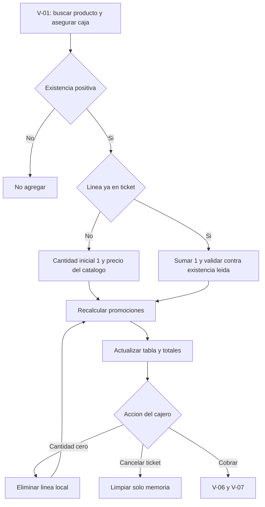
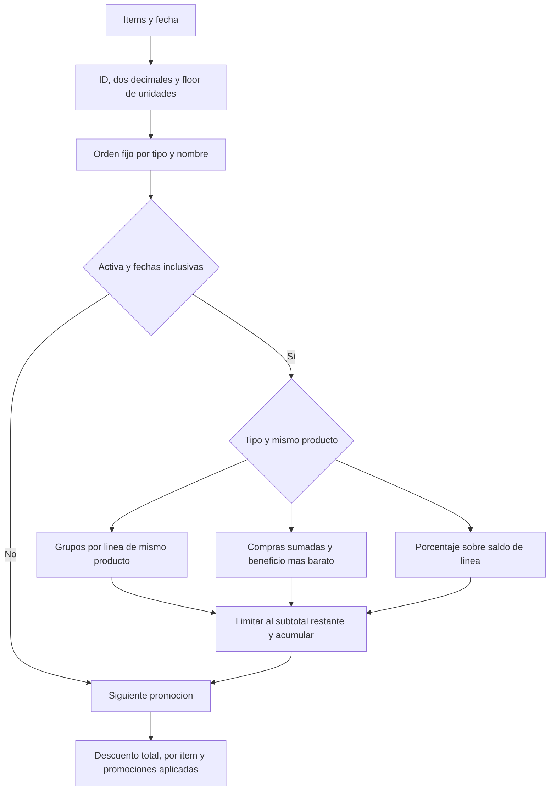
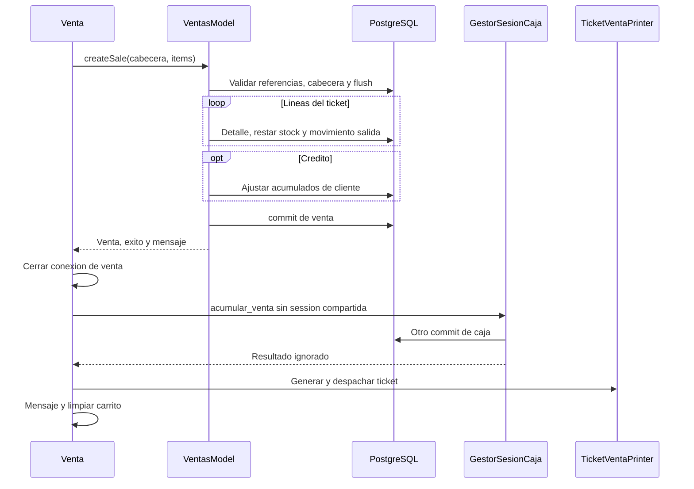
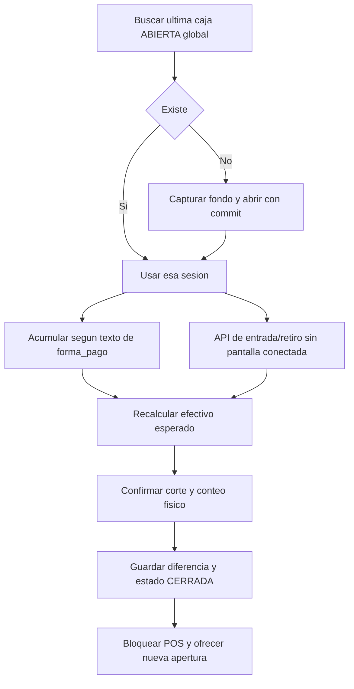

# Spec 02: ventas, caja y promociones

## 1. Alcance, fuentes y permisos

Fecha: 2026-11-10. As-Is por lectura estatica, sin cobros ni cortes ejecutados. [Maestro SDD](../03-especificaciones-funcionales-sdd.md), [modelo de datos](../02-modelo-de-datos.md). Las pruebas propuestas son escenarios de caracterizacion, no tests existentes ni cambios funcionales.

| Fuente | Propietario |
| --- | --- |
| [VentaController.py](../../app/Controller/VentaController.py) | Venta, DialogoSeleccionProductoVenta |
| [VentasController.py](../../app/Controller/VentasController.py) | Ventas (historial), DialogoEditarVenta |
| [VentasModel.py](../../app/Model/VentasModel.py) | VentasModel |
| [PromocionesController.py](../../app/Controller/PromocionesController.py) | PromocionesController, SelectorProductosPromocionWidget |
| [PromocionesModel.py](../../app/Model/PromocionesModel.py) | Persistencia y calculadora de promociones |
| [sesion_caja.py](../../sesion_caja.py) | GestorSesionCaja |
| [apertura_caja_dialog.py](../../gui/apertura_caja_dialog.py) | AperturaCajaDialog |
| [corte_caja_dialog.py](../../gui/corte_caja_dialog.py) | CorteCajaDialog |
| [MetodosPagoController.py](../../app/Controller/MetodosPagoController.py) | Mantenimiento incompleto de metodos de pago |
| [MetodoPagoModel.py](../../app/Model/MetodoPagoModel.py) | Catalogo Metodos_pagos |
| [ConfiguracionSistemaModel.py](../../app/Model/ConfiguracionSistemaModel.py) | IVA e impresion en archivo JSON, no tabla ORM |
| [VentaTicketPrinter.py](../../app/Controller/VentaTicketPrinter.py) | TicketVentaPrinter |
| [SistemaPrincipalController.py](../../app/Controller/SistemaPrincipalController.py) | Acceso al POS, historial, opciones y promociones |
| [Hilo_consultas.py](../../app/Controller/Hilo_consultas.py) | WorkerDB en historial, no en cobro POS |
| [BaseDatosModel.py](../../app/Model/BaseDatosModel.py) | Restricciones de Ventas, detalles, stock, credito y caja |

Actor principal: cajero/operador autenticado. SistemaPrincipal admite ADMINISTRADOR o CREARVENTA para POS; el historial admite CREARVENTA/MODIFICARVENTA/ELIMINARVENTA por interseccion. Restringe botones de cobrar, credito, aplicar descuento y cancelar ticket a CREARVENTA; modificar historial a MODIFICARVENTA y cancelar venta a ELIMINARVENTA. No hay autorizacion por esos permisos dentro de VentasModel.

Promociones se abre desde OpcionesSistemaController.agregar_promociones, no por un permiso CREARPROMOCION inexistente. Ese metodo comprueba interseccion con CREARTRASACCIONES, MODIFICARTRANSACCIONES o ELIMINARTRANSACCIONES, con ADMINISTRADOR como alternativa. No hay permiso semilla exclusivo de abrir/cerrar caja o registrar retiro. Las reglas de habilitacion por caja de Venta._set_controles_habilitados pueden cambiar enabled, no sustituyen la politica de autorizacion del principal.

No se encontro clase, tabla ni uso Historial_creditos en el codigo propio revisado. El credito actual se representa mediante acumulados en Clientes y ventas/comentarios; no se documenta como un libro de abonos, cuotas, vencimientos o intereses ya implementado. Turnos/Transacciones no estan enlazados a SesionCaja por FK y no son un historial equivalente.

## 2. V-01: buscar o escanear productos

**Actor/entrada:** cajero con acceso POS; Venta.buscar_y_agregar_producto desde campo de busqueda. Primero exige _verificar_y_asegurar_caja; strip del texto, vacio muestra mensaje. No hay protocolo especial de escaner: se usa el texto del campo y su accion de busqueda.

**Flujo:**

1. Si criterio.isdigit(), _buscar_y_agregar_producto_por_codigo llama VentasModel.buscar_producto_para_venta.
2. Ese modelo busca codigo exacto o ILIKE parcial de UPC o nombre, prioriza UPC exacto, luego nombre ascendente y toma first. No garantiza igualdad estricta del escaneo si no hay UPC exacto: puede seleccionar una coincidencia parcial.
3. Si no es numerico, _buscar_y_agregar_producto_por_nombre llama buscar_productos_por_nombre_para_venta: solo nombre ILIKE, orden nombre/UPC y limite 100. Abre DialogoSeleccionProductoVenta para elegir; cancelar no agrega.
4. Con producto seleccionado llama _agregar_producto_a_ticket; despues limpia/reubica foco del campo en ese camino.

**UI/BD:** UPC SQL String(20) unique; nombre String(60). El campo POS no impone esos limites como validacion de entrada. Un UPC alfanumerico se dirige a busqueda por nombre, no a igualdad UPC. Precio/existencia Float pueden ser None en una BD divergente; UI usa or 0.0.

**Transaccion/hilos:** consultas sincronas with Conexion_base_datos en el hilo UI, sin WorkerDB ni commit de venta. Abrir la caja puede producir un commit previo independiente. Error del modelo retorna objeto/lista vacia,False,mensaje y se muestra alerta.

**Caracterizacion:** escaneo exacto y parcial; UPC con ceros iniciales/alfanumerico; texto numerico que coincide con nombre; mas de 100 productos; caja cancelada; seleccion cancelada; fallo SQL. No se reserva stock al buscar.

## 3. V-02: carrito, cantidades y cancelacion de ticket local

**Actor/entrada:** cajero, _agregar_producto_a_ticket, _editar_cantidad_item, cancelar_ticket y _limpiar_ticket. Cancelar ticket usa boton restringido a CREARVENTA, no permiso ELIMINARVENTA de venta persistida.

**Reglas:** _agregar_producto_a_ticket rechaza existencia <= 0. Una linea nueva toma precio de producto redondeado a 2 decimales, cantidad 1.0, subtotal precio, snapshot de existencia; no comprueba que una existencia fraccionaria positiva sea al menos 1 antes de crear esa primera linea. Si producto_id ya esta, suma 1, redondea cantidad a 2 y exige <= existencia leida en esa busqueda. No consulta catalogo de unidades para definir paso de venta.

_editar_cantidad_item abre QInputDialog.getDouble con min=0, max=existencia guardada en item y decimals=2. Cero elimina esa linea; otra cantidad actualiza subtotal a cantidad * precio redondeado. _actualizar_ticket recalcula promociones, actualiza modelo Qt y resumen.

cancelar_ticket pide confirmacion si hay items; si acepta limpia items, seleccion, clientes de descuento/credito, porcentaje y resumen de promociones, formularios y foco. No cancela una fila Ventas ni revierte BD.

**BD/hilos:** carrito solo memoria; _actualizar_ticket consulta promociones sincronamente (V-05). Sin commit de venta/stock. El snapshot no se bloquea ni se actualiza por otras cajas; createSale valida de nuevo existencia.

**Bordes/caracterizacion:** stock 0, 0.5 y 1; sumar repetidos; stock cambia mientras ticket abierto; cantidad 0/fraccion; promociones al quitar item; cancelar con/sin ticket; no debe haber filas de venta o movimiento antes de cobrar.



## 4. V-03: descuento de cliente, IVA y totales

**Actor/entrada:** cajero con CREARVENTA en boton aplicar; Venta.buscar_cliente_descuento -> _buscar_cliente_por_id -> VentasModel.buscar_cliente_por_id. El modelo convierte ID con int, consulta Clientes polimorficos y captura error; texto no numerico genera fallo de consulta informado, no una busqueda por nombre.

**Validaciones:** aplicar_descuento_cliente exige items y cliente seleccionado. Lee aplica_descuento y porcentaje_descuento; si no aplica o porcentaje <=0, reinicia porcentaje a cero, recalcula y avisa. Si positivo, asigna porcentaje sin limitarlo explicitamente a 100 en este metodo; BD tampoco tiene CHECK de rango. Elegir cliente no aplica por si solo el descuento.

**Calculo exacto de Venta._calcular_totales:** round(...,2) en cada paso, usando float. Se reproducen las operaciones, no aritmetica Decimal:

```text
subtotal = round(sum(item.subtotal), 2)
descuento_promociones = round(resumen_promociones.descuento_total, 2)
base_cliente = round(max(subtotal - descuento_promociones, 0), 2)
descuento_cliente = round(base_cliente * porcentaje_cliente / 100, 2)
descuento = round(min(subtotal, descuento_promociones + descuento_cliente), 2)
base_imponible = round(max(subtotal - descuento, 0), 2)
iva = round(base_imponible * iva_tasa, 2)
total = round(base_imponible + iva, 2)
```

Promociones se descuentan primero, descuento cliente sobre remanente; IVA se suma despues. La tasa se carga de ConfiguracionSistemaModel, no de un campo por producto ni calculo de impuesto incluido en precio.

_construir_items_venta toma descuento_por_item, lo limita al subtotal de linea, calcula base restante y distribuye descuento cliente proporcionalmente entre lineas con base positiva. La ultima base recibe remanente, limitado a su base; descuentos promocion/cliente quedan en dict para el modelo. Un porcentaje fuera de rango o datos negativos por llamada directa puede producir discrepancias entre resumen y distribucion; no se certifica reconciliacion universal.

**Transaccion/hilos:** lecturas de cliente y promociones sincronas; calculos locales sin commit. Cliente elegido tambien puede ser el cliente de la venta de contado, aun si no tiene descuento aplicable. La BD usa Float y no recalcula automaticamente totales.

**Caracterizacion:** sin cliente/ticket, descuento 0/negativo/100/mayor100 en datos; promociones mas cliente; lineas pequenas con redondeos y ultima linea sin base; total cero; IVA 0/16; comparar suma de detalles y cabecera.

## 5. V-04: mantener promociones

**Actor/puerta:** operador habilitado desde opciones; PromocionesController.nueva_promocion, PromocionesController.refrescar_promociones, PromocionesController.guardar_promocion y PromocionesController.desactivar_promocion. No hay permiso especifico en el propio modelo o constructor del editor.

**Contrato UI/BD:** nombre y descripcion strip, combo de tipos, porcentaje 0..100 con 2 decimales, cantidades enteras 1..999, checkboxes de activa/mismo producto/sin fecha fin, QDate de inicio y fin; selectores de productos por ID. No hay setMaxLength propio en txt_nombre del editor: BD limita nombre a String(120), unique NOT NULL; tipo String(40), roles String(20); FK reales a Productos. Fechas sin fin -> None; fecha inicio del formulario siempre se proporciona. Defaults de nueva UI: activa, inicio hoy, fin hoy+1 mes pero sin fecha fin marcado, porcentaje 10, cantidades 1 y primer tipo.

**Consulta/selector:** PromocionesModel.buscar_productos limite 120: si texto numerico UPC exacto/parcial; si no, ILIKE de nombre/UPC/marca/modelo. Selector mantiene seleccion por ID, permite agregar/quitar y devuelve IDs; no cambia stock. listar_promociones busca nombre/descripcion/tipo y ordena fecha_actualizacion descendente y nombre; detalle serializa asociaciones.

**Tipos literales y normalizacion del modelo:**

| Tipo | Tratamiento al guardar |
| --- | --- |
| SEGUNDO_DESCUENTO | Porcentaje capturado, mismo producto opcional, compra y beneficio segun seleccion |
| SEGUNDO_GRATIS | Fuerza porcentaje=100; mismo producto opcional |
| DOS_POR_UNO | Fuerza mismo producto=True, compra requerida=2, beneficio=1, porcentaje=100 y vacia lista beneficio |
| DESCUENTO_GRUPAL | Vacia compra y beneficio; exige lista de descuento |

_normalizar_payload convierte tipo a upper, nombre/descripcion strip, IDs a enteros normalizados sin repetidos, cantidades con minimo 1; no conserva maximo UI 999 como CHECK SQL. Si mismo producto vacia lista beneficio; la lista de descuento no se vacia automaticamente para tipos no grupales en ese metodo. _validar_payload exige nombre, tipo conocido, fin >= inicio si hay ambos; grupal requiere productos_descuento y porcentaje >0..100; otros requieren compra y, salvo mismo producto/2x1, beneficio. SEGUNDO_DESCUENTO requiere porcentaje >0..100. No valida explicitamente longitud de nombre, existencia de cada ID ni que listas compra/beneficio sean disjuntas; FK y unique actuan en BD.

**Persistencia:** guardar_promocion normaliza/valida, obtiene existente por id o crea, reemplaza productos_promocion mediante clear y append por roles COMPRA/BENEFICIO/DESCUENTO; add y commit dentro del modelo; vuelve a consultar y serializa. IntegrityError se reporta siempre como nombre ya existente aunque provenga de otra restriccion. Otros errores -> rollback y mensaje. desactivar_promocion solo cambia activa=False y fecha_actualizacion, commit; ausente falla, ya inactiva retorna exito sin nuevo commit.

**Hilos/DDL:** editor sincronico, no WorkerDB. Varios metodos llaman ensure_schema, que crea las dos tablas si faltan mediante checkfirst; tampoco migra tablas existentes. Cambiar una promocion existente elimina/recrea enlaces: caracterizar restricciones unique durante flush antes de asumir que una edicion identica siempre funciona.

**Caracterizacion:** los cuatro tipos; nombre 120/121 y duplicado; producto borrado; ID no existente; solapamiento compra/beneficio; fechas invertidas/inclusivas; activa/inactiva; editar preservando mismo triple; IntegrityError distinto a nombre; consulta con BD sin tablas.

## 6. V-05: motor de promociones en ticket

**Entrada/actor:** accion interna del POS tras editar ticket y antes de cobrar; Venta._recalcular_promociones_ticket consulta obtener_promociones_vigentes(date.today), luego PromocionesModel.calcular_descuentos_ticket. No hay permiso adicional ni reserva de beneficios. Sin ticket retorna resumen vacio. Error vacia resumen, retorna False y solo muestra alerta si mostrar_error=True; cobrar detiene si falla, mientras la actualizacion visual puede mostrar total sin promociones temporalmente.

**Vigencia/normalizacion:** consulta activas, inicio NULL o <= fecha, fin NULL o >= fecha. La calculadora tambien filtra vigencia. _normalizar_ticket_items omite producto_id que no puede convertirse a int, redondea cantidad/precio/subtotal a 2, subtotal minimo cero y cantidad_unidades=max(floor(cantidad),0). La fraccion se conserva en precio/subtotal, pero no genera unidades de beneficio enteras.

**Orden literal:** DOS_POR_UNO, SEGUNDO_GRATIS, SEGUNDO_DESCUENTO, DESCUENTO_GRUPAL; empate por nombre en minusculas, tipo desconocido al final. No busca combinacion optima ni exclusividad global entre promociones. Se aplica descuento acumulado por producto_id y cada aplicacion queda limitada al subtotal aun no descontado.

| Camino del motor | Regla exacta |
| --- | --- |
| Mismo producto | Por cada linea incluida en productos_compra. DOS_POR_UNO: grupos=unidades // cantidad_compra_requerida (normalmente 2). Otros: grupos=unidades // (compra_requerida + beneficio). Unidades bonificadas=grupos * beneficio; descuento bruto=unidades bonificadas * precio * porcentaje/100 |
| Beneficio distinto | Suma unidades enteras de todos los items compra; grupos=total_compra // requerida. Beneficios disponibles=grupos * cantidad_beneficio. Candidatos beneficio ordenados precio ascendente y producto_id; descuenta primero los mas baratos y consume unidades hasta agotar |
| Grupal | Para cada producto_descuento, porcentaje sobre subtotal restante tras descuentos ya acumulados |
| Tope por item | _aplicar_descuento_item limita bruto entre 0 y subtotal restante, acumula por producto_id y redondea a 2 |

No elimina unidades ya usadas como compra para otras promociones; limita dinero, no una bolsa unica de unidades elegibles. Si un producto pertenece a compra y beneficio puede intervenir en ambos papeles. No agrega productos gratis al carrito: solo bonifica los ya presentes. Unidades entre lineas distintas no se combinan en camino mismo producto. El POS normalmente consolida una linea por producto, pero llamadas directas a la calculadora pueden tener duplicados que comparten descuento_por_item.

**Transaccion/hilos:** lectura sincrona de Promociones/Promocion_productos/Productos y calculo en memoria. No hay tabla de aplicaciones de promocion por venta: el resultado se conserva como descuentos en detalles y resumen textual en comentarios de venta.

**Caracterizacion:** 1/2/3/4 unidades 2x1; 1.99 y 2.0; compra distinta y beneficios de dos precios; promociones simultaneas y empate de nombre; cambio de vigencia entre agregar y cobrar; descuento tope 100%; linea repetida por llamada directa; productos en dos roles.



## 7. V-06: preparar cobro de contado o credito

**Actor/entrada:** cajero CREARVENTA; Venta.cobrar_venta(metodo_pago) y cobrar_a_credito. Exigen caja activa, contexto con claves id_empleado/id_usuario, ticket no vacio y recalculo de promociones exitoso. _validar_contexto_usuario comprueba claves, no garantiza que sus valores existan en BD; modelo valida empleado/metodo/cliente y FK valida usuario de movimiento.

### Contado

Menu _cargar_menu_cobro obtiene metodos con incluir_credito=False. VentasModel crea la lista semilla con commit propio si no hay ninguno. El filtro por substring crédito/credito tambien excluye Tarjeta de crédito, no solo credito al cliente. Usa cliente_descuento si hay uno, aun sin descuento aplicado; de otro modo obtiene/crea PUBLICO GENERAL con commit propio (ver datos 02 para sus valores). Prepara resumen/items, pregunta confirmacion y envia fecha ahora, estado COMPLETADA, IDs, total/IVA/subtotal/descuento, tasa, forma de pago y sesion_caja_id. No hay entrada de efectivo recibido, cambio o pago mixto en este flujo.

### Credito

buscar_cliente_credito consulta por ID; muestra saldo y ajusta spinbox monto a min(total, disponible). UI tiene 2 decimales, minimo 0, maximo inicial 999999999.99 que luego se sustituye por saldo no negativo; fecha compromiso por defecto hoy+30 dias, sin rechazo explicito de fecha pasada aqui.

cobrar_a_credito exige cliente_credito. Si hay descuento positivo con cliente distinto, rechaza. Si monto <=0 lo sustituye por total; exige igualdad de monto y total a 2 decimales, por lo que no soporta pagos parciales/mixtos. Compara saldo de cliente en memoria; el modelo lo comprueba otra vez y tambien exige cliente.credito habilitado. _obtener_metodo_credito toma el primer metodo cuyo nombre contenga crédito/credito de la lista ordenada por nombre, no un ID/tipo reservado. Con catalogo modificado puede elegir Tarjeta de crédito.

Tras confirmacion envia es_credito=True y fecha_pago_credito, con comentarios que ya incluyen la fecha; createSale la agrega de nuevo en otra linea. No se crea Historial_creditos ni calendario de cuotas, abono, interes calculado o cuenta por cobrar separada.

**Transaccion/hilos:** cobros sincronicos en UI; sin WorkerDB. Consulta/creacion PUBLICO GENERAL y carga semilla de metodos pueden confirmar filas antes de que el usuario acepte el cobro. La creacion de venta se describe en V-07.

**Caracterizacion:** sin caja/contexto/ticket; no confirmar despues de crear cliente generico; catalogo parcial/renombrado; credito deshabilitado/saldo exacto/insuficiente; cliente de descuento distinto; monto mixto; fecha pasada; credito de total cero; ausencia de categoria/area para crear PUBLICO GENERAL.

## 8. V-07: persistir venta, inventario, credito y acumular caja

**Entrada:** Venta._registrar_venta -> VentasModel.createSale(sale_details, sale_items). Tabla Ventas folio String(100) unique; snapshots de detalle String(200), FK obligatorias cliente/empleado/metodo y producto/venta. Totales y cantidades Float, sin CHECK SQL. sesion_caja_id es nullable. createSale no exige caja ABIERTA por si solo; esa precondicion esta en el controlador.

**Secuencia del modelo:**

1. Rechaza items vacios y empleado/metodo/cliente inexistentes. Lee totales de sale_details y redondea a 2. No recalcula cabecera a partir de precios actuales de BD ni comprueba que total coincida con todos los detalles.
2. Si es_credito exige credito habilitado y total <= disponible. No valida positividad del total como regla independiente.
3. Fecha de detalles o ahora; folio proporcionado o V-YYYYMMDDHHMMSS. Dos ventas en el mismo segundo pueden colisionar con unique si no hay folio distinto.
4. Crea cabecera, add/flush. Por cada item session.get producto, redondea cantidad/precio, calcula subtotal cantidad*precio; rechaza cantidad<=0 y cantidad>existencia actual con rollback. No valida precio no negativo ni igualdad al catalogo dentro del modelo.
5. Si algun item contiene descuento, usa reparto detallado: en lineas no finales limita sugerido/restante/subtotal y acumula; en ultima usa remanente limitado al subtotal. Si no hay detalle, distribuye descuento_total proporcional a subtotal para lineas no finales; ultima recibe remanente. No afirmar que esos dos caminos siempre reconcilien datos arbitrarios.
6. IVA por linea: base subtotal-descuento, round(base*tasa,2) salvo ultima, que recibe iva_total-iva_acumulado. Guarda Detalles_ventas con snapshot de nombre/UPC, activo=True.
7. Actualiza Productos.existencia restando cantidad y crea Movimientos_Inventario de salida, fecha sin hora, notas con folio y usuario_id recibido.
8. Si credito, resta total de disponible, suma a utilizado y agrega fecha compromiso a comentarios si existe. Commit unico del modelo para cabecera, detalles, stock, movimientos y credito; excepcion -> rollback y (None,False,mensaje).

Los rechazos tempranos previos a alta retornan fallo sin rollback explicito en algunas ramas; el llamador cierra sesion. No hay with_for_update ni versionado optimista en createSale. No se reserva stock/credito antes ni se garantiza ausencia de perdida de actualizacion concurrente.

**Coordinacion exterior:** _registrar_venta cierra esa conexion tras recuperar venta_id. Si falla muestra mensaje y conserva ticket. Si tiene venta exitosa y sesion_caja_id, llama GestorSesionCaja.acumular_venta sin pasar session, abre otra conexion/commit y no comprueba su retorno. Luego intenta imprimir, muestra mensaje y limpia ticket. Un fallo de caja no deshace la venta. No hay idempotencia de reintento ni compensacion implementada.

**Ruta auxiliar:** VentasModel.createSaleDetail agrega detalle y devuelve triple, sin commit ni stock/movimiento/credito; no es la rutina usada por createSale, que construye cada detalle directamente. No llamarla como si fuera otro cobro completo.

**Caracterizacion:** fallo despues de cabecera/linea/stock, precio enviado diferente al catalogo, cantidad invalida, ultima linea con remanente, folio concurrente y ventas simultaneas por ultimo stock/credito. Inyectar error de caja e impresion despues del commit y comprobar que venta persiste una sola vez.



## 9. V-08: consultar y abrir sesion de caja

**Actor/entrada:** cajero del POS; Venta._verificar_y_asegurar_caja -> GestorSesionCaja.obtener_sesion_activa. Busca la ultima SesionCaja ABIERTA por id descendente, global para todos los usuarios/sucursales. No filtra usuario, no hay sucursal ni terminal en SesionCaja.

Si hay sesion, la asigna y habilita controles. Si no, abre AperturaCajaDialog: usuario_id del contexto o fallback 1 solo si datos_usuario es falso; un dict verdadero sin id puede mandar None. El dialogo toma fondo 0..999999.99, 2 decimales, confirma fondo cero y llama abrir_sesion_caja. El modelo exige que no exista ninguna ABIERTA (consulta previa global), crea acumulados en cero y efectivo_esperado=fondo, commit/refresh. No hay CHECK de monto ni indice unique parcial para impedir dos aperturas concurrentes.

Si acepta dialogo, Venta vuelve a consultar sesion global; si no hay resultado o cancela, borra sesion_caja_id, marca caja_abierta=False y deshabilita controles. Un error de consulta tambien puede conducir a intentar apertura; no se distingue de ausencia por la UI en ese camino.

**Transaccion/hilos:** llamadas sincronas sin WorkerDB. Todas las operaciones del gestor aceptan session opcional, pero las mutaciones hacen commit interno incluso si la reciben. Con sesion propia capturan Exception y retornan fallo; con session inyectada las excepciones internas no pasan por ese except exterior. No hay rollback explicito uniforme en el gestor.

**Caracterizacion:** sin usuario valido, fondo cero/maximo/negativo por llamada directa; caja ya abierta por otro usuario; aperturas concurrentes; error de conexion; cancelar dialogo. No confundir sesion global de caja con Turnos de empleado.

## 10. V-09: acumulacion, entradas/retiros y corte

**Actor/puertas:** acumular_venta se invoca tras cobro; corte por Venta.realizar_corte_caja y CorteCajaDialog; no hay permiso semilla dedicado. registrar_entrada_retiro existe en gestor, pero no se encontro llamador UI en las fuentes Python propias: se especifica como operacion callable, no como pantalla ya conectada.

| Operacion | Entrada y validaciones | Efectos / commit |
| --- | --- | --- |
| acumular_venta(sesion_id,monto,forma_pago) | Sesion debe existir y estado ABIERTA. forma_pago.upper; no valida monto positivo ni usuario/sucursal | EFECTIVO/CONTADO -> ventas_efectivo; TARJETA -> ventas_tarjeta; TRANSFERENCIA/CHEQUE -> ventas_transferencia; otro -> efectivo. Recalcula esperado y commit |
| registrar_entrada_retiro(sesion_id,monto,es_entrada) | Sesion existente ABIERTA; sin guardia monto/justificacion ni limite de retiro | Suma a entradas_efectivo si es_entrada, si no a retiros_efectivo; recalcula esperado y commit. No crea fila de movimiento ni Transacciones |
| cerrar_sesion_caja(sesion_id,conteo_usuario) | Sesion existe ABIERTA; metodo no aplica rango SQL/usuario, UI 0..999999.99, 2 decimales | Recalcula esperado, diferencia=conteo-esperado, guarda conteo/fecha_cierre/estado CERRADA y commit |

```text
efectivo_esperado = monto_inicial + ventas_efectivo + entradas_efectivo - retiros_efectivo
diferencia = conteo_usuario - efectivo_esperado
```

No se suma tarjeta/transferencia al efectivo esperado. Pero una venta con forma_pago Crédito cae en fallback efectivo y lo incrementa; no se consulta es_credito en el gestor. Tampoco se lee nuevamente SUM(Ventas) al cortar: se usan acumulados. Una venta confirmada cuya acumulacion fallo, una cancelacion o una edicion de metodo posterior puede dejar esos acumulados desfasados.

CorteCajaDialog.cargar_datos_turno consulta la sesion global activa, no directamente su sesion_id recibido. procesar_corte cierra por self.sesion_id; si difieren por concurrencia o multiples cajas, lo mostrado y cerrado puede divergir. Pide confirmacion y muestra resumen con diferencia exacta igual/mayor/menor a cero, sin tolerancia de redondeo explicita en gestor. Al aceptar, Venta limpia sesion actual, bloquea y ofrece apertura inmediata. No limpia explicitamente ticket_items en realizar_corte_caja: puede sobrevivir un carrito local al cambio de sesion.

**Hilos/errores:** sincronico, sin WorkerDB. Mutaciones con commit individual; no bloqueo de fila ni compare-and-swap sobre acumulados. Valores negativos por llamada directa pueden invertir efectos. Los metodos no validan pertenencia del usuario y no mantienen bitacora por entrada/retiro.

**Caracterizacion:** cada etiqueta de pago y etiquetas mixtas (orden de condiciones importa), credito como fallback, monto negativo por API, retiro mayor a disponible; doble acumulacion; venta mientras se corta; diferencia fraccionaria; dialogo mostrando sesion distinta; carrito abierto al cerrar; cancelacion posterior sin ajuste de caja.



## 11. V-10: historial, editar y cancelar venta persistida

**Actor/entrada:** operador del historial Ventas, permisos indicados en seccion 1. Listado con paginacion de 100, busqueda parcial de folio y filtro de estado; obtener_estados_ventas consulta distintos de BD y UI agrega TODOS. _sales_base_query usa clientes polimorficos, detalles/productos, empleado/metodo/cancelador precargados y join a empleado; listado ordena fecha/id descendentes. _apply_sales_filters filtra estado por igualdad salvo TODOS. WorkerDB ejecuta obtener_ventas_query y operaciones de escritura; consultas auxiliares de metodos/estados son sincronas.

### Edicion

Ventas.modificar_venta exige seleccion y estado no CANCELADA, carga metodos y abre DialogoEditarVenta. Los detalles son solo lectura. Permite folio, metodo y comentarios; accept exige folio strip no vacio y metodo seleccionado. txt_folio no define maxLength=100: queda limite Qt por defecto, BD String(100) unique. Datos se pasan a actualizar_venta_query -> VentasModel.updateSale.

Modelo vuelve a exigir venta no cancelada, folio strip.upper no vacio y no repetido en otra venta, metodo existente. Actualiza folio, metodos_pagos_id, forma_pago, comentarios y fecha_actualizacion; commit/refresh, rollback en Exception. No cambia cantidades/totales ni reconcilia stock, credito o caja al cambiar metodo. Cancelacion posterior decide restitucion de credito por nombre del metodo actual, no por el es_credito original (no es columna de Ventas).

### Cancelacion

Ventas.cancelar_venta exige seleccion no cancelada, confirma, solicita motivo y pasa usuario_id del contexto o None a cancelar_venta_query -> VentasModel.cancelSale. Motivo sin limite UI explicito; BD motivo_cancelacion String(200) nullable. Motivo vacio se convierte en Cancelación de venta.

Modelo carga venta/detalles/productos/cliente; si ausente o ya cancelada falla. Por detalle repone cantidad a stock redondeado, marca activo=False y agrega movimiento entrada con usuario, fecha y motivo. Producto inexistente -> rollback/fallo. Si cliente y metodo cuyo nombre contenga crédito/credito, devuelve total a credito_disponible y resta de utilizado con minimo cero. Cambia estado CANCELADA, activo=False, motivo/cancelador/fechas; fecha_cancelacion recibe fecha_cancelacion.date() aunque columna es DateTime. Commit/refresh; Exception -> rollback.

No borra venta ni detalles. No revierte SesionCaja ni crea abono/historial de credito. Una segunda cancelacion serial se rechaza; dos cancelaciones concurrentes no tienen bloqueo explicito que garantice exactamente una reposicion. El callback de exito limpia seleccion y recarga filtro/listado; fallo conserva contexto y alerta.

**Caracterizacion:** editar folio 100/101/repetido, cambiar contado a credito y viceversa, cancelacion con motivo >200/vacio, usuario None, cancelacion repetida/concurrente, saldo de cliente despues de edicion y cancelacion, caja sin reverso, filas historicas intactas.

## 12. V-11: generar y despachar ticket

**Actor/entrada:** POS tras venta confirmada, Venta._imprimir_ticket_venta -> VentasModel.obtener_venta_para_ticket -> TicketVentaPrinter.procesar_ticket. No hay permiso de impresion separado. Reconsulta por venta_id con relaciones necesarias; error se agrega al mensaje final sin deshacer venta. Datos fiscales/cliente/empleado/productos salen de la venta cargada y sus snapshots/relaciones, no de un nuevo cobro.

**Flujo:** genera PDF ReportLab en NamedTemporaryFile(delete=False), ancho de configuracion y alto calculado. En Windows, si hay impresora configurada intenta texto Windows; si falla, comprueba impresoras y usa PDF con Qt en configurada o predeterminada. Sin configurada, Qt predeterminada. En Darwin/Linux intenta open/xdg-open para impresion manual; retorna dict ok/message/path. El PDF se crea antes de despachar y no se elimina automaticamente por ese metodo.

**BD/hilos/errores:** generacion/despacho sincronos, sin WorkerDB ni commit SQL. Fallo de impresora no cancela ni revierte stock/credito/caja. Reintentar registro completo de la venta por fallo de impresion no es una recuperacion idempotente. El flujo aqui documentado no promete reimpresion desde historial ni confirmacion fisica de papel entregado por solo recibir ok.

**Caracterizacion:** impresora ausente, configurada no disponible, fallback texto/PDF, error al crear temporal/logo, relaciones no cargadas al cerrar sesion, total descuentos del ticket y venta, conservar venta si falla impresion.

## 13. V-12: configuracion fiscal y catalogo de pagos

**Actor/puerta:** operador autorizado para opciones por politica del principal; mantenimiento de pagos usa MetodosPagoController.agregar_metodo_pago -> agregar_metodo_pago_query -> MetodoPagoModel.agregar_metodo_pago_compra. upper/strip no vacio, vista UI_AGREGAR_UN_DATO maxLength=30 frente a BD Metodos_pagos.nombre String(100) NOT NULL inferido sin unique. Modelo add sin flush/commit; controlador via WorkerDB hace commit y rollback en error/falso. Duplicados no se comprueban. eliminar_metodo_pago, editar_metodo_pago y listar_metodos_pago contienen pass: no hay CRUD completo implementado. En el As-Is original callbacks y excepcion llamaban Mensaje().mensaje, ausente en [MensajesAlertasController.py](../../app/Controller/MensajesAlertasController.py). REF-06 (2026-11-10) sustituye ese uso por mensaje_informativo solo con exito=True y mensaje_alerta ante fallo, error de worker o fallo al iniciarlo. [Regresiones Qt](../../tests/test_ref06_notifications.py) verifican notificacion unica y orden add/commit/informacion mediante dobles, sin cambiar persistencia ni abrir PostgreSQL. No confundir fallo de notificacion con rollback de una fila ya confirmada.

**Configuracion:** ConfiguracionSistemaModel almacena JSON en ruta mutable runtime_paths (no en SQL). cargar_configuracion crea directorio/default si falta, recupera JSON invalido/OSError escribiendo defaults y normaliza/regraba si cambia. guardar_configuracion escribe sin transaccion SQL ni bloqueo de archivo. Campos: iva_porcentaje default 16.0, impresora_tickets "", ancho_ticket_mm 80.0.

Normalizacion IVA: float o default16; negativo ->16; valor <=1 se multiplica por100; >100 ->16; round4. Por ello 0.16 ->16, 1 ->100, no 1%. obtener_iva_tasa divide entre100 y round6. No exige finitud expresamente. Ancho default80 y clamp40..112 con 2 decimales; nombre impresora strip. El POS carga/recarga tasa y la usa en V-03; no hay tasas por producto ni migracion retroactiva de ventas.

**Caracterizacion:** IVA 0/0.16/1/16/101/negativo/infinito, JSON corrupto, falta de permiso de escritura, escritura concurrente, ancho fuera de rango, metodo de pago duplicado y 30/31 por UI, callback de alta y operaciones pass.

## 14. Trazabilidad de efectos y verificacion

| Caso | Tablas/recursos | Dueño de confirmacion |
| --- | --- | --- |
| V-01/V-02 | Productos leido; ticket memoria; promociones leidas | Sin commit de venta; apertura de caja puede confirmar aparte |
| V-03/V-05 | Clientes y promociones leidas; totales en memoria | Sin commit funcional |
| V-04 | Promociones, Promocion_productos y FK Productos | Modelo commit/rollback; DDL ensure_schema separado |
| V-06 | Metodos_pagos y PUBLICO GENERAL pueden crearse | Commits de consulta/poblado independientes de confirmacion del cobro |
| V-07 | Ventas, Detalles_ventas, Productos, Movimientos_inventario, Clientes; despues SesionCaja | Modelo de venta confirma conjunto; gestor confirma caja por separado |
| V-08/V-09 | SesionCaja | Gestor commit incluso con session inyectada; no bitacora individual |
| V-10 | Ventas y, al cancelar, detalles, productos, movimientos, credito | Modelo commit/rollback dentro de WorkerDB |
| V-11 | Consulta venta, PDF temporal, spooler/visor | Sin rollback SQL por fallo de salida |
| V-12 | JSON de sistema y Metodos_pagos | Archivo fuera de BD; pagos commit del controlador en worker |

Antes de refactorizar se requieren pruebas aisladas de cabecera/detalles reconciliados, limites UI/BD, stock/credito concurrentes, aplicacion combinada de promociones, clasificacion de caja por texto, fallo entre commits, cancelacion/edicion y recuperacion de impresion. No se ejecutaron esos escenarios ni se garantiza integridad financiera por la sola validacion documental.