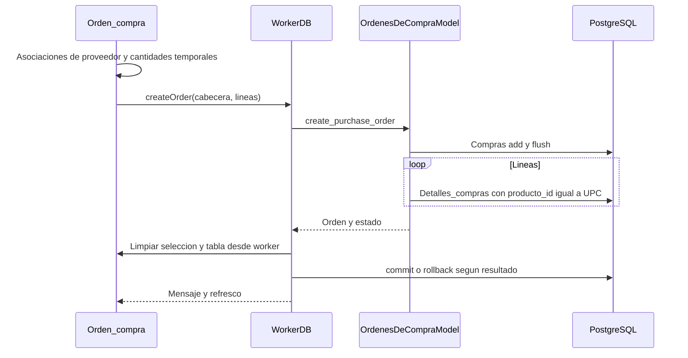
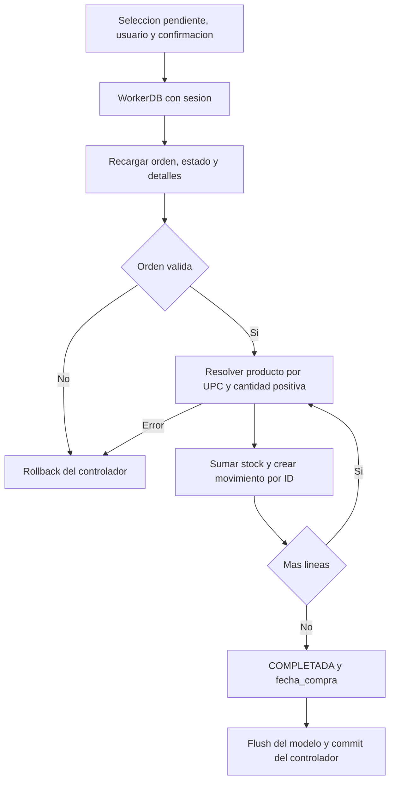
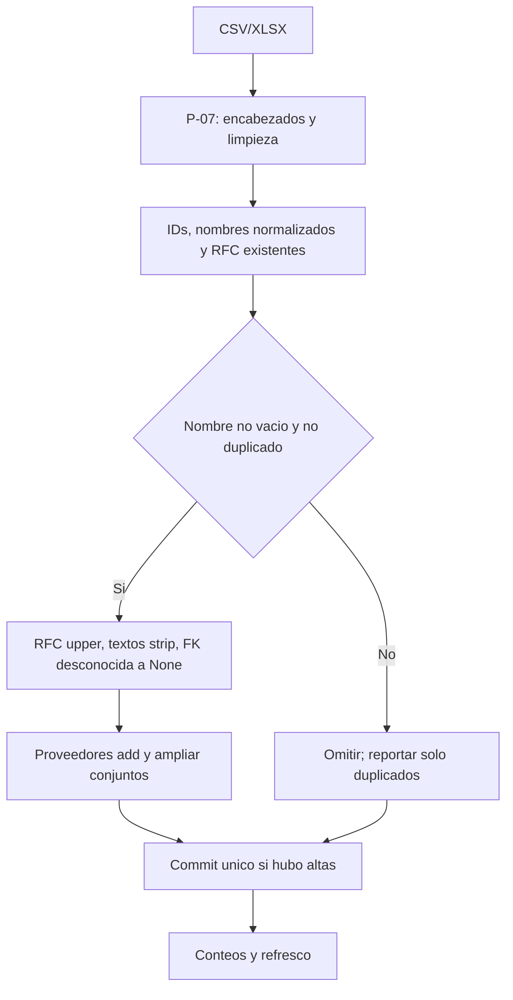
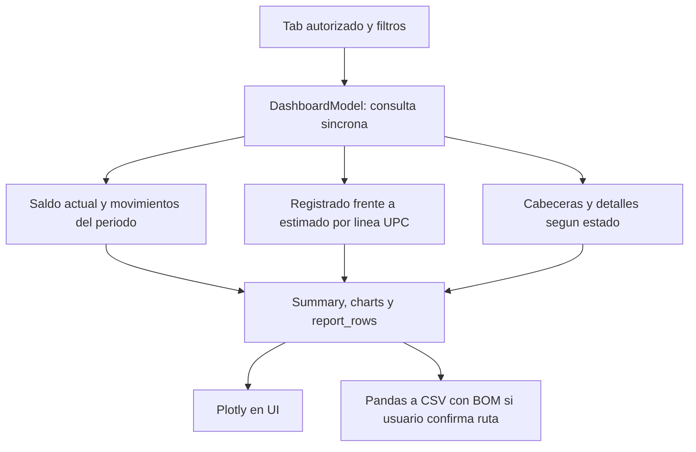

# Spec 03: compras, proveedores e inventario

## Auditoria integral de Compras 2026-11-12

Incremento autorizado C-01/C-02/C-03/C-04/C-05, REF-07/22/25/34/36 y cohorte de locks REF-40. Se conserva esquema, FK por UPC, Float, stock global, costos y APIs publicas. Autorizacion explicita posterior: editor de PENDIENTE con proveedor fijo, lineas/cantidades/pago editables y precios registrados conservados; PostgreSQL efimero mediante ejecutor existente. No es certificacion global de infraestructura ni de otros escritores de stock.

Fuente decisora: [ComprasController.py](../../app/Controller/ComprasController.py), [OrdenesDeCompraModel.py](../../app/Model/OrdenesDeCompraModel.py), [PurchaseOrderPDF.py](../../app/Controller/PurchaseOrderPDF.py). Se siguieron los imports efectivos de las tres vistas generadas y el dialogo de cantidades, sin regenerarlas. [Pruebas de compras](../../tests/test_purchases_dashboard.py), [SQL aislado](../../tests/test_modules_postgres.py), [proveedores](../../tests/test_suppliers_vertical.py) y [REF-06](../../tests/test_ref06_notifications.py).

### Tabla de dictamen

| Boton, modal, filtro o metodo | Hallazgo As-Is | Correccion y evidencia | Dictamen/limite |
| --- | --- | --- | --- |
| Crear orden, clicked -> orden_compra_window | False de clicked se trataba como orden para editar | Conexion sin booleano; clic real abre dialogo | Qt aprobado; adaptador de edicion legacy conservado |
| Seleccion principal de pendientes/realizadas | Indice invalido conservaba orden antigua | Limpiar seleccion antes de resolver item; refresco/pestana tambien descartan seleccion | Qt aprobado |
| Editar / WindowEditarOrdenCompra | Boton desconectado y clase pass | Editor sobre snapshot, proveedor fijo, carga de cantidades/precios/pago, operacion UPDATE distinta de alta | Qt y SQL aprobados; solo pendientes |
| Permisos de editor | Nuevo escritor no tenia coordinacion autorizada | MODIFICARCOMPRA/ADMINISTRADOR en apertura, guardado y consulta_compras; regla de boton en principal | Prueba negativa; no inventa permisos |
| Cambio de orden con modal abierto | No habia editor/visor operativo | Modal conserva su snapshot/ID; reutiliza mismo ID y reemplaza otro; cantidad liga callback al producto, no a fila mutable | No modifica la orden nueva por cambio de seleccion |
| Ver detalles | No existia ventana independiente | WindowDetallesOrdenCompra de lectura, UPC/nombre/descripcion/catalogos/cantidad/precio/subtotal, sin consulta lazy | Qt aprobado |
| Seleccionar proveedor | Carrito sobrevivía al cambio | Limpiar ticket y cerrar selector anterior; rechazar callbacks/asociaciones de otro proveedor | Qt aprobado |
| Productos del proveedor, abrir selector | No cargaba productos al abrir | Primera apertura consulta una sola vez; siguientes no repiten carga inicial | Qt aprobado |
| Escanear UPC / agregar producto | DTO correcto pero sin comprobar proveedor actual; reconstruccion de set alteraba orden de filas | Validar proveedor_id, dedupe UPC y agregar al final sin reset de filas | Qt real y adaptadores REF-06/proveedores aprobados |
| Agregar lote desde selector | Reconstruia tabla con orden de set; podia reasignar cantidades por posicion | Agregar solo lineas nuevas, mantener filas/cantidades existentes y proveedor | Conserva precio del par, no Productos.precio |
| Cantidad de producto | Indice invalido abria modal; callback dependia de self.fila mutable | No abrir sin item; callback captura producto y vuelve a resolver su fila | Fraccion0.125 y seleccion invalida probadas |
| Quitar producto | No habia control de orden | Boton con icono; valida seleccion y reconstruye restantes conservando cantidades | Qt aprobado |
| Limpiar orden | No habia boton; clear conservaba ediciones por posicion | Boton con icono; limpiar conjuntos/UPC/ediciones locales y total | Correccion acotada a carrito; modelo de tabla compartido no reescrito |
| Columnas de carrito / subtotal | Sin subtotal visible | Subtotal precio de proveedor por cantidad; columna6 sigue cantidad,7 subtotal | Qt aprobado; Float y precision legacy conservados |
| Guardar alta / edicion | Segundo clic podia lanzar otro worker | Guardia de operacion y boton Terminar deshabilitado; fallo libera captura; limpieza/cierre solo tras exito | Qt aprobado; worker conserva snapshot |
| Refresco postguardado | Nuevo editor no tenia señal al principal | Cierre de editor conecta a refresco; resultado confirmado cierra, fallo conserva captura | Refrescar no repite escritura; compras no toca caja |
| Filtros de orden ID/proveedor/empleado/estado/fechas | ID exacto y nombres parciales existentes; fechas por rango diario en modelo migrado | Caracterizacion de una consulta y mismos criterios al paginar; valida ID BigInt; estado original en callback | No existe selector de igualdad para nombres de orden; no se inventa ese filtro |
| Paginacion de ordenes | Refrescar dejaba nueva_busqueda True con criterios None | Reiniciar modo de busqueda; conservar filtros/offset en pagina; resultado de generacion antigua descartado | Qt aprobado; interfaz tiene cargar mas/scroll, no boton Anterior |
| Filtros selector nombre/UPC | Nombre siempre parcial; UPC exacto; no modo explicito | Contiene/Es igual para nombre, booleano estable al paginar, una sola ejecucion; refresco limpia tambien codigo | Qt aprobado |
| Fechas de columnas realizadas | Sospecha de mapeo con espacios/guiones | Check real muestra fallback correcto; no se cambia codigo de columnas | Caracterizacion aprobada |
| Recibir boton / confirmacion | Doble clic lanzaba dos workers | Guardia por ventana; capturar order_id/usuario_id antes de confirmacion | Qt con Yes/No y cambio de seleccion aprobado |
| receive_purchase_order | Estado/stock leidos sin locks | FOR UPDATE OF Compras y populate_existing, productos bloqueados por ID ordenado; prevalidacion integral y suma acumulada por producto | SQL dos backends: misma orden recibe una vez; distintas ordenes mismo producto suman ambas |
| Recepcion / commit / rollback | Coordinador activo ya confirmaba; riesgo de confundir fachada legacy | Modelo muta/flush, consulta_compras captura ID precommit y confirma una vez; rollback ante error SQL | FK invalido revierte stock/estado/movimientos; costos/caja intactos |
| update_purchase_order | Solo cabecera, commit interno, sin estado | Pendiente bloqueada; sin commit interno; version de proveedor/pago/total/plazo/lineas evita sobrescritura; mutar despues de validar | SQL: linea nueva asociada/precio actual, cantidad editada, rollback FK y conflicto aprobados |
| Precios y cabecera en UPDATE completo | Riesgo de alterar historico al reutilizar alta | Preservar proveedor, empleado y fecha_creacion; precio de lineas existentes inmutable; nuevas requieren asociacion y precio vigente | No cambio de proveedor ni anulacion contable |
| Eliminar / delete_purchase_order | Baja fisica sin confirmacion/estado; adaptador sin exito | Confirmacion con ID capturado; bloqueo/estado PENDIENTE en modelo; resultado exito explicito y errores seguros | No borrar recibidas; no se implementa CANCELADA ni reverso de inventario |
| Exportar/abrir PDF | Relaciones opcionales sin guardia, date tratado como datetime, logo hardcodeado, omision silenciosa de detalle roto | Rutas existentes, campos opcionales/date soportados, escape de datos, buffer nuevo; linea rota rechaza documento | Bytes PDF reales aprobados; visor externo/impresora/maquetacion multipagina no certificados |
| Errores tecnicos / cierre de workers | Diez lanzamientos mostraban excepciones crudas; flags podian atascar paginacion | Mensajes seguros, recuperar flags/cierre; eliminar logs de DTO completo; adaptadores de error saneados |12 lanzamientos aprobados; cierre no cancela/revierte SQL |
| ProveedoresModel / Proveedores_productoModel | Consultas legacy y DTOs compactos distintos | Consumidor activo usa snapshots/campos reales y asociacion_snapshot; no agregar relaciones ORM al DTO | Conserva CRUD/importaciones previos; no audita cada consumidor externo |
| ProductosModel / inventario global | Otros escritores usan lectura seguida de suma/resta sin locks | Compras bloquea productos y no llama esos escritores; sin refactor lateral | Carrera compras-compras verificada; ventas/ajuste legacy vs recepcion sigue pendiente |

### Verificacion y recuperacion

TDD: defectos de clic/seleccion/carrito/locks/editor/visor/filtros/errores reproducidos antes de parche, reutilizando fixtures. Sin datos personales, passwords, impresoras ni procesos externos reales en Qt. Todos los comandos con PYTHONDONTWRITEBYTECODE=1:

- `.venv/Scripts/python.exe -m pytest -q -m unit`:433 aprobadas.
- `.venv/Scripts/python.exe -m pytest -q -m qt -p pytestqt.plugin`:371 aprobadas. Fixtures REF-06/proveedores ahora incluyen proveedor seleccionado, sin relajar dedupe/notificaciones.
- `.venv/Scripts/python.exe tests/run_postgres_ephemeral.py -q tests/test_modules_postgres.py -k 'purchase_editor_update_sql or purchase_concurrent_receipts or purchase_receipt_stock_sql' --tb=short`:6 aprobadas en PostgreSQL18.4,32 deseleccionadas; dos backends y solapamiento forzado mediante eventos, sin Session compartida. Cluster temporal detenido/eliminado, incluso en ensayo fallido por fixture corregido.
- `.venv/Scripts/python.exe tests/check_docs_links.py`:529 enlaces/anclas,0 errores. Diagnosticos de controlador/modelo/PDF/tests sin errores. Warning legacy declarative_base conservado.

No100% global: no Alembic/REF-37/empaquetado, ni concurrencia con todos los escritores de stock, ni impresion fisica/render visual del PDF. No hay nuevas columnas/estados ni DDL en aplicacion; metadata solo dentro del esquema de prueba autorizado. Rollback: retirar exclusivamente hunks de esta auditoria y sus pruebas/deltas documentales, preservando cambios ajenos; datos de prueba ya eliminados. El retiro del editor deja C-03 otra vez no disponible; no revertir compras de una instalacion para revertir codigo. Las secciones siguientes conservan el levantamiento historico As-Is y su evidencia previa, no describen el estado actualizado por este incremento.

## Evidencia PostgreSQL 18.4 (2026-11-12)

### Auditoria DTO y Manejar Precio 2026-11-12

Dictamen: NO100% global de Proveedores/Productos del Proveedor/Compras. Los lotes anteriores cerraban incrementos locales. La prueba manual encontro un modal no recorrido por tests: construir DTO/modal aisladamente no certifica seleccion->boton->modal->confirmacion. La evidencia SQL focalizada de esta seccion permanece vigente solo para sus escenarios, sin certificar carreras ni todos los consumidores.

Correcciones C-09/REF-32/34/36 en [Productos_del_Proveedor.py](../../app/Controller/Productos_del_Proveedor.py): seleccion inicial ausente controlada antes de desreferenciar; proveedor tomado del editor y comprobado contra proveedor_id, sin agregar ORM al DTO; modal recibe precio actual del par y se reemplaza al seleccionar otro producto. Paginacion "es igual" ya no lanza exacta y luego parcial: hay una sola consulta con booleano explicito. Precio confirmado emite PRECIO_ACTUALIZADO, refresca editor y cierra modal; fallo mantiene captura, hace rollback y no expone la excepcion tecnica.

[Regresiones](../../tests/test_suppliers_vertical.py):8 nuevos casos Qt de seleccion vacia/DTO real/modal alternado/precio actual/paginacion exacta-parcial/refresco postcommit/error seguro; mas1 integracion consulta_compras->DTO->tabla real Orden_compra, con UPC/dedupe preservados. Cohorte52 pruebas locales. Defectos reproducidos antes de parche; integracion de Compras caracteriza codigo vigente, no reescribe su modelo.

| Superficie auditada | Estado | Limite de certificacion |
| --- | --- | --- |
| CRUD/importacion Proveedores | Incrementos locales y SQL focalizado previos conservados | Todos los FK/borrados y duplicados concurrentes no certificados |
| Productos proveedor C-09 | Modal/seleccion/paginacion/postcommit corregidos con Qt | Precio del modal con SQL real no ejecutado en esta auditoria |
| Compras C-01/C-02/C-05 | Escaneo/selector consumen DTO compartido; ticket por UPC y snapshot para PDF | PDF real y todos los consumidores legacy sin cierre integral |
| Recepcion C-04 | Prevalidacion y evidencia SQL serial existentes | Sin locks/actualizacion condicional/prueba de carrera: REF-40 pendiente |
| Edicion/baja C-03 | WindowEditarOrdenCompra sigue pass; baja fisica no es anulacion | Edicion/reverso requieren incremento y decision, no se inventan |
| Infraestructura/seguridad | Workers opt-in y gates locales | REF-37, autorizacion integral, Alembic/empaquetado pendientes |

Contratos revisados: proveedor/representante/categoria mediante snapshots; editor mediante asociacion/producto/catalogos; escaneo/selector de Compras via DTO compartido; detalle por UPC y orden_snapshot con proveedor/empleado/catalogos/detalles para PDF. Fachadas legacy conservan ORM/commit donde existen: no equivalen a rutas migradas ni prueban retiro global del legacy.

Validacion con PYTHONDONTWRITEBYTECODE=1: `.venv/Scripts/python.exe -m pytest -q -m unit`:424 aprobadas; `.venv/Scripts/python.exe -m pytest -q -m qt -p pytestqt.plugin`:338 aprobadas; `.venv/Scripts/python.exe tests/check_docs_links.py`:521 enlaces/anclas,0 errores. Diagnosticos y git diff --check de archivos tocados sin errores. Warning legacy declarative_base permanece. Sin nueva conexion PostgreSQL, DDL, cambios de configuracion ni commits. Recuperacion: retirar solo hunks de esta auditoria y sus9 regresiones, conservando lotes/cambios ajenos. No hay datos/esquema que revertir. [Dictamen del plan](../04-plan-de-refactorizacion.md#auditoria-de-consumidores-dto-2026-11-12) y [integracion Productos](spec-01-productos-e-importacion.md) usan el archivo existente; spec-01-productos-y-catalogos.md no existe en el workspace.

Gate SQL focalizado de C-01/C-04/C-07, REF-25/29, en [test_modules_postgres.py](../../tests/test_modules_postgres.py): alta de compra y detalle con FK a codigo_upc, recepcion0.125 con stock5->5.125/estado COMPLETADA/movimiento durable. FK de usuario invalido falla en flush y rollback conserva stock5, orden PENDIENTE y cero movimientos; segunda recepcion serial se rechaza. Importacion real de proveedores agrega dos, omite duplicado y pais31 invalido; CHECK temporal en segunda fila revierte lote completo.

Ejecucion conjunta: **36 db passed, 712 deselected**, cluster efimero detenido/eliminado. [Comando, aislamiento, matriz y recuperacion](../04-plan-de-refactorizacion.md#evidencia-sql-real-de-cuatro-modulos-2026-11-12). No altera reglas, precision ni esquema instalado. No demuestra carreras de recepcion/stock, informes/dashboard SQL, PDF, pagos de compra C-12 ni Alembic. Las notas de lotes previos conservan valor historico; gates sustituidos solo para estos escenarios.

## 1. Alcance y fuentes

Fecha: 2026-11-10. As-Is por lectura estatica, sin ejecutar GUI, SQL, recepciones ni reportes. [Maestro SDD](../03-especificaciones-funcionales-sdd.md), [datos](../02-modelo-de-datos.md), [productos](spec-01-productos-e-importacion.md), [ventas/caja](spec-02-ventas-caja-y-promociones.md). Los escenarios son requisitos para pruebas futuras, no pruebas ejecutadas.

| Fuente | Responsabilidad |
| --- | --- |
| [ComprasController.py](../../app/Controller/ComprasController.py) | Compras, Orden_compra, SeleccionProductosProveedor y WindowEditarOrdenCompra |
| [OrdenesDeCompraModel.py](../../app/Model/OrdenesDeCompraModel.py) | OrdenesDeCompraModel, cabecera, detalles y recepcion |
| [CantidadProductosComprasController.py](../../app/Controller/CantidadProductosComprasController.py) | Captura de cantidad para linea temporal |
| [ProveedoresController.py](../../app/Controller/ProveedoresController.py) | Control_proveedores, mantenimiento e importacion |
| [ProveedoresModel.py](../../app/Model/ProveedoresModel.py) | ProveedoresModel y escritura de asociaciones |
| [RepresentanteProveedorModel.py](../../app/Model/RepresentanteProveedorModel.py) | RepresentanteProveedorModel |
| [Productos_del_Proveedor.py](../../app/Controller/Productos_del_Proveedor.py) | Productos_de_proveedorController y CambioPreciosProductosProveedores |
| [Proveedores_ProductosModel.py](../../app/Model/Proveedores_ProductosModel.py) | Proveedores_productoModel y precio de asociacion |
| [CategoriasController.py](../../app/Controller/CategoriasController.py) | CategoriasController compartido |
| [CategoriasModel.py](../../app/Model/CategoriasModel.py) | CategoriasModel, seleccion por tipo |
| [MetodosPagoController.py](../../app/Controller/MetodosPagoController.py) | Alta de metodo, otras acciones pass; contrato V-12 |
| [MetodoPagoModel.py](../../app/Model/MetodoPagoModel.py) | Catalogo comun a compras/ventas |
| [PurchaseOrderPDF.py](../../app/Controller/PurchaseOrderPDF.py) | PurchaseOrderPDF y NumberedCanvas |
| [ProductosController.py](../../app/Controller/ProductosController.py) | ExistenciasClase, ajuste manual P-10 |
| [ProductosModel.py](../../app/Model/ProductosModel.py) | ProductosModel.ejecutar_movimiento |
| [DashboardController.py](../../app/Controller/DashboardController.py) | DashboardController, consultas, graficas y exportacion |
| [DashboardModel.py](../../app/Model/DashboardModel.py) | DashboardModel, agregaciones analiticas |
| [OperacionMasivaCsvController.py](../../app/Controller/OperacionMasivaCsvController.py) | Lector comun P-07 |
| [BaseDatosModel.py](../../app/Model/BaseDatosModel.py) | Compras, Detalles_compras, Productos, Movimientos_Inventario y proveedores |
| [SistemaPrincipalController.py](../../app/Controller/SistemaPrincipalController.py) | Navegacion y restricciones de botones |
| [Hilo_consultas.py](../../app/Controller/Hilo_consultas.py) | WorkerDB; commit pertenece al llamador/modelo |

No existen en app/ los archivos MovimientosInventarioController.py, MovimientosInventarioModel.py, ReportesController.py ni ReporteVentasCompraController.py sugeridos en la solicitud. No se inventan sus clases o pantallas: ajustes se trazan a ExistenciasClase/ProductosModel y analitica a DashboardController/DashboardModel. La ausencia de esos archivos no demuestra ausencia de todo reporte ni la existencia de un historial CRUD dedicado de movimientos.

Actor: comprador/administrador autorizado. SistemaPrincipal admite ADMINISTRADOR o alguno de CREARCOMPRA/MODIFICARCOMPRA/ELIMINARCOMPRA para modulo compras; agregar se restringe a CREARCOMPRA, recibir a MODIFICARCOMPRA, borrar a ELIMINARCOMPRA. Para proveedores aplica la familia CREARPROVEEDOR/MODIFICARPROVEEDOR/ELIMINARPROVEEDOR y protege botones guardar/actualizar/eliminar e importar. Los modelos no validan estos permisos por si mismos; no hay permiso semilla distinto de recibir mercancía o vincular producto.

## 2. C-01: formar y registrar una orden de compra

**Actor/entrada:** operador de compras, Compras.orden_compra_window abre Orden_compra. Orden_compra carga proveedores y metodos de pago en combos mediante workers. Elegir proveedor condiciona la consulta de sus productos. El escaneo __buscar_producto_del_proveedor toma UPC strip; consultar_productos_del_proveedor_query llama Proveedores_productoModel.consultar_productos_del_proveedor_por_codigo con proveedor.id y codigo.

**Contrato:** se seleccionan objetos ProductoProveedor, no solo Productos. La consulta de asociacion filtra proveedor y Productos.codigo_upc exacto, con first; devuelve objeto o None y estado. El selector adicional SeleccionProductosProveedor consulta por nombre/codigo y conserva selecciones; la orden mantiene conjunto de asociaciones y codigos_agregados para no repetir UPC en memoria. Una linea nueva muestra cantidad "1". CantidadProductosComprasController devuelve la cantidad al padre mediante senal; la tabla de orden no es un editor SQL directo.
CantidadProductosComprasController.cantidadEnviadaSignal esta declarada Signal(int), pero aceptar toma value de un control decimal: la conversion efectiva puede perder fraccion o fallar segun Qt/PySide. Debe caracterizarse antes de asumir compra fraccionaria completa.

**Reglas de formacion:** Orden_compra.__obtenerDetallesProductosParaComprar exige conjunto no vacio; recorre tabla y toma cantidad de columna 6 con float, default 1.0 si vacio/invalido. Por linea toma producto_proveedor.producto, precio_unitario=precio_venta de la asociacion o 0 si no tiene atributo, subtotal=precio*cantidad. No usa Productos.precio como costo de compra ni recalcula costo_final/margen del producto. Suma subtotales sin redondeo monetario explicito en ese metodo.

Combo de pago: solo texto exactamente "Crédito" muestra el campo de mensualidades. Otros textos reinician plazo a 0 y lo ocultan. Cabecera usa proveedor seleccionado, usuario["id_empleado"], fecha_creacion=hoy como date, fecha_compra=None, metodo.id, plazo capturado y fecha_vencimiento=hoy+timedelta(days=plazo*30), aun para plazo cero. No hay calendario real de meses ni abonos de compra en este flujo. Una seleccion de metodo/proveedor ausente puede fallar al acceder .id; no deducir validacion de existencia por el combo.

**Persistencia:** Orden_compra.createOrder lanza WorkerDB hacia __createOrder_query. OrdenesDeCompraModel.create_purchase_order crea Compras con referencias y total, add/flush para id; construye Detalles_compras con producto_id=item.producto.codigo_upc, cantidad, precio y subtotal; agrega cada detalle y retorna orden,True sin commit. Estado PENDIENTE viene del default ORM. El controlador hace commit si exito, rollback si falso/excepcion. El modelo captura Exception y retorna la excepcion como primer elemento con False, sin rollback propio.

**Hilos/defectos:** __createOrder_query llama limpiar_productos_seleccionados antes de commit, dentro del worker: modifica modelo Qt y conjuntos de UI, y puede borrar el ticket temporal aun si el commit posterior falla; esa deuda no se modifica aqui. En el As-Is original agregarProductoALConjuntoTabla invocaba Mensaje().mensaje_exito, ausente en Mensaje, despues de agregar a memoria. REF-06 (2026-11-10) cambia solo esa llamada por mensaje_informativo. [Regresion Qt](../../tests/test_ref06_notifications.py) verifica tabla real con una linea, una notificacion y rechazo de UPC repetido sin duplicar; cargas iniciales de BD y mensajes simulados. No se recibe stock al registrar la orden.

**BD vs captura:** FK proveedor/empleado/metodo obligatorias; Detalles_compras.producto_id Text referencia UPC String(20) unique. Cantidad/precio/subtotal Float sin CHECK positivo ni reconciliacion SQL de subtotales. plazo_pago Integer nullable, pero UI lo obtiene de un control numerico; debe probarse valor fraccionario al persistir. Ninguna regla de recepcion parcial se ejecuta en alta.

**Caracterizacion:** proveedor/metodo sin seleccion; UPC no asociado y repetido; cantidad vacia/no numerica/cero/negativa por llamada directa; precio de asociacion cero; credito con plazo fraccionario y texto de pago renombrado; commit fallido tras limpiar tabla; comprobar orden/detalles confirmados y stock sin cambios.



## 3. C-02: consultar, filtrar y exportar orden

**Actor/entrada:** operador con acceso compras; Compras.obtener_compras_query y buscar_ordenes_de_compra_query, mas generar_orden_compra_pdf. OrdenesDeCompraModel.get_all_purchase_orders filtra estado por igualdad, fecha_compra descendente y offset/limit (100 por defecto). get_purchase_orders_by_criteria mantiene filtro de estado y agrega los criterios no vacios: id exacto, nombre de empleado parcial, nombre de proveedor parcial y fechas por igualdad; ordena fecha_creacion descendente antes de paginar.

**Contrato:** fechas de filtro se comparan directamente contra DateTime, no un rango de dia completo dentro del modelo; una fecha a medianoche puede no coincidir con fecha/hora de recepcion. state=None no significa todos: la igualdad ORM se convierte en comprobacion de NULL. Los metodos cargan anticipadamente proveedor, empleado/sucursal/departamento/puesto, metodo y detalles/producto/unidad/presentacion para consumir fuera de sesion.

**BD/hilos:** WorkerDB para consultas del controlador, solo lectura y cierre de sesion, sin commit funcional de compras. Modelo captura errores y retorna [],False (en criterios tambien imprime), confundible con ningun registro. get_purchase_order_by_id retorna first o relanza error.

**Exportacion:** generar_orden_compra_pdf usa PurchaseOrderPDF sobre orden seleccionada; detalles y entidades relacionadas son entrada del reporte, no otra compra. PurchaseOrderPDF ofrece generar_pdf, get_pdf_bytes, save_to_file y get_temp_file; NumberedCanvas agrega numeracion de paginas. No hay commit ni recepcion por emitir PDF. Cargar relaciones antes de cerrar sesion sigue siendo requisito para no depender de lazy loading.

**Caracterizacion:** 0/100/101 ordenes, estado vacio/None/PENDIENTE/COMPLETADA, nombre parcial, fecha exacta frente a hora, navegacion entre tablas y seleccion antigua, orden eliminada antes de exportar, fallo del destino PDF.

## 4. C-03: edicion y eliminacion de compras

**Actor/permiso:** mantenimiento de compra segun botones del principal. No se documenta CRUD completo de lineas: WindowEditarOrdenCompra es una clase QDialog con pass. El As-Is original de Compras.orden_compra_window(orderSelected) intentaba conectar al atributo recibirOrdenCompra de Orden_compra, ausente. REF-07 (2026-11-10) informa edicion no disponible y retorna antes de construir modal cuando la seleccion no es None; retira la conexion muerta. Nueva orden y ventana visible mantienen su comportamiento. Tres [regresiones Qt](../../tests/test_phase1_quick_wins.py) con doble de dialogo verifican las ramas sin SQL; no se implementa editor ni recepcion alternativa.

**Modelo auxiliar:** OrdenesDeCompraModel.update_purchase_order busca por id y modifica solo proveedor_id, fecha_compra y empleado_id; hace commit interno, sin editar detalles, total, metodo, plazo ni vencimiento. No exige estado PENDIENTE y no tiene rollback en su except (relanza). No atribuirle una pantalla de edicion de lineas ni ajuste automatico de inventario.

**Baja:** Compras.orderDelete exige seleccion, inicia WorkerDB -> eliminar_orden_compra_query -> delete_purchase_order. Modelo borra fisicamente Compras si existe, sin commit propio. Controlador commit al True y rollback en falso/error, retorna dict mensaje sin exito; callback muestra mensaje, limpia seleccion y refresca. No hay confirmacion de usuario en orderDelete ni guardia de estado en ese metodo/modelo.

**BD:** Compras.detalles delete-orphan/passive_deletes y FK CASCADE pueden borrar detalles con la cabecera. La baja no repone ni resta inventario de una orden ya recibida y no borra/compensa movimientos de recepcion. No hay estado CANCELADA ni flujo contable de anulacion de compra en estos metodos. Eliminar no es cancelar con reverso.

**Caracterizacion:** eliminar pendiente y completada, detalle/cabecera inexistente, orden con movimientos, error de commit, uso directo de update_purchase_order sobre completada, intentar apertura con orderSelected y comprobar metodo ausente. Conservar evidencia de saldos antes de introducir una futura cancelacion funcional.

## 5. C-04: recibir mercancia y actualizar inventario

**Actor/entrada:** MODIFICARCOMPRA en boton recibir. Compras.recibirOrdenCompra exige seleccion, estado PENDIENTE en entidad de UI, usuario con clave id_usuario y confirmacion. WorkerDB llama recibir_orden_compra_query -> OrdenesDeCompraModel.receive_purchase_order(order_id, usuario_id, fecha_compra=datetime.now()).

**Reglas del modelo:** vuelve a cargar orden y relaciones; exige existencia, estado exactamente PENDIENTE y detalles no vacios. Por detalle resuelve detalle.producto via FK por UPC; cantidad=float(... or 0), debe ser >0. Si producto falta o cantidad invalida retorna fallo. Suma cantidad a Productos.existencia sin redondeo explicito, agrega Movimientos_Inventario con producto.id (aqui si ID numerico), cantidad, entrada, fecha recibida y usuario_id real, notas de recepcion por id de orden. Al acabar cambia estado COMPLETADA, fecha_compra=fecha_movimiento y flush. No commit interno; el controlador confirma todo si True y revierte si falso o excepcion, incluso si ya se mutaron detalles anteriores en la sesion.

**Lo que no hace:** no actualiza costo_inicial, costo_final, margen_porcentaje ni precio del producto; no pondera costos; no actualiza precio_venta de proveedor, no paga la orden ni altera SesionCaja. No recibe por linea/parcialmente ni guarda recibido_por distinto de los movimientos. fecha_movimiento ORM es Date, aunque se pasa datetime; pierde hora al persistir segun dialecto. La fecha/hora completa se conserva en Compras.fecha_compra.

**Concurrencia:** lectura de estado y stock sin bloqueo explicito/optimista. Dos recepciones simultaneas pueden superar la precondicion antes de cambiar estado; no se garantiza exactamente una recepcion por la validacion Python. Tampoco se evita perdida de actualizacion frente a otra entrada/venta.

**Caracterizacion:** orden ausente/completada/sin detalles, segundo intento serial y concurrente, linea invalida despues de una valida, usuario inexistente, producto borrado/codigo cambiado, cantidad fraccionaria, rollback integral y costos iguales antes/despues. No hay prueba ejecutada de esas carreras en esta fase.



## 6. C-05: identidad de producto y limites de integridad

**Actores/caminos:** comprador en alta/consulta/recepcion (C-01/C-02/C-04) y mantenedor del catalogo (P-03). Detalles_compras.producto_id no es un numero: guarda UPC como Text y referencia Productos.codigo_upc String(20) unique, sin onupdate CASCADE declarado. SQLAlchemy relacion Detalles_compras.producto usa esa FK. No hacer session.get(Productos, detalle.producto_id) como si fuera la PK.

ProductoProveedor, en cambio, enlaza Productos.id y Proveedores.id; la consulta de productos de proveedor filtra por UPC a traves de la entidad Productos y al crear la orden se extrae su codigo_upc. Al recibir se navega de vuelta a Productos por ese texto y los movimientos registran producto.id. No hay conversion UPC -> entero ni perdida deliberada de ceros iniciales en ese recorrido.

**Efectos/errores:** cambiar UPC desde SQL/otro flujo puede quedar impedido por detalles existentes; no hay contrato de actualizacion en cascada. El editor P-03 recibe UPC pero su modelo no lo asigna, por lo que ese editor no prueba una migracion de FK comercial. Longitudes/NULL siguen el diccionario: detalle.producto_id obligatorio, cantidades Float sin CHECK; el modelo recibe objetos, no valida longitudes de UPC en el alta de compra.

**Hilos/transaccion:** hereda la unidad de cada camino, no una transaccion propia. Caracterizar UPC alfanumerico/con ceros, referencias rotas de una BD divergente, intento de cambio de codigo y borrado de producto usado. Una refactorizacion debe decidir identidad estable y migracion de datos, no renombrar producto_id como si bastara.

## 7. C-06: alta, consulta y categoria de proveedor

**Actor/entrada:** CREARPROVEEDOR para boton guardar/importar/nueva categoria; acceso a proveedores por cualquiera de su familia de permisos o ADMINISTRADOR. Control_proveedores.control_agregar_proveedor toma obtener_datos_proveedor y representante opcional. Exige categoria currentData y todos los valores del dict de proveedor no vacios, incluidos direccion_adicional, web/correo y moneda; no solo nombre/RFC. La moneda se divide por ':' en clave/tipo: una opcion sin ese separador puede fallar antes del worker.

| Campo | Limite de captura del controlador | BD |
| --- | --- | --- |
| nombre | 150 | String(150) |
| pais, estado, ciudad | 50 cada uno | String(30) cada uno: captura excede BD |
| codigo_postal | 5 y validator numerico | String(5) |
| calles, avenidas, colonia | 60, 60, 50 | String(60), String(60), String(50) |
| rfc, correo, telefono | 13, 100, 10; telefono solo numeros | String(13), String(100), String(10), sin unique |
| Nombre/apellidos representante | 100, 60, 60 | String(100), String(60), String(60) |
| Telefono/correo/puesto representante | 10, 100, 100; telefono numerico | String(10), String(100), String(100) |

Textos se recortan con strip, no upper universal; pagina_web y direccion_adicional son Text. El controlador no impone regex general de correo/web en validaciones. La mayor parte de columnas de proveedor es NOT NULL inferido, pero admite cadena vacia en SQL; categoria_id y representante_id son nullable.

**Flujo/BD:** agregar_proveedor_query (WorkerDB) sin representante llama ProveedoresModel.agregar_proveedor y comprueba su estado; con representante llama primero RepresentanteProveedorModel.agregar_representante, que busca coincidencia exacta nombre/apellidos y retorna existente,False o add/flush,True. Si ya existe representante, el controlador revierte y no reutiliza ese representante. Si lo crea, llama agregar_proveedor pero no comprueba su retorno antes de commit/exito: proveedor duplicado puede dejar representante nuevo sin proveedor, o un error de flush llevar a fallo posterior.

ProveedoresModel.agregar_proveedor busca duplicado por nombre exacto sin unique SQL, crea entidad y add/flush; captura Exception -> None,False. Catalogo activo es categoria_id -> Categorias_proveedores.id; proveedor_categoria existe como tabla puente pero no es secondary de Proveedores.categoria ni se escribe por este alta. La consulta principal usa obtener_proveedores/obtener_nombre_proveedor con nombre ascendente, paginacion de 100 y joinedload de categoria/asociaciones/representante/compras; busqueda por nombre ILIKE. La consulta exacta consultar_proveedor se usa en otros flujos, no normaliza todos los nombres.

**Categoria:** Control_proveedores.nueva_categoria abre CategoriasController(tipo_categoria="proveedores"); reglas de alta/baja y errores estan en P-06. Nombre UI 150 coincide con String(150) de categoria proveedor; descripcion Text obligatoria en UI. Semillas de 15 categorias solo si tabla vacia, ver datos 02. La existencia de proveedor_categoria no implica que la pantalla gestione categorias multiples.

**Caracterizacion:** pais/estado/ciudad de 30/31/50, moneda sin ':', campos vacios, representante existente/nuevo/incompleto, nombre exacto y distinto en mayusculas, duplicado concurrente; comprobar filas de representante huerfanas y categoria directa frente a tabla puente.

## 8. C-07: editar y borrar proveedor/representante

**Actor/entrada:** MODIFICARPROVEEDOR / ELIMINARPROVEEDOR en los botones principales. Control_proveedores.control_actualizar_proveedor exige campos/categoria y seleccion, confirma y manda snapshot a actualizar_proveedor_query en WorkerDB. El As-Is original desempaquetaba el id/None de RepresentanteProveedorModel.actualizar_representante como tupla. REF-08 (2026-11-10) recibe el ID escalar y comprueba None: existente se actualiza sin duplicarlo, ausente hace rollback. Se conserva firma del modelo y comportamiento de representante compartido, comprobado con modelo real y sesion simulada. Si el proveedor no tenia representante y se solicita, intenta crear y usa su id.

ProveedoresModel.actualizar_proveedor modifica campos, exige categoria_id no None (mas estricto que BD), carga categoria si existe y actualiza representante o lo pone None. No hace commit propio; algunos fallos retornan None en vez de tupla, otros (None,False). Controlador captura fallos y revierte, confirma si estado verdadero. El representante puede compartirse entre proveedores; modificarlo no es una copia por proveedor.

**Baja:** Control_proveedores.eliminar_proveedor exige seleccion y confirmacion -> eliminar_proveedor_query. ProveedoresModel.eliminar_proveedor retorna (None,True), (False,False) o (None,False). En el As-Is original el controlador evaluaba la tupla como bool y confirmaba fuera del try. REF-09 (2026-11-10) desempaqueta el estado, confirma dentro del try solo al exito y revierte ante False/excepcion/commit fallido, devolviendo exito booleano. Regresion con dobles verifica esas ramas; bloqueo real por compras/FK sigue pendiente de PostgreSQL.

**BD/bordes:** borrar proveedor puede borrar ProductoProveedor por cascada ORM; Compras mantiene FK al proveedor y puede bloquear borrado. No se elimina automaticamente representante huerfano. RepresentanteProveedorModel.eliminar_representante contiene una llamada incorrecta self.session(RepresentanteProveedorModel), captura error y retorna False; no se presenta como baja funcional de representante.

**Caracterizacion:** editar con/sin representante anterior, proveedor desaparecido, categoria inexistente; borrar con compras, sin referencias y ausente; comprobar bool(tuple) frente a filas reales y que el mensaje no se interprete como commit exitoso de proveedor.

## 9. C-08: importar proveedores CSV/XLSX

**Actor/entrada:** CREARPROVEEDOR en boton; Control_proveedores.importar_proveedores_csv selecciona archivo y lanza WorkerDB -> importar_proveedores_query. Usa lector comun P-07, por tanto .xls se anuncia en selector pero se rechaza; extras invalidos rechazan archivo, conversiones tolerantes y encabezados exactos.

### Columnas requeridas de proveedores

```text
nombre
```

### Columnas validas de proveedores

```text
id, nombre, pais, estado, ciudad, codigo_postal, calles, avenidas,
colonia, direccion_adicional, rfc, pagina_web, correo, telefono,
clave_moneda, tipo_moneda, representante_id, categoria_id
```

**Reglas:** carga IDs existentes de categorias/representantes, nombres lower/strip y RFC upper de BD; por fila nombre vacio se omite, duplicado por nombre normalizado o RFC no vacio se omite y reporta nombre. Los conjuntos se amplian por fila para detectar repetidos en el lote. Nombre conserva capitalizacion, RFC se convierte a upper; otros textos strip con default "". IDs parse_int inexistentes/ausentes -> None; no se crea categoria/representante por nombre. id se acepta como columna, pero no se asigna al objeto nuevo.

**Transaccion/BD:** construye Proveedores directamente sin pasar agregar_proveedor; session.add por fila y commit final si hubo altas, exito=True incluso con cero. No hay try/rollback explicito dentro del metodo ni savepoint por fila; error SQL llega al worker y el cierre de sesion descarta trabajo no confirmado. Omision por campo vacio no se reporta individualmente. Callback limpia worker, muestra cantidades y refresca tabla. No se validan longitudes ni regex UI, ni se impone unique SQL a nombre/RFC; dos importaciones concurrentes pueden crear duplicados.

**Caracterizacion:** columnas extras y id ignorado; nombres con espacios/mayusculas, RFC repetido/vacio, FK desconocida, texto de pais de 31, fila sin nombre, archivo sin nuevas altas; comparar validaciones mas estrictas de alta manual frente a importacion que permite campos vacios.



## 10. C-09: asociar productos al proveedor y fijar precio

**Actor/entrada:** desde Control_proveedores.mostrar_productos_y_precios hacia Productos_de_proveedorController. El editor usa listas de productos de sistema, asociados y pendientes de vincular, filtros por nombre exacto/parcial/UPC y paginacion. No hay permiso dedicado validado en Proveedores_productoModel; la puerta de modulo no sustituye autorizacion de cada metodo del editor.

Productos_de_proveedorController.vincular_producto_al_proveedor_funcion exige lista no vacia y confirma -> vincular_productos_al_proveedor_query en WorkerDB -> ProveedoresModel.actualizar_productos_al_proveedor. Modelo recupera proveedor/productos, omite productos desaparecidos y, si falta el par, crea ProductoProveedor con precio_venta=0.00; hace commit interno, rollback en error y retorna (proveedor,True) o ([],False). El As-Is original interpretaba esa tupla como bool. REF-09 desempaqueta su estado para no anunciar exito ante False. El commit interno y otro commit exterior se conservan hasta REF-24; el mensaje aun cuenta productos de entrada y puede sobreestimar los omitidos. No se garantiza atomicidad mayor por este parche; regresion de retornos y excepciones con dobles.

**Precio:** CambioPreciosProductosProveedores.cambiar_precio exige valor >0 del spinbox; cambiar_precio_producto_query llama Proveedores_productoModel.establecer_precio_producto_del_proveedor. Modelo actualiza precio_venta si existe par o crea par con ese precio; retorna bool sin commit (rollback si excepcion). Controlador confirma/revierte en WorkerDB. No cambia Productos.precio/costo_inicial/costo_final ni inventario. La validacion positiva no esta en modelo ni CHECK SQL; llamada directa puede escribir otro signo.

**Desvincular:** Productos_de_proveedorController.desvincular_producto exige seleccion -> productos_del_proveedor_query recibe dict proveedor_id/producto_id/nombre_producto -> Proveedores_productoModel.desvincular_producto_del_proveedor elimina relacion, sin commit; controlador commit al True o rollback/error. Solo borra asociacion, no producto ni detalles de compras. ProductoProveedor PK compuesta con SET NULL sigue siendo anomalia para borrados SQL directos (ver datos 02).

**Diferencia con P-03:** esta ruta escribe el objeto de asociacion y su precio; asignar Productos.proveedores/Proveedores.productos viewonly en otra pantalla no es equivalente.

**Caracterizacion:** vincular par ya existente, producto borrado durante lote, proveedor inexistente, fallo de commit interno y bool(tuple), precio cero/positivo/negativo por API, desvincular un producto usado en compras, precio de compra tomado antes/despues del cambio de asociacion.

## 11. C-10: movimientos e inventario operativo

**Actores/caminos reales:** ajuste manual ExistenciasClase.ejecutar_existencias -> ProductosModel.ejecutar_movimiento (P-10); recepcion C-04; salidas y reversos por VentasModel.createSale/cancelSale (V-07/V-10). No existen las clases dedicadas de historial de movimientos propuestas en la solicitud; no se documenta una pantalla de editar/eliminar movimientos individuales.

**Contrato/efectos:** ajuste manual usa cantidad con 3 decimales y maximum=1e45, combo Entrada/Salida, fecha y notas. REF-12 corrige el id_empleado original por id_usuario validado en GUI y comprueba su existencia en modelo antes de mutar; query revierte ante False. P-10 y sus regresiones con dobles documentan el delta, sin prueba de FK SQL real. No se agregan control de stock negativo ni bloqueo. Recepcion usa usuario_id del contexto; ventas guarda salida y cancelacion entrada. Alta/edicion/importacion de Productos puede fijar existencia directamente sin crear movimientos: SUM(entradas)-SUM(salidas) no reconstruye necesariamente el saldo actual.

**Hilos/transaccion:** ajuste y recepcion usan workers y commit del controlador; venta/cancelacion commit del modelo. El inventario es global por producto; sucursal_producto no contiene saldos. Los movimientos pueden perderse al borrar producto por cascade, y Date no conserva hora. Tipos en consultas analiticas se comparan con literales minusculos entrada/salida; variantes en textos guardados pueden no sumar.

**Caracterizacion:** saldo tras alta sin historico, ajuste negativo/salida superior, movimiento con tipo no normalizado, recepciones/ventas simultaneas, producto borrado, ID empleado/usuario distintos y fracciones 3 vs 2 decimales de venta.

## 12. C-11: reportes y dashboard de inventario, compras y ventas

**Actor/entrada:** DashboardController, con tabs restringidos por familias de permisos producto/compra/venta en _aplicar_permisos_ui y acceso general del principal; no hay permiso REPORTE independiente. cargar_dashboard_inventario, cargar_dashboard_compras y cargar_dashboard_ventas consultan DashboardModel de forma sincrona con cursor de espera, no WorkerDB; retornos incluyen filtros, summary, charts y report_rows para exportar. No guardan totales de reporte en BD.

**Inventario:** DashboardModel.get_inventory_dashboard permite rango, low_stock_only y top_n minimo 1; stock bajo es existencia<=coalesce(minima,0), sin existencia <=0. Resumen usa saldo actual y valor estimado existencia*precio (precio de venta, no costo). Rango filtra movimientos diarios y sumas por producto, no reconstruye inventario a fecha. Grafica de movimientos suma entrada/salida por Date en rango inclusivo; reporte lista UPC/nombre/categoria, saldo/min/max, entradas/salidas del periodo y stock_bajo. El filtro stock bajo afecta productos/reporte, pero no necesariamente el agregado global de movimientos del periodo.

**Compras:** DashboardModel.get_purchases_dashboard usa fecha coalesce(fecha_compra,fecha_creacion), rango completo desde time.min a time.max y estado opcional salvo TODOS. _normalize_date_range por defecto ultimos 30 dias, intercambia extremos invertidos. Join a producto compara UPC, no id. _purchase_amount_expressions y _estimate_purchase_line_amount_python distinguen: registrado=subtotal positivo, o cantidad*precio_unitario positivo, o cero; estimado usa registrado si positivo, en otro caso cantidad*costo_final/costo_inicial actual no cero. No reescribe cabecera ni costos. Reporta ordenes/unidades/productos distintos, importes registrados/estimados, pendientes, estados, proveedores top y filas por orden; proveedor top ordenado por unidades/ordenes. Cambiar costo actual puede cambiar una estimacion historica cuando faltan precios de compra.

**Ventas:** DashboardModel.get_sales_dashboard usa periodo por Ventas.fecha y estado seleccionado; no presumir exclusion de canceladas cuando estado es TODOS. Analiza cabeceras/detalles y genera filas para su tab; no es un reverso contable de caja ni Historial_creditos. Los estados de tabs se cargan de valores distintos de BD.

**Salida:** DashboardController._exportar_csv exige filas, propone dashboard_seccion_fecha_hora.csv y usa pandas.DataFrame.to_csv(index=False, encoding="utf-8-sig"). Cancelar selector no escribe; error de archivo muestra alerta. Graficas se renderizan con Plotly mediante _set_plotly_html, no son otro modulo ReportesController. PDF de orden es C-02 y ticket de venta V-11, no exportacion equivalente a este CSV.

**Errores/caracterizacion:** modelos capturan excepciones con rollback y payload vacio/False/mensaje. Probar rango invertido, fechas inclusivas, TODOS/canceladas, costos registrados cero, diferencias registrado/estimado, categoria ausente, variantes Entrada/entrada, sin filas/permiso de archivo, datos grandes que bloquean UI y exportar despues de cambiar filtros o fallar recarga. Comparar SQL estimado y estimacion Python para datos negativos o incoherentes, no certificar equivalencia fuera de datos normales.



### Delta C-11: dashboard nativo (2026-11-12)

Incremento autorizado REF-34/36 de Inicio, sin DDL ni escrituras. Los apartados As-Is de C-11 y su diagrama conservan el levantamiento historico, no describen este delta activo.

- [DashboardController.py](../../app/Controller/DashboardController.py) conserva tabs, permisos y CSV; abre Resumen con fechas inclusivas (extremos invertidos se intercambian), sucursal, agrupacion diaria/mensual, cuatro KPI y cuatro graficas. [DashboardResumen.py](../../app/View/UserInterfacePy/DashboardResumen.py) es la nueva vista importada: QtCharts con animacion de 300 ms, barras horizontales Top 5, lineas, dona y barras de inventario. Todas las series conectan hovered a tooltip con etiqueta completa y valor sin redondeo de presentacion. No usa HTML, Plotly ni WebEngine; se retiran dependencias de requisitos/empaquetado.
- [DashboardModel.py](../../app/Model/DashboardModel.py) agrega consultas obtener_ventas_tiempo, obtener_top_productos, obtener_ingresos_pago, obtener_resumen_inventario y obtener_kpis. consultar_dashboard materializa payload simple en WorkerDB con cierre_seguro=True; el controlador captura filtros antes de ejecutar, restringe secciones segun permisos existentes y conserva generaciones/cierre para descartar respuestas antiguas.
- Regla nueva del Resumen: ventas activas no CANCELADA; los tabs legacy conservan TODOS. Ingresos/ticket usan cabeceras para evitar multiplicacion por detalles. Top 5 agrupa por ID (nombre de snapshot agregado), suma cantidad y total_con_iva de detalles activos y desempata por ID. Pagos agrupa por nombre del catalogo existente; no inventa cuatro categorias ni atribuye abonos de credito a ingresos cobrados. Ordenes cuenta Compras por coalesce(fecha_compra,fecha_creacion), incluyendo estados existentes.
- Margen bruto estimado = subtotal de cabecera menos cantidades activas por costo actual coalesce(costo_final,costo_inicial,0). No hay snapshot de costo ni gastos operativos suficientes para ganancia neta real; no se afirma haberla implementado. Costos nulos/detalles faltantes reducen costo estimado a cero, no certifican margen historico. Inventario es global actual, bajo positivo <= minima y agotado <=0, categorias disjuntas; no se filtra ni reconstruye por fecha/sucursal. Sucursal se atribuye mediante empleado actual, no sucursal historica de la operacion.
- Evidencia focalizada: [test_dashboard_native.py](../../tests/test_dashboard_native.py), 9 unit (compilacion SQL PostgreSQL sin conexion: limites, sucursal y rangos invertidos) y 6 Qt (render/recarga, cuatro hovered exactos/estados vacios y worker real con Session doble y GUI respondiendo). 15 aprobadas con `PYTHONDONTWRITEBYTECODE=1 .venv/Scripts/python.exe -m pytest -q -p pytestqt.plugin tests/test_dashboard_native.py`. No demuestra resultados de agregados en PostgreSQL, consistencia de varias consultas bajo escrituras concurrentes ni rendimiento con grandes volumenes.
- Comando solicitado `PYTHONDONTWRITEBYTECODE=1 .venv/Scripts/python.exe -m pytest -q -m qt -k dashboard`: 67 omitidas antes de ampliar cobertura, porque pytest.ini deshabilita el plugin. Cierre final con `-p pytestqt.plugin`: 72 Qt aprobadas; `-m unit -k dashboard`: 43 aprobadas. Incluye coincidencias por nombre de archivo de Compras. Diagnosticos Python sin errores y diff --check sin incidencias. Gate PostgreSQL bloqueado por falta de destino autorizado; empaquetado y revision visual con datos reales pendientes.
- Rollback: revertir solo este delta de controlador/modelo/vista, pruebas, requisitos y spec de empaquetado; restaurar motor/dependencia anterior. Sin migracion ni cambio de datos. No revierte otros incrementos ni cierra REF-34/36 globalmente.

### Enriquecimiento ejecutivo de C-11 (2026-11-12)

Incremento autorizado REF-34/36 sobre el resumen nativo, sin cambiar esquema, permisos ni exportaciones. Dependencias locales: payload simple y workers con cierre seguro/generaciones ya disponibles. [DashboardModel.py](../../app/Model/DashboardModel.py), [DashboardController.py](../../app/Controller/DashboardController.py) y [DashboardResumen.py](../../app/View/UserInterfacePy/DashboardResumen.py) agregan diez graficas, organizadas en Rentabilidad, Inventario, Ventas y cartera, Proveedores y Caja. General conserva sus cuatro graficas/KPI. Subpestanas respetan la misma familia de permisos que su consulta; no se inventan permisos de caja/clientes. Analiticas de cartera/caja se entregan bajo la familia ventas existente, sin afirmar que esto sea un nuevo permiso de dominio.

Columnas contrastadas con [BaseDatosModel.py](../../app/Model/BaseDatosModel.py):

| Grafica | Columnas para el agregado |
| --- | --- |
| Utilidad por categoria | Detalles_ventas.subtotal, descuento, cantidad; Productos.costo_final, costo_inicial, categoria_id; Categorias_productos.id, nombre |
| Top 5 utilidad por producto | Detalles_ventas.subtotal, descuento, cantidad; Productos.id, nombre_producto, costo_final, costo_inicial |
| Salud de stock | Productos.id, existencia, existencia_minima, existencia_maxima |
| Riesgo de caducidad | Productos.id, existencia, fecha_vencimiento |
| Ventas por hora | Ventas.id, fecha, total |
| Ventas por dia semanal | Ventas.id, fecha, total |
| Contado frente a credito | Ventas.forma_pago, total, metodos_pagos_id; Metodos_pagos.id, nombre |
| Top 5 cartera actual | Clientes.id, nombre, credito_utilizado, limite_credito |
| Top 5 importe por proveedor | Compras.id, proveedor_id, total_compra; Proveedores.id, nombre |
| Sobrantes/faltantes por dia | SesionCaja.id, fecha_cierre, estado, diferencia |

Filtros/uniones de ventas: Ventas.id, fecha, activo, estado, empleado_id; Empleados.id, sucursal_id. Utilidad une Detalles_ventas.venta_id/producto_id/activo a Ventas.id y Productos.id. Compras usa empleado_id y coalesce(fecha_compra,fecha_creacion), con la misma atribucion por empleado actual. No hay tabla OrdenesDeCompra ni DetalleVentas en este esquema; se utilizan Compras y Detalles_ventas. Productos.precio existe, pero no se usa como precio de venta historico.

- Utilidad estimada por detalle activo = subtotal - coalesce(descuento,0) - cantidad * coalesce(costo_final,costo_inicial,0). Categoria/producto actuales; costo no es snapshot historico. Puede ser negativa y no equivale a utilidad neta ni al KPI bruto anterior. Detalles ausentes no generan utilidades por producto/categoria. Categoria nula se agrupa en Sin categoria; no se sustituyen importes registrados por precio de catalogo.
- Salud global actual: agotados <=0, bajo positivo <= minima, sobre-stock > maxima positiva y normal restante, con prioridad agotado/bajo. Caducidad solo stock positivo, a partir del dia actual: vencido < hoy, 0-7, 8-15, 16-30, mas de 30 y Sin caducidad (NULL), categorias disjuntas. No reconstruye lotes, mermas realizadas ni inventario a fecha; rango/sucursal no se aplican a esta fotografia.
- Patrones cuentan cabeceras activas no CANCELADA y suman total; extract(hour/dow) de fecha, sin convertir zona horaria. Incluyen ceros para las 24 horas/7 dias. Contado agrupa efectivo/tarjeta/transferencia segun clasificador existente, credito al cliente separado; tarjeta de credito sigue siendo contado. Valores desconocidos se muestran Sin clasificar, no se asumen cobrados. No son abonos ni flujo de caja efectivo.
- Cartera Top 5 por credito_utilizado positivo es global actual y no depende de haber comprado en el periodo. No hay FK cliente-sucursal ni saldo historico suficiente para filtro local. Compras suma total_compra registrado incluyendo estados del camino existente y cuenta ordenes; no afirma inversion desembolsada ni estima con precios actuales.
- Caja solo CERRADA, filtro completo por fecha_cierre, agregacion diaria separada de diferencias positivas/negativas para evitar compensacion oculta. No existe sucursal_id en SesionCaja: es global incluso cuando se selecciona sucursal, indicado en titulo/estado. No se inventa atribucion a partir de ventas o del usuario.
- Todas las consultas se integran al mismo payload ejecutivo; workers y callbacks existentes mantienen aislamiento y descarte de generaciones antiguas. [FormaPago.py](../../app/Model/FormaPago.py) extrae sin cambios la funcion pura clasificar_forma_pago; [sesion_caja.py](../../sesion_caja.py) la reexporta para preservar consumidores. Esta extraccion evita cargar Qt indirectamente en DashboardModel.
- Evidencia: [test_dashboard_native.py](../../tests/test_dashboard_native.py), 27 unit y 10 Qt locales (37 aprobadas antes del ajuste de aislamiento). SQL PostgreSQL compilado, DTO/dobles, limites de fechas, NULL caducidad, tramos, valores negativos, clasificacion, permisos y respuestas tardias. Qt recorre subpestanas a 1366x768 y verifica captura de widgets/tooltips; no es inspeccion humana con datos reales. Gate completo `PYTHONDONTWRITEBYTECODE=1 .venv/Scripts/python.exe -m pytest -q -m unit`: primero 463 aprobadas/1 fallo por carga Qt indirecta, despues de extraccion 464 aprobadas. `PYTHONDONTWRITEBYTECODE=1 .venv/Scripts/python.exe -m pytest -q -p pytestqt.plugin -m qt -k dashboard`: 76 aprobadas. Advertencia legacy SQLAlchemy declarative_base permanece.
- No se conecto a PostgreSQL: resultados SQL, concurrencia/consistencia entre varios agregados, volumen y ejecutable quedan pendientes de destino aislado autorizado. Rollback: revertir solo este incremento en modelo/controlador/vista/pruebas/documentacion y la extraccion pura, preservando el resumen nativo anterior y los demas cambios locales; sin DDL ni restauracion de datos. No cierra REF-34/36 globalmente.

## 13. C-12: metodos de pago y catalogos compartidos

**Actor/puerta:** opciones administrativas protege alta de metodo por permisos de transacciones; comprador selecciona un metodo existente. Orden_compra.obtener_metodos_pagos_query lee MetodoPagoModel.obtener_metodos_pagos en worker. La semilla de 6 metodos solo se inserta si tabla vacia en arranque inicial o ruta diferida de ventas (datos 02). No hay pagos aplicados a Compras ni cuenta de abonos en este modelo.

MetodosPagoController.agregar_metodo_pago normaliza upper/strip no vacio; vista de 30 caracteres frente a String(100), sin unique. Modelo add, controlador commit; la llamada original al metodo inexistente mensaje en callbacks se corrige en REF-06 con informacion al exito y alerta al fallo (V-12 y regresiones Qt). Editar/eliminar/listar de ese controlador contienen pass. Comparar texto exacto "Crédito" de compra con valores upper creados manualmente: puede no mostrar mensualidades aunque semanticamente sea credito. Categorias de proveedor se mantienen con P-06/C-06, FK directa opcional en SQL frente a obligatoria en UI manual.

**Caracterizacion:** metodo duplicado, CREDITO/CRÉDITO frente a Crédito, catalogo parcial, metodo borrado en otra sesion, fecha vencimiento con plazo cero y perdida del mensaje tras commit. No declarar que crear compra a credito genera egreso/corte de caja.

## 14. Trazabilidad de riesgos y validacion

### Lote 2 Cierre Local Modulo 3 2026-11-12

Incremento autorizado C-01/C-02/C-04/C-05/C-11 y seleccion de pago C-12, REF-22/25/34/36. Los apartados As-Is anteriores conservan evidencia historica; los deltas siguientes prevalecen para los caminos activos migrados. Dependencias locales: REF-07 disponible, REF-25 parcial y soporte opt-in REF-36 existente; REF-17/37 y gates PostgreSQL no se dan por completados.

- C-01/REF-22: UPC20, nombre de producto60 y proveedor150 en buscadores; empleado100 e ID numerico de compra hasta BigInteger positivo en filtros. Captura Qt probada n-1/n/n+1 sin ampliar columnas. El ticket rechaza cantidades vacias/no numericas/no finitas/no positivas, UPC vacio/excesivo/duplicado, precios negativos/no finitos, subtotales incoherentes y total incoherente antes de add en modo estricto. Precio cero se conserva, sin redondeo monetario nuevo; Float permanece. Metodo/empleado/proveedor obligatorios; la integridad de FK exige SQL real.
- C-01/C-12: clasificar_forma_pago existente sustituye igualdad exacta con Credito. CREDITO/Crédito muestran plazo; tarjeta de credito no es financiamiento. Desconocidos impiden formar la orden; el slot controla ValueError. Plazo entero no negativo; pagos no crediticios reinician plazo0. Vencimiento de30 dias por periodo y vencimiento de hoy con plazo0 se conservan; no se crean abonos ni egresos de caja.
- C-01/REF-25/34: consulta_compras coordina la creacion, modelo add/flush sin commit propio, confirmacion unica en coordinacion de modelo. Error tecnico se propaga por propagar=True al coordinador, rollback y mensaje seguro. Retorno de escritura contiene ID escalar capturado antes de commit, no entidad expirada. La limpieza de tabla/conjuntos ocurre exclusivamente en callback GUI exitoso postcommit; fallo conserva ticket. Wrappers/firmas legacy quedan disponibles, no se declara migracion de todos sus llamadores.
- C-04/REF-25: todas las lineas/productos/cantidades y existencias finitas se validan antes de mutar. Recepcion completa stock global y movimientos por PK de producto/usuario, con detalle por UPC; fecha y estado COMPLETADA conservados. El coordinador confirma o revierte la unidad, sin tocar costos/precio/caja. Segundo intento serial se rechaza. No se agregan locks ni recepcion parcial y no se certifica atomicidad/concurrencia PostgreSQL con dobles.
- C-01: el formulario importado realmente usa QSpinBox, no captura decimal. Se sustituye localmente en controlador por QDoubleSpinBox con3 decimales, minimo0.001 y maximo anterior; Signal(float) conserva0.125. No se regeneran vistas ni se cambian escalas SQL. Este es delta deliberado, no prueba de precision persistida.
- C-02/C-05/REF-34: cargas activas llaman consulta_compras con snapshots capturados en GUI; SQL y transacciones quedan en OrdenesDeCompraModel. ordenes_dto materializa cabecera/proveedor/empleado/sucursal/departamento/puesto/pago/detalles/producto/unidad/presentacion para tablas y contrato PDF. Asociaciones reutilizan DTO hashables existentes. Escaneo estricto distingue error SQL de no encontrado, sin imprimir detalles tecnicos. Filtro de fecha ahora cubre todo el dia, delta autorizado frente a igualdad a medianoche; orden estable con desempate ID. Vacias son consultas exitosas, no errores SQL.
- REF-36: todas las cargas activas de compras/orden/selector usan funciones libres, owners por instancia/operacion y cierre_seguro=True. Offset cambia en callback GUI, no en query; tablas se enrutan por estado original aunque cambie la pestaña. Hide/close/error de lanzamiento cierran modal antes de terminar limpieza. Cierre suprime callbacks, no mata QThread ni cancela/revierte SQL en curso. Callbacks y sesiones distintas verificados con dos QThreads reales y conexiones simuladas.
- C-11/REF-34/36: dashboard usa consultar_dashboard con filtros escalares, sesion del worker y payload simple; no hay SQL directo en QWidget. Se mantienen rango inclusivo/intercambio de extremos, fecha coalesce de compra, TODOS incluyendo canceladas, top/stock actual y prioridad de importe registrado/estimado. No es una nueva extraccion de SQL que ya residia en modelo. Generaciones por seccion descartan respuestas antiguas; hide/close limpian workers; filas exportables se vacian al solicitar recarga/fallar, sin exportar datos de filtros anteriores. No se prueba pool real ni volumen de produccion.
- C-11: importes no finitos rechazan reporte/exportacion. usa_estimaciones identifica tambien cohortes mixtas; resumen muestra monto registrado y estimado separados. Estimado con costo actual no es historico confirmado, no modifica cabecera/costos. CSV usa csv.DictWriter estandar, columnas en orden de primera aparicion, sin indice y UTF-8 con BOM; evita el fallo del importador pandas/six observado en test. Cancelar no escribe; CSV real verificado en directorio aislado. _importar_pandas queda como API legacy, no se cambia requirements ni empaquetado.

[Pruebas del lote](../../tests/test_purchases_dashboard.py):58 pruebas,25 unit y33 Qt. Pruebas primero con fallos reproducidos de limpieza precommit, no finitos, fraccion truncada, pago CREDITO, hide/lanzamiento, owners/paginacion, errores SQL absorbidos y reporte mixto. Matriz de12 lanzamientos, snapshot sin ORM, limites Qt, rollback/commit simulado, recepcion fraccionaria serial, filtros compilados PostgreSQL, CSV aislado, dos QThreads de compras y QThread de dashboard con cierre durante trabajo. Compilar filtros no demuestra ejecucion SQL; conexiones simuladas no prueban locks/FK/rollback real.

Gates finales (2026-11-12), todos con `PYTHONDONTWRITEBYTECODE=1`:

| Comando | Resultado |
| --- | --- |
| `.venv/Scripts/python.exe -m pytest -q -m unit` | 264 aprobadas |
| `.venv/Scripts/python.exe -m pytest -q -m qt -p pytestqt.plugin` | 235 aprobadas |
| `.venv/Scripts/python.exe tests/check_docs_links.py` | 477 enlaces comprobados, 0 errores |

Diagnosticos del editor sin errores en fuentes/tests tocados. Warning legacy declarative_base permanece. Cierre local499 pruebas, no certificacion de instalacion ni cierre global de REF-22/25/34/36. No se ejecutan PostgreSQL, DDL/REF-39/40, Alembic, datos reales, impresora, PDF real, render Plotly/Mermaid ni empaquetado.

| Cohorte del Modulo 3 | Cierre local | Pendiente |
| --- | --- | --- |
| Proveedores/representantes/categorias/importacion/asociaciones | Lote vertical anterior conservado | FK, relectura, rollback SQL y duplicados concurrentes |
| Orden/ticket y pago C-01/C-12 | Limites, validacion estricta, fraccion3, ID y limpieza GUI postcommit | Persistencia de Float/FK y autorizacion de dominio global |
| Recepcion C-04/C-05 | Prevalidacion, stock/movimientos/estado y commit/rollback coordinados | Dos conexiones PostgreSQL, exactamente una recepcion y conflictos de stock |
| Tablas/selector C-02 y REF-34/36 | Snapshots/DTO, filtros por dia, paginacion GUI y cierre seguro | PDF real, SQL real, REF-17/37 y empaquetado |
| Dashboard C-11 | Workers, rango/estados, registrado/estimado separado y CSV sin datos obsoletos | Agregados SQL, consistencia entre consultas, volumen y render graficas |
| C-03 y evolucion de esquema | Sin nuevas capacidades; adaptador de baja conserva politica legacy | Edicion, anulacion con reverso, Numeric, UPC estable y REF-39/40 |

Recuperacion: retirar solo los hunks del Lote2 y sus pruebas/notas despues de revisar el worktree; preservar el diff previo de Proveedores. No hay DDL ni datos que revertir. [Cierre y gates del plan](../04-plan-de-refactorizacion.md#lote-2-cierre-local-modulo-3-2026-11-12).

### Cohorte vertical Proveedores 2026-11-11

Delta autorizado C-06/C-07/C-08/C-09 y categorias proveedor C-12; los apartados As-Is anteriores son evidencia historica, no cierre de gates SQL.

- C-06/C-07/REF-22: pais/estado/ciudad UI50->30; String de proveedor/representante validados contra ORM en modo estricto, sin ampliar columnas. Categoria proveedor nombre1..150/descripcion obligatoria. Representante marcado/incompleto impide alta/edicion; desmarcar conserva desvinculacion legacy, no borra representante compartido.
- REF-25: coordinadores migrados poseen commit/rollback. Alta con representante comprueba ambos estados y no confirma representante solo cuando falla proveedor. Alta/edicion/baja/precio/desvinculacion usan propagacion opt-in y firmas legacy. Baja de representante usa session.get de Representantes_proveedores; no se agrega pantalla ausente. Baja de categoria resuelve DTO por ID en sesion de escritura.
- C-08/REF-29: leer_con_reporte acepta las mismas18 columnas/exige nombre. ID ignorado advertido; nombre lower/RFC upper deduplican BD/lote. Campos ausentes conservan cadena vacia legacy. Nombre vacio o String excesivo omite/reporta fila; FK desconocida mantiene None advertido, sin crear representante/categoria. Invalidos/duplicados no abortan otras filas; SQL/commit fallido revierte lote, exitoFalse/agregados0/diagnostico seguro. Cero altas produce sin_cambios sin commit. Reporte conserva origen CSV/XLSX y se presenta en callback.
- C-09/REF-24: escritor compartido existente conservado con confirmar=False; precio de pares existentes y stock/precio del producto no cambian al vincular. Precio por API migrada finito/>0. Listados/filtros devuelven DTO de asociacion/producto/presentacion/unidad dentro de sesion, no entidades lazy.
- REF-34/REF-36: SQL de importacion fuera del QWidget; lecturas proveedor/categoria/editor en modelos. Workers consultan sobre snapshot local de valores/DTO; paginacion en callback GUI. Adaptador opt-in ResultadoProductos conserva contrato directo legacy/emite estado real. Owners por instancia/operacion con cierre_seguro=True en proveedores/editor/precio/categorias. Hide/close/errores de lanzamiento y callbacks de importacion cierran modal antes de cleanup; limpieza no mata hilo activo. Cerrar no cancela SQL ni autoriza repetir escritura.
- REF-23 conserva politica de password pendiente: no hay password de representante; validadores en REF-22, sin cambios de hashes/login.

[Pruebas de cohorte](../../tests/test_suppliers_vertical.py): String n-1/n/n+1, categoria149/150/151, alta rechazada/mutacion/commit, edicion/baja, baja por ID, precio0/negativo/NaN/inf, snapshots sin ORM/hashables, CSV/XLSX mixtos, flush/commit, modal real y dos QThreads reales con conexiones simuladas, sesiones distintas/callback GUI/cierre independiente. Escritor compartido en [test_products_phase3.py](../../tests/test_products_phase3.py). Cohorte43 pruebas locales, sin PostgreSQL.

Gates finales ejecutados (2026-11-11): `PYTHONDONTWRITEBYTECODE=1 .venv/Scripts/python.exe -m pytest -q -m unit`:239 aprobadas; `PYTHONDONTWRITEBYTECODE=1 .venv/Scripts/python.exe -m pytest -q -m qt -p pytestqt.plugin`:202 aprobadas; `PYTHONDONTWRITEBYTECODE=1 .venv/Scripts/python.exe tests/check_docs_links.py`:473 enlaces locales/anclas,0 errores. Diagnosticos del editor sin errores en fuentes/tests tocados y git diff --check sin errores de whitespace. Warning legacy declarative_base de SQLAlchemy, sin modificarlo. Estas verificaciones no prueban restricciones SQL, concurrencia, render Mermaid ni empaquetado.

Pendiente al cierre de Proveedores: persistencia/relectura/FK/rollback SQL real/concurrencia (PostgreSQL aislado fuera de lote), REF-37/empaquetado. Compras/Dashboard estaban sin cambios en ese lote; su incremento posterior se registra en Lote2 anterior. C-03 incompleto, Numeric, migracion UPC y locks no se implementan por semejanza. [Estado y recuperacion](../04-plan-de-refactorizacion.md#cohorte-vertical-proveedores-2026-11-11).

| Riesgo | Casos |
| --- | --- |
| FK de compra por UPC, no PK; costo no actualizado al recibir | C-01, C-04, C-05 |
| Limpieza de Qt desde worker antes del commit; Signal(int) con decimal | C-01 |
| Edicion incompleta, baja sin reverso de inventario | C-03 |
| Recepcion concurrente sin bloqueo | C-04 |
| Contrato ID vs tupla en representante, bool(tuple) en baja/vinculo | C-06, C-07, C-09 |
| Longitudes UI 50 frente a BD30 en ubicacion de proveedor | C-06, C-08 |
| Estimacion con costos actuales distinta a monto historico | C-11 |
| Pantallas solicitadas inexistentes, equivalente analitico delimitado | C-10, C-11 |

Cada caso fija actores, punto de entrada, captura/BD, efectos/hilos, excepciones y escenarios. Verificar los simbolos y columnas por AST no reproduce concurrencia, funcionamiento de QDialog ni salidas de impresora/archivo. No se ejecutan escenarios de caracterizacion en esta fase documental.