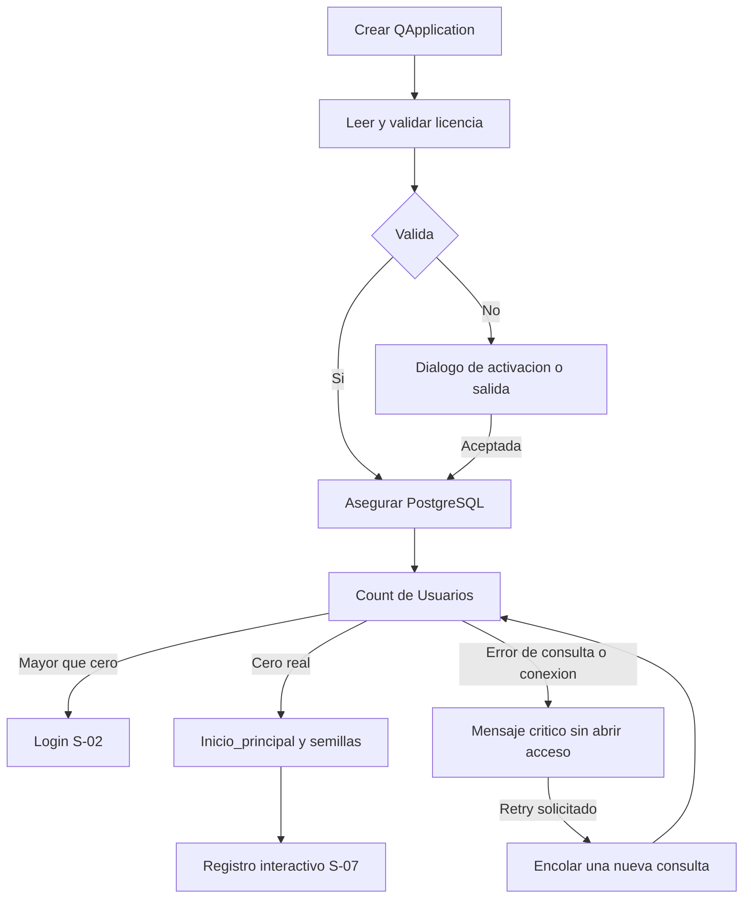
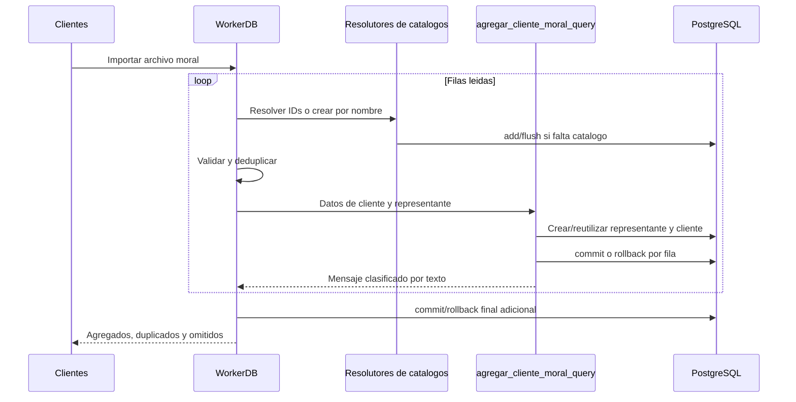
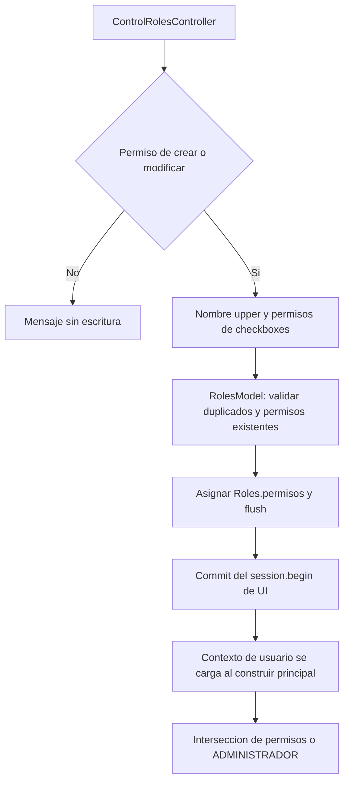
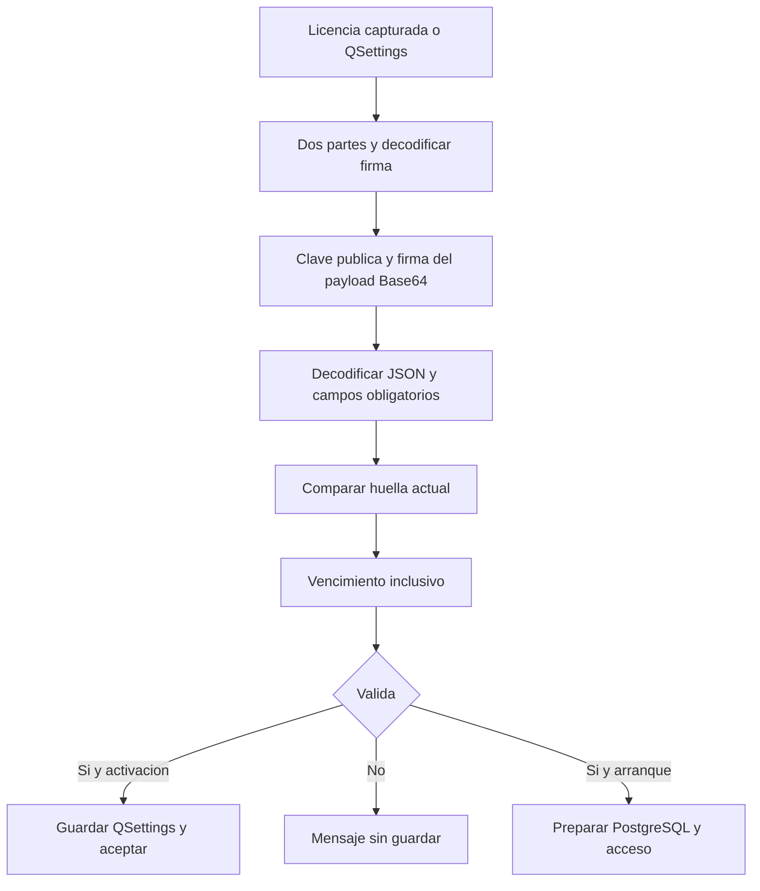

# Spec 04: clientes, personal, organizacion y seguridad

## 1. Alcance y fuentes

Fecha: 2026-11-10. As-Is por lectura estatica; no se ejecutan login, licencia, migraciones, respaldo ni cambios reales de personal/credito. [Maestro](../03-especificaciones-funcionales-sdd.md), [datos](../02-modelo-de-datos.md), [productos](spec-01-productos-e-importacion.md), [ventas](spec-02-ventas-caja-y-promociones.md), [compras](spec-03-compras-proveedores-e-inventario.md). Las pruebas de caracterizacion propuestas no son tests existentes ni autorizacion para corregir estos defectos.

| Fuente | Propietario y frontera |
| --- | --- |
| [inicio.py](../../inicio.py) | Inicio_sistema y entrada __main__ |
| [InicioDeSesionController.py](../../app/Controller/InicioDeSesionController.py) | Login y SaludoIngreso |
| [CreadencialesUsuarioController.py](../../app/Controller/CreadencialesUsuarioController.py) | CredencialesModel (nombre de archivo con errata real) |
| [CodificarPasswordController.py](../../app/Controller/CodificarPasswordController.py) | EncriptarPasswordConrtoller |
| [UsuarioModel.py](../../app/Model/UsuarioModel.py) | UsuarioModel |
| [ClientesController.py](../../app/Controller/ClientesController.py) | Clientes y sus importadores |
| [ClientesFisicosAndMoralesModel.py](../../app/Model/ClientesFisicosAndMoralesModel.py) | ClientesFisicosAndMorales |
| [AreaNegocioClientesController.py](../../app/Controller/AreaNegocioClientesController.py) | Alta interactiva de area |
| [AreaNegocioClientesModel.py](../../app/Model/AreaNegocioClientesModel.py) | AreaNegocioClientesModel |
| [CategoriasController.py](../../app/Controller/CategoriasController.py) | CategoriasController compartido P-06 |
| [CategoriasModel.py](../../app/Model/CategoriasModel.py) | Seleccion por tipo y acceso a categoria |
| [OperacionMasivaCsvController.py](../../app/Controller/OperacionMasivaCsvController.py) | Lector comun P-07 |
| [BaseDatosModel.py](../../app/Model/BaseDatosModel.py) | Herencia de clientes, personal, identidad y organizacion |
| [Hilo_consultas.py](../../app/Controller/Hilo_consultas.py) | WorkerDB y callbacks |
| [SistemaPrincipalController.py](../../app/Controller/SistemaPrincipalController.py) | Autorizacion/navegacion, opciones fiscales e impresion |

Actor de clientes: operador con acceso por cualquiera de CREARCLIENTE/MODIFICARCLIENTE/ELIMINARCLIENTE o ADMINISTRADOR. SistemaPrincipal restringe alta/importadores/creacion de categorias y areas a CREARCLIENTE, actualizar a MODIFICARCLIENTE y borrar a ELIMINARCLIENTE. Los modelos y funciones query no implementan esos permisos como servicio independiente. Las fronteras de personal y organizacion se especifican en sus casos, no se presume autorizacion universal por abrir una ventana.

## 2. S-01: arranque, seleccion de acceso e inicializacion

**Actor/entrada:** usuario de escritorio aun sin autenticar; inicio.py crea Inicio_sistema y QApplication, estilo/paleta. __main__ lee/valida licencia antes de preparar PostgreSQL; si invalida abre VentanaActivacion y sale con codigo0 si se rechaza. Si falla asegurar_servicio_postgres, muestra error y sale1. Licencia no es un permiso SQL ni reemplaza login.

Inicio_sistema.comprobar_usuarios consulta count(Usuarios) de forma sincrona: >0 abre Login, cero abre Inicio_principal. En el As-Is original error de consulta parecia count0 y una excepcion exterior podia abrir Login. REF-15 (2026-11-10) agrega error_consulta, resultado=None al fallar, y ninguna ruta de acceso se abre por error. Mensaje critico ofrece Abort/Retry: solo Retry encola QTimer.singleShot(0, comprobar_usuarios), sin recursion automatica; count0/count1 conservan rutas y reintento exitoso abre una sola ventana. [Cinco regresiones Qt](../../tests/test_phase1_access.py) con conexiones/ventanas simuladas verifican esas ramas, sin SQL ni semillas reales. No es un hilo real solo por nombres de callbacks con hilo.

**Semillas:** [VentanaInicialController.py](../../app/Controller/VentanaInicialController.py), Inicio_principal.crear_datos_principales, dentro de session.begin llama permisos/rol y catalogos. [GruposyPermisosModel.py](../../app/Model/GruposyPermisosModel.py) define 40 permisos persistidos en upper y rol ADMINISTRADOR con descripcion ADMINISTRADOR DEL SISTEMA; solo enlaza permiso ADMINISTRADOR, no los 40. Valores literales y condiciones estan completos en datos02. Los catalogos se cargan solo si cada tabla esta vacia; permisos se agregan por nombre faltante. No se crea un password, empleado o sucursal por defecto. El primer registro los captura interactivamente (S-07), y los editores de sucursal/departamento/puesto se abren como dependencias.

**BD/hilos/transaccion:** wrapper Conexion_base_datos crea engine/create_all al instanciar; count no necesita commit de negocio. Semillas usan transaccion exterior y varios errores se absorben/retornan False o imprimen: no hay garantia uniforme de catalogos completos. No confundir create_all con migracion del esquema instalado.

**Caracterizacion:** licencia ausente/corrupta, PostgreSQL no disponible, cero/un usuario, fallo de count, bienvenida con catalogo parcialmente poblado, rol sin permiso administrador y primer registro abortado tras guardar dependencias. La misma configuracion de desarrollo no garantiza rutas iguales en ejecutable.



## 3. S-02: autenticacion y credenciales

**Actor/entrada:** Login.ingresar toma usuario/password con strip; no conserva espacios iniciales/finales del password. CredencialesModel.verificar_credenciales usa nombre exacto de Usuarios, joinedload de empleado y bcrypt.checkpw(password.encode(), hash); no normaliza a upper/lower. En el As-Is original hash NULL/corrupto podia lanzar y no se comprobaba activo. REF-16 (2026-11-10) convierte errores de verificacion a None,False sin secretos y exige usuario/empleado con IDs enteros positivos no bool y empleado.activo=True. Rechazar inactivos es delta correctivo aprobado en el lote; no se alteran hashes ni politica de creacion. Siguen sin rate limit ni bloqueo por intentos.

**Flujo:** CredencialesModel construye Conexion_base_datos y mantiene session.begin para consulta. Con contexto valido y bcrypt correcto retorna objeto,True; si no None,False. Login vuelve a validar contexto antes de construir datos_usuario, captura fallos tecnicos con alerta generica y solo al exito cierra y muestra SaludoIngreso. Logs nuevos contienen categoria/tipo de fallo, no password/hash ni texto de excepcion. [21 regresiones Qt](../../tests/test_phase1_access.py) prueban bcrypt sintetico, login real, rechazo de inactivo, recontratacion y perfil con sesiones simuladas. entrar_al_sistema construye SistemaPrincipal, que carga rol/permisos; error deja conjunto vacio. La relacion usuario->rol es FK rol_id, no usuario_rol. Carga/expiracion con sesiones PostgreSQL reales sigue sin verificarse; no se introduce DTO por este parche.

**Creacion/edicion de password:** UsuarioModel.crear_usuario busca nombre existente exacto, llama EncriptarPasswordConrtoller.hashear_password, construye Usuarios, add/flush y retorna objeto/estado; hashear_password usa bcrypt.hashpw con gensalt. actualizar_usuario solo cambia nombre/password si valores no vacios, rol si no None y fecha; flush sin commit. Controlador de personal confirma/revierte (S-07/S-08). unique(usuario) sigue siendo defensa contra carrera; no hay politica de longitud de password en modelo ni validacion de fortaleza por bcrypt.

**UI/BD:** Usuario String(60), hash LargeBinary; validadores de registro se detallan en S-07, no se atribuyen automaticamente al login. No existe permiso de LOGIN requerido antes de autenticar. Consulta y verificacion son sincronas en UI, no WorkerDB; session.begin de lectura puede expirar atributos al salir y la sesion se cierra al devolver: caracterizar objetos consumidos fuera de sesion, no asumir DTO independiente.

**Bordes/caracterizacion:** usuario exacto/mayusculas, password con espacios, hash NULL/corrupto, empleado inexistente/inactivo, roles eliminados, duplicado de usuario concurrente, dependencia bcrypt incompatible. Facebook/linkedin/whatsapp/empresa en Login contienen pass, no integraciones funcionales de autenticacion.

## 4. S-03: CRUD y catalogos de clientes fisicos/morales

**Actor/entrada:** permisos de seccion1; Clientes.agregar_cliente elige radio fisico/moral, obtiene datos y valida campos. Fisico exige nombre/apellidos, RFC/CURP, estado civil, ingreso no falso, ubicacion/contacto/identificacion/ocupacion, comentarios, area/categoria. El ingreso 0 falla por comprobacion truthy de "nivel de ingresos". Moral exige nombre/razon/contacto/RFC/ubicacion/web/NIF/sector, constitucion, area/categoria, cuatro datos de representante y comentarios. No son opcionales en alta UI aunque algunos textos acepten cadena vacia por SQL.

**Alta:** fisico mapea a FISICO, foto a self.foto_cliente or "", usa agregar_cliente_fisico_query -> ClientesFisicosAndMorales.agregar_cliente_fisico. Modelo comprueba duplicado por nombre/apellido_paterno/CURP y retorna existente,None; en nuevo add/flush y True; Exception -> None,False. Controlador commit al True y rollback si duplicado/error.

Moral prepara datos_representante, agregar_cliente_moral_query hace pop del dict, obtiene/crea representante por nombre+telefono (reutiliza si coincide), asigna id y llama agregar_cliente_moral. Duplicado por nombre+razon_social -> existente,None; alta add/flush y commit del controlador, rollback en fallo. No hay unique SQL de RFC/CURP/NIF de clientes ni de esos conjuntos de duplicados.

**Herencia/BD:** se escriben Clientes y subtipo joined-table con PK/FK compartida, no una fila unica con todos los campos. tipo_cliente usa FISICO/MORAL; PUBLICO GENERAL usa identidad base clientes. areas_de_negocios_id y categoria_cliente_id son obligatorias por declaracion/inferencia; representante_id moral es NOT NULL inferido, aunque la funcion del modelo acepte None por defecto. Foto fisica se normaliza a cadena vacia, a diferencia de imagen de Productos.

**Consulta:** mostrar_clientes_fisicos/morales ordenan nombre y paginan 100, joinedload de area/categoria y representante moral. Filtrado fisico OR nombre/apellidos/CURP; moral OR nombre/razon/RFC/NIF, ILIKE. Fallos -> [],False; consultas por id devuelven pareja base/subtipo o None, no la misma forma de retorno que listado.

**Edicion:** Clientes.actualizar_clientes -> actualizar_clientes_query -> actualizar_cliente_fisico/moral. Modifican datos de base/subtipo y credito recibido, sin calcularlo como libro mayor. El modelo fisico hace commit interno, el moral retorna True sin commit; el controlador conserva responsabilidad exterior. Las consultas de actualizacion mezclan alias/join y entidades: caracterizar varios clientes para comprobar que se modifica el subtipo correcto, no dar por probada equivalencia de ese join.

Moral existente con representante y datos incompletos lo desvincula (None), lo que puede violar NOT NULL al confirmar; si no tenia y hay datos, crea/reutiliza uno. Eliminar Clientes.eliminar_clientes -> eliminar_cliente_query -> modelo eliminar_cliente hace delete sin commit y devuelve bool; controlador confirma/revierte. Ventas.cliente_id RESTRICT puede impedir baja, no existe borrado con compensacion de ventas.

**Catalogos:** Clientes.nueva_categoria abre CategoriasController tipo clientes (P-06), nombre UI150 vs BD100 y descripcion UI libre vs String(255). AreaNegocioClientesController/AreaNegocioClientesModel mantienen areas (detalle S-06). Son FK independientes; no hay FK que garantice categoria perteneciente al area. Semillas de 15 areas y 53 categorias solo con tabla vacia (datos02).

**Hilos:** altas/listados/busquedas/edicion/baja via WorkerDB; los modelos pueden mostrar Mensaje en fallos de categoria/area desde ese hilo. Evitar extrapolar que todo acceso a UI en persistencia esta desacoplado.

**Caracterizacion:** duplicados por cada canal, ingreso0, CURP/RFC no unicos, foto vacia, representante compartido, alias con multiples subtipos, cliente con venta al borrar, catalogo desaparecido y mensaje en worker. Los limites concretos UI/BD se agregan al contrato de captura de esta spec.

## 5. S-04: credito, descuentos y PUBLICO GENERAL

**Actor/entrada:** operador que edita cliente y cajero del POS. autorizar_credito_fisico/moral solo cambia texto AUTORIZADO/SIN AUTORIZAR segun checkbox. Los getters de cliente entregan limite_credito, credito_disponible y credito_utilizado por separado; los modelos de alta/edicion asignan lo recibido. No hay CHECK SQL que imponga limite=disponible+utilizado ni bloqueo concurrente. porcentaje_interes se almacena, no se encontro aqui motor de devengo, abonos o Historial_creditos.

**Consumo/reverso:** V-06/V-07 comprueban cliente.credito y disponible frente al total, ajustan disponible/utilizado dentro de commit de venta; cancelacion V-10 restituye por nombre del metodo actual. Edicion manual posterior de saldos puede sobreescribir informacion; no es una operacion contable de conciliacion. Descuento usa aplica_descuento/porcentaje_descuento; POS lo aplica solo tras accion de cajero y sobre remanente de promociones, no automaticamente por guardar cliente.

**Semilla diferida:** VentasModel.obtener_o_crear_cliente_publico_general busca nombre ILIKE PUBLICO GENERAL y toma menor id; si falta exige primera categoria y area ordenadas por id, crea Cliente base con credito/descuento False, ceros y datos genericos (literales en datos02), commit propio. No se inserta en arranque ni como ClienteFisico/Moral; esas tablas de pantalla solo consultan subtipos y pueden no listar el generico. Nombre no es unique y dos creaciones concurrentes pueden duplicarlo.

**Caracterizacion:** saldos incompatibles y cambios manuales con venta simultanea, credito deshabilitado, descuento fuera de rango, cancelar tras cambiar metodo, PUBLICO GENERAL duplicado/sin catalogos, confirmar su identidad base y no exigir formulario fisico/moral para ese caso. No se ejecutan prestamos ni conciliacion real.

## 6. S-05: importar clientes fisicos

**Actor/entrada:** CREARCLIENTE en boton; Clientes.importar_clientes_fisicos -> WorkerDB -> importar_clientes_fisicos_query, lector P-07. Son encabezados requeridos, no necesariamente celdas no vacias.

### Columnas validas fisicos

```text
id, nombre, correo, rfc, telefono, pais, estado, ciudad, avenidas, calles,
codigo_postal, direccion_adicional, entidad_legalizada, categoria_cliente_id,
categoria_cliente, categoria_id, credito, estado_credito, limite_credito,
porcentaje_interes, fecha_ultimo_reporte, credito_disponible, credito_utilizado,
aplica_descuento, porcentaje_descuento, comentarios, areas_de_negocios_id,
area_de_negocio_id, area_de_negocio, areas_de_negocios, apellido_paterno,
apellido_materno, curp, fecha_nacimiento, num_identificacion, ocupacion, ingresos,
estado_civil, foto, clasificacion cliente, clasificacion_cliente, area de negocio, area_id
```

### Columnas requeridas fisicos

```text
nombre, apellido_paterno, apellido_materno, curp, rfc, correo, telefono, pais,
estado, ciudad, avenidas, calles, codigo_postal, direccion_adicional,
fecha_nacimiento, num_identificacion, ocupacion, ingresos, estado_civil
```

**Resolucion comun:** _obtener_valor_importacion toma primer alias presente no vacio; a diferencia de productos no prefiere alias vacio. ID valido de categoria/area gana; si desconocido intenta nombre upper y crea catalogo faltante con descripcion automatica y flush. Si no resuelve devuelve None, no usa primer catalogo por defecto. Aliases categoria: categoria_cliente_id/categoria_id y categoria_cliente/clasificacion_cliente/clasificacion cliente/clasificacion de cliente; los encabezados admitidos exactos por canal se listan, no todos los aliases del helper estan autorizados en ambos. Area: areas_de_negocios_id/area_de_negocio_id/area_id y area_de_negocio/area de negocio/areas_de_negocios.

**Normalizacion:** nombres/apellidos/CURP/RFC y otros textos empresariales upper/strip, correo/foto sin upper. CP quita sufijo .0 y rellena ceros hasta5 si numerico corto. Bool True: 1,true,t,si,sí,yes,y,x,verdadero; False: 0,false,f,no,n,falso,vacio; desconocido usa defaultFalse. Numericos parse_float default0; disponible default limite si invalido/ausente, utilizado0; estado_credito recibido upper o AUTORIZADO/SIN AUTORIZAR segun bool. fecha_ultimo_reporte parse_date o hoy, combina a medianoche; nacimiento debe ser interpretable.

**Filtro y efectos:** por fila resuelve/crea catalogos antes de validar obligatorios efectivos y duplicados. Exige nombre, apellidos, CURP, RFC, categoria, area y nacimiento; el resto de columnas requeridas puede tener celda vacia sin rechazo aqui. Duplicado por CURP o RFC upper entre fisicos existentes/lote; llama modelo agregar_cliente_fisico y suma agregados/duplicados/omitidos segun estado True/None/False. id aceptado se ignora. commit final solo si agregados>0, si no rollback; no hay savepoint por fila y modelo puede absorber error de flush dejando sesion fallida. Catalogos de una fila omitida pueden confirmarse si otra fila se agrega.

**Caracterizacion:** falta encabezado frente a celda vacia, alias e ID desconocido con/sin nombre, catalogo autocreado de cliente luego omitido, CURP/RFC repetidos, CP00123/123.0, nacimiento serial convertido a texto, ingreso invalido0, fila demasiado larga despues de una valida y cero altas. Exito=True puede coexistir con omitidos o cero altas; no prueba ausencia de errores SQL.

## 7. S-06: importar clientes morales y mantener areas

**Actor/entrada:** CREARCLIENTE; Clientes.importar_clientes_morales -> WorkerDB -> importar_clientes_morales_query. Lector/normalizacion/resolutores son los de S-05. NIF/nif son aliases de valor, pero encabezado requerido sigue siendo nif minusculo.

### Columnas validas morales

```text
id, nombre, correo, rfc, telefono, pais, estado, ciudad, avenidas, calles,
codigo_postal, direccion_adicional, entidad_legalizada, categoria_cliente_id,
categoria_cliente, categoria_id, credito, estado_credito, limite_credito,
porcentaje_interes, fecha_ultimo_reporte, credito_disponible, credito_utilizado,
aplica_descuento, descuento_autorizado, porcentaje_descuento, comentarios,
areas_de_negocios_id, area_de_negocio_id, area_de_negocio, areas_de_negocios,
razon_social, fecha_constitucion, web, sector, nif, NIF, representante_nombre,
representante_telefono, representante_correo, representante_puesto,
clasificacion de cliente, clasificacion_cliente, area de negocio, area_id
```

### Columnas requeridas morales

```text
nombre, razon_social, correo, rfc, telefono, pais, estado, ciudad, avenidas,
calles, codigo_postal, direccion_adicional, fecha_constitucion, web, sector, nif,
representante_nombre, representante_telefono, representante_correo, representante_puesto
```

**Reglas:** exige por fila nombre/razon/RFC/NIF/categoria/area/fecha constitucion; deduplica por razon o RFC o NIF upper contra morales y lote. Datos de representante se preparan aun vacios; agregar_cliente_moral_query puede crear/reutilizar representante con cadenas vacias, pues no aplica validacion de formulario UI. aplica_descuento o descuento_autorizado se interpretan bool. id no se asigna. Si modelo detecta duplicado por nombre/razon, el importador lo clasifica por texto 'ya existe' del mensaje, no enum de error.

**Transaccion critica:** cada fila llama agregar_cliente_moral_query, que hace commit o rollback propio. Un rollback de esa fila puede descartar catalogos pendientes y otras mutaciones de esa transaccion; commits previos sobreviven. Al final commit si agregados o rollback si cero es adicional, no atomicidad de lote. El reporte agregado puede no describir todos los efectos auxiliares; comparar datos confirmados y contadores ante error tardio.

**Areas interactivas:** AreaNegocioClientesController.agregar_area es sincrono: rechaza solo si nombre y descripcion estan ambos vacios (and), normaliza upper/strip, llama AreaNegocioClientesModel.agregar_area y hace commit en su conexion. Puede aceptar uno de los campos vacio. Modelo busca nombre exacto, retorna existente o add/flush nuevo; error muestra QMessageBox y no devuelve estado uniforme. obtener_areas retorna lista/bool; su except puede referir areas sin asignar. obtener_id_area retorna id/None. No hay editor/baja de area en este controlador. Nombre String(100), descripcion Text, sin unique; las semillas son independientes. Clientes.nueva_area_cliente_fisico/moral abre ese formulario y senal recarga listas.

**Caracterizacion:** NIF como unico encabezado no satisface nif requerido; aliases descuento, categoria nueva, representante vacio/reutilizado, fila invalida despues de varias confirmadas, nombre repetido con RFC distinto, contador de duplicado por texto de mensaje, error de flush y lote parcialmente persistido.



## 8. S-07: primer registro y alta de empleado con usuario opcional

**Fuentes:** [RegistroInicialController.py](../../app/Controller/RegistroInicialController.py), [EmpleadoModel.py](../../app/Model/EmpleadoModel.py), [VentanaInicialController.py](../../app/Controller/VentanaInicialController.py). Clases Registro_personal_inicial, EmpleadosModel e Inicio_principal.

**Actor/entrada:** primer operador desde bienvenida, o personal autorizado desde EmpleadosController (S-08). Inicio_principal.abrir_registro construye formulario, luego fija variable_primer_registro=True; _permisos_catalogos_dependencias devuelve ADMINISTRADOR en ese modo para abrir editores dependientes. Ese permiso temporal no es una fila de usuario ni el rol persistido de forma automatica. Los combos cargan roles, sucursales, departamentos y puestos; los botones permiten crear esas dependencias mediante sus propios flujos y commits, no una unica transaccion de instalacion.

**Captura:** obtener_datos recorre widgets de campos: texto strip, fechas a cadena yyyy-MM-dd, tiempos HH:mm, valores numericos y currentData de combos o su texto si no hay objeto. validar_datos exige todos los valores truthy, incluso rol/direccion/numeros de domicilio que BD puede permitir NULL; su prueba isinstance(valor,QSpinBox/QDoubleSpinBox) compara valores ya extraidos y no valida como esperaba widgets. Un combo con texto sin entidad puede superar esta comprobacion y fallar luego en .id. No se fuerza al rol ADMINISTRADOR por nombre en almacenar_informacion_query; usa current_data_rol.id.

| Entrada de registro | Limite/validator UI | BD y diferencia |
| --- | --- | --- |
| Nombre/apellidos | 60, texto ^[a-zA-ZñÑ ]+$ | String(100); UI no permite acentos generales o guiones |
| CURP/RFC | 18/13, [A-ZÑ0-9]+ | String(18)/String(13), unique; maximo no asegura longitud exacta |
| Carrera/correo/NSS | 150/100/13; texto/email/numerico | Mismos limites; correo y NSS unique, correo nullable |
| Ciudad/estado/pais | 50 cada uno, texto | String(100) cada uno |
| CP/telefono/contacto emergencia | 5/10/10 y numerico | String(5)/String(10)/String(10) |
| Nombre contacto | 100, texto | String(100) nullable |
| Calles/avenidas/colonia | 50 cada uno; colonia texto | String(100) cada uno |
| Interior/exterior | 10, numerico | String(10) nullable, pero UI validar_datos exige valor |
| Usuario/password | 60/10; usuario texto, password regex de letras/numeros/simbolos | Usuario String(60), hash LargeBinary; no limite de10 en modelo ni minimo de fortaleza |
| Puesto/departamento/sucursal/rol | Objetos en combos | FK nullable para algunos; el alta accede .id sin tolerar objeto ausente |

**Persistencia:** agregar_nuevo_empleado -> WorkerDB -> Registro_personal_inicial.almacenar_informacion_query. Si uso_del_sistema y id_empleado es None, UsuarioModel.crear_usuario con usuario/password/fechas y rol seleccionado; si False retorna fallo sin rollback explicito en esa rama. Luego EmpleadosModel.crear_empleado comprueba CURP o RFC duplicado, crea datos, activo=True, fecha_despido=None, foto/ruta y FK usuario si creado; add/flush. Controlador commit si empleado creado y rollback en falso/error. No crea asistencia, turno ni caja por dar de alta un empleado.

**Seguridad/bordes:** SQL unique de CURP/RFC/NSS/correo/usuario puede fallar aunque la consulta previa no detecte duplicado. El nombre/hash no se validan como completos en almacenar_informacion_query: se confia en captura. Algunas ramas de excepcion llaman Mensaje.mensaje_alerta como metodo de clase sin instancia, otro riesgo de error al notificar. No hay transaccion global que deshaga una sucursal creada antes si luego falla el empleado.

**Salida:** abrir_inicio muestra Login solo si variable_primer_registro, y desactiva la bandera; no salta la autenticacion ni concede rol distinto al guardado. Las listas de estado civil/genero/parentesco/nivel academico son texto de UI, no tablas. La concatenacion accidental CUÑADO/ASUEGRO/A en parentescos se conserva como hallazgo As-Is.

**Caracterizacion:** empleado con/sin uso del sistema, rol no administrador, ausencia de objeto en combo, campos SQL opcionales vacios, CURP/RFC/NSS/email duplicados, password10/11 por UI y modelo directo, fallo tras crear usuario, primer registro abortado tras guardar sucursal, foto inexistente y alta sin registro de asistencia.

```mermaid
sequenceDiagram
    participant UI as Registro_personal_inicial
    participant W as WorkerDB
    participant U as UsuarioModel
    participant E as EmpleadosModel
    participant DB as PostgreSQL
    UI->>UI: Capturar dependencias y credenciales opcionales
    Note over UI,DB: Editores dependientes pueden haber hecho commits propios
    UI->>W: almacenar_informacion_query
    opt Uso del sistema y empleado nuevo
        W->>U: crear_usuario y rol seleccionado
        U->>DB: bcrypt hash, add y flush
    end
    W->>E: crear_empleado y FK de usuario si existe
    E->>DB: add y flush
    W->>DB: commit al exito; rollback ante falso/error
    W-->>UI: Mensaje y retorno al login en primer registro
```

## 9. S-08: consulta, edicion, contratacion y credenciales de personal

**Fuentes/actor:** [EmpleadosController.py](../../app/Controller/EmpleadosController.py) y Registro_personal_inicial; botones del principal restringidos a CREAREMPLEADO/MODIFICAREMPLEADO/ELIMINAREMPLEADO. No asumir permiso exclusivo por cada metodo de baja/recontratacion; EmpleadosModel no valida autorizacion.

**Consulta:** EmpleadosModel.obtener_empleados_detallados y filtrar_empleados precargan puesto/departamento/sucursal/usuario/rol; ordenan nombre y paginan100. Filtro por id y/o nombre, nombre con ILIKE exacto si tipo_filtro_nombre=0 o parcial en otro caso. Ausencia -> [],False; varias consultas capturan error como vacio/fallo. El controlador abre Registro_personal_inicial para empleado seleccionado, no otro editor completo independiente.

**Edicion:** actualizar_empleado_query -> EmpleadosModel.actualizar_empleado modifica identidad, datos, fechas, foto y FK; no commit del modelo, controlador confirma al True, rollback en excepcion. La query pasa fecha_despido=None aun al editar datos, sin cambiar activo en el modelo de edicion: puede quedar inactivo sin fecha de baja despues de editar. El retorno falso no hace rollback explicito en todas las ramas del controlador.

**Contratacion:** EmpleadosModel.baja_empleado pone activo=False y fecha_despido; EmpleadosModel.alta_empleado pone activo=True, reemplaza fecha_contratacion y limpia fecha_despido. No mantiene historico de multiples contratos ni altera automaticamente password/usuario. REF-16 consulta activo al autenticar: baja contractual impide nuevo login, recontratacion lo permite con la misma clave; regresion con modelo de alta real y sesion simulada. No se revocan contextos de principal ya abiertos por este cambio. EmpleadosModel.eliminar_empleado hace delete fisico, sin commit; bajas contractuales y delete no son equivalentes y pueden estar restringidos por referencias.

**Credenciales:** Registro_personal_inicial.agregar_usuario exige empleado y alerta solo si ambos usuario y password estan vacios (usa and, no or). agregar_usuario_query crea/flush usuario, llama UsuarioModel.asignar_usuario_empleado (UPDATE Empleados.usuario_id y flush), commit si ambos estados, rollback si no/error. Actualizar credenciales llama UsuarioModel.actualizar_usuario con rol y password nuevo; vacios preservan campos del modelo y rol=None no limpia rol. EmpleadosModel.eliminar_credenciales delega UsuarioModel.eliminar; requiere empleado.usuario; el controlador confirma/revierte. FK Empleados.usuario_id SET NULL permite desvincular si SQL/ORM lo ejecuta correctamente; ventas/caja/movimientos del usuario pueden impedir su baja fisica segun referencias.

**Hilos:** listado/busqueda/mutaciones del controlador usan WorkerDB; el hash se calcula donde se invoca modelo dentro de esa operacion, no por un servicio remoto. Sesiones cerradas y objetos pasados entre hilos exigen caracterizacion de relaciones cargadas. No hay bloqueo concurrente ni control de version por editar personal o reasignar un usuario.

**Caracterizacion:** empleado activo/inactivo visible en listados y login; recontratar preservacion/perdida de fecha anterior; editar inactivo y fecha_despido, baja fisica con ventas/compras, usuario o password vacio por separado, dos empleados asociados a mismo usuario (sin unique de FK), eliminar credencial usada en caja y rol eliminado durante edicion.

## 10. S-09: sucursales y contenedor de organizacion

**Fuentes:** [ControlSucursalesController.py](../../app/Controller/ControlSucursalesController.py), [SucursalesController.py](../../app/Controller/SucursalesController.py), [SucursalesModel.py](../../app/Model/SucursalesModel.py). ControlSucursalesController agrupa secciones, no es otro almacen de sucursales. SucursalesController tiene la captura/escritura; no confundir sus nombres.

**Actor/permiso:** el principal permite modulo sucursales por interseccion de familias sucursal/departamento/puesto/roles; luego los editores restringen crear/modificar/eliminar segun sus conjuntos y ADMINISTRADOR. Primer registro puede pasar permiso administrativo temporal a dependencias, sin usuario ya autenticado. No hay autorizacion en SucursalesModel.

**UI/BD:** todos los campos del formulario se exigen no vacios, textos strip. Nombre/ciudad/estado/pais max50, CP5, telefono10, RFC13, razon_social300, coinciden con String de BD. CP/telefono numericos, RFC alfanumerico mayusculo, nombre/ubicacion/razon con validador de letras/ñ/espacios que excluye signos/numeros de razon social aunque SQL los admita. Direccion Text. Nombre no es unique en SQL.

**Alta/consulta:** SucursalesController.agregar -> agregar_sucursal_query -> SucursalesModel.agregar_sucursal busca nombre exacto, add/flush y retorna existente,False o nuevo,True; controlador commit o rollback. obtener_todo ordena nombre y joinedload departamentos; filtrar_nombre ILIKE. Consulta por nombre/id tiene retornos heterogeneos (id o tuple en error), no un DTO uniforme.

**Edicion:** SucursalesController.actualizar confirma y llama actualizar_sucursal_query; modelo SucursalesModel.actualizar modifica datos sin commit. En el As-Is original razon_social y rfc se asignaban con coma final, produciendo tuplas de un elemento, no str. REF-05 (2026-11-10) retira solo esas dos comas; [regresion unitaria](../../tests/test_sucursales_model.py) verifica strings exactos, texto acentuado, otros campos y retorno existente/ausente, sin confirmar desde el modelo. La seleccion unitaria pasa 24 pruebas; persistencia PostgreSQL y smoke Qt no ejecutados por alcance autorizado. El commit exterior sigue sin try local en la query; no se corrige esa deuda ni se presupone coercion del driver por este parche.

**Baja:** SucursalesModel.eliminar retorna (True,None), (False,None) o (False,error). El As-Is original evaluaba esa tupla como bool y WorkerDB la interpretaba como data/estado. REF-09 (2026-11-10) desempaqueta en orden real, hace commit solo al exito y rollback ante falso/error, retorna dict con exito/mensaje y adapta mensaje_estado_eliminado para comprobar exito antes de emitir senal/recargar. [Regresion Qt](../../tests/test_phase1_quick_wins.py) cubre query y callback con dobles; las FK y borrados reales no fueron probados sin PostgreSQL. El modelo no cambia; Empleados.sucursal_id RESTRICT y enlaces sin cascada SQL general pueden bloquear borrado.

**Hilos/caracterizacion:** mutaciones/listados con WorkerDB y commit de controlador; probar nombre duplicado concurrente, razon/RFC despues de editar, baja con empleados/asociaciones y tuple de fallo, caracteres rechazados por Qt, primera sucursal creada sin terminar empleado, vinculo de departamentos consultado fuera de sesion.

## 11. S-10: departamentos y relacion con sucursales

**Fuentes/actor:** [DepartamentosController.py](../../app/Controller/DepartamentosController.py), [DepartamentosModel.py](../../app/Model/DepartamentosModel.py), permisos CREARDEPARTAMENTO/MODIFICARDEPARTAMENTO/ELIMINARDEPARTAMENTO o ADMINISTRADOR; no se validan en modelo.

**Contrato:** nombre max70, validador letras/ñ/espacios, descripcion Text; ambos upper/strip y no vacios. Nombre sin unique SQL. Formulario conserva diccionarios de sucursales seleccionadas/existentes; vincular_sucursal/desvincular_sucursal exigen item con id y solo mueven listas/estado temporal.

**Alta:** DepartamentosController.guardar -> agregar_departamento_query -> DepartamentosModel.agregar_departamento, busca nombre exacto, add/flush, retorna tupla. Controlador agrega objetos seleccionados a departamento.sucursales si no estaban y commit; error rollback. Si falla antes de asignar estado, su except puede referir estado no definido. Objetos de otra sesion en coleccion exigen caracterizacion, no se presume merge automatico.

**Edicion:** actualizar_departamento_query recibe entidad, nuevos datos y seleccion deseada. Modelo actualiza nombre/descripcion y flush; controlador compara conjuntos de IDs actuales/deseados, agrega/quita relaciones y confirma, devuelve conteos en (dict,True); error rollback/(dict,False). Consultas de modelo precargan sucursales/puestos, filtran nombre ILIKE. Sin paginacion en obtener_todos.

**Baja:** DepartamentosModel.eliminar_departamento retira el departamento de cada sucursal y delete sin commit; query de controlador confirma/revierte. FK de Puestos/Empleados SET NULL permite su desvinculacion, pero departamento_sucursal no lleva CASCADE SQL; passive_deletes de relacion no lo inventa para SQL directo. No borra puestos/empleados como regla de negocio.

**Caracterizacion/hilos:** WorkerDB; comprobar relacion M:M antes/despues de confirmar o cancelar, nombre70/71, dos editores reemplazando selecciones simultaneas, baja con empleados/puestos, error de flush e identidad de objetos de sesiones distintas. Modificar listas sin guardar no debe confundirse con escritura confirmada.

## 12. S-11: puestos, jornada y horarios

**Fuentes/actor:** [PuestosController.py](../../app/Controller/PuestosController.py), [PuestoModel.py](../../app/Model/PuestoModel.py). Permisos CREARPUESTOS (plural real), MODIFICARPUESTO, ELIMINARPUESTO; ADMINISTRADOR alternativo. Acceso a roles desde puestos usa la familia grupopermisos, no el permiso de puesto por si solo.

**Contrato UI/BD:** nombre max100 y validator texto, String(100); salario/horas Float; dias laborales se seleccionan con casillas y se unen por ', ' a Text; descripcion Text; entrada/salida Time. agregar requiere campos truthy y al menos un dia; un valor numerico0 puede fallar esa validacion generica. Departamento seleccionado asigna self.id_departamento; si no hay seleccion puede conservar un ID anterior o None. No hay CHECK de horas/salario, horario ordenado ni dias validos en BD.

**Alta/edicion:** PuestosController.agregar -> agregar_puestos_query -> PuestoModel.crear_puesto busca nombre exacto (sin unique SQL), add/flush; controlador commit/rollback. actualizar_puesto_query -> PuestoModel.actualizar por PK, modifica campos/horarios/departamento y flush, commit de controlador. Busquedas por nombre ILIKE y obtener_todos precargan departamento.

**Baja:** PuestoModel.eliminar_puesto busca empleados que lo usan y les fija puesto_id=None, luego query.delete de puesto, sin commit propio. Controlador confirma/revierte. No elimina empleados ni sus usuarios. El As-Is original de Puestos repetia hora_salida/departamento_id y empleados/departamento: no eran columnas SQL duplicadas. REF-13 (2026-11-10) retira solo las primeras declaraciones y conserva las ultimas efectivas. [Snapshot unitario](../../tests/test_phase1_stabilization.py) de columnas/NULL/FK/relaciones es identico antes/despues y AST no tiene duplicados. No se ejecutan autogenerate ni CRUD PostgreSQL.

**Caracterizacion/hilos:** WorkerDB; puesto duplicado concurrente, horario salida menor a entrada, dias en distinto orden, salario/horas0, departamento borrado, baja con varios empleados, formulario sin departamento tras editar otro y ninguna creacion automatica de asistencia por dias laborales.

## 13. S-12: asistencias, turnos y alcance no implementado

**Actor solicitado:** personal/operador de asistencias. En el inventario actual no hay tabla/clase Asistencias ni controlador/modelo dedicado a marcaciones, y no se encontro un caso de uso de entrada/salida de empleado conectado a esa entidad. No se inventan metodos, permisos o pantallas para completar la simetria del dominio.

Lo existente en [BaseDatosModel.py](../../app/Model/BaseDatosModel.py) es Turnos (empleado_id, fecha_turno, hora_inicio/hora_fin DateTime) y Transacciones (tipo, monto, fecha, turno_id obligatorio). La existencia de metadata no equivale a CRUD operativo ni garantiza generacion desde puestos/horarios. SesionCaja es otra tabla y no tiene FK a Turnos; abrir/cerrar caja V-08/V-09 no registra asistencia.

**Contrato/hilos/transaccion:** no hay captura Qt, commits ni worker atribuibles a Asistencias que puedan documentarse como implementados. Restricciones exactas de Turnos/Transacciones en datos02; no hay CHECK de orden de horas ni horas remuneradas calculadas por un motor de asistencia.

**Caracterizacion:** comprobar que alta de empleado, jornada y caja no generan una marcacion ficticia; cualquier dato Turnos de una instalacion requiere rastrear su escritor real antes de extraer servicio. La cobertura funcional se registra como ausencia confirmada, no como caso ejecutable inventado.

## 14. S-13: roles, permisos y politica de navegacion

**Fuentes:** [RolesPermisosController.py](../../app/Controller/RolesPermisosController.py), [GruposyPermisosModel.py](../../app/Model/GruposyPermisosModel.py), [SistemaPrincipalController.py](../../app/Controller/SistemaPrincipalController.py). [RolesController.py](../../app/Controller/RolesController.py) solo contiene codigo comentado, no clases ni flujo activo: el propietario real es ControlRolesController.

**Actor/entrada:** permisos CREARGRUPOPERMISOS/MODIFICARGRUPOPERMISOS/ELIMINARGRUPOPERMISOS o ADMINISTRADOR, recibidos por el editor. ControlRolesController.agregar_roles_al_sistema comprueba permiso segun nuevo/edicion; exige nombre strip.upper y al menos un checkbox de permiso. txt_nombrerol max100 coincide con Roles.nombre String(100) unique; descripcion UI255 frente a Text SQL, puede vaciarse en modelo como "". Los nombres de checkbox se convierten a permiso quitando opcion_ y upper.

**Modelo:** RolesModel.crear_Rol y RolesModel.actualizar_rol normalizan nombre/descripcion upper y strip; permisos deduplicados/ordenados. Exigen nombre y permisos, buscan nombre duplicado, aseguran catalogo de permisos y comprueban que todos los solicitados existan, antes de asignar coleccion Roles.permisos. add/flush en alta, flush en edicion; IntegrityError/Exception -> rollback y triple de fallo. Los 40 nombres exactos, incluida errata CREARTRASACCIONES y singular/plural de puesto/usuarios, estan en datos02, no se renombran por coherencia en estas specs.

**Consulta/baja:** todos_roles_con_permisos y buscar_roles_por_nombre precargan permisos, orden nombre; filtro ILIKE. modificar_rol_del_sistema carga por id y llena formulario. eliminar_rol_del_sistema comprueba permiso/seleccion; RolesModel.eliminar_rol_con_permisos hace delete sin commit y devuelve bool. No protege rol ADMINISTRADOR ni rol del usuario actual; FK Usuarios.rol_id SET NULL y rol_permisos CASCADE difieren de usuario_rol sin CASCADE, que puede bloquear si tiene filas. No existe contrato de conservar siempre un administrador.

**Transaccion/hilos:** ControlRolesController usa consultas sincronas with session.begin, no WorkerDB; el contexto confirma al salir. Algunos metodos muestran mensaje exitoso aun dentro del bloque antes del commit efectivo. RolesModel puede hacer rollback dentro del contexto; no suponer que un retorno de error equivale siempre a salida limpia del contexto transaccional.

**Aplicacion de autorizacion:** SistemaPrincipal._cargar_contexto_autorizacion llama RolesModel.obtener_contexto_usuario por usuario, usa Usuarios.rol -> Roles.permisos, no tabla usuario_rol. Acceso por interseccion de permisos, ADMINISTRADOR habilita todo. Principal restringe widgets y metodos de navegacion; no es una capa de autorizacion para consultas directas. Un cambio de rol en otra ventana no se propaga automaticamente al contexto ya cargado en principal. La ruta incorrecta a widgets internos del modal de productos se documenta en spec01.

**Caracterizacion:** rol sin permisos/nombre, permiso desconocido, duplicado concurrente, descripcion >255 por llamada directa, borrar rol propio/administrador/ultimo administrador, usuarios sin rol, usuario_rol poblado por fuera, contexto de principal obsoleto y mensaje antes de fallo del commit.



## 15. S-14: perfil y visualizacion de datos personales

**Fuente/actor:** [PerfilUsuarioController.py](../../app/Controller/PerfilUsuarioController.py), Perfil y PasswordDialog; usuario del contexto actual, sin permiso semilla PERFIL separado. Perfil.comprobarIntegridad alterna ocultacion/limpieza; para revelar abre PasswordDialog y verifica con CredencialesModel el nombre del usuario actual. Cancelar tambien muestra alerta de contraseña incorrecta, no es un cambio de password.

Tras verificacion, Perfil.obtenerDatosUsuario lanza WorkerDB -> buscarEmpleadoQuery -> UsuarioModel.obtenerDatosGeneralesUsuario con idUsuario; precarga empleado/puesto y rol y llena widgets con datos personales/jornada. No hace UPDATE de perfil ni password en estos metodos. Datos se limpian al alternar ocultar; foto se usa para visualizacion local y no es un upload remoto. PasswordDialog solo captura texto, no otro almacen de credenciales.

**BD/hilos/bordes:** consulta en worker, comprobacion bcrypt sincrona; sin commit funcional de actualizacion. buscarEmpleadoQuery no tiene retorno explicito de fallo para todo estadoFalse, por lo que puede retornar None; el consumidor no debe asumir dict siempre. Usuario sin empleado/puesto puede fallar en llenado si no se controla cada acceso. No se garantiza que ocultar datos en UI elimine todo objeto en memoria.

**Caracterizacion:** password correcto/incorrecto/cancelado, usuario/empleado eliminado entre verificacion y consulta, relaciones nulas, alternar ocultacion, cerrar vista durante worker, errores como None frente a dict y rutas de foto inaccesibles. El cambio de password real pertenece a S-08, no a este dialogo.

## 16. S-15: licencia, activacion y huella de hardware

**Fuentes:** [licencia.py](../../licencia.py), [hardware.py](../../hardware.py), [activacion_dialog.py](../../gui/activacion_dialog.py), [herramientas_view.py](../../gui/herramientas_view.py). Funciones validar_licencia, get_hardware_id, guardar_licencia, leer_licencia y obtener_info_licencia; VentanaActivacion y TarjetaLicenciaWidget. No hay tabla Licencias ni commit SQL.

**Contrato/flujo:** licencia es string strip con exactamente dos partes payloadBase64.firmaBase64. Firma se decodifica con padding Base64 agregado si falta; carga clave RSA publica desde licencia_publica.pem (directorio del modulo, cwd y al lado del ejecutable congelado como alternativas). Verifica PKCS1v15/SHA256 sobre el texto payload_b64, antes de decodificar JSON. No se firma el dict reserializado. Firma invalida/error de clave retorna False,mensaje,{}.

Payload requiere cliente, hardware_id y vencimiento truthy; compara hardware_id.strip().upper contra get_hardware_id y fecha YYYY-MM-DD. Vence si fecha<date.today: el dia de vencimiento sigue siendo valido. No hay validacion de zona/servidor de hora, revocacion remota o comprobacion periodica forzada por un servicio. Firma no valida las licencias por solo tener campos correctos.

**Bordes estaticos:** despues de json.loads se usa payload.get sin comprobar que sea dict, y hardware_id.strip sin validar str. Un payload firmado con tipos inesperados puede lanzar error no capturado en esas ramas; dialogo de activacion captura error exterior, pero llamada directa de arranque no tiene ese mismo envoltorio general. No se alteran claves ni se generan licencias de prueba reales en esta fase.

**Huella:** en Windows intenta WMIC csproduct UUID, PowerShell si no obtiene valor; limpia espacios y mayusculas, rechaza placeholders conocidos y longitud<10. Si WMIC devuelve un placeholder no vacio, el fallback PowerShell no se prueba en esa rama y se llega al hash secundario. No valida sintaxis completa de UUID. Fallback SHA256 upper de detalles disponibles: uuid.getnode, serie de volumen C:, discos WMIC, nombre de equipo/procesador/arquitectura. Puede cambiar con hardware, red, hostname, disponibilidad/orden de comandos o MAC aleatoria de getnode. Comandos sin timeout explicito pueden bloquear captura; no se ejecutaron aqui.

**Activacion/persistencia:** VentanaActivacion.intentar_activacion exige texto no vacio, deshabilita botones mientras valida, guarda licencia solo si valida y acepta dialogo; error/falso informa y finally rehabilita botones. QSettings("TuleVenta","Licencia") almacena licencia_key en persistencia nativa, no en BD ni cifrado adicional implementado por esta funcion. TarjetaLicenciaWidget muestra cliente/vencimiento/dias/estado via obtener_info_licencia y abre dialogo para actualizar. Estado mostrado no es autorizacion SQL y no recalcula permisos de usuario.

**Caracterizacion:** formato incorrecto/base64/clave ausente/firma invalida; vencimiento ayer/hoy/mañana y reloj cambiado; payload con tipo no dict o hardware no str (solo fixtures controlados autorizados); UUID placeholder, WMIC/PowerShell ausentes, cambio de huella, QSettings otro usuario del SO o sin escritura, cancelar activacion y actualizar desde tarjeta. No se prueba una licencia real ni se publica hardware ID del equipo.



## 17. S-16: conexion PostgreSQL, configuracion y respaldo

**Fuentes:** [configuracionConexion.py](../../app/DataBase/configuracionConexion.py), [conexionBD.py](../../app/DataBase/conexionBD.py), [postgres_manager.py](../../app/DataBase/postgres_manager.py), [postgresql_portable.py](../../app/DataBase/postgresql_portable.py), [runtime_paths.py](../../app/runtime_paths.py), [configurar_conexion_postgresql.py](../../configurar_conexion_postgresql.py), [ConfiguracionSistemaModel.py](../../app/Model/ConfiguracionSistemaModel.py).

**Actor/entrada:** operador de despliegue por CLI/archivo/entorno, y administrador de opciones de sistema. No existen RespaldoController.py ni ConfiguracionBDController.py en app/; no hay llamadas Python propias a pg_dump o pg_restore en el snapshot (la coincidencia de 'respaldo' encontrada es descripcion semilla de Cloud Computing). Binarios distribuidos de PostgreSQL no constituyen una pantalla o politica de backup implementada. No se promete respaldo/restauracion, programacion, retencion ni prueba de recuperacion de datos. No copiar data/ en caliente como si fuera el mecanismo actual documentado.

**Conexion compartida:** ConfiguracionConexionBD.obtener_url_conexion prioriza TULEVENTA_DATABASE_URL no vacia; despues construir_url prioriza database_url del JSON; si no, construye con driver/host/puerto/database/username/password/options. Normaliza puerto entero1..65535 o default5432, options dict con claves/valores string no vacios, escapa credenciales con quote_plus y options con urlencode. La fuente incluye defaults de credenciales y JSON guarda password sin cifrado propio: riesgo de distribucion/configuracion, no se reproducen valores secretos aqui.

Ruta mutable por TULEVENTA_DB_CONFIG_PATH si existe, o runtime_paths hacia configuracion de sistema/PROGRAMDATA y fallback de proyecto. cargar_configuracion crea directorio/archivo default si falta; JSON invalido/OSError usa y regraba defaults, lo que puede reemplazar configuracion anterior. No hay transaccion ni bloqueo de archivo. Conexion_base_datos crea engine/pool_pre_ping y Base.metadata.create_all por instancia, no migra longitudes/restricciones; abre/cierra sesion, no commit automatico al salir.

**CLI actual:** configurar_conexion_postgresql.main acepta URL o campos y --test. Guarda primero mediante guardar_configuracion, imprime ruta y solo despues prueba SELECT1 si --test. Fallo SQL devuelve codigo1 sin restaurar archivo anterior; sin --test devuelve0 sin validar conectividad. No se ejecuta esta herramienta en la fase documental. Credenciales por argumento pueden quedar visibles en procesos/historial; la spec no incluye comandos con contrasenas.

**Gestor portable:** PostgresServiceManager.asegurar_servicio_postgres carga configuracion, comprueba socket host/puerto (1s), si responde no valida aun autenticacion ni esquema. Si host remoto no responde falla sin intentar arranque local. Si local, resuelve pg_ctl/data/log (busca PG_VERSION), inicia y espera socket hasta10s, incluye ultimas25 lineas de log en errores. No inicia una migracion ni crea usuarios por solo escuchar puerto. El gestor lee archivo JSON y su database_url, no prioriza TULEVENTA_DATABASE_URL como obtener_url_conexion: un override solo de entorno puede apuntar SQLAlchemy a otro destino respecto a la comprobacion portable. PostgreSqlPortableBootstrap es adaptador de compatibilidad; no otro mecanismo de respaldo.

**Configuracion de sistema:** JSON independiente de la BD para IVA/impresora/ancho, contrato completo V-12. OpcionesSistemaController.guardar_configuracion_fiscal y guardar_configuracion_impresora comprueban familia de transacciones; al guardar IVA recargan tasa de Venta. No hay cambio retroactivo de impuestos de ventas anteriores. guardar_configuracion no es backup del negocio ni de QSettings de licencia. Alembic tiene entorno/metadata, pero no revisiones encontradas; ver datos02 para deuda de evolucion.

**Caracterizacion:** archivo ausente/corrupto, entorno contra JSON, puerto invalido, prueba fallida despues de guardar, socket de servicio incorrecto, host remoto caido, data/pg_ctl ausentes, logs con informacion sensible, rutas desarrollo/congelado y archivo sin permiso. Respaldo/restauracion quedan como capacidad ausente que debe especificarse antes de implementarse, no accion probada por esta documentacion.

## 18. S-17: infraestructura UI, adaptadores y archivos sin caso de negocio

Estos componentes completan la cobertura funcional de auxiliares del inventario; no se asigna un CRUD ficticio a cada archivo.

| Fuente | Contrato funcional y efectos | Riesgo / caracterizacion |
| --- | --- | --- |
| [AjustarCajaOpcionesGlobal.py](../../app/Controller/AjustarCajaOpcionesGlobal.py) | AjustarcajaOpciones configura lista/ancho y menu contextual; delete_current_item confirma y elimina_elemento_seleccionado_query delega a CategoriasController.eliminar del objeto actual, con worker/commit de ese controlador | No es solo estilo. El despacho especifico a presentacion esta comentado; actualmente trata todo objeto por la ruta generica de categoria. Se conecta senal despues de iniciar la operacion; probar recarga y restricciones de borrado, no imponer autorizacion por el menu |
| [ComprobarValoresTablasController.py](../../app/Controller/ComprobarValoresTablasController.py) | Comprobacion.obtener_valor_o_vacio convierte None en "", conserva otro valor, sin SQL | No valida tipos/formatos/credito; probar 0, False y None |
| [AbstractTableModel.py](../../app/Model/AbstractTableModel.py) | GenericTableModel adapta listas/dicts/entidades a Qt; update_data reemplaza/inserta, clear resetea; actualizarCelda valida indices, guarda str en _edited_values y emite dataChanged. ComprobarModelosTablas gestiona modelos/seleccion de vistas | Editar celda no hace UPDATE SQL. _safe_reset no limpia explicitamente _edited_values en ese bloque; caracterizar cambio de fila/lote con valores editados, especialmente cantidades C-01 |
| [Convertir_a_diccionariosModel.py](../../app/Model/Convertir_a_diccionariosModel.py) | model_to_dict enumera columnas, fechas ISO; deep=True serializa relacion un nivel, exclusion de claves configurable, sin commit | Solo detecta listas, no colecciones set como asociaciones de proveedor; posible fallo al tratar set como entidad. Acceso a atributos puede disparar lazy load; no es DTO seguro por existir la funcion |
| [FuncionesAuxiliares.py](../../app/Controller/FuncionesAuxiliares.py) | quitar_acentos normaliza NFD, size_validator_image hasta5MiB, mover elemento de combo por ID/texto y centrar ventana; sin SQL propio | No usar quitar_acentos como normalizacion universal no invocada. Imagen por ruta y movimiento de combo no persisten por si solos |
| [Validaciones.py](../../app/Controller/Validaciones.py) | Fabrica QRegularExpressionValidator de texto, CURP/RFC, correo, numeros, password y web; sin SQL ni errores de negocio | Texto solo letras ASCII/ñ/espacios; maxLength y regex no comprueban longitud exacta, campos obligatorios ni compatibilidad BD. Probar acentos, simbolos y estados intermedios Qt |
| [MensajesAlertasController.py](../../app/Controller/MensajesAlertasController.py) | Mensaje informa, alerta, critico Abort/Retry y pregunta Yes/No, resuelve parent activo; acciones locales bloqueantes Qt | No declara mensaje ni mensaje_exito; REF-06 migra los llamadores de C-01/V-12 a sus APIs reales y agrega regresiones Qt, sin ampliar Mensaje. Otros usos requieren analisis propio. Texto de exito no prueba commit si se muestra antes |
| [UiTheme.py](../../app/Controller/UiTheme.py) | apply_module_theme/apply_access_theme, escalas/tamaños, stabilize_item_view, configure_child_modal, drag y foco/escape; interfaz, no transaccion de dominio | Cambia estados/tamaños/ventanas, no autoriza SQL. Probar cierre Escape, focos, densidad y seleccion con workers activos |
| [favicon.py](../../app/Controller/favicon.py) | Declaracion de recurso/icono; sin clase ni caso de negocio propio | Disponibilidad de recursos al empaquetar |
| [Ventana_espera.py](../../app/Controller/Ventana_espera.py) | Modal_de_espera y ModalManager muestran/cierran espera; catalogo en maestro | Cerrar espera no revierte SQL ni cancela consulta; probar callback duplicado/cierre de padre |
| [Hilo_consultas.py](../../app/Controller/Hilo_consultas.py) | WorkerDB, managers y relay; ProcesadorArchivoWorker alternativo de Excel; contrato completo en maestro/P-07 | Payload.exito y segundo bool de senal difieren; sesiones/objetos e interrupcion forzosa del procesador no garantizan cancelacion SQL |
| [Controller/__init__.py](../../app/Controller/__init__.py) | Inicializador sin reglas propias | Cobertura de paquete, no caso CRUD |
| [Model/__init__.py](../../app/Model/__init__.py) | Inicializador sin reglas propias | Cobertura de paquete, no caso CRUD |

**Actor/hilos/transacciones:** usuario de cualquier modulo que usa esos adaptadores; solo los delegados de borrado/consultas descritos pueden escribir BD, con propietario del commit en su caso de negocio. No se inventan permisos dedicados para tema/tabla; pero el borrado desde combo si debe caracterizarse como accion de datos.

## 19. Contrato de captura de clientes y cierre de cobertura

Fuente efectiva: [UI_CONTROL_CLIENTES.py](../../app/View/UserInterfacePy/UI_CONTROL_CLIENTES.py), importada por ClientesController. Ni esa vista ni el controlador fijan setMaxLength o setValidator para sus textos en las declaraciones inspeccionadas. Rige QLineEdit por defecto (max32767), no los limites SQL de registro de personal ni los de otro formulario. QPlainTextEdit no adquiere por eso el limite de String(255).

| Captura de cliente | BD | Diferencia relevante |
| --- | --- | --- |
| Nombre, apellidos fisicos, razon social, ciudad, avenidas/calles, correo | String(255) | UI puede admitir mas, importador tampoco valida longitud |
| RFC, telefono, CP | String(20), String(15), String(20) | Sin regex UI propia para estos campos en esa vista; importacion normaliza CP sin validar todas las longitudes |
| Pais/estado, estado_credito/tipo_cliente | String(100), String(25)/String(50) | Textos de captura/estado no constituyen Enum SQL |
| CURP, identificacion, ocupacion, estado civil fisico | String(18), String(20), String(150), String(15) | Algunas opciones de combo no son restricciones CHECK; probar cadenas y longitudes |
| Web/sector/NIF moral | String(255), String(255), String(20) | NIF mayusculo es nombre de columna, no validacion fiscal |
| Representante moral: nombre, telefono, correo, puesto | String(100), String(20), String(100), String(100) | Alta UI exige datos completos; importacion puede crear textos vacios |
| Ingresos, limite/disponible/utilizado, interes y descuento de ambos tipos | Float; UI maximum=99999999.99 en todos esos controles | Defaults Qt minimo0 y2 decimales; interes/descuento no limitados a100 por esa vista. Modelo no agrega CHECK ni coherencia de saldos |

S-01 a S-17 cubren flujos existentes, auxiliares o ausencia explicita de capacidad solicitada. No convierten Asistencias/respaldo en implementaciones. Los casos C de spec03, P de spec01 y V de spec02 completan el mapa funcional por archivo de la Fase3; validacion AST certifica referencias y contratos literales, no ejecucion o cobertura automatizada de cada rama.

| Defecto/riesgo principal | Casos |
| --- | --- |
| Error de count tratado como primer uso, dependencia fuera de transaccion global | S-01, S-07 |
| Login de empleado inactivo, hash NULL, contexto sin empleado | S-02, S-08 |
| Edicion fisica/moral con commits distintos y alias de subtipo | S-03 |
| Credito sin libro mayor ni invariantes SQL | S-04 |
| Autocreacion antes de descarte y commit por fila moral | S-05, S-06 |
| Tuplas en campos de sucursal/bool(tuple), concurrencia M:M | S-09, S-10 |
| Declaraciones repetidas de Puestos y jornada sin asistencia | S-11, S-12 |
| Borrado del rol administrador/contexto obsoleto | S-13 |
| Licencia dependiente de reloj/huella/tipos de payload | S-15 |
| Respaldo ausente, configuracion reescrita y override desigual de URL | S-16 |
| Borrado contextual, APIs de mensaje ausentes y serializacion set | S-17 |

Queda pendiente ejecutar escenarios de caracterizacion, contrastar BD instalada y visualizar los diagramas en renderer Mermaid. Esta entrega documental no corrige codigo de negocio.

### Estado de REF-01: infraestructura de pruebas

Se agrega un [arnes aislado](../../tests/README.md) para S-16/S-17: pytest con marcas unit/db/qt/concurrency, rutas temporales, guardia de conexiones y esquema PostgreSQL desechable autorizado. Las pruebas unitarias y de QSettings/impresoras verifican la infraestructura, no caracterizan los flujos funcionales de REF-02. El gate DB sigue bloqueado por ausencia de URL de test autorizada; no se ha ejecutado DDL ni conectado a la BD instalada. No cambia ninguna regla de negocio de esta spec ni se da por migrado el esquema.